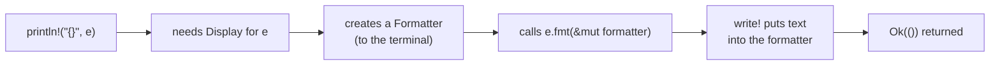
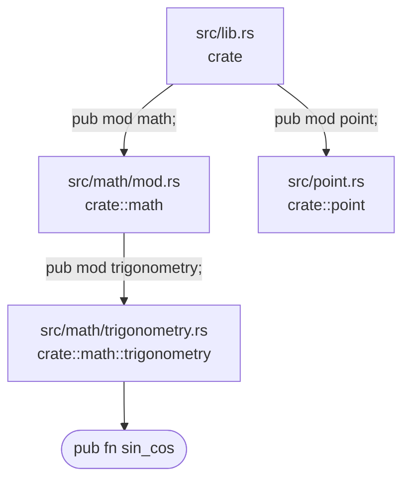

## Index: Rust notes in this guide
{: #index}

The notes are in **reading order**: each one builds on the one before, so a beginner can go from top to bottom. Click any topic to jump straight to it.

- [The demo project used in every note](#demo-project)
- [Note 01: Ownership and borrowing, explained from scratch](#note-ownership)
  - [1. The problem ownership solves](#own-problem)
  - [2. Stack and heap](#own-stack-heap)
  - [3. The three ownership rules (and watching drop happen)](#own-rules)
  - [4. Move: ownership is transferred](#own-move)
  - [5. Copy and Clone](#own-copy-clone)
  - [6. Borrowing: `&T`, `&mut T` and the borrowing rule](#own-borrow)
  - [7. `self`, `&self` and `&mut self`](#own-self)
  - [8. All the concepts together](#own-table)
  - [Summary](#own-summary)
- [Note 02: Structs, `impl` and the `Display` trait, line by line](#note-display)
  - [1. `struct`: a data type you define](#dsp-struct)
  - [2. `impl`: adding behaviour to a type](#dsp-impl)
  - [3. `fmt::Display`: what `{}` prints](#dsp-display)
  - [4. Why `fmt` appears twice](#dsp-fmt-twice)
  - [5. The parameters: `&self`, `Formatter`, `fmt::Result`](#dsp-params)
  - [6. `write!`: a macro, like `println!`](#dsp-write)
  - [7. How the parts connect](#dsp-flow)
  - [Summary](#dsp-summary)
- [Note 03: `#[derive]`: Debug, Clone, Copy, PartialEq and Eq](#note-derive)
  - [Plain-English glossary: attribute, trait, derive](#der-glossary)
  - [1. What `#[derive(...)]` does](#der-derive)
  - [2. Each derived trait, one at a time](#der-traits)
  - [3. Why the derive lists differ between types](#der-lists)
  - [4. Memory and performance](#der-memory)
  - [Summary](#der-summary)
- [Note 04: Modules and `use`, importing with `crate::` paths](#note-modules)
  - [1. What `use` actually does](#mod-use)
  - [2. Reading a path: `crate::`, `::` and the module tree](#mod-paths)
  - [3. Importing a module vs an item: `use std::fmt`](#mod-fmt)
  - [4. Visibility: `pub` is required](#mod-pub)
  - [Summary](#mod-summary)
{: .dg-toc}

---

## The demo project used in these Rust notes
{: #demo-project}

Every note uses one small Cargo project, `shapes_demo`, so the examples connect. Each note shows the files it needs. This is the whole project:

```text
shapes_demo/
├── Cargo.toml
├── examples/               <- small experiments: cargo run --example <name>
└── src/
    ├── lib.rs              <- library crate root (Note 04)
    ├── main.rs             <- binary that uses the library (Note 04)
    ├── point.rs            <- Point + Display (Note 04)
    └── math/
        ├── mod.rs          <- declares the math modules, approx_eq (Note 03)
        ├── vector.rs       <- Vector: heap data, len/scale/into_inner (Notes 01, 03)
        ├── matrix.rs       <- DimensionMismatch + Display, Matrix2 (Notes 02, 03)
        ├── complex.rs      <- Complex (Note 03)
        └── trigonometry.rs <- sin_cos (Note 04)
```

Create it with `cargo new --lib shapes_demo`, add the files as each note shows them, and run `cargo run`. I compiled every snippet and every quoted compiler error in this guide with **Rust 1.99**, so you should see the same messages.

[↑ Back to index](#index)

---

## Note 01: Rust ownership and borrowing, explained from scratch
{: #note-ownership}

Ownership is the most important idea in Rust. It's the main thing that makes Rust different from Python, and almost every other note in this guide builds on it: `&self`, moves, `Copy`, `.clone()`.

If a Rust compiler error has ever said *"value used after move"* or *"cannot borrow as mutable"*, this note explains why. I build it up one step at a time.

### 1. The problem that ownership solves
{: #own-problem}

A program stores data in memory. When the program no longer needs the data, that memory must be freed. Languages handle this in three ways:

| Language | Who frees the memory? | Problem |
|---|---|---|
| C | You call `free()` by hand | Forget it and the program leaks memory. Free twice, or use memory after freeing it, and it crashes or silently corrupts data. |
| Python | A garbage collector frees it while the program runs | It costs extra time and memory, and you don't control *when* it happens |
| Rust | The **compiler** works out where to free it, using ownership rules | You must follow the rules, and the compiler enforces them |

Python mainly counts how many names point to each object (reference counting). When the count drops to 0, Python frees the object, and a cycle collector cleans up what counting misses. All of this happens **while the program runs**.

Rust decides where memory is freed **while the code compiles**. At runtime nothing is counted or collected. That's how Rust is fast and memory-safe at the same time.

### 2. Stack and heap: the two memory areas
{: #own-stack-heap}

You need these two terms first.

**The stack** is fast and simple. It holds values whose size is fixed and known in advance, such as `f64`, `usize` and `[[f64; 2]; 2]`. A function puts its values on the stack when it starts, and they're removed automatically when it ends. Think of a stack of plates: you only add or remove at the top.

**The heap** holds data whose size can change while the program runs, such as `Vec<f64>` and `String`. The program has to ask the system for heap memory (an **allocation**), and that memory has to be freed later. Think of a warehouse: you rent space, and someone must give it back.

The `Vector` type from the demo (`src/math/vector.rs`) uses both:

```text
STACK (24 bytes)              HEAP
┌──────────────┐             ┌─────┬─────┬─────┐
│ pointer   ───┼────────────►│ 1.0 │ 2.0 │ 3.0 │
│ length = 3   │             └─────┴─────┴─────┘
│ capacity = 3 │
└──────────────┘
```

I checked the stack part with `std::mem::size_of::<Vector>()`: 24 bytes (a pointer, a length and a capacity, 8 bytes each on a 64-bit machine). The numbers themselves live on the heap.

The stack part cleans itself up. The real question is **who frees the heap part**. Ownership answers it.

### 3. The three ownership rules
{: #own-rules}

1. Every value has exactly **one owner**. Usually the owner is a variable. It can also be a struct field or a collection holding the value.
2. There can be only **one owner at a time**.
3. When the owner goes **out of scope**, Rust frees the value. This is called **drop**.

A **scope** is the region between `{` and `}`.

```rust
{
    let v = Vector::new(vec![1.0, 2.0, 3.0]); // v owns the vector
    // use v here
} // v goes out of scope here, and Rust frees the heap memory
```

You never write `free()`. The compiler inserts the cleanup at the `}`.

#### See drop happen
{: #own-drop-demo}

You can watch this by giving a type a `Drop` implementation that prints a message when it's freed:

```rust
struct Noisy(&'static str);

impl Drop for Noisy {
    fn drop(&mut self) {
        println!("dropping {}", self.0);
    }
}

fn main() {
    let _a = Noisy("a");
    {
        let _b = Noisy("b");
        println!("inner scope ends");
    }
    let c = Noisy("c");
    let _d = c; // move: only _d owns it now
    println!("main ends");
}
```

```text
inner scope ends
dropping b
main ends
dropping c
dropping a
```

Three things to notice:

- `b` is dropped exactly at the end of its inner `{ }`.
- At the end of `main`, values are dropped in **reverse** order of creation.
- `c` was moved into `_d` (see the next section), so it's dropped **once**, not twice.

### 4. Move: ownership is transferred
{: #own-move}

When you assign a heap-owning value to another variable, ownership **moves**:

```rust
let a = Vector::new(vec![1.0, 2.0]);
let b = a;              // ownership moves from a to b
println!("{:?}", a);    // ERROR: a was moved
```

```text
error[E0382]: borrow of moved value: `a`
```

Why does Rust do this? Imagine that `a` and `b` both owned the heap data. At the `}`, both would free the same memory: a **double free**, a classic C crash. With a move, only `b` owns the data, so it's freed exactly once.

A move is cheap. Only the 24-byte stack part is copied. The heap numbers stay where they are.

Compare this with Python:

```python
a = [1.0, 2.0]
b = a          # a and b point to the SAME list
b.append(3.0)
print(a)       # [1.0, 2.0, 3.0]: a changed too!
```

Python lets two names share one object. Rust doesn't allow two owners. (When you genuinely need shared ownership, Rust has explicit tools for it, such as `Rc`, but that's a later topic.)

#### Passing a value to a function also moves it
{: #own-move-fn}

```rust
fn consume(v: Vector) { /* v is dropped at the end of this function */ }

let a = Vector::new(vec![1.0]);
consume(a);           // a moves into the function
println!("{:?}", a);  // ERROR: a was moved
```

The compiler points at the exact cause: `this parameter takes ownership of the value`.

### 5. Copy and Clone: two ways to duplicate
{: #own-copy-clone}

**`Copy`**: small, stack-only values are duplicated automatically. They never move.

```rust
let x: f64 = 1.5;
let y = x;           // a copy, not a move
println!("{}", x);   // OK
```

`f64`, `usize`, `bool`, `Matrix2` and `DimensionMismatch` are all `Copy`. [Note 03](#der-copy) shows how a struct becomes `Copy`.

**`Clone`**: an explicit, possibly expensive duplicate.

```rust
let a = Vector::new(vec![1.0, 2.0]);
let b = a.clone();   // new heap allocation, and the numbers are copied
println!("{:?}", a); // OK: a and b own two separate copies
```

### 6. Borrowing: use a value without owning it
{: #own-borrow}

Moving and cloning often aren't what you want. Usually you want to *look at* a value and then give it back. That's **borrowing**. A borrow is a **reference**, written with `&`.

**Analogy:** you own a book. A friend borrows it, reads it and returns it. You still own the book, and the friend isn't allowed to throw it away.

```rust
fn print_len(v: &Vector) {     // borrows: doesn't take ownership
    println!("len = {}", v.len());
}

let a = Vector::new(vec![1.0, 2.0]);
print_len(&a);        // lend a
print_len(&a);        // lend it again
println!("{:?}", a);  // a is still the owner
```

There are two kinds of borrow:

| Syntax | Name | Allows | Analogy |
|---|---|---|---|
| `&T` | shared borrow | read only | many people can read the book at the same time |
| `&mut T` | mutable borrow | read and change | one person writes in the book, and nobody else touches it |

A reference is just a pointer: `size_of::<&Vector>()` is 8 bytes.

#### The borrowing rule
{: #own-borrow-rule}

At any one time you can have **either**:

- any number of `&T` (readers), **or**
- exactly one `&mut T` (one writer).

Never both at the same time.

```rust
let mut v = vec![1.0, 2.0];
let first = &v[0];     // a shared borrow (a reader)
v.push(3.0);           // ERROR: push needs &mut v, but a reader still exists
println!("{}", first);
```

```text
error[E0502]: cannot borrow `v` as mutable because it is also borrowed as immutable
```

Why is this an error? `push` may need more room and **move the numbers to a new, larger heap location**. `first` would then point at freed memory. In C, this bug silently corrupts memory. Rust stops it before the program even exists.

A detail that confused me: a borrow lasts only until its **last use**, not until the `}`. If you read `first` *before* the `push`, the code compiles:

```rust
let mut v = vec![1.0, 2.0];
let first = &v[0];
println!("{}", first); // last use of the reader...
v.push(3.0);           // ...so the writer is allowed now
```

#### A borrow cannot outlive its owner
{: #own-outlive}

```rust
let r;
{
    let x = 5.0;
    r = &x;
}                   // x is dropped here
println!("{}", r);  // ERROR: r would point at freed memory
```

```text
error[E0597]: `x` does not live long enough
```

This check is what **lifetimes** are about: the compiler proves that every borrow ends before its owner is dropped.

#### `mut`: changing needs permission twice
{: #own-mut}

Variables are read-only by default. To change a value, or to lend it out as `&mut`, the variable itself must be declared `let mut`:

```rust
let v = Vector::new(vec![1.0]);
v.scale(2.0);   // ERROR: v is not declared as mutable
```

```text
error[E0596]: cannot borrow `v` as mutable, as it is not declared as mutable
```

### 7. Back to `self`, `&self` and `&mut self`
{: #own-self}

Methods take their value in one of the same three ways. The demo's `Vector` has one method of each kind:

```rust
impl Vector {
    /// Borrow to read.
    pub fn len(&self) -> usize {
        self.data.len()
    }

    /// Borrow to change.
    pub fn scale(&mut self, k: f64) {
        for x in self.data.iter_mut() {
            *x *= k;
        }
    }

    /// Take ownership: the Vector is consumed.
    pub fn into_inner(self) -> Vec<f64> {
        self.data
    }
}
```

```rust
let mut v = Vector::new(vec![1.0, 2.0]);
v.len();                  // v is still usable
v.scale(2.0);             // v is still usable, and now holds [2.0, 4.0]
let raw = v.into_inner(); // v moved into the method; v is gone now
```

| Form | Meaning | After the call |
|---|---|---|
| `self` | take ownership (the value moves into the method) | the caller can't use it any more |
| `&self` | borrow to read | unchanged, still usable |
| `&mut self` | borrow to change | changed, still usable |

`Display::fmt` (the method behind `println!("{}", ...)`, see [Note 02](#note-display)) takes `&self` because printing only reads. That's why you can still use a value after printing it.

### 8. All the ownership concepts together
{: #own-table}

| Concept | What happens | Cost |
|---|---|---|
| Owner | One variable (or field) is responsible for a value | none |
| Drop | The owner leaves its scope, and Rust frees the value | one free, at a known place |
| Move | Ownership transfers, and the old name becomes unusable | copies only the stack part (24 bytes for `Vector`) |
| Copy | A small stack value is duplicated automatically | copies a few bytes |
| Clone | An explicit full duplicate | can allocate heap memory |
| `&T` | A shared, read-only borrow; many can exist at once | a pointer, 8 bytes |
| `&mut T` | One exclusive borrow that can change the value | a pointer, 8 bytes |
| Lifetime | The compiler proves a borrow ends before the owner is dropped | none at runtime |

### Summary: Rust ownership and borrowing
{: #own-summary}

- Ownership is how Rust frees memory without a garbage collector.
- Every value has one owner. When the owner leaves its scope, Rust drops the value, exactly once.
- Assigning or passing a heap value moves it. `Copy` types are copied instead.
- `.clone()` makes an explicit, possibly expensive duplicate.
- `&` borrows to read. `&mut` borrows to change. You can have many readers or one writer, never both at once, and a borrow ends at its last use.
- The compiler checks all these rules before the program runs, so they cost nothing at runtime.

[↑ Back to index](#index)

---

## Note 02: Rust structs, `impl` and the `Display` trait, line by line
{: #note-display}

This note takes one small, very common piece of Rust and explains every word in it: a struct, plus an `impl fmt::Display` block that controls how the struct prints with `println!("{}", ...)`.

It uses `&self` and borrowing from [Note 01](#note-ownership), so read that first if `&` still looks mysterious.

### The code for this note
{: #dsp-code}

From `src/math/matrix.rs` in the demo project:

```rust
use std::fmt;

#[derive(Debug, Clone, Copy, PartialEq, Eq)]
pub struct DimensionMismatch {
    pub left: usize,
    pub right: usize,
}

impl fmt::Display for DimensionMismatch {
    fn fmt(&self, f: &mut fmt::Formatter<'_>) -> fmt::Result {
        write!(
            f,
            "dimension mismatch: the left vector has {} components, the right vector has {}",
            self.left, self.right
        )
    }
}
```

`DimensionMismatch` is an error value: "you tried to combine a vector with `left` components and one with `right` components". Ignore the `#[derive(...)]` line for now; [Note 03](#note-derive) is all about it. Here is each remaining part, in order.

### 1. `struct`: a data type you define
{: #dsp-struct}

A **struct** is a data type that you define. It groups named **fields**:

```rust
pub struct DimensionMismatch {
    pub left: usize,
    pub right: usize,
}
```

`usize` is an unsigned (never negative) integer, the type Rust uses for sizes and indexes. `pub` makes the struct and each field visible outside this module (see [Note 04](#mod-pub)).

The Python equivalent is a class that only has fields:

```python
class DimensionMismatch:
    def __init__(self, left, right):
        self.left = left
        self.right = right
```

There's one important difference. In Python, a class holds its data **and** its methods together. In Rust, the struct holds **only data**. Behaviour goes in a separate block, called `impl`.

### 2. `impl`: "implement", adding behaviour to a type
{: #dsp-impl}

`impl` means "implement". It attaches behaviour to a type, and it comes in two forms:

```rust
// Form A: your own methods (an "inherent impl")
impl DimensionMismatch {
    pub fn total(&self) -> usize {
        self.left + self.right
    }
}

// Form B: implement a trait
impl fmt::Display for DimensionMismatch {
    fn fmt(&self, f: &mut fmt::Formatter<'_>) -> fmt::Result { /* ... */ }
}
```

- **Form A** adds methods that only this type has. You call it as `e.total()`, which returns `10` for `left: 4, right: 6`.
- **Form B** fulfils a contract that is defined somewhere else. Read it aloud as: *"Implement the trait `Display` for the type `DimensionMismatch`."*

The code in this note uses Form B.

### 3. `fmt::Display`: the trait that decides what `{}` prints
{: #dsp-display}

`Display` is a **trait** from the standard library. A trait is a **contract**: *"any type that has this trait must provide these methods"*. It's similar to an interface in Java or a protocol in Python.

The standard library defines `Display` like this (simplified):

```rust
pub trait Display {
    fn fmt(&self, f: &mut Formatter<'_>) -> Result;
}
```

So the contract has exactly one method, `fmt`. Once your type provides it, `println!("{}", value)` knows how to print your type.

`Display` is the text meant for a **human user**. Its sibling `Debug` is meant for the **programmer**:

| Trait | Placeholder | Who reads it | Python | How you get it |
|---|---|---|---|---|
| `Debug` | `{:?}` | the programmer | `__repr__` | `#[derive(Debug)]` |
| `Display` | `{}` | the user | `__str__` | write it by hand |

For the same value:

```text
{}   -> dimension mismatch: the left vector has 4 components, the right vector has 6
{:?} -> DimensionMismatch { left: 4, right: 6 }
```

Rust **can't derive** `Display`, because the compiler can't guess which message you want a user to see. So you write it yourself.

### 4. Why `fmt` appears twice with different meanings
{: #dsp-fmt-twice}

The name `fmt` shows up twice in `impl fmt::Display ... fn fmt(...)`, but the two mean different things:

- **`fmt::Display`**: here `fmt` is the **module** `std::fmt`, brought in by `use std::fmt;` (see [Note 04](#mod-fmt)).
- **`fn fmt(...)`**: here `fmt` is the **method** that the `Display` contract requires.

You must use the name `fmt`, because the contract says so. Name it anything else and the compiler refuses:

```rust
impl fmt::Display for D {
    fn format(&self, f: &mut fmt::Formatter<'_>) -> fmt::Result { write!(f, "d") }
}
```

```text
error[E0407]: method `format` is not a member of trait `fmt::Display`
error[E0046]: not all trait items implemented, missing: `fmt`
```

It's the same in Python: the method must be called `__str__`, and Python won't call a method with any other name.

### 5. The parameters, one by one
{: #dsp-params}

```rust
fn fmt(&self, f: &mut fmt::Formatter<'_>) -> fmt::Result
```

#### `&self`: the value being printed
{: #dsp-self}

`self` is the value itself, like `self` in Python. The `&` means **borrow**: the method reads the value but doesn't take ownership. So after `println!` runs, you can still use the value.

| Form | Meaning |
|---|---|
| `self` | take ownership (the value moves into the method) |
| `&self` | borrow to read |
| `&mut self` | borrow to change |

Printing only reads the data, so `&self` is the right choice. [Note 01](#own-self) explains these three forms in depth.

#### `f: &mut fmt::Formatter<'_>`: where the text goes
{: #dsp-formatter}

`f` is the **destination** for the text. It might be the terminal, a `String` or a file. Your code doesn't need to know which, because it just writes into `f`.

- **`&mut`** is a mutable borrow. Writing text into `f` changes it, so the method needs permission to change it.
- **`<'_>`** is a **lifetime**: a label that tells the compiler how long a borrowed reference stays valid. `Formatter` holds a reference inside it, and `'_` means *"compiler, work out the correct lifetime yourself"*. You don't need to name it here. (Writing plain `fmt::Formatter` also compiles; the `<'_>` just makes the hidden reference visible.)

#### `-> fmt::Result`: success or failure
{: #dsp-result}

`->` introduces the return type. `fmt::Result` is short for `Result<(), fmt::Error>`, which has two possible values:

- **`Ok(())`**: the text was written. `()`, called "unit", means "no value", a bit like `None` in Python.
- **`Err(fmt::Error)`**: the destination couldn't accept the text.

Writing can fail, so Rust makes the failure part of the return type, and the caller has to deal with it. Python would raise an exception instead. In practice, a `Display` method just passes on whatever `write!` returns. It never invents an error of its own.

### 6. `write!`: a macro, like `println!`
{: #dsp-write}

The `!` tells you that `write!` is a **macro**: code that writes code while the program compiles.

Why a macro and not a function? A Rust function has a fixed number of arguments, but a macro can take any number. The macro also **checks the format string while the code compiles**. Use two `{}` but give only one value, and the build fails:

```rust
let a = 1;
println!("{} and {}", a);
```

```text
error: 2 positional arguments in format string, but there is 1 argument
```

Python would only find this mistake at runtime.

`write!`, `println!` and `format!` work almost the same way. Only the destination differs:

| Macro | Destination | Returns |
|---|---|---|
| `println!("...", a)` | the terminal (standard output), plus a newline | nothing |
| `write!(f, "...", a)` | the destination `f` | `fmt::Result` |
| `format!("...", a)` | a brand-new `String` | the `String` |

Each `{}` is replaced by the next value, in order:

```text
"...the left vector has {} components, the right vector has {}"
                        ↑                                   ↑
                    self.left                          self.right
```

#### No semicolon on the last line
{: #dsp-semicolon}

Look closely: the `write!(...)` call has **no `;`** after it. In Rust, the last expression of a block, written without a `;`, is the block's **return value**. So the method returns whatever `fmt::Result` `write!` produced.

Add a `;` and the expression becomes a statement, the method returns `()`, and the compiler stops:

```text
error[E0308]: mismatched types
  expected `Result<(), Error>`, found `()`
  help: remove this semicolon to return this value
```

### 7. How the parts connect
{: #dsp-flow}

```rust
let e = DimensionMismatch { left: 4, right: 6 };
println!("{}", e);
```

1. `println!` sees `{}`, so it needs `Display` for `e`.
2. It creates a `Formatter` that writes to the terminal.
3. It calls your method, `e.fmt(&mut formatter)`, lending `e` with `&`.
4. Your `write!` puts the text into the formatter.
5. The output is:

```text
dimension mismatch: the left vector has 4 components, the right vector has 6
```



Because you implemented `Display`, you also get `.to_string()` and `format!` support for free:

```rust
let text: String = e.to_string();
let line = format!("error: {e}");
```

### Summary: Rust structs, `impl` and `Display`
{: #dsp-summary}

- `struct` is a data type you define. It holds only data.
- `impl Type` adds your own methods. `impl Trait for Type` fulfils a trait's contract.
- `Display` controls the output of `{}`, like `__str__` in Python, and must be written by hand. `Debug` (`{:?}`) can be derived.
- The method must be called `fmt`, because the trait requires that name.
- `&self` borrows the value. `&mut Formatter<'_>` is the destination you write into.
- `fmt::Result` reports success (`Ok(())`) or failure (`Err`).
- `write!` is a macro like `println!` but writes to `f`, and it checks the format string while the code compiles.
- The last line has no `;`, so its value is the return value.

[↑ Back to index](#index)

---

## Note 03: `#[derive]` in Rust, Debug, Clone, Copy, PartialEq and Eq
{: #note-derive}

The line `#[derive(Debug, Clone, Copy, PartialEq, Eq)]` shows up above almost every struct in Rust code. It looks like noise at first, but each word in it changes what you're allowed to do with the type.

This note explains the line piece by piece. It builds on moves from [Note 01](#note-ownership) and traits from [Note 02](#note-display), and it starts with a plain-English glossary you can come back to.

### Plain-English glossary: attribute, trait, derive
{: #der-glossary}

A recap of the terms from the earlier notes, plus the new ones. The rest of the note uses all of them.

| Term | In plain English | Everyday analogy |
|---|---|---|
| **struct** | A custom data type that groups a few named values together. | A form with labelled boxes: "left", "right". |
| **field** | One named value inside a struct, such as `left: usize`. | One box on the form. |
| **attribute** `#[...]` | A note to the **compiler** attached to the item directly below it. It's not code that runs. It changes how the compiler treats that item. | A sticky note on a document: "please photocopy this twice". The note isn't part of the document, but it tells the office what to do with it. |
| **trait** | A named set of abilities that a type promises to have, such as "can be printed" or "can be compared". It's similar to an interface in Java or a protocol in Python. | A skill badge: "certified to drive". Any type that holds the badge must actually be able to do the thing. |
| **`impl`** | The block of code where you write how a type performs a trait. | The training that earns the badge. |
| **derive** | "Compiler, write the `impl` for these traits for me." It works for traits whose code follows an obvious pattern (compare every field, print every field...). | Auto-fill on a web form: the browser fills in the boxes it can work out by itself. |
| **move** | Handing a value to a new owner. The old variable can't be used afterwards. | Giving someone your only house key. |
| **copy** | Duplicating the value, so both variables stay usable. | Photocopying a page. |

So `#[derive(Debug, Clone, Copy, PartialEq, Eq)]` reads as: *"Compiler, please give the struct below these five abilities, and write the code for them yourself."*

### The demo files for this Rust derive note
{: #der-files}

These are the files from the [demo project](#demo-project) that this note uses:

```text
shapes_demo/
└── src/
    ├── lib.rs
    ├── main.rs
    └── math/
        ├── mod.rs          <- declares the modules + approx_eq
        ├── matrix.rs       <- DimensionMismatch, Matrix2
        ├── complex.rs      <- Complex
        ├── vector.rs       <- Vector
        └── trigonometry.rs
```

**`src/math/mod.rs`**:

```rust
pub mod complex;
pub mod matrix;
pub mod trigonometry;
pub mod vector;

/// Float comparison with a tolerance. `==` is unreliable for f64,
/// and NaN is never equal to anything, not even itself.
pub fn approx_eq(a: f64, b: f64) -> bool {
    (a - b).abs() < 1e-9
}
```

**`src/math/matrix.rs`** (the `Display` impl and `total` method from Note 02 are left out here):

```rust
#[derive(Debug, Clone, Copy, PartialEq, Eq)]
pub struct DimensionMismatch {
    pub left: usize,
    pub right: usize,
}

#[derive(Debug, Clone, Copy, PartialEq)]
pub struct Matrix2 {
    pub data: [[f64; 2]; 2],
}
```

**`src/math/complex.rs`**:

```rust
#[derive(Debug, Clone, Copy, PartialEq, Default)]
pub struct Complex {
    pub re: f64,
    pub im: f64,
}
```

**`src/math/vector.rs`** (the `len`, `scale` and `into_inner` methods from Note 01 are left out here):

```rust
#[derive(Debug, Clone, PartialEq)]
pub struct Vector {
    pub data: Vec<f64>,
}

impl Vector {
    pub fn new(data: Vec<f64>) -> Vector {
        Vector { data }
    }
}
```

`DimensionMismatch` is an error value: "you tried to combine something of size `left` with something of size `right`". It's the main example below.

### 1. What `#[derive(...)]` does
{: #der-derive}

`#[...]` is an **attribute**: an instruction to the compiler about the item directly below it. Other attributes you'll meet soon are `#[test]` (this function is a test) and `#[allow(dead_code)]` (don't warn me about unused code).

`derive` is one specific attribute. It tells the compiler: *"Write the code for these traits for me."*

Without `derive`, you have to write each implementation by hand. Here is `PartialEq` (the `==` ability) written out manually:

```rust
impl PartialEq for DimensionMismatch {
    fn eq(&self, other: &Self) -> bool {
        self.left == other.left && self.right == other.right
    }
}
```

`derive(PartialEq)` makes the compiler write exactly this: it compares each field in order. The generated code is as fast as code you'd write by hand, because it **is** that code. The compiler just writes it for you.

#### Python analogy: `@dataclass`

`derive` is like Python's `@dataclass`, which creates `__repr__`, `__eq__` and other methods automatically:

```python
from dataclasses import dataclass

@dataclass(frozen=True)
class DimensionMismatch:
    left: int
    right: int
```

The difference is **when** it happens. Python creates these methods while the program runs. Rust creates them while the code compiles, and it checks that they're valid before the program can exist (see [section 3](#der-lists)).

### 2. Each derived trait, one at a time
{: #der-traits}

#### `Debug`: print the value for debugging
{: #der-debug}

**In plain English:** "Show me what's inside."

```rust
let e = DimensionMismatch { left: 4, right: 6 };
println!("{:?}", e);   // DimensionMismatch { left: 4, right: 6 }
println!("{:#?}", e);  // the same, pretty-printed over several lines
```

`{:?}` uses `Debug`. The Python equivalent is `__repr__`.

You need `Debug` to use `assert_eq!` in tests, because a failed assertion prints both values. Without it:

```text
error[E0277]: `P` doesn't implement `Debug`
```

`Debug` does **not** give you `{}`. For `{}` you must implement `Display` yourself, as [Note 02](#note-display) does for this exact type. Rust deliberately won't derive `Display`: there's no obvious "user-facing" format to generate. Using `{}` on a type without it fails:

```text
error[E0277]: `DimensionMismatch` doesn't implement `std::fmt::Display`
```

#### `Clone`: make an explicit copy with `.clone()`
{: #der-clone}

**In plain English:** "You may duplicate me, but you have to ask out loud."

```rust
let a = Vector::new(vec![1.0, 2.0]);
let b = a.clone();      // a and b are now two separate vectors
```

The nearest Python equivalent is `copy.deepcopy(a)`. A derived `clone()` clones every field, and for a `Vec` that means new heap memory plus copying every number.

That's why a clone can be expensive. Writing `.clone()` makes the cost visible in your code.

#### `Copy`: assignment copies the value instead of moving it
{: #der-copy}

**In plain English:** "I'm so small and simple that duplicating me is free, so do it automatically."

This is the most important trait in the list for **ownership** ([Note 01](#own-move) explains moves in full). By default, assigning a value to another variable *moves* it, and the old variable can't be used any more:

```rust
let a = Vector::new(vec![1.0, 2.0]);
let b = a;              // a MOVES into b
println!("{:?}", a);    // ERROR
```

```text
error[E0382]: borrow of moved value: `a`
  |     let b = a;
  |             - value moved here
  |     println!("{:?}", a);
  |                      ^ value borrowed here after move
```

With `Copy`, the compiler copies the bytes and `a` stays valid:

```rust
let a = DimensionMismatch { left: 4, right: 6 };
let b = a;              // the bytes are copied
println!("{:?}", a);    // OK: a is still valid
```

Rust allows `Copy` only when a plain byte-for-byte copy is safe and cheap:

- **every field must be `Copy` too** (`usize`, `f64`, `bool`, `char`, and arrays/tuples of them all are), and
- the type must not need cleanup, which means it can't own heap memory like `Vec` or `String`.

`usize` is `Copy`, so `DimensionMismatch` can be `Copy`.

`Copy` **requires** `Clone`: every `Copy` type must also be `Clone`. That's why the two always appear together. Drop `Clone` and the compiler refuses:

```text
error[E0277]: the trait bound `DimensionMismatch: Clone` is not satisfied
```

#### `PartialEq`: compare values with `==` and `!=`
{: #der-partialeq}

**In plain English:** "You may ask whether two of me are equal."

The Python equivalent is `__eq__`. The derived version checks every field, as shown in [section 1](#der-derive).

#### `Eq`: equality is a complete equivalence
{: #der-eq}

**In plain English:** "...and my answer is always sensible: anything is equal to itself."

`Eq` has **no methods**. It's a promise: *every value is equal to itself* (`a == a` is always `true`).

Why does Rust need two traits for equality? Because of floating-point numbers. In `f64`, `NaN == NaN` is `false`:

```rust
println!("{}", f64::NAN == f64::NAN); // false
```

The compiler even warns about it (`incorrect NaN comparison`) and suggests `f64::is_nan()` instead. This is also why `approx_eq` in `src/math/mod.rs` exists: comparing floats with plain `==` is unreliable.

So `f64` is `PartialEq` but **not** `Eq`. Some code needs the full promise. For example, `HashMap` keys must be `Eq` **and** `Hash`. A key that isn't equal to itself could never be found again. To use `DimensionMismatch` as a key, add `Hash` to its derive list as well:

```rust
#[derive(Debug, Clone, Copy, PartialEq, Eq, Hash)]
pub struct DimensionMismatch { pub left: usize, pub right: usize }

let mut seen: HashMap<DimensionMismatch, u32> = HashMap::new();
*seen.entry(DimensionMismatch { left: 4, right: 6 }).or_insert(0) += 1;
// {DimensionMismatch { left: 4, right: 6 }: 1}
```

#### Bonus: `Default`, a sensible "empty" value
{: #der-default}

**In plain English:** "If you don't tell me what to be, here is my starting value."

`Complex` derives `Default`, so `Complex::default()` sets every field to *its* default. For `f64` that's `0.0`, so you get `0 + 0i`:

```rust
let z = Complex::default();
println!("{:?}", z);    // Complex { re: 0.0, im: 0.0 }
```

### 3. Why the derive lists differ between types
{: #der-lists}

Compare the four structs in the demo:

| Type | Fields | Derives | Reason |
|---|---|---|---|
| `DimensionMismatch` | `usize, usize` | Debug, Clone, Copy, PartialEq, Eq | Integers: cheap to copy, and full equality is possible |
| `Matrix2` | `[[f64; 2]; 2]` | no `Eq` | `f64` has NaN, so `Eq` isn't possible |
| `Complex` | `f64, f64` | no `Eq`, adds `Default` | `f64` again. `Default` gives `0 + 0i` |
| `Vector` | `Vec<f64>` | no `Copy`, no `Eq` | `Vec` owns heap memory, so `Copy` isn't possible |

The rule behind the table: **a struct can derive a trait only if every one of its fields has that trait.**

Try it. Add `Eq` to `Matrix2`, or `Copy` to `Vector`, and the compiler stops:

```text
// Eq on Matrix2
error[E0277]: the trait bound `f64: Eq` is not satisfied

// Copy on Vector
error[E0204]: the trait `Copy` cannot be implemented for this type
```

The compiler checks every field against every derived trait. Python's `@dataclass` can't do this check: it would happily generate `__eq__` and `__hash__` for a class full of floats.

### 4. Memory and performance
{: #der-memory}

I checked the sizes with `std::mem::size_of`:

| Type | Size | What a copy costs |
|---|---|---|
| `Matrix2` | 32 bytes (4 × 8-byte `f64`) | Copying 32 bytes. Passed by value like a number, with no heap allocation |
| `Complex` | 16 bytes (2 × `f64`) | Copying 16 bytes |
| `Vector` | 24 bytes on the stack (pointer, length, capacity) **plus** the heap buffer | `Copy` isn't allowed. `.clone()` allocates and copies the whole heap buffer |

- Small `Copy` types like `Matrix2` behave like plain numbers: you can pass them around freely.
- `Vector` owns heap memory, so any copy must be an explicit `.clone()`. You always see the cost in the code.
- All derived code is generated while the code compiles. It has no runtime overhead compared with writing it by hand.

### Summary: Rust `#[derive]`
{: #der-summary}

- `#[...]` is an attribute: a note to the compiler about the item below it.
- `#[derive(...)]` tells the compiler to write trait implementations for you, like Python's `@dataclass` but checked when the code compiles.
- `Debug` lets you print with `{:?}` (and is needed by `assert_eq!`). `PartialEq` lets you use `==`.
- `Clone` gives an explicit `.clone()`. `Copy` makes assignment copy the value instead of moving it, and it requires `Clone`.
- `Eq` promises full equality. Floats can't make that promise because of NaN. `HashMap` keys need `Eq + Hash`.
- A type can derive a trait only if every field supports it, and the compiler checks this for you.

[↑ Back to index](#index)

---

## Note 04: Rust modules and `use`, importing with `crate::` paths
{: #note-modules}

A line like `use crate::math::trigonometry::sin_cos;` confused me at first. Where does `crate` come from? Why `::`? And why does the import fail when the function plainly exists?

This note answers all three. By now you can read what's *inside* each file (Notes 01 to 03). This note is about how the files **connect**.

### The files for this note
{: #mod-files}

These are the parts of the [demo project](#demo-project) that matter here. The package `shapes_demo` has a library crate (`src/lib.rs`) and a binary crate (`src/main.rs`) that uses it. The other `math/` files (`matrix.rs`, `vector.rs`, ...) from the earlier notes are left out of this tree.

```text
shapes_demo/
├── Cargo.toml
└── src/
    ├── lib.rs              <- library crate root: crate::
    ├── main.rs             <- binary crate root (a separate crate)
    ├── point.rs            <- crate::point
    └── math/
        ├── mod.rs          <- crate::math
        └── trigonometry.rs <- crate::math::trigonometry
```

**`src/lib.rs`** declares the top-level modules:

```rust
pub mod math;
pub mod point;
```

**`src/math/mod.rs`** declares the modules nested inside `math` (only `trigonometry` matters for this note):

```rust
pub mod complex;
pub mod matrix;
pub mod trigonometry;
pub mod vector;
```

**`src/math/trigonometry.rs`** holds the function we want to import:

```rust
/// Returns (sine, cosine) of an angle given in radians.
pub fn sin_cos(angle: f64) -> (f64, f64) {
    (angle.sin(), angle.cos())
}
```

**`src/point.rs`** imports that function, plus the `fmt` module, so it can build a `Point` and print it:

```rust
use std::fmt;

use crate::math::trigonometry::sin_cos;

pub struct Point {
    x: f64,
    y: f64,
}

impl Point {
    /// The point on the unit circle at `angle` radians.
    pub fn on_unit_circle(angle: f64) -> Point {
        let (sin, cos) = sin_cos(angle);
        Point { x: cos, y: sin }
    }
}

impl fmt::Display for Point {
    fn fmt(&self, f: &mut fmt::Formatter<'_>) -> fmt::Result {
        write!(f, "({}, {})", self.x, self.y)
    }
}
```

**`src/main.rs`** uses the library from outside it. That's why it starts with the package name, `shapes_demo::`, and not `crate::`:

```rust
use shapes_demo::math::trigonometry::sin_cos;
use shapes_demo::point::Point;

fn main() {
    let (sin, cos) = sin_cos(0.0);
    println!("sin = {sin}, cos = {cos}");

    let p = Point::on_unit_circle(0.0);
    println!("{}", p);
}
```

Running `cargo run` prints:

```text
sin = 0, cos = 1
(1, 0)
```

### 1. What `use` actually does
{: #mod-use}

`use` creates a **shortcut name** for something that already exists somewhere in the module tree. Without it, you could still call the function by its full path:

```rust
// No `use`: write the full path every time.
let (sin, cos) = crate::math::trigonometry::sin_cos(angle);

// With `use`: bind the short name `sin_cos` once at the top of the file.
use crate::math::trigonometry::sin_cos;
let (sin, cos) = sin_cos(angle);
```

Both versions compile to exactly the same program. `use` is resolved while the code compiles. It runs no code, loads nothing, and costs nothing at runtime.

This is the big difference from Python. In Python, `import` is a statement that runs: the first import of a module runs its code. Rust's `use` is closer to a name alias that the compiler sets up for you.

One more detail: a `use` applies only to the module (the file) it's written in. `point.rs` importing `sin_cos` doesn't make `sin_cos` available in `main.rs`. Each file declares its own imports.

### 2. Reading a path: `crate::`, `::` and the module tree
{: #mod-paths}

A path is read from left to right, one module at a time, and `::` separates the parts. It plays the same role as `.` in a Python import such as `import os.path`.

```text
crate :: math :: trigonometry :: sin_cos
  │       │          │              └── the function
  │       │          └── module declared in src/math/mod.rs
  │       └── module declared in src/lib.rs
  └── the root of the current crate (src/lib.rs here)
```

The first part tells Rust where to start:

| Path starts with | Starts from | Example |
|---|---|---|
| `crate::` | The root of the **current** crate (`src/lib.rs` for a library, `src/main.rs` for a binary) | `crate::math::trigonometry::sin_cos` |
| `self::` | The current module | `self::helpers::round` |
| `super::` | The parent module (like `..` in a file path) | `super::trigonometry::sin_cos` |
| A crate name | Another crate: a dependency, `std`, or your own library seen from `main.rs` | `std::fmt`, `shapes_demo::point::Point` |

That's why `point.rs` writes `crate::math::...` but `main.rs` writes `shapes_demo::math::...`. A package with both `lib.rs` and `main.rs` contains **two crates**. Inside `main.rs`, `crate::` means the binary crate, which has no `math` module. The binary has to reach the library by name, just as any outside user would.

#### The `mod` declarations build the tree, not the folders
{: #mod-tree}

This point catches almost everyone coming from Python, where a file on disk can be imported as a module. In Rust, a file is **only** part of the module tree if a `mod` line declares it:



When the compiler sees `pub mod math;` in `src/lib.rs`, it looks for the module's code in `src/math.rs` **or** `src/math/mod.rs`. The folder layout tells the compiler *where to find* a module's code. The `mod` line is what *creates* the module.

To check this, delete `pub mod point;` from `src/lib.rs`. `src/point.rs` still exists on disk, but the build fails:

```text
error[E0432]: unresolved import `shapes_demo::point`
 --> src\main.rs:2:18
```

As far as the compiler is concerned, the file is no longer part of the crate.

> **Two valid layouts.** `src/math/mod.rs` is the older style. Since the 2018 edition you can instead put the same code in `src/math.rs` and keep `src/math/trigonometry.rs` beside it. Both produce the same `crate::math::trigonometry` path. Pick one style per project.

### 3. Importing a module vs importing an item: `use std::fmt`
{: #mod-fmt}

Look at the first line of `point.rs` again:

```rust
use std::fmt;
```

This line imports the **module** `fmt`, not a function or type inside it. The code then names things through it: `fmt::Display`, `fmt::Formatter` and `fmt::Result`. You need all three to make your own type printable with `println!("{}", value)`. [Note 02](#note-display) walks through this block line by line:

```rust
impl fmt::Display for Point {
    fn fmt(&self, f: &mut fmt::Formatter<'_>) -> fmt::Result {
        write!(f, "({}, {})", self.x, self.y)
    }
}
```

- `fmt::Display` is the trait that `{}` in `println!` uses.
- `fmt::Formatter` is the output buffer you write into.
- `fmt::Result` is the return type, which tells the caller whether writing succeeded.

#### Why import `fmt` and not `fmt::Result`?
{: #mod-fmt-result}

`Result` already means something in Rust. The standard `Result<T, E>` is in every file automatically (through the *prelude*). `std::fmt::Result` is a different type: an alias for `Result<(), std::fmt::Error>`, which takes **no** type parameters.

If you write `use std::fmt::Result;`, your import hides the standard `Result` in that whole file. Any ordinary `Result<T, E>` in the file then breaks:

```rust
use std::fmt::Result; // hides the standard Result<T, E> in this file

pub fn parse(s: &str) -> Result<i32, String> {
    s.parse::<i32>().map_err(|e| e.to_string())
}
```

```text
error[E0107]: type alias takes 0 generic arguments but 2 generic arguments were supplied
```

Importing the module and writing `fmt::Result` avoids the clash, and the code also shows which `Result` you mean. Python programmers do the same thing when they write `import os` and then `os.path` instead of importing every name directly.

If you really want a short name, rename it on import:

```rust
use std::fmt::Result as FmtResult;
```

A common convention: import **functions** through their parent module (`fmt::write`), and import **types and traits** directly (`use std::collections::HashMap;`), unless the name would clash like `Result` does.

### 4. Visibility: `pub` is required
{: #mod-pub}

`use` only works if you're allowed to see every part of the path. Rust makes items **private by default**. Python doesn't: a leading `_` in Python is only a convention, and nothing stops you from importing it.

The precise rule: a private item is visible only inside the module that defines it and that module's children. `pub` makes it visible to the parent as well, and from there, to anyone who can reach the parent.

In the demo, three `pub` keywords make these imports compile:

- `pub mod math;` in `src/lib.rs`
- `pub mod trigonometry;` in `src/math/mod.rs`
- `pub fn sin_cos` in `src/math/trigonometry.rs`

I removed each one in turn and rebuilt. These are the real compiler errors:

| Remove `pub` from | Error | Where it fails |
|---|---|---|
| `fn sin_cos` | `error[E0603]: function 'sin_cos' is private` | `src/point.rs` |
| `mod trigonometry` | `error[E0603]: module 'trigonometry' is private` | `src/point.rs` |
| `mod math` | `error[E0603]: module 'math' is private` | `src/main.rs` only |

The last row is the subtle one. Without `pub mod math;`, `src/point.rs` **still compiles**. `math` is a private child of the crate root, and `point` is also inside the crate, so it can see its private sibling. Only `src/main.rs` fails, because it's a separate crate looking in from outside.

So `pub` on a top-level module decides what your **library exposes to other crates**. `pub` on deeper modules and items decides what is visible **between modules inside the crate**.

### Summary: Rust modules and `use`
{: #mod-summary}

- `use` creates a short name while the code compiles. It runs no code and costs nothing at runtime.
- `crate::` starts at the root of the current crate (`src/lib.rs` in a library). From `main.rs`, you reach your library by its package name.
- `::` separates the parts of a path, like `.` in Python.
- The `mod` declarations define the path. A file that no `mod` declares isn't part of the crate.
- Import modules (`use std::fmt;`) when the item names would clash or read better qualified, such as `fmt::Result`.
- Every part of the path must be visible from where you import it. Usually that means `pub`, or the build fails with `E0603 ... is private`.

[↑ Back to index](#index)
