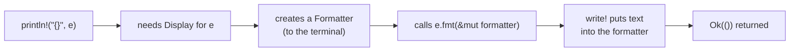

This note takes one small, very common piece of Rust and explains every word in it: a struct, plus an `impl fmt::Display` block that controls how the struct prints with `println!("{}", ...)`.

It uses `&self` and borrowing from [Note 01](/digital-garden/rust-sandbox/ownership-borrowing/), so read that first if `&` still looks mysterious.

## The code for this note
{: #dsp-code}

From `src/math/matrix.rs` in the demo project:

```rust
use std::fmt;

#[derive(Debug, Clone, Copy, PartialEq, Eq)]
pub struct DimensionMismatch {
    pub left: usize,
    pub right: usize,
}

impl fmt::Display for DimensionMismatch {
    fn fmt(&self, f: &mut fmt::Formatter<'_>) -> fmt::Result {
        write!(
            f,
            "dimension mismatch: the left vector has {} components, the right vector has {}",
            self.left, self.right
        )
    }
}
```

`DimensionMismatch` is an error value: "you tried to combine a vector with `left` components and one with `right` components". Ignore the `#[derive(...)]` line for now; [Note 06](/digital-garden/rust-sandbox/derive/) is all about it. Here is each remaining part, in order.

## 1. `struct`: a data type you define
{: #dsp-struct}

A **struct** is a data type that you define. It groups named **fields**:

```rust
pub struct DimensionMismatch {
    pub left: usize,
    pub right: usize,
}
```

`usize` is an unsigned (never negative) integer, the type Rust uses for sizes and indexes. `pub` makes the struct and each field visible outside this module (see [Note 10](/digital-garden/rust-sandbox/modules-use/#mod-pub)).

The Python equivalent is a class that only has fields:

```python
class DimensionMismatch:
    def __init__(self, left, right):
        self.left = left
        self.right = right
```

There's one important difference. In Python, a class holds its data **and** its methods together. In Rust, the struct holds **only data**. Behaviour goes in a separate block, called `impl`.

## 2. `impl`: "implement", adding behaviour to a type
{: #dsp-impl}

`impl` means "implement". It attaches behaviour to a type, and it comes in two forms:

```rust
// Form A: your own methods (an "inherent impl")
impl DimensionMismatch {
    pub fn total(&self) -> usize {
        self.left + self.right
    }
}

// Form B: implement a trait
impl fmt::Display for DimensionMismatch {
    fn fmt(&self, f: &mut fmt::Formatter<'_>) -> fmt::Result { /* ... */ }
}
```

- **Form A** adds methods that only this type has. You call it as `e.total()`, which returns `10` for `left: 4, right: 6`.
- **Form B** fulfils a contract that is defined somewhere else. Read it aloud as: *"Implement the trait `Display` for the type `DimensionMismatch`."*

The code in this note uses Form B.

## 3. `fmt::Display`: the trait that decides what `{}` prints
{: #dsp-display}

`Display` is a **trait** from the standard library. A trait is a **contract**: *"any type that has this trait must provide these methods"*. It's similar to an interface in Java or a protocol in Python. ([Note 05](/digital-garden/rust-sandbox/traits/) covers traits in general: defining your own, generics and `dyn Trait`.)

The standard library defines `Display` like this (simplified):

```rust
pub trait Display {
    fn fmt(&self, f: &mut Formatter<'_>) -> Result;
}
```

So the contract has exactly one method, `fmt`. Once your type provides it, `println!("{}", value)` knows how to print your type.

`Display` is the text meant for a **human user**. Its sibling `Debug` is meant for the **programmer**:

| Trait | Placeholder | Who reads it | Python | How you get it |
|---|---|---|---|---|
| `Debug` | `{:?}` | the programmer | `__repr__` | `#[derive(Debug)]` |
| `Display` | `{}` | the user | `__str__` | write it by hand |

For the same value:

```text
{}   -> dimension mismatch: the left vector has 4 components, the right vector has 6
{:?} -> DimensionMismatch { left: 4, right: 6 }
```

Rust **can't derive** `Display`, because the compiler can't guess which message you want a user to see. So you write it yourself.

## 4. Why `fmt` appears twice with different meanings
{: #dsp-fmt-twice}

The name `fmt` shows up twice in `impl fmt::Display ... fn fmt(...)`, but the two mean different things:

- **`fmt::Display`**: here `fmt` is the **module** `std::fmt`, brought in by `use std::fmt;` (see [Note 10](/digital-garden/rust-sandbox/modules-use/#mod-fmt)).
- **`fn fmt(...)`**: here `fmt` is the **method** that the `Display` contract requires.

You must use the name `fmt`, because the contract says so. Name it anything else and the compiler refuses:

```rust
impl fmt::Display for D {
    fn format(&self, f: &mut fmt::Formatter<'_>) -> fmt::Result { write!(f, "d") }
}
```

```text
error[E0407]: method `format` is not a member of trait `fmt::Display`
error[E0046]: not all trait items implemented, missing: `fmt`
```

It's the same in Python: the method must be called `__str__`, and Python won't call a method with any other name.

## 5. The parameters, one by one
{: #dsp-params}

```rust
fn fmt(&self, f: &mut fmt::Formatter<'_>) -> fmt::Result
```

### `&self`: the value being printed
{: #dsp-self}

`self` is the value itself, like `self` in Python. The `&` means **borrow**: the method reads the value but doesn't take ownership. So after `println!` runs, you can still use the value.

| Form | Meaning |
|---|---|
| `self` | take ownership (the value moves into the method) |
| `&self` | borrow to read |
| `&mut self` | borrow to change |

Printing only reads the data, so `&self` is the right choice. [Note 01](/digital-garden/rust-sandbox/ownership-borrowing/#own-self) explains these three forms in depth.

### `f: &mut fmt::Formatter<'_>`: where the text goes
{: #dsp-formatter}

`f` is the **destination** for the text. It might be the terminal, a `String` or a file. Your code doesn't need to know which, because it just writes into `f`.

- **`&mut`** is a mutable borrow. Writing text into `f` changes it, so the method needs permission to change it.
- **`<'_>`** is a **lifetime**: a label that tells the compiler how long a borrowed reference stays valid. `Formatter` holds a reference inside it, and `'_` means *"compiler, work out the correct lifetime yourself"*. You don't need to name it here. (Writing plain `fmt::Formatter` also compiles; the `<'_>` just makes the hidden reference visible.)

### `-> fmt::Result`: success or failure
{: #dsp-result}

`->` introduces the return type. `fmt::Result` is short for `Result<(), fmt::Error>`, which has two possible values:

- **`Ok(())`**: the text was written. `()`, called "unit", means "no value", a bit like `None` in Python.
- **`Err(fmt::Error)`**: the destination couldn't accept the text.

Writing can fail, so Rust makes the failure part of the return type, and the caller has to deal with it. Python would raise an exception instead. In practice, a `Display` method just passes on whatever `write!` returns. It never invents an error of its own.

## 6. `write!`: a macro, like `println!`
{: #dsp-write}

The `!` tells you that `write!` is a **macro**: code that writes code while the program compiles.

Why a macro and not a function? A Rust function has a fixed number of arguments, but a macro can take any number. The macro also **checks the format string while the code compiles**. Use two `{}` but give only one value, and the build fails:

```rust
let a = 1;
println!("{} and {}", a);
```

```text
error: 2 positional arguments in format string, but there is 1 argument
```

Python would only find this mistake at runtime.

`write!`, `println!` and `format!` work almost the same way. Only the destination differs:

| Macro | Destination | Returns |
|---|---|---|
| `println!("...", a)` | the terminal (standard output), plus a newline | nothing |
| `write!(f, "...", a)` | the destination `f` | `fmt::Result` |
| `format!("...", a)` | a brand-new `String` | the `String` |

Each `{}` is replaced by the next value, in order:

```text
"...the left vector has {} components, the right vector has {}"
                        ↑                                   ↑
                    self.left                          self.right
```

### No semicolon on the last line
{: #dsp-semicolon}

Look closely: the `write!(...)` call has **no `;`** after it. In Rust, the last expression of a block, written without a `;`, is the block's **return value**. So the method returns whatever `fmt::Result` `write!` produced.

Add a `;` and the expression becomes a statement, the method returns `()`, and the compiler stops:

```text
error[E0308]: mismatched types
  expected `Result<(), Error>`, found `()`
  help: remove this semicolon to return this value
```

## 7. How the parts connect
{: #dsp-flow}

```rust
let e = DimensionMismatch { left: 4, right: 6 };
println!("{}", e);
```

1. `println!` sees `{}`, so it needs `Display` for `e`.
2. It creates a `Formatter` that writes to the terminal.
3. It calls your method, `e.fmt(&mut formatter)`, lending `e` with `&`.
4. Your `write!` puts the text into the formatter.
5. The output is:

```text
dimension mismatch: the left vector has 4 components, the right vector has 6
```



Because you implemented `Display`, you also get `.to_string()` and `format!` support for free:

```rust
let text: String = e.to_string();
let line = format!("error: {e}");
```

## Summary: Rust structs, `impl` and `Display`
{: #dsp-summary}

- `struct` is a data type you define. It holds only data.
- `impl Type` adds your own methods. `impl Trait for Type` fulfils a trait's contract.
- `Display` controls the output of `{}`, like `__str__` in Python, and must be written by hand. `Debug` (`{:?}`) can be derived.
- The method must be called `fmt`, because the trait requires that name.
- `&self` borrows the value. `&mut Formatter<'_>` is the destination you write into.
- `fmt::Result` reports success (`Ok(())`) or failure (`Err`).
- `write!` is a macro like `println!` but writes to `f`, and it checks the format string while the code compiles.
- The last line has no `;`, so its value is the return value.

