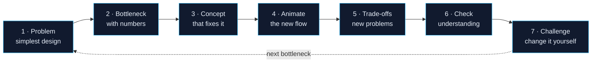

## Why learn system design from Uber's production architecture
{: #sd-why}

Most **system design** material teaches building blocks in isolation: here's a cache, here's a queue, here's a load balancer. That tells you *what* each part is, but not *when* you need it or *what breaks* without it.

In production, nobody adds a message queue because a diagram has one. They add it because checkout requests started timing out while a downstream service was slow. **The use case comes first and the component second.**

Uber is an unusually good case study. A ride is real time, geographic, high-volume and money-moving all at once, and Uber has published a lot about how its architecture evolved. This guide follows one ride request from a single rider to millions.

## How every system design note teaches
{: #sd-method}

Every concept follows the same seven steps:

1. **The problem:** start with the simplest Uber implementation that works (e.g. one server handles every ride).
2. **The bottleneck:** show, with numbers, why it fails as users grow.
3. **The concept:** introduce the component that fixes it.
4. **The animation:** run the new architecture and watch requests flow.
5. **The trade-offs:** what it solves, and what new problems it creates.
6. **Knowledge check:** questions with explained answers.
7. **Engineering challenge:** change the architecture in the lab and observe the result.

## How to use the interactive labs
{: #sd-labs}

The labs are embedded in the notes and run in your browser:

- **Animation controls:** Play, Pause, Reset, Step forward, Step backward, speed (0.5x, 1x, 2x) and **Explain this step**.
- **Click any component** to see what it does, why it exists, what it talks to, what data it holds, and what happens when it fails or traffic grows.
- **Inspect network messages:** step panels show the request and response on the wire.
- **Simulations are real models:** the gateway overload lab is an actual queueing simulation (Poisson arrivals, bounded queue, timeouts). Its numbers are estimates from that model, **never Uber telemetry**.

## The system design curriculum
{: #sd-curriculum}

| Module | Notes | Status |
|---|---|---|
| **1 · Uber's API architecture evolution** | 01 Gen 1 dispatch · 02 Gen 2 RTAPI · 03 Gen 3 Edge Gateway | Live |
| **2 · What happens when someone requests a ride** | 04 Ride lifecycle · 05 Uber H3 · 06 Scaling lab | Planned |
| **3 · APIs, query languages and communication** | 07 REST, GraphQL, gRPC, and the UberQL question | Planned |
| **Syllabus A–I** | 08 Scalability & CAP · 09 Availability · 10 App architecture · 11 Databases · 12 Caching · 13 Async & Kafka · 14 Protocols · 15 Security · 16 Math & calculators | Planned |
| **Failure laboratory** | 17 Break it and watch it recover | Planned |

## Track your progress
{: #sd-progress}

Your quiz scores and lab activity are saved in this browser only.

## Sources and accuracy
{: #sd-sources}

Every Uber-specific claim links to a public source, mainly the [Uber Engineering blog](https://www.uber.com/blog/engineering/), [h3geo.org](https://h3geo.org/) and Uber's GitHub repositories.

Each note's References section separates **documented Uber facts** from **illustrative designs** (service names, payloads, simulation numbers) that teach the idea but aren't claims about Uber's internals.

## The notes in this system design guide
{: #sd-notes}

Each note builds on the one before it:
