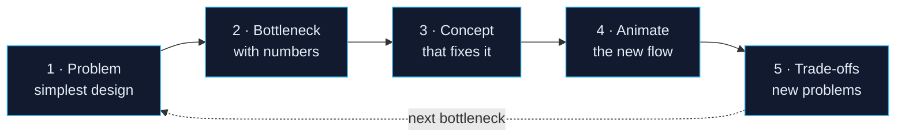

## Why learn system design from production architectures
{: #sd-why}

Most **system design** material teaches building blocks in isolation: here's a cache, here's a queue, here's a load balancer. That tells you *what* each part is, but not *when* you need it or *what breaks* without it.

In production, nobody adds a message queue because a diagram has one. They add it because checkout requests started timing out while a downstream service was slow. **The use case comes first and the component second.**

So this guide studies real companies' architectures: what they built, what broke as they grew, and what they changed.

## How every system design case study teaches
{: #sd-method}

Every page follows the same sequence:

1. **The problem:** the simplest design that worked at the time.
2. **The bottleneck:** why it failed as traffic, teams or products grew, shown with numbers.
3. **The concept:** the component or pattern that fixed it.
4. **The animation:** run the new architecture and watch requests flow.
5. **The trade-offs:** what it solved, and what new problems it created.

## How the case studies are organised
{: #sd-structure}

- **One case study per company.** Each company has its own section in the sidebar, with an overview page and a set of pages.
- **Pages have subsections.** Open a page in the sidebar to jump straight to any part of it.
- **Facts are sourced.** Company-specific claims link to the company's own engineering publications, and each page marks which parts are documented and which are illustrative.

## The system design case studies
{: #sd-notes}
