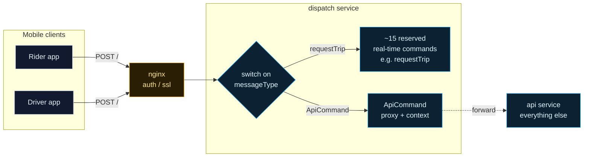
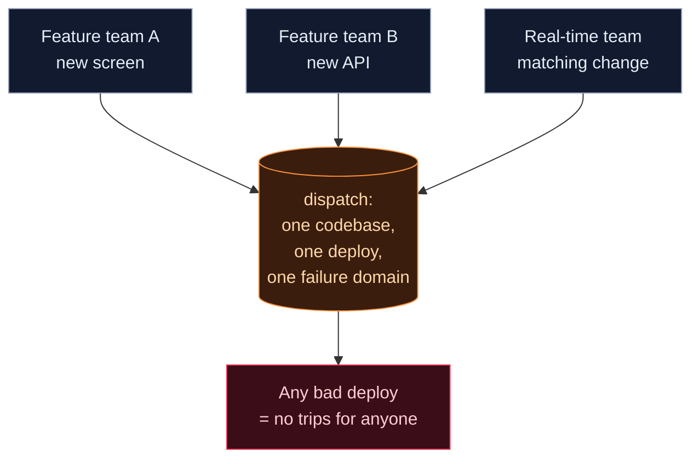

The **Uber API gateway** story starts before Uber had an API gateway. In 2014 the backend was essentially two services, *dispatch* and *api*. Both mobile apps sent every request to one URL, and a field inside the message decided what happened next.

This note rebuilds that first-generation design from Uber's own engineering write-up. You'll animate a request through it, learn the concepts inside the diagram (TLS termination, reverse proxying, request routing) and then work out, with numbers, why it had to change.

## 1. The problem: one backend, two apps, every request
{: #g1-problem}

Start where Uber started: a rider app, a driver app and a small backend. The job is simple to state:

- A rider asks for a trip; a nearby driver is matched; both apps see the update.
- Everything else (profile, payment methods, trip history) must work too.

The simplest design that works is **one entry point** that receives every message and decides what to do with it. That's what Uber built, and for a young company it was a reasonable choice.

## 2. Uber's first-generation architecture, reconstructed
{: #g1-architecture}

Uber describes it like this: *"A 2014 survey of Uber's architecture would have resulted in two key services: dispatch and api."* Both apps *"connected to the dispatch service using a single endpoint hosted at '/'"*, and a body field named `messageType` *"determined the RPC command to invoke a specific handler."*

Three details matter:

- **One endpoint, many operations.** The URL is always `/`. The operation lives in the body. This is RPC (remote procedure call) style, not REST, where the URL names the resource.
- **About 15 reserved real-time commands** handled inside dispatch: drivers going online, accepting or rejecting trips, riders requesting trips.
- **`ApiCommand`** was a special messageType that *"proxied all requests to the api service with some additional context."* Uber's own words: it *"would look like 'ApiCommand' was our gateway into Uber."*

The `nginx (auth/ssl)` box comes from Fig. 1 of Uber's article; the article text doesn't describe it further.

## 3. Lab: animate a request through dispatch
{: #g1-lab}

Press **Play**, or use **Step forward** to go one hop at a time. Turn on **Explain this step** for the full reasoning, and click any box to inspect what it does, what it talks to and what happens when it fails. The message panel shows each step's request.

Watch step 5 closely. Loading payment methods has nothing to do with matching trips, yet it still flows *through dispatch*.

## 4. The concepts hiding in this diagram
{: #g1-concepts}

### SSL/TLS termination

TLS is the protocol behind HTTPS. It gives you **encryption** (nobody on the network can read the request), **integrity** (nobody can modify it) and **server authentication** (the certificate proves the server's identity).

*Terminating* TLS means the encrypted connection ends at a proxy. The proxy holds the certificate, performs the handshake and decrypts, so services behind it receive plain HTTP over the private network.

- **Why do it:** certificates and handshake CPU live in one hardened place, and the proxy can read paths and headers to route.
- **What it costs:** traffic behind the proxy is only as safe as the internal network. Zero-trust networks re-encrypt each hop with mutual TLS (mTLS).

### Authentication at the edge

Authentication answers *who is calling?* Checking a token once at the edge means invalid requests are rejected before they cost dispatch anything, and downstream code can trust the attached identity.

*Authorization* (may this rider see this trip?) is a different question and usually belongs to the service that owns the data.

### Reverse proxying

A **reverse proxy** accepts requests on behalf of servers and forwards them. Clients never talk to the backend directly. (A *forward* proxy is the mirror image: it acts on behalf of clients.)

Here there are two reverse proxies in a row: nginx in front of dispatch, and dispatch itself forwarding `ApiCommand` to api.

### Request routing

Routing decides which code or service handles a request. Gen 1 routes in **application code**, with a switch statement on `messageType`. A real gateway routes with a **declarative table** (method + path → upstream) that can change without redeploying business logic.

## 5. The bottleneck: why every path through dispatch hurts
{: #g1-bottleneck}

### Availability multiplies along a path

If a request must pass through components in series, it succeeds only if *all* of them are up:

$$A_{path} = A_{nginx} \times A_{dispatch} \times A_{api}$$

Give each component 99.9% availability (about 8.8 hours of downtime a year):

- Trip request (nginx → dispatch): $0.999^2 \approx 99.80\%$, about **17.5 hours** down per year.
- ApiCommand (nginx → dispatch → api): $0.999^3 \approx 99.70\%$, about **26.3 hours** down per year.

The extra hop through dispatch adds roughly 8.8 hours of downtime a year to every non-trip feature, *for no functional benefit*.

### Contention for one service's capacity

Dispatch's CPU, memory and connections are shared by latency-critical trip commands and everything else. A spike in "everything else" (say, everyone opening their trip history at once) now competes with matching riders to drivers.

### Coupling of change

A new client feature means a new handler or proxy rule *in dispatch*, the most critical service in the company. Every product team's release now touches the code whose failure stops all trips.

## 6. Trade-offs: what Gen 1 got right
{: #g1-tradeoffs}

Don't read Gen 1 as a mistake. For a small team it had real advantages:

| Decision | Benefit at small scale | Cost as Uber grew |
|---|---|---|
| One endpoint `/` | Trivial client networking | No per-API metrics, caching or rate limits by URL |
| Route by `messageType` | Add an operation with one handler | Routing changes require dispatch deploys |
| `ApiCommand` proxy | Reuse dispatch's connection and auth | Non-trip traffic coupled to dispatch's availability |
| Few services | Easy to run, debug and deploy | Every team works in the same critical code |

The lesson generalises: **start simple, and introduce a component only when a bottleneck proves you need it.** Uber's bottleneck was coupling, and the response was a real API gateway.

## 7. Exercise and engineering challenge
{: #g1-exercise}

**Exercise (5 minutes).** Dispatch handles 2,000 messages per second, of which 30% are `ApiCommand`. Each `ApiCommand` costs dispatch 2 ms of CPU to proxy. How many CPU cores does dispatch spend purely on proxying?

Show the working

$2{,}000 \times 0.30 = 600$ proxied messages/s. $600 \times 2\text{ ms} = 1{,}200$ ms of CPU per second, which is **1.2 cores** spent on traffic that dispatch doesn't need to see. Those cores are capacity taken from trip matching.

**Engineering challenge.** Redraw the diagram so that `ApiCommand` traffic no longer depends on dispatch, *without changing the mobile apps*. What must nginx learn to do? What does it need to inspect? (Hint: you just invented request routing at the edge, which is Gen 2.)

## 8. Knowledge check
{: #g1-check}

## Key takeaways: Uber's first-generation API architecture
{: #g1-summary}

- Uber's 2014 backend routed **every request through one endpoint `/`**, using a `messageType` body field to pick an RPC handler.
- **`ApiCommand` made dispatch the de facto gateway:** non-trip requests were proxied through the real-time core.
- **TLS termination** and **authentication** at the edge centralise security work, and a **reverse proxy** hides backend topology from clients.
- **Availability multiplies along a path:** each extra hop adds downtime ($0.999^3 \approx 99.7\%$).
- The real limit was **coupling** of capacity, failure and change to the most critical service. Next: [Gen 2, RTAPI, the all-encompassing gateway](/digital-garden/system-design/uber-rtapi-api-gateway-bottleneck/#g2-problem).

## References
{: #g1-refs}

- Uber Engineering, [*Designing Edge Gateway, Uber's API Lifecycle Management Platform*](https://www.uber.com/blog/gatewayuberapi/), Pavel Astakhov, Madan Thangavelu and Uday Kiran Medisetty, August 2020. The source for the 2014 design, the `messageType` routing, `ApiCommand` and Fig. 1. **Documented Uber facts.**
- NGINX, [*NGINX Reverse Proxy*](https://docs.nginx.com/nginx/admin-guide/web-server/reverse-proxy/) and [*SSL Termination*](https://docs.nginx.com/nginx/admin-guide/security-controls/terminating-ssl-http/) (official documentation).
- IETF, [RFC 8446: TLS 1.3](https://www.rfc-editor.org/rfc/rfc8446).
- **Illustrative, not Uber's:** the request payloads, the `getPaymentProfiles` command name, and the exercise numbers.
