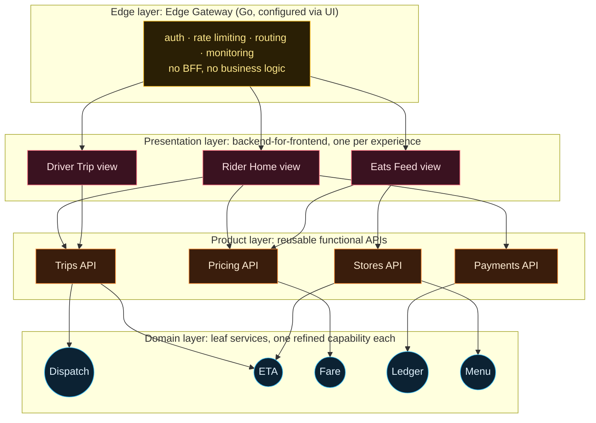
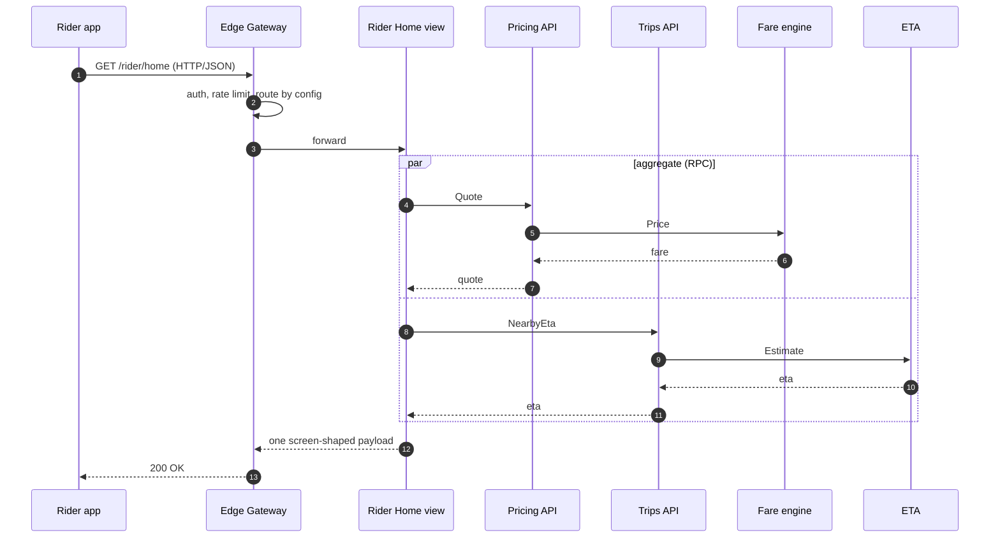

A **microservices architecture** only pays off if teams can actually change their services independently. By 2018 Uber had the microservices (2,200+ of them), but every product-facing API still lived in one shared gateway, RTAPI ([Note 02](/digital-garden/system-design/uber-rtapi-api-gateway-bottleneck/#g2-coupling)).

Uber's third generation fixed that by doing *less* at the gateway. This note rebuilds the layered design (edge, presentation, product, domain) and animates the transformation. You'll fail services to measure blast radius, then weigh what the design costs.

## 1. The problem: a gateway every team must queue behind
{: #g3-problem}

By early 2018 Uber had new business lines (Freight, ATG, Elevate, groceries) and many new apps. The Gen 2 gateway had three structural problems:

- **Business logic leaked into it:** aggregation, view shaping and product rules, all in one codebase.
- **The gateway team was a bottleneck:** every new API needed their review, tests and release train.
- **Shared failure and upgrade domains:** one runtime, one dependency tree, one test suite.

The design goal: **keep what every API needs at the edge, and move everything product-specific into services that the product teams own.**

## 2. Uber's third-generation layered architecture
{: #g3-architecture}

Uber's Fig. 3 shows four layers. In Uber's words:

- **Edge layer:** *"the true gateway system that provides all the functionalities described in the goals of our gateway section of our second generation system except 'backend for the frontend' and 'reduced round trips.'"*
- **Presentation layer:** *"microservices that are tagged specifically to provide the backend for the frontend for their features & products"* (view generation and aggregation).
- **Product layer:** *"microservices are tagged specifically to provide functional, reusable APIs that describe their product/feature."*
- **Domain layer:** *"the microservices that are the leaf node that provides a single refined functionality for a product team."*

The edge was rebuilt as *"a single standalone Golang service paired with a UI."* *"All Uber engineers now have the ability to visit a UI to configure, create, and modify our product-facing APIs."* That's the **self-service** part.

The layer *roles* are Uber's. The service names (Rider Home view, Trips API and so on) are an illustrative model; Uber's figure just says "Product Service A" and "Presentation Service B".

## 3. Lab: transform the architecture, layer by layer
{: #g3-lab}

Each step is one transformation: **one gateway → gateway groups → thin edge + product services → presentation services → domain services with their own data**. Pick a user flow to animate it through each phase.

Then click any component to inspect its responsibility, API, dependencies, database, incoming and outgoing calls, and what happens if it fails. Press **Fail this service** to see the blast radius.

Experiments to run:

1. Phase 1, fail **RTAPI**: all 5 flows break.
2. Phase 2, fail **Gateway Group 2**: only the driver flow breaks.
3. Phase 3, watch **Rider: home screen**: the phone makes *two* calls. No layer aggregates any more.
4. Phase 4: home screen is back to one call, now through the Rider Home view.
5. Phase 5, fail **Menu store**: only Eats breaks. Fail **Trips API**: three flows break, because a reusable product service has a wide blast radius.

## 4. Why split one large gateway into gateway groups?
{: #g3-groups}

Gateway groups (Gen 2's 40+ deployments) were the *first* step, and they solve the **runtime** problem:

- **Load isolation:** an Eats spike consumes Eats-group instances, not rider ones.
- **Crash isolation:** a crash in group 2 takes down group 2's endpoints only.
- **Independent scaling:** each group is sized for its own peak.

They don't solve the **organisational** problem: the same repo, runtime, libraries and reviewers. Gen 3's real move was to change *what the gateway is for*, not just how many copies of it exist.

## 5. Microservices architecture concepts
{: #g3-concepts}

### What is a microservice?

A **microservice** is a small, independently deployable service that owns one business capability *and its data*, and is reached only through its API. "Micro" refers to scope of responsibility, not lines of code.

### What is a service boundary?

A **service boundary** is the line around a service's code and data that others may cross *only* through its published API. No reaching into its database, no importing its internals.

Good boundaries follow business capabilities (pricing, dispatch, payments), so most changes stay inside one boundary.

### What is a product service?

A **product service** exposes *reusable, functional* APIs for a product capability, such as "create a trip" or "quote a price". Many presentation services call it, so it changes conservatively and stays backward compatible.

### What is a presentation service?

A **presentation service** is a *backend for frontend* (BFF): it serves one screen or experience. It calls product services, merges and localizes the results, and returns exactly the payload the client needs in **one round trip**.

It's owned by the team that owns the screen, so it can change with the UI.

### Where the domain layer fits

**Domain services** are the leaves: one refined capability each, usually with their own datastore. Uber's later *Domain-Oriented Microservice Architecture* (DOMA) groups related services into **domains** behind a single **domain gateway**. It uses five layers: infrastructure, business, product, presentation and edge, *"for thinking about failure blast radius and product specificity."*

## 6. How services communicate
{: #g3-comms}

What Uber has documented, and what is an educational generalisation:

| Hop | Typical mechanism | Documented at Uber? |
|---|---|---|
| Mobile → edge | HTTP/JSON | Yes. *"All mobile to server communications were primarily in HTTP/JSON."* |
| Service → service (sync) | RPC over a multiplexed protocol | Yes: *"a new internal protocol … multiplexed bidirectional transport."* Uber open-sourced [TChannel](https://github.com/uber/tchannel) and [YARPC](https://github.com/yarpc/yarpc-go) (HTTP, TChannel and gRPC transports) |
| Orchestrating many calls | In-process workflow framework | Yes: Control Flow Framework (CFF) in Go, and the Glue framework on [Fx](https://github.com/uber-go/fx) |
| Service → service (async) | Events on a log such as Kafka | Kafka at Uber is widely documented; covered in Module 2 |

Uber's own lesson from the article: *"If there is an option, stick with a single protocol for your mobile applications and internal services."* Every extra protocol makes the gateway translate.

[Module 3](/digital-garden/system-design/) will cover REST vs GraphQL vs gRPC in depth.

## 7. Decentralization, ownership and independent deployment
{: #g3-ownership}

### What is decentralized architecture?

**Decentralized** means no single team or component sits on every change path. The platform team owns the *edge platform*; product teams own their *APIs* (self-service config) and their services.

Decisions such as data model, scaling, release cadence and even language are made where the knowledge is.

### What is service ownership?

**Ownership** means one team is accountable for a service end to end: code, data, on-call, SLOs, capacity and its API contract. If it pages at 3 a.m., everyone knows whose phone rings.

### How does independent deployment work?

You can deploy whenever you like **as long as your API contract stays backward compatible**:

1. **Additive changes only:** add optional fields; never remove or repurpose them in place.
2. **Expand → migrate → contract:** ship v2 alongside v1, move callers over, then remove v1.
3. **Progressive rollout:** canary a small slice of traffic, watch error rates and latency, then roll forward or back automatically.
4. **Own your data:** if nobody else reads your tables, schema changes are private.

## 8. The problems microservices architecture introduces
{: #g3-costs}

Microservices move complexity from *inside the code* to *between services*. Uber's DOMA post is candid: *"Understanding dependencies between services can become quite difficult, as calls between services can go many layers deep."* One investigation required engineers to *"work through around 50 services across 12 different teams."*

- **Partial failure:** every call can be slow or fail, so you need timeouts, retries with backoff, circuit breakers and fallbacks.
- **Latency:** function calls become network calls. A chain of 5 calls at 2 ms each adds 10 ms before any work happens.
- **Observability:** distributed tracing (trace IDs on every hop), per-service dashboards and centralized logs become mandatory.
- **Data consistency:** no cross-service transactions. You get eventual consistency, sagas and idempotent handlers.
- **Contract management:** versioning, deprecation and schema registries.
- **Operational overhead:** thousands of deployables, on-call rotations, capacity plans.
- **Reusable services have wide blast radius:** fail the Trips API in Lab 4 and three flows break.

Availability also compounds along a call chain. A request that crosses 6 services, each at 99.95%:

$$A = 0.9995^6 \approx 99.70\%$$

That's about 26 hours a year, versus about 4.4 hours for one service. Deep call graphs need fallbacks, not just uptime.

## 9. Lab: Gen 2 vs Gen 3, side by side
{: #g3-compare}

Same event, two architectures. Switch scenarios: a crashing bug, a traffic spike, adding an API, debugging a slow request. Note that Gen 2 *wins* the debugging scenario.

## 10. Exercise and engineering challenge
{: #g3-exercise}

**Exercise.** You own the Pricing API (product layer). The Eats team asks for a new `delivery_fee` field, and the Rider team needs the existing `fare` field unchanged. Design the change so both teams can deploy on their own schedules.

Show one good answer

Add `delivery_fee` as a new **optional** field and keep `fare` exactly as it is. That's an additive, backward-compatible change. Ship it behind a canary.

The Eats Feed view starts reading the field when it's ready; the Rider Home view ignores it. Nobody coordinates a release. If the field's meaning ever has to change, add a new field (or a v2 endpoint) and deprecate the old one after callers migrate: expand, migrate, contract.

**Engineering challenge.** In Lab 4, phase 5, find the **single** service whose failure breaks the most flows. Then propose two ways to shrink its blast radius. (Think: a cached fallback in the presentation layer, splitting read and write APIs, or a degraded response that drops the ETA instead of failing the screen.)

## 11. Knowledge check
{: #g3-check}

## Key takeaways: microservices architecture at Uber
{: #g3-summary}

- Gen 3 made the gateway **thinner, not faster**: the Edge Gateway (Go + UI) keeps only cross-cutting concerns and is **self-service**.
- **Presentation services** (BFFs) own screen-shaped aggregation; **product services** own reusable APIs; **domain services** own one capability and its data.
- **Service boundaries + ownership + backward-compatible contracts** are what make independent deployment work.
- Microservices **shrink blast radius and remove team bottlenecks**, but bring partial failure, tracing, consistency and operational cost.
- Uber's later **DOMA** groups services into domains behind domain gateways to keep 2,200 services understandable.
- Module 1 recap: [Gen 1](/digital-garden/system-design/uber-api-gateway-first-generation/#g1-architecture) → [Gen 2](/digital-garden/system-design/uber-rtapi-api-gateway-bottleneck/#g2-architecture) → Gen 3. Next is Module 2: what happens when someone requests a ride.

## References
{: #g3-refs}

- Uber Engineering, [*Designing Edge Gateway, Uber's API Lifecycle Management Platform*](https://www.uber.com/blog/gatewayuberapi/) (Astakhov, Thangavelu, Medisetty, 2020). Source of the layer definitions, Fig. 3, Golang edge, UI self-service, protocol notes, CFF and Glue. **Documented Uber facts.**
- Uber Engineering, [*Introducing Domain-Oriented Microservice Architecture*](https://www.uber.com/blog/microservice-architecture/) (Adam Gluck, July 2020). Source of the ~2,200 critical microservices, the 50 services / 12 teams quote, domains, layers and domain gateways. **Documented Uber facts.**
- Uber open source: [TChannel](https://github.com/uber/tchannel), [YARPC](https://github.com/yarpc/yarpc-go), [Fx](https://github.com/uber-go/fx).
- Sam Newman, [*Pattern: Backends For Frontends*](https://samnewman.io/patterns/architectural/bff/).
- Martin Fowler and James Lewis, [*Microservices*](https://martinfowler.com/articles/microservices.html), 2014.
- **Illustrative, not Uber's:** every service name, API path and dependency in the labs and diagrams, and the scenario outcomes in the comparison lab.
