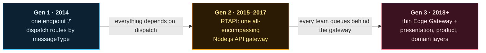

## Why Uber is a good system design case study
{: #uber-why}

The **Uber system design** problem is unusually demanding. A ride request is real-time (a driver must be matched in seconds), geographic (who is *near* the rider?), high-volume, and moves money. Every part of that pushes on the architecture.

Uber has also written in public about how its backend changed as the company grew, which lets us study a real system rather than an imagined one.

This case study follows the part of the system every request touches first: **the API layer between the apps and the backend**.

## Uber's API architecture evolution at a glance
{: #uber-evolution}

| Generation | What changed | The bottleneck that forced the next step |
|---|---|---|
| **Gen 1 (2014)** | Two services, dispatch and api. Every request goes to `/`, and a `messageType` field picks the handler | Non-trip traffic coupled to the real-time dispatch service |
| **Gen 2 (2015–2017)** | RTAPI, a dedicated API gateway: ~1M lines of Node.js, 800,000 req/s at peak | Business logic leaked in; 40% of engineering shared one codebase and release train |
| **Gen 3 (2018+)** | A thin Go Edge Gateway configured through a UI, plus layers of team-owned services | Operational complexity: tracing, contracts, partial failures |

## How to use the Uber labs
{: #uber-labs}

Each page embeds interactive labs that run in your browser:

- **Animation controls:** Play, Pause, Reset, Step forward, Step backward, speed (0.5x, 1x, 2x) and **Explain this step**.
- **Click any component** to see what it does, why it exists, what it talks to, what data it holds, and what happens when it fails or traffic grows.
- **Inspect network messages:** step panels show the request and response on the wire.
- **Simulations are real models.** The gateway overload lab is a queueing simulation; its numbers are estimates from that model, **never Uber telemetry**.

## Sources and accuracy
{: #uber-sources}

Every Uber-specific claim links to a public source, mainly Uber Engineering's [*Designing Edge Gateway, Uber's API Lifecycle Management Platform*](https://www.uber.com/blog/gatewayuberapi/) (2020) and [*Introducing Domain-Oriented Microservice Architecture*](https://www.uber.com/blog/microservice-architecture/) (2020).

Each page's References section separates **documented Uber facts** from **illustrative designs** (service names, payloads, simulation numbers) that teach the idea without claiming anything about Uber's internals.

## The pages in the Uber case study
{: #uber-pages}

Read them in order; each generation exists because of the previous one's bottleneck:
