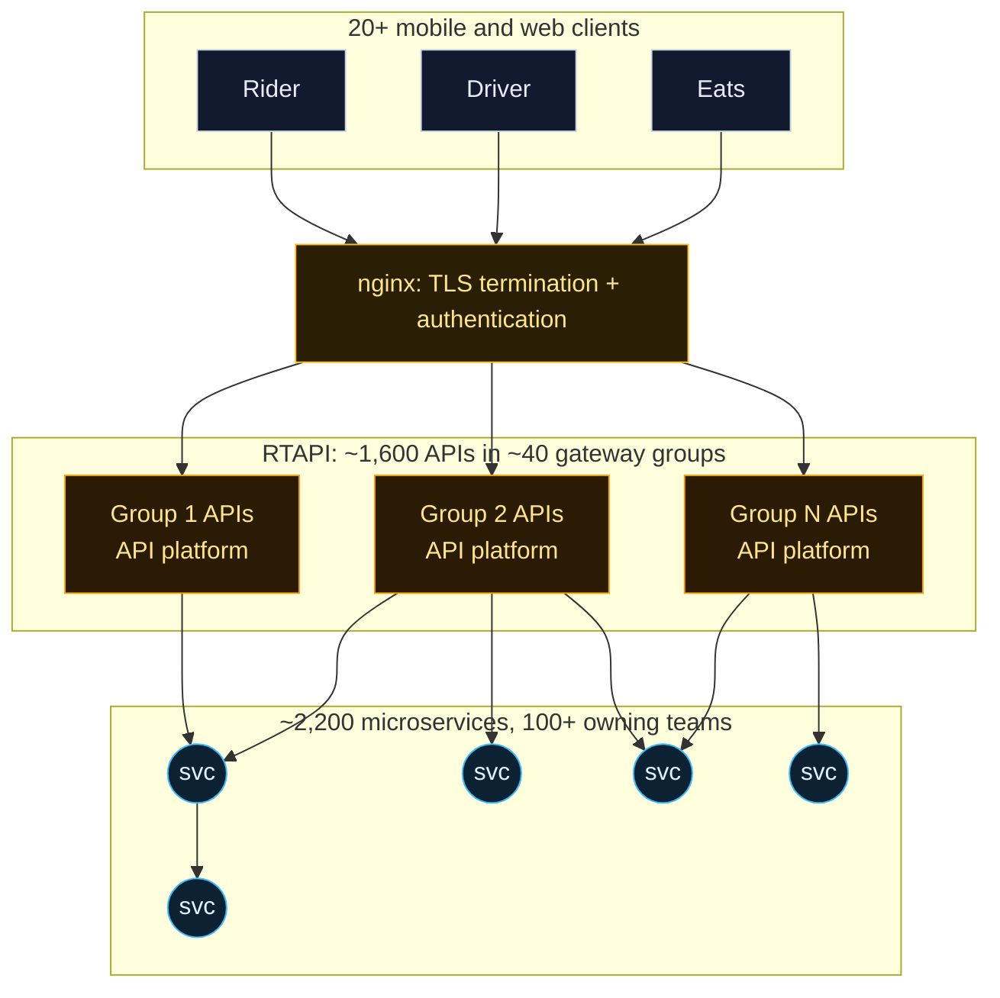
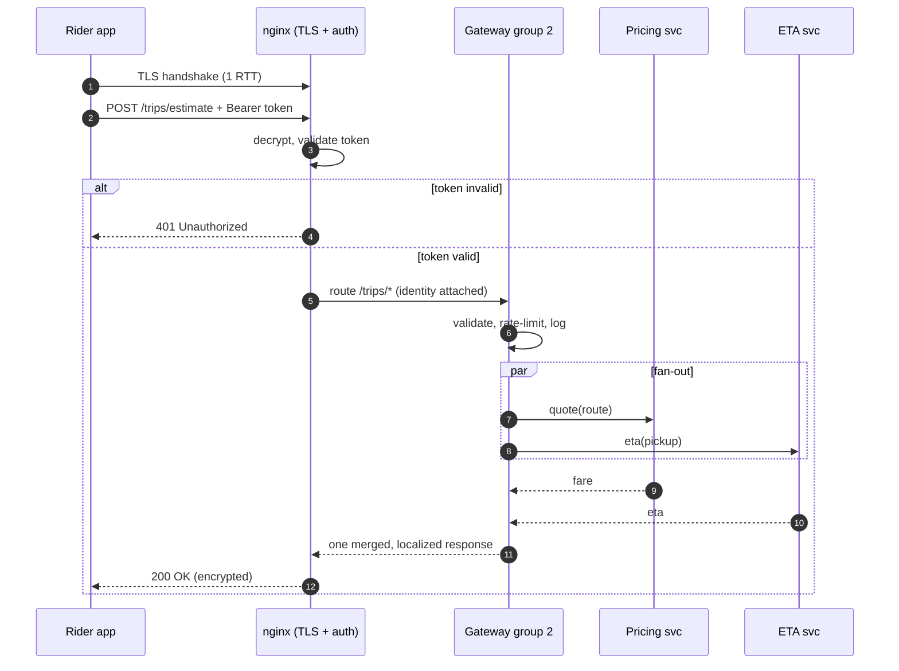
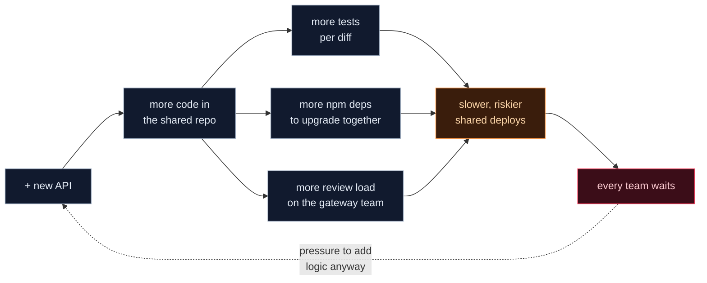

An **API gateway bottleneck** rarely looks like one at first. In 2015 Uber replaced "everything goes through dispatch" ([Page 01](/digital-garden/system-design/uber/api-gateway-first-generation/#g1-problem)) with a real gateway, RTAPI, and it worked. It grew to serve 800,000 requests per second.

Then it became the thing every team waited on. This page rebuilds RTAPI from Uber's write-up and walks a request through NGINX, authentication and routing. Then you'll overload it in a live simulation and work out the mathematics of why latency explodes, and why the hardest bottleneck wasn't CPU at all.

## 1. The problem Gen 2 solved, and the one it created
{: #g2-problem}

**The problem:** in Gen 1 every request depended on dispatch. Uber needed a dedicated entry point that understood *APIs*: paths, methods, schemas, per-endpoint rate limits.

**The solution:** RTAPI ("Real-Time API"). It *"started out with a single RESTful API in early 2015 and grew to become a gateway with many public-facing APIs powering more than 20 growing portfolios of mobile and web clients."*

**The new problem:** the gateway did so much, for so many teams, that it became a shared bottleneck. Uber's numbers, from the same article:

| RTAPI at its peak | Value |
|---|---|
| Peak traffic | 800,000 requests/second |
| Code | ~1 million lines of Node.js |
| Logical endpoint groupings | 110 |
| Engineers who had committed to it | ~40% of engineering |
| Integration tests per diff | 50,000 (under 5 minutes) |
| Downstream services called | ~400+, owned by 100+ teams |
| Deployments | 40+ independent services from one monorepo |

## 2. Uber's RTAPI API gateway, reconstructed
{: #g2-architecture}

Fig. 2 of Uber's article shows the shape: all apps → `nginx (auth/ssl)` → gateway groups, each running on a shared **API platform** → about 2,200 microservices. The figure labels the groups *"1600 APIs grouped into 40 gateways"*. Treat those numbers as illustrative of 2019, not as current production figures.

The API platform gave every endpoint the same features. Uber lists them: *authentication, monitoring (latency, error, payload size), data validation, security audit logging, on-demand debug logging, baseline alerting, SLA measurement, datacenter stickiness, CORS configurations, localization, caching, rate limiting, load shedding and field obfuscation.*

RTAPI also acted as a **backend for the frontend** (BFF): one client call fans out to many services and is merged into one response, which reduces mobile round trips.

## 3. Lab: one request through the API gateway
{: #g2-request}

Step through a rider's fare-estimate request: TLS handshake → termination → authentication → classification and routing → fan-out → aggregation → response. Open the message panel at each step to see the request on the wire, and click a gateway group to inspect it.

## 4. API gateway concepts, from first principles
{: #g2-concepts}

### What is an API gateway?

An **API gateway** is a single entry point that sits between clients and backend services. It does the work *every* API needs (authentication, rate limiting, routing, monitoring) so individual services don't each reimplement it.

Analogy: a hotel front desk checks your ID and directs you to the right room. Technically, it's a reverse proxy that understands API semantics: paths, methods, schemas, per-endpoint policies.

### What is NGINX?

**NGINX** is an open-source web server and reverse proxy. Its architecture is event-driven: a few worker processes each handle thousands of connections with non-blocking I/O, instead of one thread per connection. That makes it cheap at holding many idle or slow mobile connections.

Typical roles are reverse proxy, TLS termination, load balancing, static content and caching. In Uber's figure it terminates TLS and authenticates in front of the gateway.

### What happens during SSL/TLS termination?

1. The client opens TCP to port 443 and sends a **ClientHello** (supported ciphers and a key share).
2. The proxy replies with **ServerHello**, its **certificate** and a signature proving it owns the certificate's private key.
3. Both derive the same session keys. TLS 1.3 needs **one round trip** before the first encrypted request.
4. The proxy decrypts each request and forwards it, usually as plain HTTP on the private network, or re-encrypted with mTLS.

The cost is one round trip plus asymmetric crypto CPU per *new* connection. That's why clients reuse connections and why TLS sits at the edge, where it's done once.

### Why do we need authentication?

Without it, anyone could request trips as anyone else. **Authentication** proves the caller's identity, typically by validating a token's signature and expiry.

Doing it at the gateway rejects bad requests before they cost downstream services anything. **Authorization** (*may this user do this?*) still belongs to the service that owns the data.

### What is reverse proxying?

A reverse proxy receives requests *on behalf of* backend servers and relays them. Clients see one address. The backend can split, move, scale or be replaced without any client change.

That property is why Uber could later swap the whole gateway generation underneath its apps.

### What is request routing?

Routing maps a request to the upstream that owns it, using method, path, headers or client type. For example, `/trips/*` goes to group 2. In RTAPI, endpoints were organised into 110 logical groupings deployed as 40+ separate services.

## 5. Why an API gateway becomes a bottleneck
{: #g2-bottleneck}

A gateway is a **shared tier**: every request for every product passes through it. That creates three kinds of bottleneck: capacity, tail latency and people.

### Capacity: the arithmetic

Give one gateway instance $c$ concurrent workers and a mean service time of $S$. Each worker completes $1/S$ requests per second, so with $n$ instances:

$$\mu = \frac{n \cdot c}{S}$$

With $n = 1$, $c = 64$ and $S = 40\text{ ms}$: $\mu = 64 / 0.040 = 1{,}600$ requests/second. **Utilisation** is offered load over capacity: $\rho = \lambda / \mu$.

### Latency: why it explodes before you hit 100%

For a single-server queue (M/M/1), the mean time a request spends in the system is:

$$W = \frac{S}{1 - \rho}$$

| Utilisation ρ | Mean latency W | vs. service time |
|---|---|---|
| 0.50 | 80 ms | 2× |
| 0.80 | 200 ms | 5× |
| 0.90 | 400 ms | 10× |
| 0.99 | 4,000 ms | 100× |

Multi-worker queues (M/M/c) are kinder at moderate load but show the same hockey stick near $\rho = 1$. **The tail moves first:** p99 rises long before the average looks bad.

### Little's Law: how many requests are in flight

For any stable system, the average number of requests inside it equals the arrival rate times the time each one spends there:

$$L = \lambda W$$

At 2,000 req/s and 50 ms, $L = 2{,}000 \times 0.05 = 100$ requests in flight. This is how you size worker pools and connection pools. The lab below shows the measured $L$ next to $\lambda W$.

### Fan-out amplifies the tail

If a gateway endpoint waits for $k$ downstream calls in parallel and each is slow with probability $p$, the request is slow if *any* of them is:

$$P(\text{slow}) = 1 - (1 - p)^k$$

With $p = 1\%$ and $k = 5$, about **4.9%** of requests are slow. Aggregating at the gateway is convenient, but it ties the gateway's latency to its slowest dependency.

## 6. Lab: overload the gateway
{: #g2-traffic}

This simulator is a real queue, not a scripted animation. Requests arrive randomly (Poisson), wait in a bounded queue, and are served by workers with random service times. Clients give up after a timeout.

Push the **Offered load** slider and watch three things in order: p99, then queue depth, then errors. Try the scenarios, then add instances.

What to notice:

1. **Normal load** (ρ ≈ 0.63): latency ≈ service time, no queue.
2. **Evening peak** (ρ ≈ 0.94): throughput still keeps up, but p99 climbs. This is the knee.
3. **New Year's Eve spike** (ρ ≈ 2.5): throughput flattens at μ; the queue fills; requests are shed or time out. *Every product* sharing this tier degrades at once.
4. **Spike + scale out ×3**: horizontal scaling restores headroom. Raw throughput was a solvable problem.

## 7. What happens if the gateway fails
{: #g2-failure}

Toggle **Gateway crashes** in the lab. Error rate goes to 100%, even though all 2,200 microservices behind it are healthy. A single entry point is a **single point of failure** (SPOF) unless you engineer it not to be:

- **Replicas** across machines, availability zones and data centres, behind health-checked load balancers.
- **Load shedding:** reject early (cheap 503) instead of queueing work that will time out anyway. RTAPI's platform listed load shedding as a feature.
- **Graceful degradation:** the app shows cached data or a reduced experience instead of an error screen.
- **Static stability:** the edge keeps serving with its last known configuration if its control plane is down.

## 8. Tight coupling: the bottleneck replicas can't fix
{: #g2-coupling}

Now toggle **Bad deploy in shared code**. Adding instances doesn't help, because the bug ships to every replica. This is the bottleneck Uber actually wrote about.

**Tight coupling** means components can't change, deploy or fail independently. RTAPI coupled teams through:

- **One codebase:** ~1M lines; *"it was pretty hard to discern between 'reduce round trips' and heavy business logic."*
- **One runtime and dependency tree:** upgrading *"the 2,500 npm libraries to a newer version of Node.js continued to increase effort exponentially."*
- **One test and release pipeline:** 50,000 tests per diff, and for a long time a deploy almost every day.
- **One owning team:** *"The gateway team started to become a bottleneck for product development at Uber."*
- **A dynamic language at huge scale:** Uber cites null-pointer-style runtime errors that couldn't be prevented at compile time.

### Why maintenance got harder as APIs grew

Each new API added code paths, tests and dependencies to the *same* artefact. Test time, review load and upgrade cost grew with the total, not with any one team's work, so every team paid for every other team's growth.

## 9. Trade-offs of an all-encompassing gateway
{: #g2-tradeoffs}

| | Strength | Weakness |
|---|---|---|
| Cross-cutting features | Auth, rate limits and metrics built once for 1,600 APIs | Every policy change touches the shared system |
| BFF / aggregation | Fewer mobile round trips | Business logic leaks into the gateway |
| One codebase | One place to debug; consistent behaviour | Coupled tests, dependencies and deploys |
| Scaling | Stateless, so add instances for throughput | Can't scale *people*; the gateway team is a queue |
| Failure | Split into 40+ deployments to isolate load | A shared-library bug still reaches all of them |

## Key takeaways: the API gateway bottleneck
{: #g2-summary}

- An **API gateway** is a reverse proxy that understands APIs and centralises auth, rate limiting, routing and observability.
- **Capacity is $\mu = nc/S$**; latency grows like $1/(1-\rho)$, so run shared tiers well below 100%, because the **p99 moves first**.
- **Little's Law, $L = \lambda W$**, sizes worker and connection pools.
- A gateway is a **single point of failure** unless it's replicated, health-checked and able to shed load.
- Uber's real RTAPI bottleneck was **tight coupling**: one codebase, test suite, dependency tree and team shared by 40% of engineering.
- Next: [Gen 3, the Edge Gateway and layered microservices](/digital-garden/system-design/uber/edge-gateway-microservices/#g3-problem).

## References
{: #g2-refs}

- Uber Engineering, [*Designing Edge Gateway, Uber's API Lifecycle Management Platform*](https://www.uber.com/blog/gatewayuberapi/) (Astakhov, Thangavelu, Medisetty, 2020). Source of every RTAPI statistic, quote and Fig. 2. **Documented Uber facts.**
- NGINX, [*Inside NGINX: How We Designed for Performance & Scale*](https://blog.nginx.org/blog/inside-nginx-how-we-designed-for-performance-scale) and [reverse proxy docs](https://docs.nginx.com/nginx/admin-guide/web-server/reverse-proxy/).
- IETF, [RFC 8446: TLS 1.3](https://www.rfc-editor.org/rfc/rfc8446).
- J. D. C. Little, "A Proof for the Queuing Formula: L = λW," *Operations Research* 9(3), 1961.
- J. Dean and L. A. Barroso, ["The Tail at Scale,"](https://research.google/pubs/the-tail-at-scale/) *Communications of the ACM*, 2013.
- **Illustrative, not Uber's:** paths such as `/trips/estimate`, payloads, header names, and all simulator parameters and outputs.
