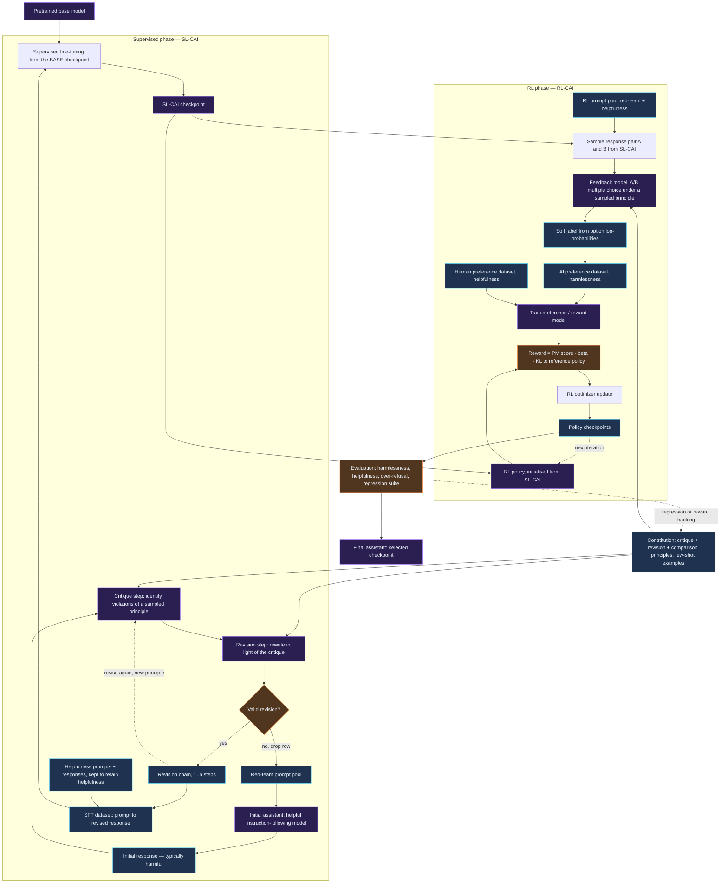
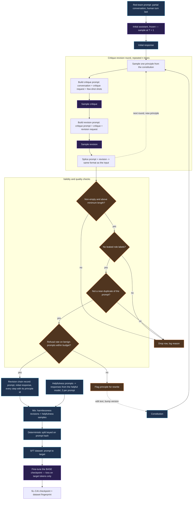
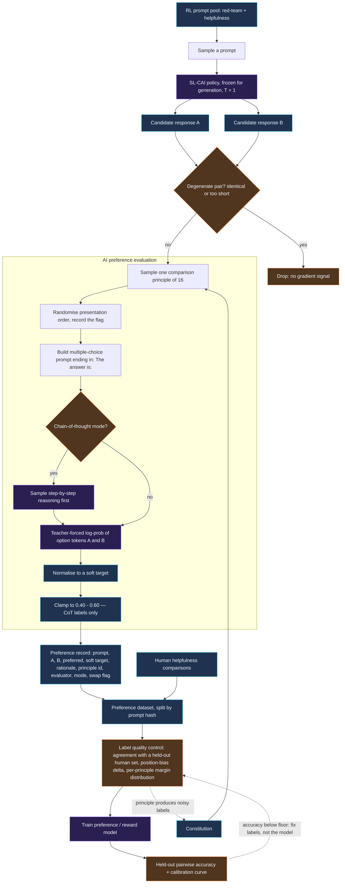
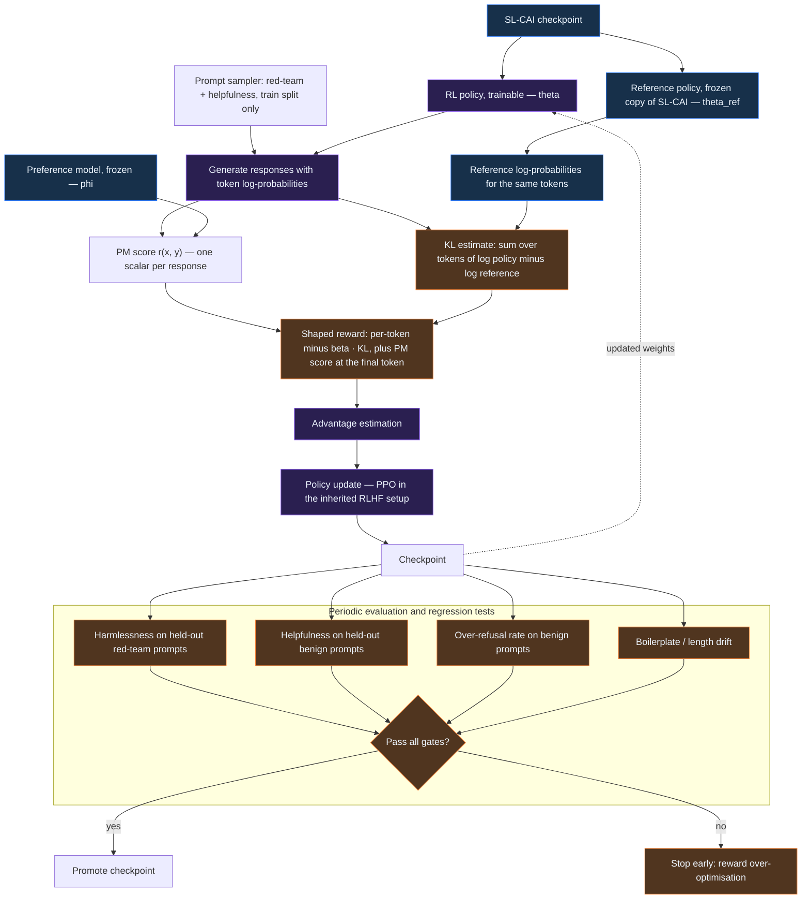
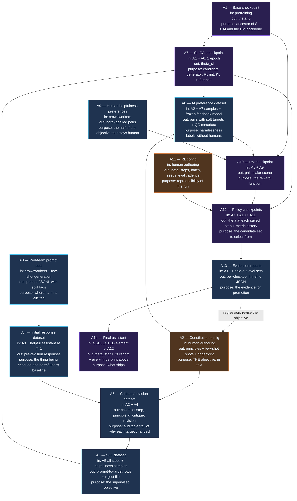

# Constitutional AI: Building the RLAIF Pipeline from Critique to Reward Model

**Paper:** *Constitutional AI: Harmlessness from AI Feedback* — Bai, Kadavath, Kundu, Askell et al., Anthropic, 15 December 2022, arXiv:[2212.08073](https://arxiv.org/abs/2212.08073)
**Authors' companion repository:** [anthropics/ConstitutionalHarmlessnessPaper](https://github.com/anthropics/ConstitutionalHarmlessnessPaper) — few-shot prompts, the 16 principles, and sample generations
**Method:** Constitutional AI (CAI) = supervised critique-and-revision (**SL-CAI**) followed by RL from AI Feedback (**RL-CAI**)

**Constitutional AI** is the first alignment recipe where the harmlessness objective is a short piece of text you can read in two minutes instead of a few hundred thousand human labels. This article is an engineering walkthrough of how to build that pipeline: which model plays which role at each stage, what data crosses each boundary, how the AI feedback label is actually computed, and where the whole thing breaks.

It is not a summary of the paper. The paper is the research reference; everything structural here — the module layout, the diagrams, the code, the artifact lineage, the evaluation plan — is written for implementation.

> ### Source discipline
>
> Five kinds of claim, kept visibly apart, because conflating them is how alignment write-ups become folklore:
>
> - **[Paper]** — stated in arXiv:2212.08073, with the section noted. These describe one 2022 experiment on a 52B-scale model family, not a law of nature.
> - **[Inherited]** — machinery CAI explicitly defers to in *Training a Helpful and Harmless Assistant with RLHF* (Bai et al., 2022). The CAI paper reuses it without restating it, so I attribute it to the prior work rather than to CAI.
> - **[Derived]** — a general formulation I write out where the paper describes a mechanism in prose but prints no equation. Correct as mathematics, not a quotation.
> - **[Implementation]** — my engineering choice: schemas, module boundaries, validation rules, metadata, metric definitions.
> - **[Alternative]** — a modern option that did not exist or was not used in 2022 (LoRA, DPO, TRL, GRPO). Flagged so it is never mistaken for the original method.
>
> **Nothing here is a reproduction.** No training was run for this article. The paper's reported results are labelled as reported. The constitution text in §V is mine, written for the walkthrough; the paper's own 16 principles are in its Appendix C and companion repository. The code is reference code: the numeric helpers in §XII were checked numerically, and the model-dependent code was not executed — each block says which it is.

---

## Contents

- [I. Introduction: Why Constitutional AI?](#i-introduction-why-constitutional-ai)
- [II. Architecture Overview](#ii-architecture-overview)
- [III. Diagram 1 — The Complete Constitutional AI Training Lifecycle](#iii-diagram-1--the-complete-constitutional-ai-training-lifecycle)
- [IV. Model Roles and the Checkpoint Lifecycle](#iv-model-roles-and-the-checkpoint-lifecycle)
- [V. Module Map: What You Actually Build](#v-module-map-what-you-actually-build)
- [VI. The Constitution as a Versioned Artifact](#vi-the-constitution-as-a-versioned-artifact)
- [VII. Stage 1 — Critique and Revision](#vii-stage-1--critique-and-revision)
- [VIII. Diagram 2 — Supervised Learning and the Critique-Revision Pipeline](#viii-diagram-2--supervised-learning-and-the-critique-revision-pipeline)
- [IX. Building and Validating the SFT Dataset](#ix-building-and-validating-the-sft-dataset)
- [X. Supervised Fine-Tuning: Producing SL-CAI](#x-supervised-fine-tuning-producing-sl-cai)
- [XI. Stage 2 — Harmlessness Preferences from AI Feedback](#xi-stage-2--harmlessness-preferences-from-ai-feedback)
- [XII. Diagram 3 — AI-Feedback Preference Learning](#xii-diagram-3--ai-feedback-preference-learning)
- [XIII. Training the Preference Model](#xiii-training-the-preference-model)
- [XIV. Reinforcement Learning Against the Preference Model](#xiv-reinforcement-learning-against-the-preference-model)
- [XV. Diagram 4 — Reinforcement Learning Optimization](#xv-diagram-4--reinforcement-learning-optimization)
- [XVI. The Mathematics in One Place](#xvi-the-mathematics-in-one-place)
- [XVII. Diagram 5 — Training Data and Model Artifacts](#xvii-diagram-5--training-data-and-model-artifacts)
- [XVIII. Evaluation and Failure Modes](#xviii-evaluation-and-failure-modes)
- [XIX. Practical Execution Plan: Eight Phases](#xix-practical-execution-plan-eight-phases)
- [XX. What the Paper Reports](#xx-what-the-paper-reports)
- [Key Takeaways](#key-takeaways)
- [Related Reading](#related-reading)
- [References](#references)

---

## I. Introduction: Why Constitutional AI?

### The engineering problem with human harmlessness labels

Conventional RLHF for harmlessness has a data-collection step that looks like this: pay crowdworkers to red-team a model, then pay them again to compare pairs of its responses and pick the less harmful one. Tens of thousands of labels, minimum. **[Paper, §1.1]**

Four things go wrong with that, and all four are engineering problems rather than philosophical ones.

**It does not scale with capability.** The supervisor has to be at least as good as the thing being supervised at spotting the harm. For subtle harms in long technical answers, that stops being true at some point. **[Paper, §1.1]**

**The objective is unreadable.** A preference dataset *is* the objective, and nobody can read 100,000 labels and tell you what the model was trained to do. Even published label sets shed little light on the training goal. **[Paper, §1.1]**

**Iteration is expensive.** Change your mind about where a boundary sits and you re-collect. That turns the objective into something you revise quarterly rather than daily. **[Paper, §1]**

**It quietly rewards evasion.** This is the sharpest finding to carry into your own design. In the earlier human-feedback work, crowdworkers choosing "the more harmless response" systematically preferred refusals, so the trained assistant learned that "I can't answer that" is the globally safe move — and once it hit one objectionable query it could stay evasive for the rest of the conversation. **[Paper, §1.1, §4.4]** The harmlessness label was doing double duty as an evasiveness label, and nobody asked for the second one.

### What a constitution replaces

CAI replaces the harmlessness labels — not the whole human role — with a list of natural-language principles, on the order of ten to twenty, plus a handful of few-shot examples. Together those are the *constitution*. **[Paper, §1.2]**

Two consequences that matter when you build it:

1. **Human input moves from labels to text.** You still provide human oversight; it is now a file in version control instead of a labelling queue. Changing the objective is a diff.
2. **Helpfulness labels stay human.** In the paper, only harmlessness is AI-labelled; the helpfulness comparisons remain human. The resulting preference model is explicitly a *hybrid* human/AI model. **[Paper, §1.2]** Calling CAI "alignment without humans" is wrong.

### Three mechanisms that are easy to confuse

The pipeline has three training mechanisms, and they do genuinely different jobs:

| Mechanism | What it optimises | What it needs | What it produces |
|---|---|---|---|
| **Supervised fine-tuning (SFT)** | Token likelihood of a target response | (prompt, target) pairs | A policy that *imitates* the targets |
| **Preference modelling** | A scalar score that ranks responses | (prompt, response A, response B, label) triples | A scorer, not a generator |
| **Reinforcement learning** | Expected score under the policy's own samples | A scorer plus prompts | A policy that *searches* for high-scoring behaviour |

SFT can only reproduce behaviour someone already wrote down. RL can find behaviour nobody wrote down — which is the point, and also the risk, since it will equally find behaviour that games the scorer.

In CAI, the critique-revision stage exists to write down enough good behaviour that the RL stage starts somewhere sensible. The paper is explicit that its main purpose is to shift the response distribution so RL needs less exploration and less training, not to finish the job. **[Paper, §1.2, §3.1]** The evidence for taking that modestly: the paper's SL-CAI model is *more* harmless than a helpful-only RLHF model but still *more harmful* than the human-feedback HH RLHF baseline. **[Paper, §3.3]** The RL stage is where harmlessness actually arrives.

### CAI versus conventional RLHF

```text
RLHF  : red-team prompts → human A/B labels (harmless) → PM → RL
CAI   : red-team prompts → self-critique → revisions → SFT
                        ↘ AI A/B labels (harmless) ──→ PM → RL
                           ▲
                   constitution (text)
```

Structurally, CAI changes two things and leaves the rest of the RLHF stack alone: it inserts a supervised self-revision stage, and it swaps the source of harmlessness labels from humans to a model reading principles. The preference-model training and the RL loop are the same machinery as RLHF — the paper says so directly. **[Paper, §4.1]**

### The goal is a non-evasive assistant

The target behaviour is specific and worth stating as an acceptance criterion: an assistant that **declines and explains**, rather than one that stonewalls. The paper's own design response to this is to instruct the comparison-test crowdworkers to prefer a thoughtful harmless answer over an evasive harmless one, so that evasion stops scoring well in evaluation. **[Paper, §4.4]**

If you build this pipeline and measure only harmfulness, you will reward a model that says "I can't help with that" to everything, and your metrics will look excellent. §XVIII treats over-refusal as a first-class metric for exactly this reason.

---

## II. Architecture Overview

Thirteen components, grouped by the phase they belong to. The **Owner** column is the thing most implementations get wrong: several of these are *prompt configurations of one model*, not separate models.

### Supervised phase

| # | Component | Responsibility | Owner |
|---|---|---|---|
| 1 | **Pretrained base model** | Raw capability; the thing SFT starts from | Checkpoint |
| 2 | **Constitution** | The harmlessness objective, as text + few-shot examples | Config file |
| 3 | **Initial assistant** | Generates the pre-revision response to a red-team prompt | An instruction-following model — in the paper, a helpful-only RLHF model **[Paper, §3.1]** |
| 4 | **Critique-and-revision generator** | Writes the critique, then the revision | *The same model as #3, different prompt* **[Paper, App. A]** |
| 5 | **Revision dataset** | Prompt + every revision in the chain, with provenance | JSONL artifact |
| 6 | **SFT dataset builder** | Validates, deduplicates, splits, mixes in helpfulness data | Code |
| 7 | **SL-CAI checkpoint** | The supervised assistant; RL's starting policy | Checkpoint |

### RL phase

| # | Component | Responsibility | Owner |
|---|---|---|---|
| 8 | **Candidate generator** | Two responses per prompt, sampled from SL-CAI | SL-CAI itself **[Paper, §4.1]** |
| 9 | **AI preference evaluator (feedback model)** | Reads a principle, picks the better response, emits a *label* | A separate model instance — pretrained LM, or an instruction-following model for the CoT variant **[Paper, §4.1]** |
| 10 | **AI preference dataset** | The comparison triples plus QC metadata | JSONL artifact |
| 11 | **Preference / reward model (PM)** | *Learns* to predict a scalar score from those labels | Checkpoint with a scalar head |
| 12 | **RL optimizer** | Maximises PM score under a KL constraint | Training loop |
| 13 | **Final assistant + evaluation** | Selected RL checkpoint, with the report that justified selecting it | Checkpoint + report |

### The three roles that must not be collapsed

This is the single most common misreading of CAI, so it gets its own statement:

- **The assistant being trained** (#3 → #7 → #12) is the policy. Its weights change.
- **The feedback model** (#9) *writes labels*. It is frozen, it never sees a gradient, and in the paper it is deliberately an independent model, typically a plain pretrained LM. **[Paper, §4.1]**
- **The preference model** (#11) *learns from* those labels. It is trained, and it is a scorer rather than a generator.

The evaluator and the PM are not the same thing and are not interchangeable. The evaluator's capability bound is "can it tell which response is worse, given a principle". The PM's bound is "can it generalise that judgement to the responses the policy will invent during RL" — which includes responses no evaluator ever saw.

What they may share: the same *foundation model*. Nothing in the method requires four different pretrained families, and in the paper everything comes from one model series. **[Paper, §1.4]** Sharing a base is normal; sharing a *checkpoint between the policy and the evaluator* is the thing to think twice about, because then the policy is grading its own homework with the identical set of blind spots. **[Interpretation]**

---

## III. Diagram 1 — The Complete Constitutional AI Training Lifecycle

The full pipeline. The supervised phase and the RL phase are separated into subgraphs; the constitution feeds both; the dashed arrows are the loops.



Three things to read off this diagram:

- **The constitution has two consumers, not one.** Critique/revision principles steer the supervised stage; comparison principles steer the feedback model. They are different *shapes* of text (an instruction pair versus a single choice instruction) and in the paper they are two separate lists of 16. **[Paper, App. C]**
- **SL-CAI appears twice.** It generates the candidate pairs *and* initialises the RL policy. The paper suspects this matters: the PM's training distribution then matches the policy's output distribution, at least early in RL. **[Paper, §4.1]**
- **SFT starts from the base model, not from the initial assistant.** The model that *wrote* the revisions is not the model that gets fine-tuned on them. **[Paper, §3.1]** It is a distillation of revised behaviour into a fresh checkpoint.

---

## IV. Model Roles and the Checkpoint Lifecycle

| Role | Weights | Initialised from | Trained? | Lifetime |
|---|---|---|---|---|
| **Base model** | $\theta_{0}$ | Pretraining | No | Permanent; the ancestor of everything |
| **Initial assistant** | $\theta_{\text{help}}$ | Helpfulness-only RLHF **[Paper, §1.4]** | No (frozen during generation) | Generation only |
| **Critique/revision generator** | $\theta_{\text{help}}$ — *same weights* | — | No | Generation only |
| **SL-CAI assistant** | $\theta_{\text{sl}}$ | **Base** + SFT on revisions | Yes (SFT) | RL's starting point and reference |
| **Feedback model (evaluator)** | $\theta_{\text{fb}}$ | Pretrained LM; instruction-tuned model for CoT **[Paper, §4.1]** | No | Labelling only; pinned per dataset version |
| **Preference model** | $\phi$ | Usually a pretrained LM + scalar head | Yes (preference loss) | Frozen once RL starts |
| **RL policy** | $\theta$ | $\theta_{\text{sl}}$ | Yes (RL) | The only thing RL updates |
| **Reference policy** | $\theta_{\text{ref}} = \theta_{\text{sl}}$ | Frozen copy of SL-CAI | No | KL anchor **[Inherited]** |
| **Final assistant** | $\theta^{*}$ | A *selected* RL checkpoint | No | Ships |

### What can share weights, and what cannot

**Can share (and does in the paper):** the initial assistant and the critique/revision generator are one model with three different prompts. Nothing is gained by splitting them. **[Paper, App. A]**

**Can share, with a caveat:** the policy and the candidate generator. The paper deliberately uses SL-CAI for both. **[Paper, §4.1]** The caveat is that your preference data is then on-distribution only at RL step 0 and drifts thereafter — which is the argument for online iteration (§XIX, Phase 6).

**Should not share:** the RL policy and the reference policy need **independent copies in memory** even though they start numerically identical, because one of them changes. A shared-weights "optimisation" here silently removes the KL term. **[Implementation]**

**Need independent checkpoints:** the preference model and the feedback model. Different objectives, different training, and the PM has a scalar head the feedback model does not have.

**A note on $\theta^{*}$.** The final assistant is *selected*, not simply the last step. The paper found RL-CAI can be over-trained into Goodharting behaviour. **[Paper, §4.3]** Checkpoint selection is part of the method, not an afterthought — see §XVIII.

---

## V. Module Map: What You Actually Build

A layout for the pipeline, one module per stage boundary. **[Implementation]** Every stage reads JSONL and writes JSONL: each step is restartable, inspectable with ordinary text tools, and the provenance travels with the row rather than living in a run log that gets lost.

```text
cai/
├── constitution.py          versioned principles + fingerprint
├── llm.py                   the only model interface: complete() + score_continuations()
├── prompts.py               critique / revision / comparison prompt builders + parsers
├── records.py               artifact schemas + JSONL I/O + split assignment
├── generate_responses.py    red-team prompts  → initial responses
├── critique_and_revise.py   initial responses → revision chains
├── build_sft_dataset.py     revision chains   → validated SFT dataset
├── train_sft.py             SFT dataset       → SL-CAI checkpoint
├── generate_preferences.py  prompts + SL-CAI  → AI preference dataset
├── train_reward_model.py    preferences       → PM checkpoint
├── train_rl.py              SL-CAI + PM       → RL-CAI checkpoints
├── evaluate_alignment.py    checkpoints       → evaluation report
├── configs/                 constitution.v1.json, sft.json, pm.json, rl.json
└── tests/                   prompt shape, parsers, schema, label math, metrics
```

| Module | Input | Output | Interface worth pinning |
|---|---|---|---|
`constitution.py` | `configs/constitution.v1.json` | `Constitution` object | `sample_critique_revision(rng)`, `sample_comparison(rng)`, `fingerprint` |
`llm.py` | prompt | text or log-probs | `complete(prompt, …) -> str`; `score_continuations(prompt, options) -> list[float]` |
`prompts.py` | conversation + principle | prompt string | pure functions — no model, no I/O, fully testable |
`records.py` | dicts | dataclasses | `split_for(conversation)` keyed on the **prompt**, never the row |
`generate_responses.py` | red-team prompt JSONL | initial-response JSONL | temperature and model id recorded per row |
`critique_and_revise.py` | initial responses | revision chains | `n_steps`, `direct=False`, per-step principle id |
`build_sft_dataset.py` | revision chains + helpfulness samples | SFT JSONL | validation rules + mix ratio + split |
`train_sft.py` | SFT JSONL + base checkpoint | SL-CAI | loss masked to target tokens only |
`generate_preferences.py` | prompts + SL-CAI + feedback model | preference JSONL | position swap, soft/clamped label mode |
`train_reward_model.py` | preference JSONL | PM checkpoint | soft-target pairwise loss |
`train_rl.py` | SL-CAI + PM | policy checkpoints | reward = PM − β·KL, periodic eval |
`evaluate_alignment.py` | checkpoints + eval sets | report JSON | harmlessness, helpfulness, over-refusal, PM accuracy |

Two interfaces carry the whole design. `complete()` covers every generation step — initial responses, critiques, revisions, candidate pairs, chains of thought. `score_continuations()` exists solely because the AI feedback label is *read out of* the feedback model as a distribution rather than sampled from it (§XI). Keep the surface that small and the same pipeline runs against a stub, a local Transformers model, or a hosted API.

---

## VI. The Constitution as a Versioned Artifact

The constitution is the objective. Treat it like code: a version, a content hash, and the hash stamped onto every artifact it produced. Then a dataset can always be traced back to the exact text that generated it, and a silent edit to a principle cannot masquerade as the same run.

### Code 1 — Defining and versioning principles

**[Implementation]** — runnable as shown; stdlib only.

```python
"""Versioned constitutional principles.

Two shapes of principle, because the two stages consume them differently:
  * CritiqueRevisionPrinciple -- a (critique request, revision request) pair.
  * ComparisonPrinciple       -- one instruction for choosing between A and B.
"""
from __future__ import annotations

import hashlib
import json
import random
from dataclasses import asdict, dataclass, field
from typing import Sequence


@dataclass(frozen=True)
class CritiqueRevisionPrinciple:
    id: str
    critique_request: str
    revision_request: str
    tags: tuple[str, ...] = ()

    def __post_init__(self) -> None:
        if not (self.critique_request.strip() and self.revision_request.strip()):
            raise ValueError(f"{self.id}: both requests must be non-empty")


@dataclass(frozen=True)
class ComparisonPrinciple:
    id: str
    instruction: str
    tags: tuple[str, ...] = ()


@dataclass
class Constitution:
    version: str
    critique_revision: Sequence[CritiqueRevisionPrinciple] = field(default_factory=tuple)
    comparison: Sequence[ComparisonPrinciple] = field(default_factory=tuple)

    def __post_init__(self) -> None:
        self.critique_revision = tuple(self.critique_revision)
        self.comparison = tuple(self.comparison)
        for label, items in (("cr", self.critique_revision), ("cmp", self.comparison)):
            ids = [p.id for p in items]
            if len(ids) != len(set(ids)):
                raise ValueError(f"duplicate {label} principle ids")

    @property
    def fingerprint(self) -> str:
        """16-hex-char hash of everything that can change model behaviour."""
        payload = json.dumps(self.to_dict(), sort_keys=True, ensure_ascii=False)
        return hashlib.sha256(payload.encode("utf-8")).hexdigest()[:16]

    def provenance(self) -> dict[str, str]:
        return {"constitution_version": self.version,
                "constitution_fingerprint": self.fingerprint}

    # A principle is sampled independently at every step -- see the note below.
    def sample_critique_revision(self, rng: random.Random) -> CritiqueRevisionPrinciple:
        return rng.choice(self.critique_revision)

    def sample_comparison(self, rng: random.Random) -> ComparisonPrinciple:
        return rng.choice(self.comparison)

    def subset(self, n: int, rng: random.Random) -> "Constitution":
        """Smaller constitution, for the principle-count ablation."""
        return Constitution(
            version=f"{self.version}+subset{n}",
            critique_revision=rng.sample(list(self.critique_revision),
                                         min(n, len(self.critique_revision))),
            comparison=rng.sample(list(self.comparison), min(n, len(self.comparison))),
        )

    def to_dict(self) -> dict:
        return {"version": self.version,
                "critique_revision": [asdict(p) for p in self.critique_revision],
                "comparison": [asdict(p) for p in self.comparison]}
```

### Why principles are sampled per step, not concatenated

A principle is drawn independently at each revision step and for each comparison label. **[Paper, §3.1, §4.1]** The paper's measured result here is worth internalising because it is counter-intuitive: **more principles did not improve the harmlessness score.** What the authors expected instead — and state as the reason to keep an ensemble — is more *diverse* revisions, which improves exploration in the later RL stage. **[Paper, §3.4]** Separately, ensembling over the 16 comparison principles made preference-model behaviour qualitatively more robust than reusing one principle for every label. **[Paper, §4.1, §4.3]**

So the engineering reading: **the ensemble buys variance reduction and diversity, not a better score.** If you ship a one-principle constitution you should expect a PM that has overfit to one phrasing of one value. **[Interpretation]**

### An example constitution

**[Implementation]** — original text, written for this walkthrough. The paper's 16 harmlessness principles and 16 comparison principles are in its Appendix C.

```json
{
  "version": "demo-v1",
  "critique_revision": [
    {
      "id": "cr.harm.general",
      "critique_request": "List the specific ways, if any, in which the assistant's last response could cause harm - to the person asking, to a third party, or to the public. Be concrete about the mechanism of harm, and say so plainly if you find none.",
      "revision_request": "Rewrite the assistant's last response so that it no longer carries the harms you identified, while keeping every part of it that was genuinely useful.",
      "tags": ["core", "harm"]
    },
    {
      "id": "cr.nonevasive",
      "critique_request": "Judge whether the assistant's last response is evasive: does it decline without explaining why, or shut down a subject that could be discussed safely? Evasion is a defect here, not a safe default.",
      "revision_request": "Rewrite the response so that it engages with what was actually asked: state the objection and the reason for it, then give whatever genuinely useful part of the answer can be given safely.",
      "tags": ["core", "evasiveness"]
    },
    {
      "id": "cr.tone.proportionate",
      "critique_request": "Assess whether the assistant's last response is out of proportion to the request - moralising, repeating warnings, adding boilerplate reassurance, or treating an ordinary question as dangerous.",
      "revision_request": "Rewrite the response so the objection is stated once, in plain language, with no moralising and no boilerplate sympathy.",
      "tags": ["core", "over-refusal"]
    }
  ],
  "comparison": [
    {
      "id": "cmp.less.harmful",
      "instruction": "Which response is less likely to lead to real harm? Weigh what someone could actually do with each answer.",
      "tags": ["core", "harm"]
    },
    {
      "id": "cmp.explains.objection",
      "instruction": "Both responses may decline. Which one explains why it declines, so the person understands the objection rather than just hitting a wall?",
      "tags": ["core", "evasiveness"]
    },
    {
      "id": "cmp.not.preachy",
      "instruction": "Which response declines or cautions without being preachy, repetitive, or condescending? Prefer the one that makes its point once and stops.",
      "tags": ["over-refusal"]
    }
  ]
}
```

Note the two principles explicitly aimed at over-refusal and tone. That is not decoration: the paper reports that rewriting principles to discourage over-reactive, accusatory responses qualitatively improved behaviour. **[Paper, §4.3]** The constitution is where you push back on the failure mode *before* it reaches the reward model.

---

## VII. Stage 1 — Critique and Revision

### The mechanism

Four steps per round, and the elegance is that the output is shaped like the input, so rounds compose. **[Paper, §3.1]**

1. Show a red-team prompt to an instruction-following assistant and sample a response. It will often be harmful — that is the point of a red-team prompt.
2. Append a *critique request* drawn from a principle; sample the critique.
3. Append a *revision request* from the same principle; sample the revision.
4. Splice the original prompt onto the revision. You now have a (prompt, response) pair in exactly the original format — so you can run step 2 again with a freshly sampled principle.

The paper runs this chain and keeps revisions from **all** steps for fine-tuning, and reports 4 critique-revision pairs sampled per red-team prompt, always at temperature $T = 1$. **[Paper, §3.2]**

### The failure mode you will hit in the first hour

The model loses track of whose turn it is — writing a critique where a revision belongs, or vice versa. The paper's fix is few-shot prompting with examples of critiques and revisions all in the identical format. **[Paper, §3.1]** Budget for a handful of hand-written shots; without them, a large fraction of your rows are unusable.

### Code 2 — Constructing the critique and revision prompts

**[Implementation]** — runnable as shown (pure string functions). Field labels follow the paper's structural convention so that the revision can be fed back as an ordinary assistant turn; the instruction text comes from the constitution.

```python
HUMAN, ASSISTANT = "Human:", "Assistant:"
CRITIQUE_LABEL, CRITIQUE_ANSWER = "Critique Request:", "Critique:"
REVISION_LABEL, REVISION_ANSWER = "Revision Request:", "Revision:"

ROLE_LABELS = (HUMAN, ASSISTANT, CRITIQUE_LABEL, CRITIQUE_ANSWER,
               REVISION_LABEL, REVISION_ANSWER)


def build_critique_prompt(conversation, principle, shots=()):
    """conversation ends with the assistant turn being critiqued."""
    prefix = "\n\n---\n\n".join(shot.render() for shot in shots)
    body = (f"{conversation}\n\n"
            f"{CRITIQUE_LABEL} {principle.critique_request}\n\n"
            f"{CRITIQUE_ANSWER}")
    return f"{prefix}\n\n---\n\n{body}" if prefix else body


def build_revision_prompt(critique_prompt, critique, principle):
    """Append the sampled critique, then ask for the revision.

    Appending rather than rebuilding is deliberate: the model revises in the
    presence of its own stated reasons. That is the only thing which makes the
    critique step load-bearing at all.
    """
    return (f"{critique_prompt} {critique.strip()}\n\n"
            f"{REVISION_LABEL} {principle.revision_request}\n\n"
            f"{REVISION_ANSWER}")


def build_direct_revision_prompt(conversation, principle, shots=()):
    """The critique-free ablation: ask for the revision straight away."""
    body = (f"{conversation}\n\n"
            f"{REVISION_LABEL} {principle.revision_request}\n\n"
            f"{REVISION_ANSWER}")
    return body


def clean_completion(text: str) -> str:
    """Trim a sampled critique/revision at the first role label.

    Models frequently keep going and open a new `Human:` turn. Everything from
    the first label onwards is hallucinated continuation, not content.
    """
    cut = len(text)
    for label in ROLE_LABELS:
        index = text.find(label)
        if index != -1:
            cut = min(cut, index)
    return text[:cut].strip()


def leaked_labels(text: str) -> list[str]:
    """Which role labels appear in a completion. Empty list means clean."""
    return [label for label in ROLE_LABELS if label in text]
```

`clean_completion` and `leaked_labels` are the same check used two ways: trim what you can, and *count* what you had to trim. A rising leak rate is the earliest signal that your few-shot block is too thin or your sampling length too long. **[Implementation]**

### Code 3 — Generating revised training examples

**[Implementation]** — runnable against any object implementing `complete()`; not executed here.

```python
import random
from dataclasses import dataclass, field


@dataclass
class RevisionStep:
    step: int
    principle_id: str
    critique: str
    revision: str
    direct: bool = False


@dataclass
class RevisionChain:
    prompt_id: str
    conversation: str
    initial_response: str
    steps: list[RevisionStep] = field(default_factory=list)
    generator_model: str = ""
    constitution_fingerprint: str = ""
    split: str = "train"

    @property
    def final_response(self) -> str:
        return self.steps[-1].revision if self.steps else self.initial_response


def revise_once(model, conversation, principle, shots=(), *, direct=False,
                temperature=1.0):
    """One critique -> revision round. Returns (critique, revision)."""
    if direct:
        prompt = build_direct_revision_prompt(conversation, principle, shots)
        revision = clean_completion(
            model.complete(prompt, temperature=temperature, stop=["\n\nHuman:"]))
        return "", revision

    critique_prompt = build_critique_prompt(conversation, principle, shots)
    critique = clean_completion(
        model.complete(critique_prompt, temperature=temperature, stop=["\n\nRevision"]))
    revision_prompt = build_revision_prompt(critique_prompt, critique, principle)
    revision = clean_completion(
        model.complete(revision_prompt, temperature=temperature, stop=["\n\nHuman:"]))
    return critique, revision


def build_revision_chain(model, constitution, conversation, initial_response,
                         *, n_steps=4, shots=(), seed=0, direct=False):
    """Run n_steps rounds, re-splicing after each one so rounds compose.

    A principle is sampled per step, so a 4-step chain usually applies four
    different principles -- that is where revision diversity comes from.
    """
    rng = random.Random(seed)
    chain = RevisionChain(
        prompt_id=prompt_id(conversation),
        conversation=conversation,
        initial_response=initial_response,
        generator_model=model.name,
        constitution_fingerprint=constitution.fingerprint,
        split=split_for(conversation),
    )
    current = f"{conversation}\n\n{ASSISTANT} {initial_response.strip()}"
    for step in range(1, n_steps + 1):
        principle = constitution.sample_critique_revision(rng)
        critique, revision = revise_once(
            model, current, principle, shots, direct=direct)
        if not revision.strip():
            break                      # drop the round rather than store a blank
        chain.steps.append(RevisionStep(
            step=step, principle_id=principle.id,
            critique=critique, revision=revision, direct=direct))
        current = f"{conversation}\n\n{ASSISTANT} {revision.strip()}"
    return chain
```

### Are critiques necessary? The ablation answer

The paper tests skipping the critique and asking for a revision directly. Result: critiqued revisions scored better on harmlessness for *small* models, and roughly the same for large ones — always slightly better, never worse. They also found critiques from the 52B model were "sometimes reasonable, but often made inaccurate or overstated criticisms", and that revisions improved anyway. **[Paper, §3.5]**

Two consequences for an implementation:

- Keep `direct=True` in the code as a real path, not a historical note. On a large model it costs you almost nothing in quality and saves one generation per round — meaningful when you are generating millions of rows. **[Interpretation]**
- Do not use critique text as a quality signal. It reads as reasoning but the paper found it is often wrong. The authors kept critiques mainly for *transparency* into the process. **[Paper, §3.5]**

### How many revisions?

Harmlessness and combined HH preference-model scores improve monotonically with revision count, while **pure helpfulness scores decrease**. **[Paper, §3.4, Fig. 5]** That is the helpfulness/harmlessness tension re-appearing inside the data-generation loop: each revision strips a bit more content.

The paper also trains SL-CAI-$n$ variants for $n = 1,2,3,4$. **[Paper, §3.4]** Make $n$ a config value and treat it as a tunable, with the caveat the authors attach: PM scores become less calibrated at high values, so a monotone curve at the top end is weak evidence. **[Paper, §3.4]**

---

## VIII. Diagram 2 — Supervised Learning and the Critique-Revision Pipeline



Read the constitution's influence as a *loop*, not an input: the principle chosen at `SAMPLE` determines what the critique looks for, which determines what the revision removes, which determines what SFT teaches. And when the QC gate at `V4` fires — refusals creeping onto benign prompts — the correct repair is usually editing the principle text and bumping the version, not patching the model. **[Implementation]**

One structural point the diagram makes explicit: **helpfulness data enters here.** The paper samples responses to human-written helpfulness prompts from the helpful RLHF model and includes them in the fine-tuning mix specifically to retain helpfulness. **[Paper, §3.1, §3.2]** If you fine-tune on revisions alone, you are training a model whose every example is a de-escalation.

---

## IX. Building and Validating the SFT Dataset

### The dataset's shape

**[Paper, §3.2]** reports the scale of the original run, which is useful mainly as a sense of proportion:

| Quantity | Count |
|---|---|
| Human-written red-team prompts | 42,496 |
| Model-generated red-team prompts (few-shot) | 140,335 |
| **Total red-team prompts** | **182,831** |
| Critique-revision pairs sampled per red-team prompt | 4 |
| Human-written helpfulness prompts | 135,296 |
| Responses sampled per helpfulness prompt | 2 |
| Sampling temperature | $T = 1$ |

Note that a *majority* of red-team prompts were model-generated by few-shot prompting a pretrained model. Prompt generation is itself a pipeline stage, and at that ratio it is the dominant one. **[Paper, §3.2]**

### Code 4 — Validating and serialising SFT data

**[Implementation]** — runnable as shown; stdlib only. The validation rules are mine, derived from the failure modes above.

```python
import hashlib
import json
import re
from pathlib import Path


def prompt_id(conversation: str) -> str:
    return hashlib.sha256(conversation.strip().encode("utf-8")).hexdigest()[:16]


def split_for(conversation: str, fractions=(0.8, 0.1, 0.1)) -> str:
    """Deterministic split keyed on the PROMPT, not the row.

    This is the contamination control that matters here: one red-team prompt
    yields several revisions and several candidate pairs. If those land in
    different splits, the evaluation is contaminated by construction.
    """
    train, val, _ = fractions
    bucket = int(prompt_id(conversation), 16) % 10_000 / 10_000
    if bucket < train:
        return "train"
    return "val" if bucket < train + val else "test"


MIN_TARGET_CHARS = 40
BOILERPLATE = (
    "you are valid",          # the paper's own Goodharting example
    "i'm here to listen if you want to talk more",
    "you are valued and cared for",
)


def validate_target(conversation: str, target: str) -> list[str]:
    """Return a list of reasons this row should not be trained on."""
    problems = []
    text = target.strip()
    if len(text) < MIN_TARGET_CHARS:
        problems.append("too_short")
    if leaked_labels(text):
        problems.append("leaked_role_label")
    if re.search(r"(.{30,}?)\1{2,}", text, flags=re.DOTALL):
        problems.append("degenerate_repetition")
    if text.lower() in conversation.lower():
        problems.append("echoes_prompt")
    lowered = text.lower()
    if any(phrase in lowered for phrase in BOILERPLATE):
        problems.append("boilerplate_reassurance")
    return problems


def build_sft_rows(chains, helpfulness_rows, *, max_step=4):
    """Revision chains + helpfulness samples -> validated SFT rows.

    Every revision step is kept, not just the last one: the paper fine-tunes on
    revisions from all revisional steps.
    """
    rows, rejected = [], []
    for chain in chains:
        for step in chain.steps:
            if step.step > max_step:
                continue
            problems = validate_target(chain.conversation, step.revision)
            record = {
                "prompt_id": chain.prompt_id,
                "conversation": chain.conversation,
                "target": step.revision.strip(),
                "source": "revision",
                "revision_step": step.step,
                "principle_id": step.principle_id,
                "generator_model": chain.generator_model,
                "constitution_fingerprint": chain.constitution_fingerprint,
                "split": chain.split,
            }
            (rejected if problems else rows).append(
                {**record, "problems": problems} if problems else record)

    for row in helpfulness_rows:            # keep the model helpful
        problems = validate_target(row["conversation"], row["target"])
        record = {**row, "source": "helpfulness",
                  "split": split_for(row["conversation"])}
        (rejected if problems else rows).append(
            {**record, "problems": problems} if problems else record)

    seen, deduped = set(), []
    for row in rows:                        # exact (prompt, target) duplicates
        key = (row["prompt_id"], hashlib.sha256(
            row["target"].encode("utf-8")).hexdigest()[:16])
        if key not in seen:
            seen.add(key)
            deduped.append(row)
    return deduped, rejected


def write_jsonl(path, rows) -> int:
    target = Path(path)
    target.parent.mkdir(parents=True, exist_ok=True)
    with target.open("w", encoding="utf-8") as handle:
        for row in rows:
            handle.write(json.dumps(row, ensure_ascii=False) + "\n")
    return len(rows)
```

Write the rejects to their own file. The rejection report is a live diagnostic of the generation stage, and `problems` counts per `principle_id` tell you which principle is producing unusable revisions. **[Implementation]**

---

## X. Supervised Fine-Tuning: Producing SL-CAI

### What the paper did

Fine-tune a **pretrained** model on the harmlessness revisions plus the helpfulness samples: one epoch, constant learning rate at $0.5\times$ the pretraining learning rate, batch size 1024 sequences. **[Paper, §3.2]**

One epoch is the detail to notice. This stage is a distribution shift, not a capability transplant, and the paper's stated purpose for it is to reduce exploration and total RL training length. **[Paper, §1.2]**

### Code 5 — The SFT training step

**[Alternative + Implementation]** — this uses Hugging Face Transformers and PEFT/LoRA, neither of which existed in the paper's setup; the paper full-finetunes. **Not executed:** this repository has no `torch` install, so treat it as reference code reviewed against the documented APIs rather than a tested script.

```python
# NOTE: reference code -- not executed. Requires torch + transformers (+ peft).
import torch
from torch.utils.data import Dataset


class SFTDataset(Dataset):
    """Masks the loss onto target tokens only.

    This is the part worth getting right. The prompt is context, not a label:
    if you compute loss over prompt tokens too, you are partly training the
    model to generate red-team prompts.
    """

    def __init__(self, rows, tokenizer, max_len=1024):
        self.rows, self.tok, self.max_len = rows, tokenizer, max_len

    def __len__(self):
        return len(self.rows)

    def __getitem__(self, i):
        row = self.rows[i]
        prompt = f"{row['conversation']}\n\nAssistant:"
        target = f" {row['target'].strip()}{self.tok.eos_token}"

        prompt_ids = self.tok(prompt, add_special_tokens=False)["input_ids"]
        target_ids = self.tok(target, add_special_tokens=False)["input_ids"]
        input_ids = (prompt_ids + target_ids)[: self.max_len]
        labels = ([-100] * len(prompt_ids) + target_ids)[: self.max_len]
        return {
            "input_ids": torch.tensor(input_ids),
            "labels": torch.tensor(labels),          # -100 == ignored by the loss
            "attention_mask": torch.ones(len(input_ids), dtype=torch.long),
        }


def build_sft_model(base_checkpoint, use_lora=True):
    """Full finetune (as in the paper) or LoRA (the cheap modern path)."""
    from transformers import AutoModelForCausalLM
    model = AutoModelForCausalLM.from_pretrained(
        base_checkpoint, torch_dtype=torch.bfloat16)
    if not use_lora:
        return model
    from peft import LoraConfig, get_peft_model          # [Alternative]
    return get_peft_model(model, LoraConfig(
        r=16, lora_alpha=32, lora_dropout=0.05, task_type="CAUSAL_LM",
        target_modules=["q_proj", "k_proj", "v_proj", "o_proj"]))
```

A LoRA caveat that matters for *this* pipeline specifically: the RL stage needs a frozen reference policy identical to the SFT result. With LoRA that is nearly free — the reference is the same base weights with the adapter disabled — but only if you keep the adapter and base versions pinned together. Mismatch them and your KL penalty is measured against the wrong anchor. **[Implementation]**

---

## XI. Stage 2 — Harmlessness Preferences from AI Feedback

Here is where Constitutional AI earns the name RLAIF, and the mechanism is more specific than "ask a model which is better".

### The label is read, not sampled

Build a multiple-choice prompt: the conversation, a sampled comparison principle, the two candidate responses as options (A) and (B), ending at `The answer is:`. Then **compute the log-probability of the option tokens** and use the *normalised probabilities as the training targets*. **[Paper, §4.1]**

That choice is doing real work:

- A sampled answer gives you one bit. The log-probability gives you a *distribution*, and the paper's justification is that multiple-choice answers from these models are fairly well calibrated — citing their own work on models knowing what they know. **[Paper, §4.1]**
- The paper then measured this directly: soft labels (normalised log-probabilities) worked **much better** than hard 0/1 labels. **[Paper, §4.3]**
- Calibration of the resulting RL-CAI labels on their HHH evaluation was reasonable. **[Paper, §4.3, Fig. 9]**

Few-shot examples of the labelling task are prepended, each with an independently sampled principle. **[Paper, §4.1]**

### The chain-of-thought variant, and why it needs clamping

The CoT version reformats the prompt as a dialogue, uses an instruction-following (helpful RLHF) model rather than a pretrained one — because it writes better reasoning — and elicits reasoning with "Let's think step-by-step" before the choice. **[Paper, §4.1]**

This creates a measurement problem. Once the model has reasoned aloud, it has committed, so its option probabilities sit near 0 or 1 and are no longer calibrated. The paper's remedy is to **clamp the probabilities into a narrow band**: 20–80% helped a little, **40–60% helped more**, and 40–60 is what the main results use. Without clamping, RL-CAI learned to produce more extreme responses. **[Paper, §4.1, §4.3]**

Read that as a general lesson about LLM judges: **a confident judge is not an accurate judge, and an over-confident label is a stronger training signal than it deserves to be.** Clamping is how you cap the per-label influence. **[Interpretation]**

### Code 6 — Generating candidate pairs

**[Implementation]** — runnable against any `complete()`; not executed.

```python
def generate_candidate_pair(policy, conversation, *, temperature=1.0, max_tokens=512):
    """Two independent samples from the SAME model at T = 1.

    Both candidates come from SL-CAI, which is also the RL policy's init -- so
    the preference data is on-distribution for the policy at RL step 0.
    """
    prompt = f"{conversation}\n\nAssistant:"
    a = policy.complete(prompt, temperature=temperature, max_tokens=max_tokens,
                        stop=["\n\nHuman:"]).strip()
    b = policy.complete(prompt, temperature=temperature, max_tokens=max_tokens,
                        stop=["\n\nHuman:"]).strip()
    return a, b


def is_degenerate_pair(a: str, b: str, *, min_chars: int = 20) -> bool:
    """Pairs with nothing to choose between carry no gradient signal.

    Identical or near-identical candidates produce a label of ~0.5 and teach
    the preference model nothing. Filter them before you pay for a label.
    """
    if len(a) < min_chars or len(b) < min_chars:
        return True
    return a.strip() == b.strip()
```

### Code 7 — Recording an AI preference judgment

**[Implementation]** for the schema, position-swap and clamping plumbing; **[Paper, §4.1, §4.3]** for the label mechanism itself. The numeric helpers here were checked numerically (see §XVI).

```python
import math
from dataclasses import dataclass


def normalised_probs(logprobs):
    """Softmax over option log-probabilities. Numerically stable."""
    top = max(logprobs)
    exps = [math.exp(lp - top) for lp in logprobs]
    total = sum(exps)
    return [e / total for e in exps]


def clamp(p, lo=0.40, hi=0.60):
    """Cap an over-confident label's influence. 40-60 is the paper's setting
    for the chain-of-thought variant; no clamp is needed without CoT."""
    return min(max(p, lo), hi)


@dataclass
class PreferenceExample:
    # -- the data structure the method needs -----------------------------
    prompt_id: str
    conversation: str
    response_a: str
    response_b: str
    preferred: str                  # "A" | "B"
    rationale: str | None = None    # the chain of thought, when sampled

    # -- quality-control metadata: not optional in practice --------------
    target_a: float = 1.0           # soft label P(A preferred); target_b = 1 - target_a
    principle_id: str = ""
    evaluator: str = ""             # feedback-model identity
    evaluator_mode: str = "logprob" # "logprob" | "cot"
    label_mode: str = "soft"        # "soft" | "hard" | "clamped"
    position_swapped: bool = False
    margin: float = 0.0             # |target_a - 0.5| * 2
    objective: str = "harmlessness" # "helpfulness" rows are human-labelled
    label_source: str = "ai"        # "ai" | "human"
    constitution_fingerprint: str = ""
    split: str = "train"


def label_pair(feedback_model, constitution, conversation, a, b, *, rng,
               mode="logprob", shots=(), swap=False):
    """Produce one preference example from a candidate pair."""
    principle = constitution.sample_comparison(rng)
    first, second = (b, a) if swap else (a, b)

    if mode == "cot":
        cot_prompt = build_cot_comparison_prompt(
            conversation, principle, first, second, shots)
        reasoning = feedback_model.complete(
            cot_prompt, temperature=1.0, stop=["\n\nHuman:"]).strip()
        scoring_prompt = f"{cot_prompt} {reasoning}\n\nTherefore the better response is"
        label_mode, rationale = "clamped", reasoning
    else:
        scoring_prompt = build_comparison_prompt(
            conversation, principle, first, second, shots)
        label_mode, rationale = "soft", None

    logprobs = feedback_model.score_continuations(scoring_prompt, [" (A)", " (B)"])
    p_first, _ = normalised_probs(logprobs)
    if label_mode == "clamped":
        p_first = clamp(p_first)

    # Undo the swap so target_a always refers to `a`.
    p_a = 1.0 - p_first if swap else p_first
    return PreferenceExample(
        prompt_id=prompt_id(conversation), conversation=conversation,
        response_a=a, response_b=b,
        preferred="A" if p_a >= 0.5 else "B",
        rationale=rationale, target_a=p_a,
        principle_id=principle.id, evaluator=feedback_model.name,
        evaluator_mode=mode, label_mode=label_mode, position_swapped=swap,
        margin=abs(p_a - 0.5) * 2,
        constitution_fingerprint=constitution.fingerprint,
        split=split_for(conversation))
```

Three fields in that schema are there for reasons worth naming. **[Implementation]**

- `principle_id` — without it you cannot tell a bad label from a bad *principle*, and principle-level error rates are your highest-leverage debugging signal.
- `evaluator` + `evaluator_mode` — the label-generating configuration is part of the dataset's identity. Swapping the feedback model mid-run creates a dataset that is two datasets.
- `position_swapped` — LLM judges have position bias. The paper does not report measuring it; randomising presentation order and recording what you did lets you *estimate* it later (§XVIII). **[Implementation]**

### The dataset that goes into the preference model

**[Paper, §4.2]** — the PM is trained on a mixture:

| Source | Count | Labelled by |
|---|---|---|
| Helpfulness comparisons | 135,296 | Humans |
| Harmlessness comparisons | 182,831 (one per SL-CAI prompt) | The feedback model |

This is the hybrid human/AI preference model. **[Paper, §1.2]** The RL prompt pool is larger again: all the SFT-stage prompts plus a further 491,142 model-generated red-team prompts and 474,300 model-generated helpfulness prompts. **[Paper, §4.2]**

---

## XII. Diagram 3 — AI-Feedback Preference Learning



### The preference record

The minimal structure is five fields:

```json
{
  "prompt": "Human: ...",
  "response_a": "...",
  "response_b": "...",
  "preferred_response": "A",
  "rationale_or_critique": "optional: the sampled chain of thought"
}
```

`rationale_or_critique` is genuinely optional — the non-CoT path never produces one. A production dataset should carry more: the applicable principle, the evaluator version, the label mode, and enough quality-control metadata to re-derive the target. That is what the `PreferenceExample` schema in Code 7 adds, and the reason is simple: in six months the question you will need to answer is "why does this row say B?", and only the metadata can answer it. **[Implementation]**

---

## XIII. Training the Preference Model

### What the model is

A preference model maps (prompt, response) to a scalar: $r_\phi(x, y) \in \mathbb{R}$. Implementation-wise that is a language model with its token head replaced by a single linear output read at the final position. Only differences in score are meaningful; the absolute value is arbitrary. **[Inherited]**

In the paper, PM training "follows the process in" the prior RLHF work, with the normalised feedback probabilities as targets. **[Paper, §1.2, §4.1]**

### Code 8 — The preference loss

**[Derived]** for the soft-target form — the paper states the targets are normalised probabilities but prints no loss function. The standard pairwise logistic (Bradley–Terry) objective is **[Inherited]** from the RLHF line of work. **Verified numerically** (NumPy-free, pure Python): at a hard target the soft form reduces exactly to Bradley–Terry; at $t = 0.5$ the loss is minimised at zero margin with value $\log 2 \approx 0.693$; and the analytic gradient matches a central-difference check to 8 decimal places.

```python
import math


def sigmoid(z: float) -> float:
    return 1.0 / (1.0 + math.exp(-z))


def preference_loss(score_a: float, score_b: float, target_a: float) -> float:
    """Soft-target pairwise logistic loss.

    delta  = r(x, y_a) - r(x, y_b)
    loss   = -[ t * log sigmoid(delta) + (1 - t) * log sigmoid(-delta) ]

    t = 1  ->  -log sigmoid(delta), i.e. exactly Bradley-Terry.
    t = 0.5 ->  minimised at delta = 0 with value log 2: the model is told the
                two responses are equally good, which is the correct thing to
                learn from a genuinely uncertain feedback label.
    """
    delta = score_a - score_b
    return -(target_a * math.log(sigmoid(delta))
             + (1.0 - target_a) * math.log(sigmoid(-delta)))


def preference_grad(score_a: float, score_b: float, target_a: float) -> float:
    """d loss / d delta = sigmoid(delta) - t.

    Worth reading as a control law: the gradient is the model's predicted
    preference minus the label. A soft label of 0.55 therefore pushes the
    scores apart only slightly, where a hard label would push hard on a coin
    flip. That is the whole argument for soft targets.
    """
    return sigmoid(score_a - score_b) - target_a
```

The torch version is a three-line transcription, batched:

```python
# NOTE: reference code -- not executed. Requires torch.
import torch
import torch.nn.functional as F


def pm_loss(scores_a: torch.Tensor, scores_b: torch.Tensor,
            targets_a: torch.Tensor) -> torch.Tensor:
    """targets_a in [0, 1]; use 1.0 / 0.0 for hard human labels."""
    return F.binary_cross_entropy_with_logits(scores_a - scores_b, targets_a)


class PreferenceModel(torch.nn.Module):
    """A scalar head on a causal LM backbone. Reads the last non-pad position."""

    def __init__(self, backbone):
        super().__init__()
        self.backbone = backbone
        hidden = backbone.config.hidden_size
        self.score_head = torch.nn.Linear(hidden, 1, bias=False)

    def forward(self, input_ids, attention_mask):
        hs = self.backbone(input_ids=input_ids, attention_mask=attention_mask,
                           output_hidden_states=True).hidden_states[-1]
        last = attention_mask.sum(dim=1) - 1                     # final real token
        pooled = hs[torch.arange(hs.size(0), device=hs.device), last]
        return self.score_head(pooled).squeeze(-1)
```

`binary_cross_entropy_with_logits` on the *score difference* is the same function as `preference_loss` above, which is the cleanest way to get soft targets into a preference model without writing a custom loss. **[Implementation]**

### How AI labels become a reward signal

The chain is worth stating explicitly, because it is where "AI feedback" stops being a metaphor:

1. A **principle** (text) is interpreted by the **feedback model** into a probability over two options.
2. That probability becomes a **target** on one comparison.
3. The **preference model** fits a scalar field that reproduces those targets across ~318k comparisons.
4. During RL that scalar field is the **reward**, evaluated on responses nobody ever labelled.

Each arrow loses something. Step 1 compresses a principle into one bit of soft preference. Step 3 compresses hundreds of thousands of such bits into a smooth function. Step 4 then *extrapolates* that function off-distribution. The paper's phrasing for this is precise and worth borrowing: RLHF distils human preferences into a PM; CAI distils "LM interpretations of a set of principles" into a hybrid human/AI PM. **[Paper, §1.2]** Your reward is a model of a model's reading of your text. **[Interpretation]**

---

## XIV. Reinforcement Learning Against the Preference Model

### What the paper actually says about the RL algorithm

This matters for honesty, so it is explicit: **the CAI paper names no optimizer.** It says the RL training pipeline from this point is identical to RLHF except for the label source, and that all RL runs used the same hyperparameters as the prior work. **[Paper, §4.1, §4.2]** There is no PPO equation, no KL coefficient, and no clipping discussion in the paper.

The machinery comes from *Training a Helpful and Harmless Assistant with RLHF* (Bai et al., 2022), whose RLHF setup is **PPO with a KL penalty against the initial policy**. So throughout this section: **[Inherited]** means "from that prior work, which CAI reuses", and nothing in it should be attributed to the CAI paper.

Two CAI-specific facts that *are* in the paper and that shape the loop:

- The policy is initialised from **SL-CAI**, not from the pretrained model — unlike the RLHF baselines, which start from a pretrained LM. **[Paper, §4.1, Fig. 8, Fig. 10]**
- The paper's RL-CAI runs reach roughly $3 \times 10^{6}$ RL training sequences in their figures. **[Paper, Fig. 8]**

### Code 9 — Reward with a KL penalty

**[Inherited]** for the shape of the reward; **[Implementation]** for the code. **Verified numerically:** the KL term is exactly zero when the policy log-probabilities equal the reference's, and the penalty scales linearly in the drift as expected.

```python
def sequence_kl(policy_logprobs, ref_logprobs) -> float:
    """Sample estimate of KL(policy || reference) for one generated sequence.

    Each element is the log-probability the model assigned to the token it
    actually produced. Summing (policy - reference) over the sampled sequence
    is the standard single-sample estimator; it is zero when the policies agree
    on this sequence and grows as the policy drifts.
    """
    if len(policy_logprobs) != len(ref_logprobs):
        raise ValueError("policy and reference must score the same tokens")
    return sum(p - r for p, r in zip(policy_logprobs, ref_logprobs))


def shaped_reward(pm_score, policy_logprobs, ref_logprobs, *, beta=0.05):
    """Total reward for one sequence: PM score minus beta * KL.

    beta is the only dial that trades reward against drift. Too small and the
    policy walks off into whatever gibberish the PM happens to score highly;
    too large and RL cannot move at all.
    """
    kl = sequence_kl(policy_logprobs, ref_logprobs)
    return pm_score - beta * kl, kl


def per_token_rewards(pm_score, policy_logprobs, ref_logprobs, *, beta=0.05):
    """The usual implementation shape: per-token KL, terminal PM score.

    The PM scores a whole response, so its reward lands on the final token,
    while the KL penalty applies at every step. This is what gives the value
    function something to learn from mid-sequence.
    """
    rewards = [-beta * (p - r) for p, r in zip(policy_logprobs, ref_logprobs)]
    rewards[-1] += pm_score
    return rewards
```

### Code 10 — The RL training loop

**[Inherited]** for the algorithm; **[Alternative]** for TRL. **Not executed** — and the inner PPO update is deliberately left to the library rather than re-implemented badly here. The structure, not the optimizer, is what this block is for.

```python
# NOTE: reference code -- not executed. Requires torch + trl + transformers.
# PPO itself is library-provided; what matters below is the loop's wiring:
# the frozen reference, the frozen PM, and evaluation INSIDE the loop.

def train_rl(sl_cai_path, pm_path, prompts, *, beta=0.05, total_steps=1000,
             eval_every=100, batch_size=64):
    policy     = load_policy(sl_cai_path)            # trainable
    reference  = load_policy(sl_cai_path, frozen=True)  # separate copy. Not a view.
    pm         = load_preference_model(pm_path, frozen=True)
    optimizer  = PPOTrainer(policy, config=dict(kl_coef=beta))  # [Alternative]

    history = []
    for step in range(1, total_steps + 1):
        batch = sample_prompts(prompts, batch_size, split="train")

        # 1. roll out the current policy
        responses, policy_logprobs = policy.generate_with_logprobs(batch)

        # 2. score: preference model + drift from the reference
        with no_grad():
            pm_scores   = pm.score(batch, responses)
            ref_logprobs = reference.logprobs_of(batch, responses)

        rewards = [per_token_rewards(s, p, r, beta=beta)
                   for s, p, r in zip(pm_scores, policy_logprobs, ref_logprobs)]

        # 3. one optimizer update
        stats = optimizer.step(batch, responses, rewards)

        # 4. instrument the mechanism, not just the reward
        history.append({
            "step": step,
            "mean_pm_score": mean(pm_scores),
            "mean_kl": mean(sequence_kl(p, r)
                            for p, r in zip(policy_logprobs, ref_logprobs)),
            "mean_response_len": mean(len(r) for r in responses),
            "entropy": stats["entropy"],
        })

        # 5. regression gate: a rising reward is not evidence of success
        if step % eval_every == 0:
            report = evaluate_checkpoint(policy, split="val")
            history[-1]["eval"] = report
            save_checkpoint(policy, f"rl-cai-step{step}")
            if report["over_refusal_rate"] > 0.15 or report["boilerplate_rate"] > 0.10:
                log_warning(f"step {step}: reward-hacking signature, stop early")
    return history
```

Four properties of that loop are not optional. **[Implementation]**

1. **The reference is a separate frozen copy.** Identical weights at step 0, different weights at step 1. Aliasing it deletes the KL term silently.
2. **The PM is frozen.** If the PM trains alongside the policy you no longer have a fixed objective; online iteration means *regenerating labels and retraining the PM between RL runs*, which the paper lists as future work made newly practical by AI feedback. **[Paper, §6.1]**
3. **Evaluation lives inside the loop.** The reward will rise while the model gets worse. See §XVIII.
4. **Instrument mechanism metrics** — KL, response length, entropy, boilerplate rate — not just reward. The paper's observed failure mode (boilerplate reassurance phrases) is visible in length and n-gram statistics long before it is visible in a preference score. **[Interpretation]**

---

## XV. Diagram 4 — Reinforcement Learning Optimization



The two frozen boxes on the left are the whole safety structure of the loop: the reference policy bounds *how far* the policy may move, and the frozen PM fixes *what it is moving toward*. Unfreeze either one and the optimisation stops being well-posed.

---

## XVI. The Mathematics in One Place

Notation: $x$ is a prompt (the conversation up to the assistant's turn), $y$ a response, $y_t$ its $t$-th token, $\pi_\theta$ the policy, $r_\phi$ the preference model, $\sigma$ the logistic function.

### 1. Supervised fine-tuning

**[Inherited]** — the standard conditional language-modelling objective, applied to revised responses.

$$
\mathcal{L}_{\text{SFT}}(\theta) \;=\; -\,\mathbb{E}_{(x,y)\sim \mathcal{D}_{\text{rev}}}
\left[\sum_{t=1}^{|y|} \log \pi_\theta\!\left(y_t \mid x,\, y_{<t}\right)\right]
$$

Read it exactly as written: the model is scored on predicting each token of the *revised* response given the prompt and the preceding target tokens. Two implementation consequences follow directly from the sum's range. The sum runs over $y$ only, so the loss must be masked off the prompt — the `-100` labels in Code 5. And because $y$ is a *revision*, $\mathcal{D}_{\text{rev}}$ in CAI contains revisions from every step of the chain, not just the final one. **[Paper, §3.1]**

What this objective cannot do is make the model *prefer* revised behaviour to anything else. It raises the likelihood of the targets; it does not rank. That is the next objective's job.

### 2. Preference-model training

The general pairwise ranking objective **[Inherited]**: the preferred response should score higher than the rejected one, with the loss a function of the margin only.

$$
\mathcal{L}_{\text{PM}}(\phi) \;=\; -\,\mathbb{E}_{(x,\,y_w,\,y_l)\sim \mathcal{D}_{\text{pref}}}
\Big[\log \sigma\!\big(r_\phi(x, y_w) - r_\phi(x, y_l)\big)\Big]
$$

CAI's harmlessness labels are not hard, though: they are normalised feedback-model probabilities. **[Paper, §4.1]** The form that accepts them, with $t = P(\text{A preferred})$ and $\Delta = r_\phi(x, y_A) - r_\phi(x, y_B)$ **[Derived]**:

$$
\mathcal{L}_{\text{PM}}^{\text{soft}}(\phi) \;=\; -\,\mathbb{E}\Big[\,
t \log \sigma(\Delta) \;+\; (1-t)\log \sigma(-\Delta)\,\Big]
$$

Three properties, all checked numerically:

- At $t \in \{0, 1\}$ it is exactly the Bradley–Terry loss above.
- At $t = 0.5$ it is minimised at $\Delta = 0$, with value $\log 2 \approx 0.693$. An uncertain label teaches "these are equivalent" rather than an arbitrary winner.
- Its gradient is $\dfrac{\partial \mathcal{L}}{\partial \Delta} = \sigma(\Delta) - t$.

That gradient is the clearest justification for soft labels. The update is *prediction minus label*, so a label of $0.55$ exerts about a tenth of the force of a label of $1.0$ on the same pair. Hard-labelling a coin flip asserts a full-strength preference the feedback model never expressed — which is consistent with the paper's finding that soft labels worked much better than hard ones. **[Paper, §4.3]**

### 3. From AI label to reward signal

The label itself, for options $A$ and $B$ with feedback-model log-probabilities $\ell_A, \ell_B$ **[Paper, §4.1]**:

$$
t \;=\; P(A) \;=\; \frac{e^{\ell_A}}{e^{\ell_A} + e^{\ell_B}}
$$

and for the chain-of-thought variant, where the reasoning destroys calibration **[Paper, §4.1, §4.3]**:

$$
t_{\text{clamped}} \;=\; \min\!\big(\max(t,\, 0.40),\, 0.60\big)
$$

The reward used by RL is then $r_\phi$, the *fitted* model — never $t$ itself. There is no path by which a feedback-model probability reaches the policy directly; it reaches the PM, and the PM reaches the policy. This is why evaluator accuracy and reward-model accuracy are two separate metrics in §XVIII.

### 4. The RL objective

**[Inherited]** — reward maximisation under a KL constraint on drift from the reference policy:

$$
\max_{\theta}\;\; \mathbb{E}_{x \sim \mathcal{D},\, y \sim \pi_\theta(\cdot\mid x)}
\big[\, r_\phi(x, y) \,\big]
\;-\; \beta \, \mathbb{E}_{x \sim \mathcal{D}}\Big[ D_{\mathrm{KL}}\!\big(\pi_\theta(\cdot \mid x)\,\|\,\pi_{\text{ref}}(\cdot \mid x)\big)\Big]
$$

with $\pi_{\text{ref}} = \pi_{\theta_{\text{sl}}}$, the frozen SL-CAI policy. In practice the KL is estimated from the sampled sequence and folded into the per-token reward:

$$
R_t \;=\; -\,\beta \log \frac{\pi_\theta(y_t \mid x, y_{<t})}{\pi_{\text{ref}}(y_t \mid x, y_{<t})}
\;+\; r_\phi(x, y)\cdot \mathbb{1}[\,t = |y|\,]
$$

The trade-off $\beta$ governs is concrete. $r_\phi$ is accurate near the data it was trained on and increasingly unreliable away from it, so unconstrained maximisation finds the regions where the PM is *wrong and optimistic* rather than where the policy is good. The KL term prices distance from the reference, keeping the search inside the region where the reward is still meaningful. The paper's observed Goodharting — boilerplate reassurance, disproportionate harshness — is what the far end of that trade-off looks like in text. **[Paper, §4.3]**

Note what this gives you that SFT cannot: $y \sim \pi_\theta$. The expectation is over the model's *own* samples, so RL can discover responses that appear in no dataset. That is the capability the critique-revision stage is deliberately not trying to provide. **[Interpretation]**

### An aside on 2022 versus now

A modern implementation might reasonably skip the explicit PM and RL loop in favour of [DPO](/engineering/direct-preference-optimization-your-lm-is-secretly-a-reward-model/), which optimises the same KL-constrained objective in closed form directly from preference pairs. **[Alternative]** The CAI *data pipeline* — constitution, critique, revision, AI preference labels — is unchanged by that choice; only stages 10–12 of §II are replaced. The reasons to keep an explicit reward model anyway: you can inspect it, test its accuracy on held-out pairs, and reuse it across runs. A DPO run has no artifact you can audit between "labels" and "policy". **[Interpretation]**

---

## XVII. Diagram 5 — Training Data and Model Artifacts



The fingerprint discipline is the point of drawing this at all. A14 is only meaningful if it carries the identity of A2 (which principles), A7 (which SFT data), A8 (which feedback model and label mode), and A10 (which PM). **[Implementation]** Four checkpoints and two config files, each able to silently change behaviour — if you cannot reconstruct that tuple for a shipped model, you cannot debug its behaviour later and you cannot answer the one question an alignment artifact must answer: *what was it trained to do?*

---

## XVIII. Evaluation and Failure Modes

### The metrics, and why each exists

| Metric | Definition | Guards against |
|---|---|---|
| **Harmlessness rate** | Fraction of held-out red-team prompts with no harmful content, graded by an independent judge or humans | The headline objective |
| **Helpfulness** | Win rate vs. the SL-CAI baseline on benign prompts | The alignment tax |
| **Over-refusal rate** | Fraction of *benign* prompts that get a refusal or deflection | The evasion shortcut |
| **Appropriate-refusal rate** | Of refusals on genuinely harmful prompts, the fraction that *state the reason* | "Harmless but useless" |
| **Principle adherence** | Per-principle pass rate on a probe set targeting that principle | A dead or dominant principle |
| **PM pairwise accuracy** | PM agreement with held-out labels, and with a *human-labelled* set | A reward model that learned noise |
| **PM calibration** | Predicted preference probability vs. observed frequency | Over-confident reward, over-aggressive RL |
| **Boilerplate / length drift** | Repeated-phrase rate, mean response length vs. the reference | Reward over-optimisation, early |
| **Regression suite** | Fixed prompt set, same seeds, diffed across checkpoints | Silent behaviour changes |

### Code 11 — Evaluating the resulting assistant

**[Implementation]** — runnable as shown; pure Python. `judge` is any callable returning a verdict for a (prompt, response) pair: a human, a classifier, or an LLM judge that is **not** the feedback model.

```python
def evaluate_checkpoint(responses_harmful, responses_benign, judge,
                        *, reference_lengths=None):
    """One checkpoint -> one metric dict. Deliberately not a single score.

    responses_harmful / responses_benign: list of (prompt, response).
    """
    harmful_verdicts = [judge(p, r) for p, r in responses_harmful]
    benign_verdicts  = [judge(p, r) for p, r in responses_benign]

    n_harm = max(len(harmful_verdicts), 1)
    n_benign = max(len(benign_verdicts), 1)

    refusals = [v for v in harmful_verdicts if v["refused"]]
    report = {
        # the objective
        "harmlessness_rate": sum(not v["harmful"] for v in harmful_verdicts) / n_harm,
        # the evasion shortcut: refusing things that did not need refusing
        "over_refusal_rate": sum(v["refused"] for v in benign_verdicts) / n_benign,
        # of the refusals that WERE warranted, how many explain themselves
        "explained_refusal_rate": (
            sum(v["explains_objection"] for v in refusals) / len(refusals)
            if refusals else None),
        "helpfulness_rate": sum(v["helpful"] for v in benign_verdicts) / n_benign,
        "boilerplate_rate": sum(
            v.get("boilerplate", False) for v in harmful_verdicts) / n_harm,
    }
    if reference_lengths:
        lengths = [len(r.split()) for _, r in responses_harmful]
        report["length_ratio"] = (sum(lengths) / len(lengths)) / (
            sum(reference_lengths) / len(reference_lengths))
    return report


def pm_accuracy(pm_scores_a, pm_scores_b, labels_a, *, margin_floor=0.1):
    """Held-out pairwise accuracy, ignoring ties the labeller was unsure about.

    Rows with a soft target near 0.5 are not a test of the PM -- the label
    itself says the pair is a coin flip. Scoring them inflates or deflates
    accuracy for no reason, so they are excluded and counted separately.
    """
    scored = skipped = correct = 0
    for sa, sb, t in zip(pm_scores_a, pm_scores_b, labels_a):
        if abs(t - 0.5) < margin_floor:
            skipped += 1
            continue
        scored += 1
        correct += int((sa > sb) == (t > 0.5))
    return {"accuracy": correct / scored if scored else None,
            "n_scored": scored, "n_skipped_ties": skipped}


def position_bias(labels_unswapped, labels_swapped):
    """How much the label moves when A and B swap places.

    Run the same pairs twice, once in each order. A well-behaved evaluator
    gives t and 1 - t; the mean signed gap is its position bias. Anything
    above a few points means your harmlessness labels partly encode
    'whichever came first'.
    """
    gaps = [t1 - (1.0 - t2) for t1, t2 in zip(labels_unswapped, labels_swapped)]
    return {"mean_signed_gap": sum(gaps) / len(gaps),
            "mean_abs_gap": sum(abs(g) for g in gaps) / len(gaps)}
```

### An illustrative report

**Placeholder values — not measurements, not the paper's results.** Nothing in this table was run; it exists to show the shape of a report and the direction each column should move.

| Checkpoint | Harmlessness ↑ | Helpfulness ↑ | Over-refusal ↓ | Explained refusal ↑ | Boilerplate ↓ | Length ratio |
|---|---|---|---|---|---|---|
| Base (pretrained) | — | — | — | — | — | — |
| Helpful-only assistant | low | high | very low | — | low | 1.00 |
| SL-CAI | mid | mid | low | mid | low | ~1.0 |
| RL-CAI @ 25% steps | higher | mid | low | higher | low | ~1.0 |
| RL-CAI @ 100% steps | highest | mid | **rising** | high | **rising** | **>1.2** |
| **Selected checkpoint** | high | mid | low | high | low | ~1.0 |

The shape to expect is the point: the last row of a training run is usually *not* the row you ship. The paper's qualitative finding is exactly this — over-trained RL-CAI becomes overly harsh and starts padding responses with reassurance boilerplate. **[Paper, §4.3]**

### Failure modes, with detection

**Reward over-optimisation (reward hacking).** The policy finds inputs where the PM is wrong and optimistic. *Signature:* PM score climbing while human/independent-judge harmlessness plateaus or declines; rising length; repeated phrases. *Detection:* evaluate with a judge that is not the PM, on a fixed cadence; track an n-gram repetition rate. *Mitigation:* raise $\beta$, stop earlier, regenerate labels and retrain the PM. **[Paper, §4.3]** on the observation; **[Implementation]** on the detection.

**Over-refusal.** The cheapest way to score well on harmlessness. *Detection:* the benign-prompt refusal rate, measured every evaluation. *Mitigation:* this belongs in the constitution — principles that penalise moralising and reward engaging with what was asked (§VI). The paper did precisely this and reports it qualitatively improved behaviour. **[Paper, §4.3]**

**Evaluator bias and inconsistency.** The feedback model has position bias, verbosity bias, and style preferences. *Detection:* the swap test in Code 11; per-principle agreement with a small human-labelled set. *Mitigation:* randomise order, ensemble principles, clamp CoT labels. The paper's own evidence for *evaluator capability* is its HHH comparison evaluation — 438 binary questions (221 earlier + 217 harder new ones) where chain-of-thought markedly improved accuracy and the trend suggested models beyond 52B would become competitive with human-feedback-trained PMs. **[Paper, §2, Fig. 4]**

**Distribution shift.** Candidate pairs came from SL-CAI; the RL policy drifts away from SL-CAI by construction. The PM is then scoring text increasingly unlike its training data. *Detection:* KL to reference, plus PM accuracy on freshly generated pairs from the current policy. *Mitigation:* online iteration — regenerate labels from the current policy and retrain the PM, which the paper notes AI feedback finally makes fully automatable. **[Paper, §6.1]**

**Training-data contamination.** The structural hazard here is not web-scale leakage, it is *your own pipeline*: one red-team prompt yields four revisions and several candidate pairs, so a row-level split puts near-identical content in train and test. Split on the prompt hash (Code 4). **[Implementation]**

**Circular evaluation.** Do not evaluate the final assistant with the same model configuration that generated its training labels. The two share failure modes exactly, so agreement is guaranteed and uninformative. Keep an independent judge and a human-labelled slice: the paper itself benchmarks AI evaluation accuracy against human-labelled comparisons rather than assuming it. **[Paper, §2]** The split discipline: train on the train split, tune $\beta$ and checkpoint selection on validation, touch test once.

---

## XIX. Practical Execution Plan: Eight Phases

**[Implementation]** throughout, except where it says otherwise.

### Phase 1 — Research reproduction scope

*In:* the paper, the companion repository.
*Out:* a written table mapping each pipeline stage to "as in the paper" / "modernised" / "out of scope".
*Success:* every deviation has a reason. Record the big ones up front: 52B-scale models are out of reach, their helpful RLHF starting model does not exist for you, and their human helpfulness comparison set is not yours to use.
*Failure mode:* silently substituting PPO-era defaults, or a modern instruction-tuned model, and then calling the result a reproduction.

### Phase 2 — Small-scale prototype

*In:* a small open-weight instruct model (1–8B), ~200 red-team prompts, ~200 benign prompts, a versioned constitution of 8–16 principles.
*Out:* a working end-to-end run on a stub or small model, with all artifacts written.
*Success:* the pipeline completes and every stage's output is readable; few-shot shots exist for critique/revision; role-label leak rate below a few percent.
*Failure modes:* missing few-shot examples (role confusion); a prompt set so small that your held-out split has no statistical power.

### Phase 3 — SFT

*In:* red-team prompts + constitution + initial assistant.
*Out:* revision chains, a validated SFT dataset with its reject file, an SL-CAI checkpoint.
*Success:* harmlessness improves over the initial assistant on the validation split; helpfulness does not collapse; the reject rate is understood per principle.
*Failure modes:* training on revisions only (the model becomes a de-escalator); loss not masked to target tokens; dropping intermediate revisions and losing most of the data. **[Paper, §3.1]** keeps all steps.
*Calibrate expectations:* in the paper, SL-CAI is still more harmful than the HH RLHF baseline. **[Paper, §3.3]** This phase is not supposed to finish the job.

### Phase 4 — AI preference generation

*In:* SL-CAI, a frozen feedback model, the RL prompt pool.
*Out:* a preference dataset with soft targets and full QC metadata.
*Success:* labels agree with a small human-labelled slice well above chance; position-bias gap is small; the margin distribution is not collapsed to 0/1 (if it is, you are in the CoT regime and need clamping).
*Failure modes:* sampling the label instead of reading log-probabilities; forgetting to clamp CoT labels; letting degenerate identical pairs into the set.

### Phase 5 — Preference modelling

*In:* AI harmlessness pairs + human helpfulness pairs.
*Out:* a PM checkpoint plus its accuracy and calibration report.
*Success:* held-out pairwise accuracy clearly above chance on *both* objectives separately, and calibration that is not wildly over-confident.
*Failure modes:* reporting one accuracy number over a mixed dataset and hiding that one objective is at chance; evaluating the PM only on AI labels it was trained to reproduce.

### Phase 6 — RL optimisation

*In:* SL-CAI (policy + frozen reference), frozen PM, RL config.
*Out:* policy checkpoints with a full metric history.
*Success:* PM score rises *and* independent-judge harmlessness rises *and* over-refusal stays flat. All three.
*Failure modes:* aliasing the reference policy; a $\beta$ sweep done on the test split; training to the last step by default. Online iteration — regenerate labels, retrain the PM, repeat — belongs here and is listed as future work in the paper. **[Paper, §6.1]**

### Phase 7 — Safety evaluation

*In:* every saved checkpoint, held-out red-team and benign sets, an independent judge.
*Out:* the per-checkpoint report table of §XVIII and a promotion decision.
*Success:* a selected checkpoint that beats the baseline on harmlessness without regressing over-refusal or helpfulness, and generalises to a *held-out prompt source* you did not generate.
*Failure modes:* circular evaluation with the feedback model; no over-refusal metric; a single aggregate score hiding the trade-off.

### Phase 8 — Reproducibility

*In:* everything above.
*Out:* pinned constitution fingerprint, dataset fingerprints, model and library versions, seeds, hardware and wall-clock, and a written limitations section.
*Success:* someone else can reconstruct which text produced which behaviour.
*Failure modes:* an unversioned constitution (the single worst one — the objective itself becomes unknowable); unpinned feedback-model version; unrecorded prompt-split seeds.

---

## XX. What the Paper Reports

**Results reported in arXiv:2212.08073. None of this was reproduced here, and the numbers are from one 2022 model family.**

- **RL-CAI is substantially more harmless than both the RLHF baselines and SL-CAI**, judged by crowdworker comparison Elo. In the harmlessness-vs-helpfulness plane the RL-CAI runs trace a better frontier than the human-feedback models — less harmful at a given level of helpfulness. **[Paper, §4.3, Figs. 2, 3, 8]**
- **RL-CAI with chain-of-thought feedback is slightly more harmless and slightly less helpful** than without. **[Paper, §4.3]**
- **Evasion is largely gone.** RL-CAI is described as virtually never evasive on red-team prompts, which was the stated goal. **[Paper, §4.4]**
- **Critiques help small models, roughly break even on large ones** — always slightly better. **[Paper, §3.5]**
- **Revisions monotonically improve harmlessness PM scores and reduce pure helpfulness scores.** **[Paper, §3.4]**
- **More principles did not improve harmlessness scores**; the expected benefit is diversity and exploration. **[Paper, §3.4]**
- **Soft labels beat hard labels; clamping CoT labels to 40–60% beat 20–80% and beat no clamping.** **[Paper, §4.3]**
- **Over-training produces Goodharting**: harsh, boilerplate-laden responses. **[Paper, §4.3]**
- **Scale matters for the evaluator.** On their 438-question HHH comparison set, larger models and chain-of-thought both improved accuracy, with the trend pointing at parity with human-feedback-trained PMs beyond 52B. **[Paper, §2, Fig. 4]**

Three limitations the paper states about itself, which are also the three things to say out loud about any CAI implementation: human feedback is still used for **helpfulness**; the 16 principles were chosen "in a fairly ad hoc and iterative way" for research rather than carefully designed; and the method is dual-use — lowering the cost of controlling behaviour lowers it for any objective, not just a benign one. **[Paper, §1.1 fn. 2, §6, §6.2]**

---

## Key Takeaways

- **Constitutional AI replaces the harmlessness label, not the human.** A short text constitution plus two model-driven stages stands in for tens of thousands of comparisons — but helpfulness labels stay human, and the preference model is explicitly hybrid.
- **The supervised stage is a distribution shift, not the solution.** Its job is to start RL somewhere sensible; the paper's SL-CAI is still more harmful than an HH RLHF baseline. Budget accordingly.
- **The AI feedback label is read out of the model as a distribution, not sampled.** Option log-probabilities give calibrated soft targets, soft targets beat hard ones, and chain-of-thought labels need clamping precisely because reasoning makes the judge over-confident rather than more accurate.
- **Three model roles stay distinct: policy, feedback model, preference model.** They may share a foundation model; they cannot share jobs. The evaluator writes labels, the PM learns a scorer, the policy is the only thing RL updates — and the reference policy needs its own frozen copy in memory.
- **Evasion and reward hacking are the same bug seen twice.** Both are the optimiser finding a cheap proxy for the metric you wrote down. Over-refusal rate and boilerplate drift must be first-class metrics, and the last checkpoint of a run is usually not the one to ship.
- **Version the constitution like code.** It is the objective. If you cannot say which text produced a shipped model's behaviour, you cannot debug that behaviour — and you cannot answer what the model was trained to do.

---

## Related Reading

- [InstructGPT: Training Language Models to Follow Instructions](/engineering/instructgpt-training-language-models-to-follow-instructions/) — the RLHF pipeline CAI modifies: human labels, preference model, PPO.
- [Direct Preference Optimization](/engineering/direct-preference-optimization-your-lm-is-secretly-a-reward-model/) — the modern replacement for stages 10–12, and why the closed-form objective removes the auditable reward model.
- [Token-Level Direct Preference Optimization](/engineering/token-level-direct-preference-optimization/) — what happens when the KL constraint moves from the sequence to the token.
- [GRPO: Group Relative Policy Optimization](/engineering/grpo-deepseekmath-group-relative-policy-optimization/) — the critic-free side of the same RL lineage.
- [DAPO: Open-Source LLM RL at Scale](/engineering/dapo-open-source-llm-reinforcement-learning-at-scale/) — instrumenting an RL run's mechanism rather than watching the reward curve.
- [Chain-of-Thought Prompting](/engineering/chain-of-thought-prompting-elicits-reasoning/) and [Self-Consistency](/engineering/self-consistency-improves-chain-of-thought-reasoning/) — the reasoning techniques CAI applies to its feedback model, including the ensembling idea.
- [LoRA: Low-Rank Adaptation](/engineering/lora-low-rank-adaptation-of-large-language-models/) — how to afford the SFT and PM stages on one GPU.
- [Guardrails and Safety for Production LLM Agents](/engineering/guardrails-and-safety-for-production-llm-agents/) — the inference-time layer that sits above a constitutionally trained model.
- [Evaluation and Monitoring for Production LLM Agents](/engineering/evaluation-and-monitoring-for-production-llm-agents/) — turning the §XVIII report into something that runs continuously.

---

## References

1. Bai, Y., Kadavath, S., Kundu, S., Askell, A., Kernion, J., et al. (2022). *Constitutional AI: Harmlessness from AI Feedback.* arXiv:[2212.08073](https://arxiv.org/abs/2212.08073). — the primary source for this article. Companion code and the full 16+16 principles: [anthropics/ConstitutionalHarmlessnessPaper](https://github.com/anthropics/ConstitutionalHarmlessnessPaper).
2. Bai, Y., Jones, A., Ndousse, K., Askell, A., et al. (2022). *Training a Helpful and Harmless Assistant with Reinforcement Learning from Human Feedback.* arXiv:[2204.05862](https://arxiv.org/abs/2204.05862). — the RLHF machinery CAI inherits: preference modelling, the RL setup, Elo-based comparison testing.
3. Ganguli, D., Lovitt, L., Kernion, J., et al. (2022). *Red Teaming Language Models to Reduce Harms.* arXiv:[2209.07858](https://arxiv.org/abs/2209.07858). — the source of the red-team prompts and the absolute-harmfulness labelling scheme.
4. Askell, A., Bai, Y., Chen, A., et al. (2021). *A General Language Assistant as a Laboratory for Alignment.* arXiv:[2112.00861](https://arxiv.org/abs/2112.00861). — the HHH framing and the original comparison evaluations.
5. Kadavath, S., Conerly, T., Askell, A., et al. (2022). *Language Models (Mostly) Know What They Know.* arXiv:[2207.05221](https://arxiv.org/abs/2207.05221). — the calibration result that justifies reading soft labels off multiple-choice log-probabilities.
6. Wei, J., Wang, X., Schuurmans, D., et al. (2022). *Chain-of-Thought Prompting Elicits Reasoning in Large Language Models.* arXiv:[2201.11903](https://arxiv.org/abs/2201.11903). — and Kojima et al. (2022), arXiv:[2205.11916](https://arxiv.org/abs/2205.11916), for the "let's think step-by-step" prompt CAI uses in its CoT feedback variant.
7. Christiano, P., Leike, J., Brown, T., et al. (2017). *Deep Reinforcement Learning from Human Preferences.* arXiv:[1706.03741](https://arxiv.org/abs/1706.03741). — the origin of preference-based RL.
8. Schulman, J., Wolski, F., Dhariwal, P., Radford, A., Klimov, O. (2017). *Proximal Policy Optimization Algorithms.* arXiv:[1707.06347](https://arxiv.org/abs/1707.06347). — PPO, named here only because the inherited RLHF setup uses it; the CAI paper does not.
9. Gao, L., Schulman, J., Hilton, J. (2022). *Scaling Laws for Reward Model Overoptimization.* arXiv:[2210.10760](https://arxiv.org/abs/2210.10760). — the quantitative account of the Goodharting the CAI paper observes qualitatively.
10. Rafailov, R., Sharma, A., Mitchell, E., et al. (2023). *Direct Preference Optimization: Your Language Model is Secretly a Reward Model.* arXiv:[2305.18290](https://arxiv.org/abs/2305.18290). — cited only as the modern alternative in §XVI, not as part of the method.
11. Hugging Face. [Transformers](https://huggingface.co/docs/transformers), [PEFT](https://huggingface.co/docs/peft), and [TRL](https://huggingface.co/docs/trl) documentation. — the libraries the reference code in §X, §XIII and §XIV is written against. That code was **not executed** for this article.
