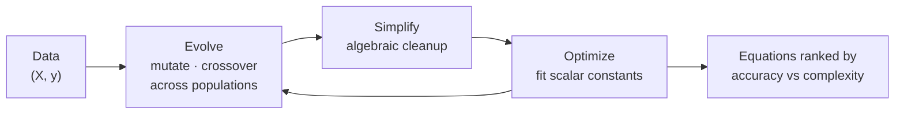

**PySR** is an open-source library for **symbolic regression** — a type of machine learning that, instead of training an opaque network, searches for a **human-interpretable mathematical expression** that fits your data. Give it measurements; get back something like $y = 2.5\,\cos(x_3) + x_0^2$.

This entry covers the paper *"Interpretable Machine Learning for Science with PySR and SymbolicRegression.jl"* (Miles Cranmer, 2023). It explains what problem PySR solves, how its search works, and why it matters for anyone who needs **equation discovery** rather than prediction alone.

**Paper:** [arXiv:2305.01582](https://arxiv.org/abs/2305.01582) · **Code:** [github.com/MilesCranmer/PySR](https://github.com/MilesCranmer/PySR)

*The PySR logo says it all: equations are evolved, like DNA, out of a vocabulary of operators.*

---

## Why PySR Symbolic Regression Matters

Most machine learning gives you a model that predicts well but explains nothing. A neural network with millions of weights won't tell a physicist *what law* the data follows.

Science works differently. Kepler's laws, Planck's law, and the ideal gas law are short formulas. They generalize far beyond the data they came from, and a person can reason about them.

Symbolic regression aims at exactly that kind of output. The paper's stated goal is to **democratize and popularize symbolic regression for the sciences**. That means a practical, fast, well-engineered tool instead of a research prototype.

## The Core Idea: Search Over Equations, Not Weights

Think of it as a search problem. The "model space" is every expression you can build from:

- **Variables** — your input features ($x_0, x_1, \dots$)
- **Constants** — unknown scalars to be fitted
- **Operators** — `+`, `−`, `×`, `÷`, `sin`, `exp`, `log`, or anything you define

A regular regression picks the coefficients of a *fixed* formula. Symbolic regression picks the **formula itself**. The trade-off it manages is accuracy against **complexity**: a longer expression can fit better, but a shorter one is more likely to be the real law.

## How PySR Works (Step-by-Step)

### Step 1: Evolve populations of expressions

PySR's search is a **multi-population evolutionary algorithm**. Many independent populations of candidate equations evolve in parallel. Expressions are mutated and recombined, and fitter ones survive.

### Step 2: Simplify

Candidates are algebraically simplified along the way. This keeps equations compact and stops the search wasting effort on redundant forms of the same expression.

### Step 3: Optimize the constants

This is the distinctive part. The **evolve-simplify-optimize loop** is designed to fit the **unknown scalar constants** in newly discovered empirical expressions. Evolution finds the *shape* of the equation, and numerical optimization fills in the numbers.

### Step 4: Return a set of equations, not one answer

The output is a set of candidate equations at different complexities. You choose the point where extra complexity stops buying meaningful accuracy.

## Under the Hood: SymbolicRegression.jl

PySR is the Python front end. The engine is **SymbolicRegression.jl**, a heavily optimized Julia library that you can also call directly from Julia. According to the paper, it can:

- **Fuse user-defined operators into SIMD kernels at runtime**
- Perform **automatic differentiation**
- **Distribute populations across thousands of cores** on a cluster

PySR also **interfaces with several deep learning packages**. That opens up a well-known pattern: train a neural network first, then distill parts of it into symbolic expressions.

## EmpiricalBench: Measuring Equation Discovery in Science

Alongside the software, the paper introduces **EmpiricalBench**, a benchmark for how useful symbolic regression algorithms really are in science.

Instead of synthetic toy formulas, it measures whether an algorithm can **recover historical empirical equations** from original and synthetic datasets. These are the kinds of laws scientists actually found from data.

This is the right test. The question isn't "can it fit a curve?" but "would it have found the law the scientist found?"

## Trade-offs and Limitations

- **Search cost grows fast.** The space of expressions explodes combinatorially with more operators, variables, and depth. That is why the backend's performance engineering matters so much.
- **The operator set is a prior.** If the true law needs an operator you didn't include, PySR can only approximate it.
- **Best for low-dimensional problems.** Symbolic regression shines with a handful of meaningful features, not raw pixels or thousands of columns. Pairing it with a neural network that compresses the input first is the usual workaround.

## My Understanding

What clicked for me: PySR treats *interpretability as the output format*, not something added after the fact. You don't explain a black box with saliency maps. You never build the black box.

What I find underrated is the split between **evolution for structure** and **optimization for constants**. Each tool does what it's good at. Genetic search is bad at fine-tuning numbers, and gradient-style optimization can't invent structure.

## Practical Applications

- **Physics and astrophysics** — recovering laws from simulations and observations
- **Engineering** — compact surrogate models you can embed and audit
- **Distilling neural networks** — replacing learned sub-modules with closed-form expressions
- **Any regulated domain** where a model must be explainable line by line

## Key Takeaways

- **Symbolic regression returns equations**, so the model itself is the explanation.
- PySR uses a **multi-population evolutionary search** with an **evolve-simplify-optimize** loop.
- **SymbolicRegression.jl** delivers the speed: runtime SIMD fusion of custom operators, autodiff, and cluster-scale parallelism.
- **EmpiricalBench** tests what matters for science: rediscovering real historical laws.
- The real trade-off is **accuracy vs complexity**, and PySR gives you the whole curve to choose from.

## Related Topics

- [Engineering Implementations — all domains](/engineering/)
- [Scaling Laws for Neural Language Models](/engineering/scaling-laws-for-neural-language-models/) — empirical power laws found from data, the same kind of result symbolic regression automates
- [Mamba: Linear-Time Sequence Modeling](/engineering/mamba-linear-time-sequence-modeling-selective-state-spaces/) — another case where structure, not scale, is the contribution

## Conclusion

PySR reframes machine learning for science. The goal isn't a model that predicts; it's a law you can write on a whiteboard. Fast evolutionary search, careful constant fitting, and a high-performance Julia backend make that practical.

If your model could give you the equation instead of the weights, would you still pick the black box?
