<!--
GROUNDING NOTES
- Source: raw_data/5th Nov 26 - SwarmEvolve ... .pdf (arXiv:2611.08483v1, 40 pp). All [Paper] numbers were read off the PDF text (Tables 1, Supp. 1-5, Figs 1-5).
- Code: github.com/Qile-J/SwarmEvolve holds only benchmarks/baselines/analysis as of 2026-11-14 ("code will be released soon"). All code in this article is MY reconstruction, tagged [Implementation].
- scripts/swarmevolve_verify.py (numpy, seeded) verifies Eq. 1, the RoPE block shift, Eq. 2 ridge closed form, Eq. 4-5 novelty filter, and the concat-KV = LSE-gated mixture identity. Every number tagged [Verified] comes from that script.
- Paper says "5 to 13 times more programs per hour"; the Qwen3 8B numbers it prints (734 vs 158/99/81) give 4.6x-9.1x. The wider range presumably covers the 14B/32B runs, which the paper does not tabulate per-hour. Flagged in-text.
- Qwen3 KV sizes (36 layers / 64 layers, 8 KV heads, head_dim 128, bf16) are model-config facts, not from the paper -> [Derived].
- Section "Latent swarms inside agentic pipelines" draws ~10% from raw_data/Document-to-Knowledge-to-Agents (D2K2A).md, generalised (no organisation names).
-->

**Latent agent swarms** are the idea at the heart of **SwarmEvolve** (Jiang and Karniadakis, Brown University, arXiv:2611.08483). Instead of asking one LLM to write a long chain of thought per candidate, SwarmEvolve runs **hundreds of cheap agents that think in vectors, never in words**, and lets them talk by handing each other their KV caches. **[Paper]**

The result is an LLM-guided evolutionary search that, on a single GPU with Qwen3 8B, evaluates **734 programs an hour** where text-based frameworks manage 81 to 158. It reaches their 60-minute scores in a **median of 3 to 8 minutes**. **[Paper]**

This article is an engineering dissection. I rebuild every mechanism from first principles, check the math numerically, separate what the paper shows from what it claims, and end with where latent agent swarms actually belong inside production multi-agent systems.

**Attribution convention.** Non-obvious claims carry a tag:

- **[Paper]**: stated in the paper.
- **[Derived]**: follows directly from the paper's equations or numbers; I did the arithmetic.
- **[Verified]**: checked numerically in `scripts/swarmevolve_verify.py` (numpy, seeded).
- **[Implementation]**: my reconstruction. The official code is not released yet.
- **[Interpretation]**: my engineering reading.

**Difficulty:** 🔴 Tier 3 (Advanced). You should be comfortable with attention, KV caching and RoPE. If not, start with [Attention Is All You Need](/engineering/attention-is-all-you-need/) and [vLLM PagedAttention](/engineering/vllm-pagedattention-efficient-memory-management-for-llm-serving/).

---

## 🚀 Why SwarmEvolve Matters: The Cost of Thinking in Text

Many open problems in maths and scientific computing reduce to **searching for a good program**: a packing routine, a step function that tightens an inequality bound, a PDE solver that gains a digit of accuracy. Evolutionary computation is the classical way to search that space: vary, recombine, select, repeat. **[Paper]**

Since FunSearch and AlphaEvolve, the mutation and crossover operators have been LLMs. That works, and it has produced real results such as new cap set constructions and a faster 4×4 complex matrix multiplication. **[Paper]**

The problem is cost. Every candidate program is preceded by a long textual chain of thought. Diversity, which evolution needs, means doing that **many times per round**. The archive, evaluator feedback and inter-agent messages all pile into the context. **[Paper]**

The paper measures how bad this is. Across a 60-minute run with Qwen3 8B, the three baselines spend **57% to 87% of their GPU time on text reasoning**: 20 to 35 seconds and several thousand tokens per evaluated program. **[Paper]**

So the question the paper asks is sharp:

> Can swarms of low-cost agents make evolutionary search faster *and* better?

The answer depends on one bet: **the reasoning doesn't have to be readable, only the program does.** **[Interpretation]**

### What came before

| Lineage | What it contributed | What it still pays for |
|---|---|---|
| FunSearch | Island-based program evolution with an LLM mutator | One text proposal per call |
| AlphaEvolve and open variants (OpenEvolve, ShinkaEvolve, CodeEvolve) | MAP-Elites archives, frontier-model ensembles, novelty rejection | Long text CoT per candidate; ShinkaEvolve adds an embedding model plus an LLM judge for novelty |
| Latent reasoning (Coconut, Soft Thinking, CODI) | Feed hidden states back as inputs instead of sampling tokens | Mostly single-agent |
| Latent communication (KVComm, Cache-to-Cache, LatentMAS) | Agents exchange activations or KV caches instead of text | Small teams, single-shot tasks |
| **SwarmEvolve** | **LatentMAS at evolutionary scale**: hundreds of latent agents per round, a latent novelty filter, crossover via KV concatenation | Single-model only; standard attention only; KV memory grows linearly |

**[Paper]** for the lineage. The framing of the last column is mine. **[Interpretation]**

---

## 🧠 The Core Idea of Latent Agent Swarms (Intuition First)

Picture a design review with 450 engineers. In the text-based world, each of them writes a two-page memo, and a lead reads all the memos before writing the final design. That is slow, and most of the time goes into writing and reading memos.

SwarmEvolve replaces the memos with **telepathy**. Each engineer thinks for 40 "beats" in their own head. The lead then reads their **working memory directly**, here the KV cache, and writes one design. Nobody ever writes a memo. **[Interpretation]**

Three moves make this work:

1. **Think in latent space.** An agent feeds its last hidden state back in as the next input embedding, 40 times. No tokens are sampled. **[Paper]**
2. **Communicate by KV cache.** A summarizer's attention runs over the concatenated caches of many agents, so it "reads" all of them in one forward pass. **[Paper]**
3. **Filter for novelty in the same vector space.** Because each agent's thinking *is* a vector trajectory, you can measure how different two agents are with a dot product and keep the most distinct ones. **[Paper]**

Crossover, the hardest part of LLM evolution, then comes for free. If a summarizer reads agents who studied *different* parent programs, its output is a recombination. **[Paper]**

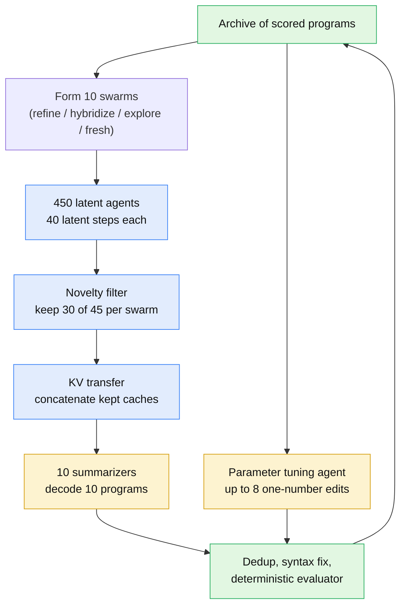

Blue nodes never produce a token. Yellow nodes decode text. Green nodes are deterministic code. That colour split is the whole cost story. **[Interpretation]**

---

## ⚙️ Key Concepts Behind Latent Reasoning and KV Cache Communication

### Concept 1: The KV cache and RoPE position shifting

**What it is.** A decoder-only transformer caches the keys and values of every past position in every layer, $\lbrace (\mathbf{K}^{(\ell)}, \mathbf{V}^{(\ell)}) \rbrace\_{\ell=1}^{L}$. A new token is one forward pass of a single position attending to that cache. **[Paper]**

**Why it matters here.** The KV cache is the agent's working memory in its most consumable form. Whatever another model would need to "read" an agent's thinking is already sitting in it. **[Interpretation]**

**The catch is position.** Qwen3 uses rotary position embeddings. RoPE rotates each query and key at position $i$ by a matrix $R\_i$ whose angles grow linearly with $i$, so the score depends only on the offset: **[Paper]**

$$
(R_i \mathbf{q})^\top (R_j \mathbf{k}) = \mathbf{q}^\top R_{j-i}\, \mathbf{k}
$$

Agents run in parallel, so every agent's cache starts at position 0. To stack caches end to end you must move a block from positions $0, 1, 2, \dots$ to $\delta, \delta+1, \delta+2, \dots$. Because rotations compose ($R\_\delta R\_t = R\_{t+\delta}$), that means multiplying every cached key by $R\_\delta$. **Values carry no position and are copied unchanged.** **[Paper]**

Both identities hold to machine precision in my check: $0$ error for the relative property and $1.6\times10^{-13}$ for a 1,234-position block shift. **[Verified]**

### Concept 2: Latent reasoning without training (the LatentMAS step)

**What it is.** Normally the last hidden state $\mathbf{h}\_t$ is projected to logits and a token is sampled. In latent reasoning the hidden state is fed back as the next input embedding $\mathbf{e}\_{t+1}$, with no sampling. **[Paper]**

**Why it's needed.** Output hidden states and input embeddings live in different spaces. Feed $\mathbf{h}\_t$ straight back and the model sees out-of-distribution inputs. LatentMAS bridges the gap **without any training**, using a ridge-regression alignment map: **[Paper]**

$$
\mathbf{e}_{t+1} = \rho \,\frac{W_a \mathbf{h}_t}{\lVert W_a \mathbf{h}_t \rVert},
\qquad
W_a = W_{\text{in}}^\top W_{\text{out}} \left( W_{\text{out}}^\top W_{\text{out}} + \lambda I \right)^{-1}
$$

Here $W\_{\text{in}}, W\_{\text{out}} \in \mathbb{R}^{\lvert V \rvert \times d}$ are the input and output embedding matrices, $\lambda$ is the ridge weight, and $\rho$ is the mean input-embedding norm over the vocabulary. **[Paper]**

**How to read it.** $W\_a$ is the best linear map, in a least-squares sense, that sends *each token's output embedding to the same token's input embedding*. Apply it to a hidden state and you get "the input embedding of the token you were about to say", except as a soft blend rather than a hard choice. The norm rescaling keeps the input on the scale the first layer expects. **[Interpretation]**

My check confirms the closed form equals an augmented least-squares solve to $2\times10^{-15}$. On a toy vocabulary, a latent step from a token's output embedding lands at cosine 0.98 from that token's true input embedding, with norm exactly $\rho$. **[Verified]**

Each latent step appends **one position** to the KV cache. Forty steps cost about as much as decoding forty tokens, minus sampling and detokenization, and the per-step state is a full $d$-dimensional vector rather than one of $\lvert V \rvert$ discrete choices. **[Paper]** **[Interpretation]**

### Concept 3: Latent communication by KV concatenation

**What it is.** In the LatentMAS hierarchical setting, $J$ agents reason in latent space, then a summarizer concatenates their caches with its own prompt, layer by layer: **[Paper]**

$$
\mathbf{K}^{(\ell)} = [\mathbf{K}^{(\ell)}_1; \dots; \mathbf{K}^{(\ell)}_J; \mathbf{K}^{(\ell)}_{\text{sum}}],
\qquad
\mathbf{V}^{(\ell)} = [\mathbf{V}^{(\ell)}_1; \dots; \mathbf{V}^{(\ell)}_J; \mathbf{V}^{(\ell)}_{\text{sum}}]
$$

The summarizer then decodes text while attending to everything at once. **[Paper]**

**The identity that makes this intuitive.** Softmax attention over a concatenation of blocks is *exactly* a gated mixture of per-block attentions. For query $\mathbf{q}$ and blocks $b$: **[Derived]**

$$
\operatorname{Attn}(\mathbf{q}, [\mathbf{K}_1;\dots;\mathbf{K}_B], [\mathbf{V}_1;\dots;\mathbf{V}_B])
= \sum_{b=1}^{B} g_b \operatorname{Attn}(\mathbf{q}, \mathbf{K}_b, \mathbf{V}_b),
\quad
g_b = \operatorname{softmax}_b\!\big(\operatorname{LSE}(\mathbf{K}_b \mathbf{q}/\sqrt{d_k})\big)
$$

where LSE is log-sum-exp over the block's scores. This holds to $10^{-16}$ in my check. **[Verified]** It is the same algebra FlashAttention uses to merge tiles.

**Why that matters.** Every summarizer head, at every layer and every decoded token, runs a **free, query-dependent router over agents**. An agent whose latent trajectory is relevant to what the summarizer is writing *right now* gets a large gate; the rest get almost nothing. That is a mixture-of-experts router with no trained gate. **[Interpretation]**

It also explains a failure mode. Bigger blocks win more attention mass just by being bigger. In my toy, a 300-row block took 68% of the gate against 3% to 10% for 12-to-41-row blocks with random scores. That is one reason the parent programs, which are long, are placed *once* in the summarizer cache, after the agents, rather than duplicated per agent. **[Verified]** **[Interpretation]**

---

## 🏗️ SwarmEvolve Architecture: One Evolution Round, Step by Step

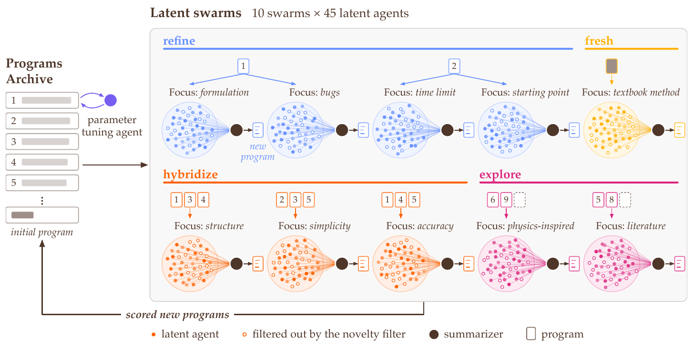

*Figure 2 from the paper. Each round launches 10 swarms of 45 latent agents. Hollow circles are agents removed by the novelty filter. The parameter tuning agent works on the best program in parallel.* **[Paper]**

SwarmEvolve keeps an **archive** of every candidate program with its score, logs and errors. It starts from a simple baseline program. Each round, roughly one minute of wall clock, runs seven steps. **[Paper]**

### Step 1: Form 10 swarms with four roles

Every swarm has one **main focus**. Each of its 45 agents gets a *distinct* prompt: one of **5 phrasings** of the focus × one of **9 ways of thinking** (for example "Reason from first principles" or "Question one assumption the program makes"). **[Paper]**

Note that $5 \times 9 = 45$, exactly the swarm size. Every agent in a swarm has a unique prompt, so prompt diversity is guaranteed by construction, not by sampling temperature. **[Derived]**

| Swarm type | Count | Parent programs | Agent-to-program assignment | Goal |
|---|---|---|---|---|
| Refinement | 4 | One of the **top 2** programs (2 swarms each) | All 45 read the same program; focus = the aspect used least so far for that program | Improve the best |
| Hybridization | 3 | **5** programs drawn from the top 10 | 9 agents per program | Recombine strong ideas |
| Exploration | 2 | **4** programs drawn from the whole archive | 9 agents per program + 9 read only the problem | Less-visited directions |
| Fresh start | 1 | The initial program only | All 45 | A genuinely new approach |

**[Paper]**

Focuses come from two lists of 14. Refinement and hybridization swarms take **aspects** ("the use of the time limit", "bugs, wasted computation, and silent failures"). Exploration and fresh-start swarms take **perspectives** ("a physics-inspired method", "an idea that nobody would try first"). **[Paper]**

The design gives a fixed **4 : 3 : 2 : 1 exploitation-to-exploration ratio**, enforced structurally rather than tuned through a bandit. **[Interpretation]**

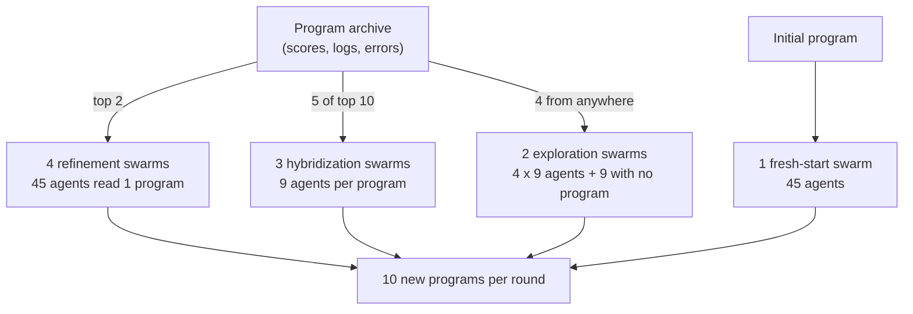

### Step 2: Reason in latent space, all 450 agents in one batch

Each agent reads the **problem statement**, its **focus prompt**, and its **parent program with that program's evaluation results**. It then takes **40 latent reasoning steps**. **[Paper]**

All 450 agents run as **one batch**. Agents that read the same program attend to **one shared copy** of that program's KV cache through paged attention, the vLLM PagedAttention kernel. **[Paper]**

That sharing is what makes the batch affordable. A refinement swarm has 45 agents but stores its parent program's KV once. **[Interpretation]**

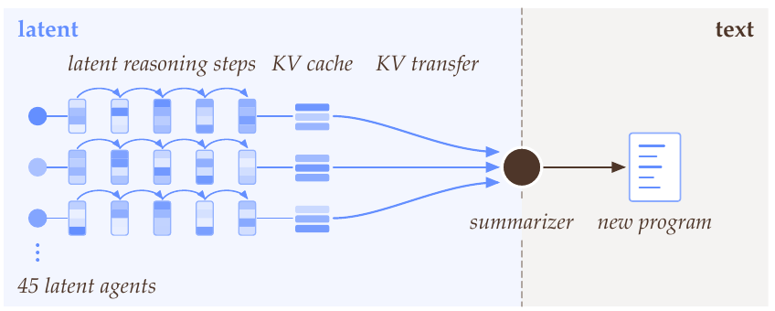

*Figure 3 from the paper. Everything left of the dashed line is latent; only the summarizer's output is text.* **[Paper]**

### Step 3: Filter for novelty with greedy farthest-point selection

Each swarm keeps the **30 most different agents** and drops 15. Agent $j$ is summarized by its mean last-layer hidden state over the 40 steps: **[Paper]**

$$
\bar{\mathbf{h}}_j = \frac{1}{40} \sum_{t=1}^{40} \mathbf{h}_{j,t}, \qquad j = 1, \dots, 45
$$

Each mean is centred on the swarm mean $\boldsymbol{\mu}$ and normalized: $\mathbf{z}\_j = (\bar{\mathbf{h}}\_j - \boldsymbol{\mu}) / \lVert \bar{\mathbf{h}}\_j - \boldsymbol{\mu} \rVert$. The kept set $\mathcal{K}$ starts with the agent closest to $\boldsymbol{\mu}$. Agents are then added greedily by cosine distance: **[Paper]**

$$
j^\star = \arg\max_{j \notin \mathcal{K}} \; \min_{i \in \mathcal{K}} \left( 1 - \mathbf{z}_j^\top \mathbf{z}_i \right)
$$

This is Gonzalez's farthest-point heuristic, the classical 2-approximation for $k$-center. In plain terms it **minimizes the worst-case distance from any dropped agent to a kept one**. **[Paper]** **[Interpretation]**

Two engineering details are easy to miss:

- **Centring matters.** Without subtracting $\boldsymbol{\mu}$, cosine distances inside a swarm are tiny, because every agent shares the same problem statement and focus. Centring removes that shared component so the filter sees only *how agents differ*. **[Interpretation]**
- **Seeding with the most central agent** keeps one "consensus" voice in the summarizer's context before the outliers are added. **[Interpretation]**

In my synthetic swarm (5 parent-program clusters × 9 agents, one deliberately near-duplicate cluster), the filter kept **6, 8, 8, 7 and 1** agents per cluster. **8 of the 9 near-duplicates were dropped.** That is the point: redundancy gets removed, distinct viewpoints survive. **[Verified]**

The paper's own PCA (Figure 5) shows the same pattern on real Qwen3 8B states. Swarms occupy distinct regions, agents cluster by the parent program they read, and the filter keeps agents from every cluster. **[Paper]**

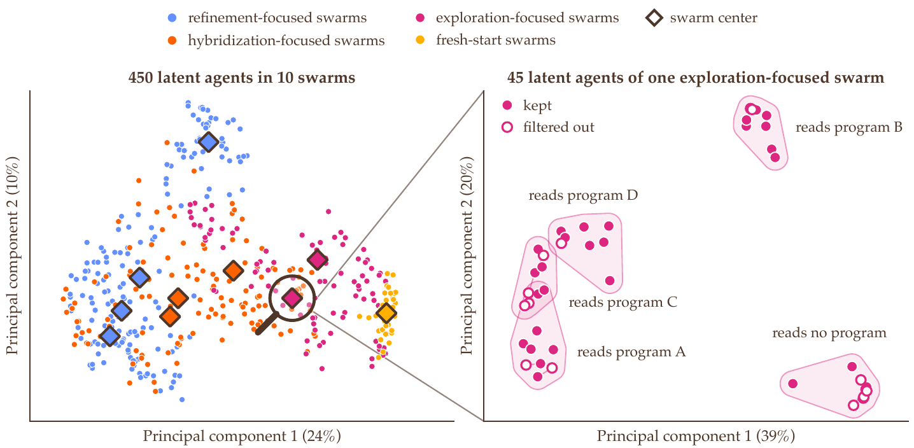

*Figure 5 from the paper. Left: all 450 agents with swarm centres. Right: one exploration swarm, coloured kept versus filtered.* **[Paper]**

### Step 4: Transfer KV caches with RoPE re-positioning

Each summarizer gets one KV cache per layer, built as: **[Paper]**

$$
\mathbf{K}^{(\ell)} = [\mathbf{K}^{(\ell)}_{\text{prob}};\, \mathbf{K}^{(\ell)}_1; \dots; \mathbf{K}^{(\ell)}_{30};\, \mathbf{K}^{(\ell)}_{p_1}; \dots; \mathbf{K}^{(\ell)}_{p_Q};\, \mathbf{K}^{(\ell)}_{\text{ins}}]
$$

and the same for $\mathbf{V}^{(\ell)}$. The blocks are: the problem statement; for each kept agent, its **focus prompt plus 40 latent steps**; the swarm's $Q$ parent programs; and the summarizer instruction. Each agent key is rotated by $R\_\delta$ to its block offset $\delta$. **[Paper]**

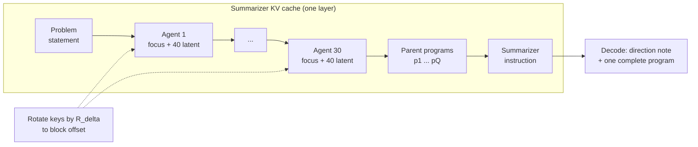

Note what is **not** duplicated. The problem statement and parent programs appear once. Agents contribute only the part that is uniquely theirs, which is their focus and their latent trajectory. **[Derived]**

### Step 5: Write programs (the only heavy text step)

The summarizer decodes a short description of its direction and **one complete program**. All 10 summarizers decode as **one batch** with paged KV caches. **[Paper]**

They use **prompt-lookup speculative decoding**: draft tokens are copied from the parent programs already in context, then verified with the standard speculative-sampling acceptance rule. The output distribution stays exactly the model's. **[Paper]** This is a natural fit, because a refined program shares long runs of tokens with its parent. See [EAGLE-3](/engineering/eagle-3-speculative-decoding-llm-inference-acceleration/) for the general theory of draft-and-verify. **[Interpretation]**

Sampling temperature depends on the swarm's role: **0.3** for refinement, **0.5** for hybridization, **0.8** for exploration and fresh start. Top-p is 0.95, top-k 20 and the maximum is 4,096 new tokens. **[Paper]**

### Step 6: Tune parameters with a one-number agent

Every round, a **parameter tuning agent** reads the best program, its evaluation results and a list of all its numeric parameters. It proposes a new value for **one** parameter. Up to **8** such one-number edits are evaluated per round, at temperature 1.0 with at most 24 new tokens. **[Paper]**

This is a cheap local-search operator bolted onto a global one. The swarms find structure; the tuner polishes constants. **[Interpretation]**

### Step 7: Evaluate and archive

New programs are deduplicated against the archive, syntax-checked, and patched for missing standard imports. A **deterministic evaluator** then scores each program on a CPU core; 8 cores evaluate 8 programs in parallel. Scores, logs and error messages go into the archive. The best program at the deadline is the answer. **[Paper]**

Sanity check on the throughput: 10 summarizer programs plus up to 8 tuning edits gives at most 18 candidates per one-minute round, so about 60 rounds cap the hour at roughly 1,000 evaluations. The reported **734** sits comfortably below that, consistent with dedup and syntax rejections. **[Derived]**

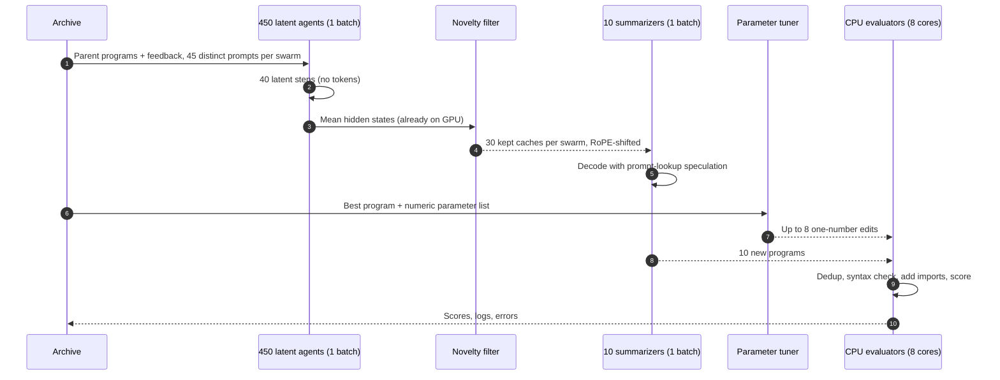

---

## 🔍 Methodology: Training-Free, Single-Model, Fixed Budget

**There is no training.** SwarmEvolve uses frozen Qwen3 models. The only learned-looking component, $W\_a$, is a closed-form ridge solve on the model's own embedding matrices. **[Paper]**

**Implementation.** PyTorch on Hugging Face Transformers Qwen3, with vLLM's paged FlashAttention kernel for shared program caches. With 14B and 32B-FP8 it also captures decoding in CUDA graphs and uses vLLM's fused kernels, including FlashAttention-3 on H100. **[Paper]**

**Benchmark protocol.**

| Setting | Value |
|---|---|
| Problems | 21: 16 from AlphaEvolve Appendix B (packing, geometry, analysis, combinatorics) + 5 new scientific-computing problems |
| Score, maths problems | Objective ÷ AlphaEvolve's published value (inverted for minimization), so > 1 beats AlphaEvolve |
| Score, sci-computing | Correct digits vs a high-fidelity reference, capped, averaged over hard test cases |
| Budget | 60 minutes, 1 GPU, 8 CPU cores |
| Models | Qwen3 8B (L40S), 14B (RTX PRO 6000), 32B-FP8 (H100) |
| Seeds | 3 per framework × problem × model |
| Baselines | OpenEvolve, ShinkaEvolve, CodeEvolve, default configs, text reasoning, served by vLLM |

**[Paper]**

The baselines run on vLLM with continuous batching, prefix caching and CUDA graphs, so "text is slow" is not a strawman about a slow serving stack. **[Paper]**

The five scientific-computing problems are a nice contribution in their own right: sparse linear systems (Poisson, high-contrast diffusion, indefinite Helmholtz, convection-diffusion), eigenvalues of non-normal matrices, and Burgers, convection-diffusion and Helmholtz PDEs. Each case runs under a hard time limit of about 8 to 9 seconds. **[Paper]**

---

## 📊 Results: What Latent Agent Swarms Actually Buy You

### Headline scores

| Model (1 GPU, 60 min) | SwarmEvolve | OpenEvolve | ShinkaEvolve | CodeEvolve |
|---|---|---|---|---|
| Qwen3 8B | **0.804** | 0.693 | 0.642 | 0.700 |
| Qwen3 14B | **0.837** | 0.771 | 0.686 | 0.739 |
| Qwen3 32B-FP8 | **0.869** | 0.774 | 0.733 | 0.731 |

*Average best score over 21 problems, three seeds.* **[Paper]**

Read the diagonal: **SwarmEvolve on 8B (0.804) beats every baseline on 32B-FP8 (≤ 0.774).** The search procedure is worth more than a 4× bigger model. **[Paper]** **[Derived]**

A few per-problem rows tell the story better than the average (Qwen3 8B): **[Paper]**

| Problem | SwarmEvolve | OpenEvolve | ShinkaEvolve | CodeEvolve |
|---|---|---|---|---|
| Heilbronn, triangle | **0.558** | 0.050 | 0.418 | 0.514 |
| Sparse linear systems | **0.933** | 0.648 | 0.695 | 0.420 |
| Autocorrelation III | **1.005** | 0.779 | 0.979 | 0.991 |
| Circles in a rectangle | 0.888 | 0.969 | 0.958 | **0.987** |
| Kissing number, d = 11 | 0.309 | 0.481 | **0.508** | 0.371 |

It doesn't win everywhere. Circle-in-rectangle and the kissing number problem favour the baselines at 8B. With 32B-FP8, SwarmEvolve solves all five sparse systems to full accuracy, which no baseline run ever does. **[Paper]**

### Throughput and time-to-target

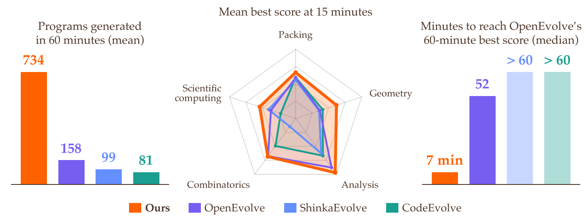

*Figure 1 from the paper, Qwen3 8B. Left: 734 versus 158/99/81 programs. Right: 7 minutes to reach OpenEvolve's 60-minute best.* **[Paper]**

The paper says SwarmEvolve evaluates "5 to 13 times more programs per hour". The Qwen3 8B numbers it prints give **4.6× (vs OpenEvolve), 7.4× (ShinkaEvolve) and 9.1× (CodeEvolve)**. The wider range presumably includes the 14B and 32B runs, which are not tabulated per hour. Quote the 8B ratios if you need a number you can defend. **[Derived]**

Median minutes to reach each baseline's 60-minute score are **7, 8 and 4** for Qwen3 8B, and 3 to 6 with the larger models. After just **15 minutes**, SwarmEvolve already beats the 60-minute average of every baseline with every model. **[Paper]**

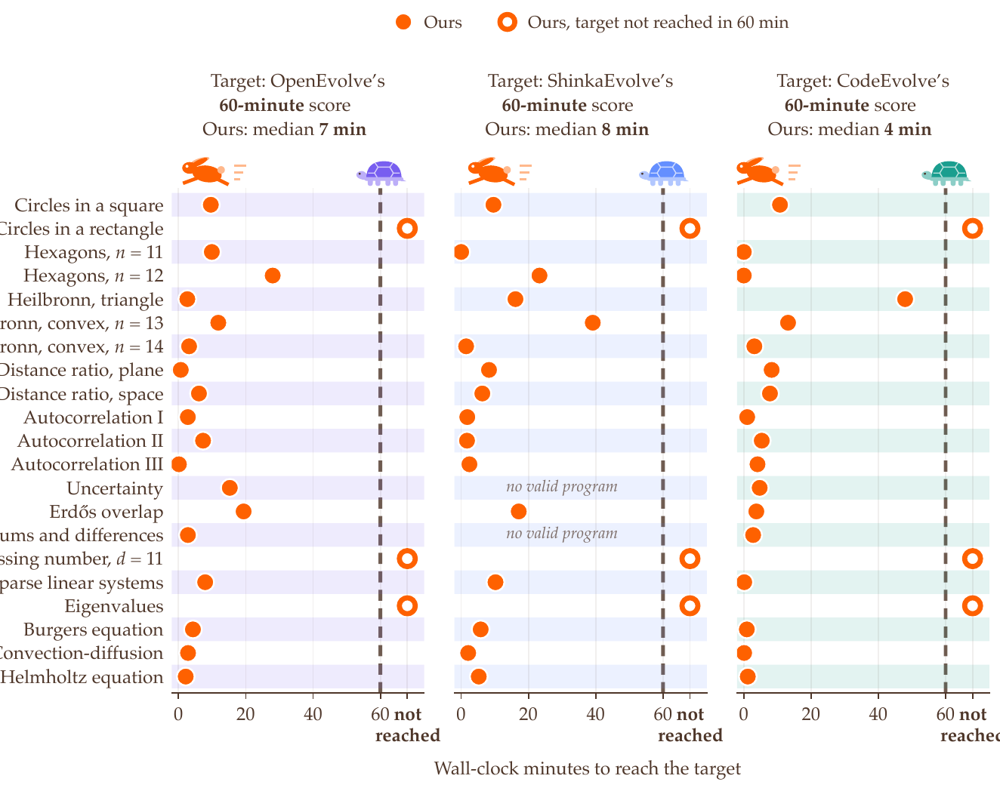

*Figure 4 from the paper. Hollow circles are problems where the target was not reached within the hour.* **[Paper]**

### Where the GPU time goes

This table is the most useful one in the paper for systems engineers.

| Stage (Qwen3 8B, 60 min) | SwarmEvolve | OpenEvolve | ShinkaEvolve | CodeEvolve |
|---|---|---|---|---|
| Reading prompts | 7.1 min (12%) | 1.0 (2%) | 0.5 (0.9%) | 0.1 (0.2%) |
| Text reasoning | — | **52.5 (87%)** | **34.4 (57%)** | **46.8 (78%)** |
| Latent reasoning | 4.1 (7%) | — | — | — |
| Latent communication | 2.6 (4%) | — | — | — |
| Writing programs | **39.4 (66%)** | 6.4 (11%) | 5.7 (9%) | 4.7 (8%) |
| Novelty checks | 0.05 (0.1%) | — | 4.5 (7%) | — |
| Summarizing earlier programs | — | — | 14.7 (24%) | — |
| Rewriting the system prompt | — | — | — | 7.7 (13%) |
| Parameter tuning agent | 1.9 (3%) | — | — | — |
| Other | 4.7 (8%) | 0.1 | 0.2 | 0.7 |
| **Programs evaluated** | **734** | 158 | 99 | 81 |

**[Paper]** (Supplementary Table 2. Evaluator CPU time runs in parallel and is excluded.)

Three things jump out. **[Interpretation]**

1. **Thinking costs 11%; writing costs 66%.** Latent reasoning plus communication take 6.7 minutes in total. The bottleneck has moved to decoding the program itself, which is why prompt-lookup speculation is the right next optimization, not a better reasoning trick.
2. **Novelty checking dropped from 4.5 minutes to 3 seconds.** ShinkaEvolve embeds code with a separate model and calls an LLM judge when cosine similarity exceeds 0.99. SwarmEvolve reuses hidden states already in GPU memory.
3. **Prompt reading is now visible (12%).** When reasoning is nearly free, prefill becomes the next cost. Paged sharing of parent-program caches is what keeps it from dominating.

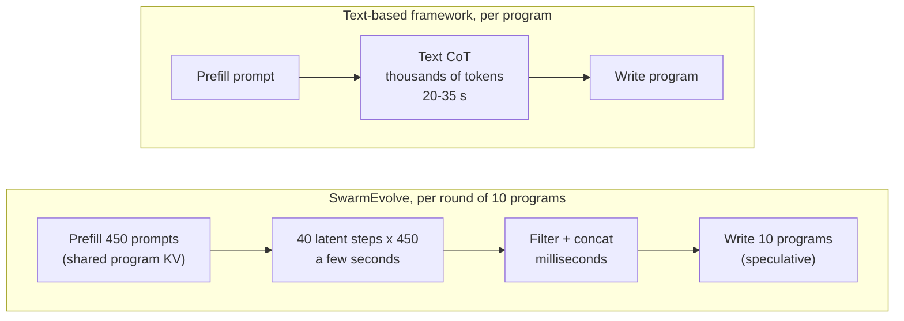

### Beyond AlphaEvolve with an 8B model

With **frozen Qwen3 8B**, SwarmEvolve surpasses AlphaEvolve's published constructions on **three** problems; each baseline manages one. **[Paper]**

- **26 circles in a unit square:** sum of radii **2.635983**, matching the best known value, versus AlphaEvolve's 2.635863. **[Paper]**
- **Second and third autocorrelation inequalities:** step functions that improve AlphaEvolve's bounds. **[Paper]**

The paper reruns every best program and rescores it under AlphaEvolve's exact constraints. Programs that use unseeded randomness are rerun 33 times. That is the kind of hygiene that makes the "beats AlphaEvolve" claim credible. **[Paper]**

### Ablations: is it the latent part, or just the swarm?

**Latent versus text reasoning** (Qwen3 8B, 45 agents): **[Paper]**

| Agent reasoning | Avg. score @ 60 min | Programs / hour |
|---|---|---|
| **40 latent steps (default)** | **0.804** | **734** |
| 40 text tokens | 0.796 | 663 |
| 256 text tokens | 0.767 | 402 |

With 256 text tokens, agent reasoning takes about **32 seconds** per round against about **4 seconds** latent. Summarizers then spend another **8 s (40 tokens) or 15 s (256 tokens)** re-encoding the text. **[Paper]**

My reading: the score gap between latent and 40-token text is small (0.008). **Most of the win is the swarm architecture plus throughput**, with latent reasoning as a meaningful but secondary speed lever. The surprising result is that 256 tokens is *worse* than 40. The authors suspect the summarizer's 32,768-token window gets swamped. Short messages beat long ones. **[Interpretation]** **[Paper]**

**Swarm size** (0, 15, 45, 75 agents per swarm, keeping two thirds): **[Paper]**

- Bigger swarms win **early**. Over the first 150 evaluated programs, mean best score rises with swarm size. From the 55th program on, 75 agents leads every setting and baseline.
- After about 150 programs the gains fall inside the bootstrap intervals. **All four sizes end the hour at similar scores.**
- Even **0 latent agents**, where the summarizer reads only the problem plus all the swarm's programs, beats every baseline's final score.

That last point matters. A meaningful share of the gain comes from the **round structure**: 10 role-diverse summarizers, an archive and a tuner, run on a fast batched engine. Latent agents add early-search diversity on top. **[Interpretation]**

The authors' explanation for convergence is honest: all agents share one model's knowledge, so extra agents cannot find blind spots the model itself has. **A larger model still raises the final score.** **[Paper]**

---

## 🔬 Deep Dive: Why Latent Agent Swarms Work, and Where the Math Is Shaky

### The summarizer's cache is "off-manifold", and it works anyway

Each agent block was computed while that agent attended to *its own* context: problem, focus, its one parent program. In the summarizer's cache, the block now sits after the problem statement and *other agents'* blocks, and before the parent programs.

RoPE re-positioning fixes the **positional phase**. It does not fix the **content**. Agent $j$'s layer-$\ell$ keys encode "what agent $j$ saw", not "what a model reading this concatenated sequence would compute". No single forward pass could have produced this cache. **[Interpretation]**

Why does it still work? The concatenation identity above gives the answer. The summarizer never needs the blocks to be mutually consistent. Each head just routes attention mass across blocks according to the current query. Each block remains internally coherent, a faithful record of one agent's computation. The summarizer reads a **library of coherent books**, not one coherent book. **[Interpretation]**

### Hidden-state averaging is a deliberately lossy fingerprint

The novelty filter uses only the **mean** over 40 steps. Two agents that pass through the same region in a different order look identical. That is fine for "did they think about the same thing", and blind to "did they reason differently". It is also only the **last layer**. Earlier layers may separate agents better, and the paper doesn't ablate this. **[Interpretation]**

The paper also never compares farthest-point selection against **random dropping** of 15 agents. In my toy, random 30-of-45 subsets *also* covered all 5 clusters in 100% of draws, though with a larger cover radius (0.0005 versus 0.0003). With 30 of 45 kept, coverage is easy; the filter's real job is **removing near-duplicates**, which it did. **[Verified]** **[Interpretation]**

### Memory arithmetic: why the 32B model needs an H100

Qwen3 8B has 36 layers and 8 KV heads of dimension 128. In bf16 that is $2 \times 36 \times 8 \times 128 \times 2 = 147{,}456$ bytes, or **144 KiB per cached position**. Qwen3 32B has 64 layers, so **256 KiB per position**. **[Derived]**

The latent positions alone for one round are $450 \times 40 = 18{,}000$, which is **2.47 GiB** on 8B and **4.39 GiB** on 32B. Add per-agent prompts, ten summarizer caches of thousands of tokens each, and FP8 weights of about 32 GB, and the paper's limitation, "memory grows linearly with agents, steps and layers", becomes concrete. **[Derived]** **[Verified]**

### Crossover without a crossover operator

In classical genetic programming, crossover splices subtrees and usually produces broken offspring. LLM-guided frameworks prompt a model with two parents and ask it to merge them in text.

SwarmEvolve's hybridization swarm does something structurally different. Nine agents each digest one of five parents from one perspective. The summarizer attends over all 45 digests (30 after filtering) **at every decoding step**, routing between parent-specific trajectories token by token. Crossover becomes a **soft, per-token, per-head interleaving** of parent ideas. **[Interpretation]**

---

## 🧩 Latent Swarms Inside Agentic Pipelines: An Engineer's Map

The paper is about program search. I care about whether the pattern transfers to production multi-agent systems. A common shape I build is a **document-to-knowledge-to-agents pipeline**: parallel workers ingest documents into evidence-backed knowledge patches, an integration service merges them into a governed knowledge base, and a planner fans out to specialist agents whose findings go through cross-agent synthesis and validation. (I write that architecture up separately in [Document-to-Knowledge-to-Agents: multi-agent document intelligence on AWS](/signals/document-to-knowledge-to-agents-aws/).)

Mapping SwarmEvolve onto that shape is instructive, because it shows both the fit and the hard boundary. **[Interpretation]**

| SwarmEvolve component | Agentic-pipeline analogue | Transfers? |
|---|---|---|
| Archive with scores, logs, errors | Knowledge base with versioned facts, confidence, conflicts | Yes: both are the shared state every round reads |
| Deterministic evaluator | Evidence, consistency and coverage checks | **Only if** the checks are mechanical. LLM-judged checks reintroduce text cost |
| Swarm focus + 45 distinct prompts | Specialist roles (requirements, dates, risks, compliance) | Yes, cheaply: many perspectives per specialist instead of one |
| Novelty filter on hidden states | Deduplicating redundant specialist findings | Yes, and it is nearly free on the same GPU |
| Summarizer reading concatenated KV | Synthesis agent | **Partly**: fast, but the reasoning is unreadable |
| Text-only program output | Knowledge patch with citations | Yes, and this is where the audit trail must live |

### The hard boundary: auditability

Evidence-backed systems have one rule I won't trade away: **every claim links back to a source span**. Latent reasoning breaks that rule *inside* the swarm. Forty hidden-state steps cannot be cited, reviewed or replayed by a human. **[Interpretation]**

So the pattern I would actually ship keeps latent swarms **inside a bounded step whose output is text and is validated**. The summarizer's output becomes a typed finding with entity and evidence IDs. Synthesis checks those citations mechanically. Anything unsupported is rejected or re-delegated, exactly as a SwarmEvolve evaluator rejects a program that fails its tests. **[Interpretation]**

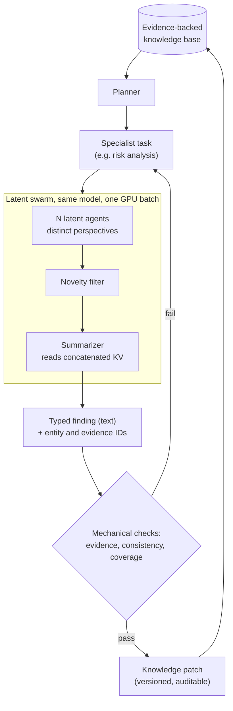

### Where it helps, and where it doesn't

- **Good fit:** high-volume, single-model, short-horizon reasoning where a mechanical check exists. Examples: proposing extraction rules or parsers and testing them against labelled spans; generating many candidate risk hypotheses and keeping only those with valid citations; optimizing prompts or heuristics against a fixed eval set.
- **Poor fit:** heterogeneous agent fleets (different models or vendors cannot share KV caches), anything served behind a closed API (you never see the cache), SSM or hybrid models without standard attention, and steps where a human must read the reasoning.
- **Topology constraint:** a latent swarm **must** live in one runtime on one model, because KV caches only make sense to the model that wrote them. If you later split specialists into independent services, the latent link breaks at the network boundary. Keep the dispatch abstraction typed and text-based between services, and latent only *within* one.

That last point lines up with a good general rule for agent platforms: **start with one runtime and logical sub-agents; promote a specialist to its own service only when it needs independent scaling, release cadence or a security boundary.** Latent swarms are a strong reason to keep a hot specialist co-located. **[Interpretation]**

For the broader harness and orchestration patterns, see [Harness Engineering](/engineering/harness-engineering/) and [LLMCompiler](/engineering/llm-compiler-parallel-function-calling/).

---

## 💻 Reference Implementation of the Core Mechanisms

The official code isn't out yet. These are my reconstructions of the three mechanisms that are pure math. The first two are lifted from `scripts/swarmevolve_verify.py`, where they pass the checks above. **[Implementation]**

### Novelty filter (Eq. 4 and 5)

```python
import numpy as np

def novelty_filter(H, keep=30):
    """H: (J, T, d) last-layer hidden states of J agents over T latent steps.
    Returns indices of the `keep` most mutually distinct agents."""
    hbar = H.mean(axis=1)                         # Eq. 4: mean over steps
    mu = hbar.mean(axis=0)                        # swarm mean
    Z = hbar - mu
    Z /= np.linalg.norm(Z, axis=1, keepdims=True) # centre + unit-normalise
    kept = [int(np.argmin(np.linalg.norm(hbar - mu, axis=1)))]  # most central
    min_d = 1 - Z @ Z[kept[0]]
    min_d[kept[0]] = -np.inf
    while len(kept) < keep:                       # Eq. 5: greedy farthest point
        nxt = int(np.argmax(min_d))
        kept.append(nxt)
        min_d = np.minimum(min_d, 1 - Z @ Z[nxt])
        min_d[kept] = -np.inf
    return kept
```

This is $O(J \cdot k \cdot d)$: for 45 agents, 30 kept and $d=4096$, it is a few million flops per swarm. That matches the paper's 0.05 minutes per *hour* for novelty checks. **[Derived]**

### Ridge alignment and one latent step (Eq. 2)

```python
def alignment_matrix(W_in, W_out, lam):
    """W_in, W_out: (|V|, d). Returns W_a (d, d) mapping output space -> input space."""
    d = W_out.shape[1]
    return W_in.T @ W_out @ np.linalg.inv(W_out.T @ W_out + lam * np.eye(d))

def latent_step(h, W_a, rho):
    e = W_a @ h
    return rho * e / np.linalg.norm(e)   # rescale to mean input-embedding norm
```

$W\_a$ is computed **once per model**. It is $d \times d$, so 4096² entries for Qwen3 8B, and costs nothing at run time beyond one matmul per step. **[Derived]**

### Agent loop and KV re-positioning (PyTorch sketch, untested)

This sketch shows the control flow with Hugging Face Transformers. It is **not** tested against a real model here. The RoPE helper must match the model's exact rotary layout (Qwen3 uses the half-split `rotate_half` convention), and production code would use paged caches rather than Python lists. **[Implementation]**

```python
import torch

@torch.no_grad()
def run_latent_agent(model, prompt_ids, W_a, rho, steps=40):
    out = model(input_ids=prompt_ids, use_cache=True, output_hidden_states=True)
    cache, h = out.past_key_values, out.hidden_states[-1][:, -1]
    trace = []
    for _ in range(steps):
        e = rho * torch.nn.functional.normalize(h @ W_a.T, dim=-1)
        out = model(inputs_embeds=e[:, None], past_key_values=cache,
                    use_cache=True, output_hidden_states=True)
        cache, h = out.past_key_values, out.hidden_states[-1][:, -1]
        trace.append(h)
    return cache, torch.stack(trace, 1)        # cache grows by `steps` positions

def shift_keys(k, delta, rope):                  # k: (B, heads, T, head_dim)
    cos, sin = rope(delta)                       # angles for an offset of `delta`
    return k * cos + rotate_half(k) * sin        # R_delta k; values unchanged
```

When building the summarizer cache, slice each kept agent's cache to its **focus prompt plus latent steps only**, shift keys by that block's offset, concatenate per layer in the Eq. 6 order, and append the instruction tokens by a normal forward pass. **[Implementation]**

---

## ⚖️ Trade-offs and Limitations of Latent Agent Swarms

The paper names three limitations. I add four more. **[Paper]** then **[Interpretation]**

**From the paper:**

1. **One model only.** A summarizer can read caches only from the same model. Learned cache-to-cache translation could lift this.
2. **Standard attention only.** Linear-attention, state-space and hybrid models compress the past into a fixed state, so "concatenate the caches" has no meaning. You'd need a way to merge states. See [Mamba](/engineering/mamba-linear-time-sequence-modeling-selective-state-spaces/).
3. **Linear KV memory growth** in agents × steps × layers. Compressed latent messages and multi-GPU rounds are proposed fixes.

**My additions:**

4. **Unauditable reasoning.** Fine when a deterministic evaluator is the judge. A blocker anywhere a human must justify *why*.
5. **Requires white-box serving.** You need hidden states, embedding matrices and raw KV access. That rules out every closed API and most managed inference endpoints.
6. **Evaluator dependence.** All 21 problems have cheap, deterministic, CPU-scale evaluators. The paper argues bigger swarms help most when evaluations are *expensive*, but every experiment has cheap ones. That claim is extrapolated, not tested.
7. **Fixed hyperparameters.** 10 swarms, 45/30 agents, 40 steps and the 4:3:2:1 role mix are hand-set. There's no sweep over latent steps and no comparison against random agent dropping.

---

## 💡 Practical Applications

The paper's own targets are maths and scientific computing: new constructions and proof strategies, faster or more accurate algorithms, PDE solvers, symbolic regression, numerical methods. What they share is **a clear evaluator**. **[Paper]**

Outside research, the pattern fits anywhere you have a self-hosted open-weight model, a mechanical scorer and a need for many diverse candidates per minute: **[Interpretation]**

- **Kernel and query tuning** against a benchmark harness.
- **Heuristic and solver search** for scheduling, routing or packing in operations.
- **Prompt and extraction-rule optimization** against a labelled eval set, inside a larger agent pipeline.
- **Test-generation swarms** where coverage or mutation score is the evaluator.

---

## 🧠 My Understanding

**What clicked.** The concatenated-KV identity. Once I wrote attention over blocks as an LSE-gated mixture, "latent communication" stopped being magic. The summarizer is a router over agents that re-decides every token, in every head, for free.

**What confused me.** The cache is not something any single forward pass could produce, and the paper doesn't dwell on why that's acceptable. My answer is that each block stays internally coherent and attention never needs the blocks to agree. It's an empirical bet, inherited from LatentMAS, and it pays off.

**What I think is underrated.** Supplementary Table 2. It says the frontier of this problem is no longer reasoning cost, which is now 11%. It is *decoding the artifact* (66%) and *prefill* (12%). The next 2× comes from speculative decoding, cache sharing and shorter programs, not smarter thinking.

**What I'd push back on.** The ablations show the swarm *structure* carries a lot of the gain. Zero latent agents still beats all baselines, and 40 text tokens nearly matches latent. The headline credits latent reasoning; the evidence credits **batched, role-diverse, evaluator-driven rounds**, with latent reasoning as the throughput multiplier that makes 450 agents affordable.

**How I hold it mentally.** *Many cheap, different, unreadable thoughts → keep the most different → let one writer attend over all of them → let a deterministic judge decide.* Readability is spent only where it's needed: the program, and the audit trail.

---

## 🧠 Key Takeaways

- **Latent agent swarms move the cost of multi-agent reasoning from text to vectors.** In SwarmEvolve, reasoning plus communication fell to about 11% of GPU time, against 57% to 87% for text frameworks.
- **KV concatenation is a free mixture-of-experts router.** Softmax over concatenated caches equals an LSE-gated mixture of per-agent attentions, recomputed per token and per head.
- **Novelty filtering belongs in the model's own space.** Greedy farthest-point selection on centred mean hidden states replaces an embedding model plus an LLM judge, taking seconds per hour instead of minutes.
- **Search procedure beats model size.** SwarmEvolve on Qwen3 8B (0.804) beats every baseline on Qwen3 32B-FP8 (at most 0.774), and matches the best known 26-circle packing.
- **The gains are front-loaded.** Bigger swarms win the first 150 programs; final scores converge, and a larger model is what lifts the ceiling.
- **For production agents, keep latent swarms inside a validated, single-model step.** Emit typed, cited text at the boundary. Never let latent reasoning replace the audit trail.

---

## 🔗 Related Topics

- [Attention Is All You Need](/engineering/attention-is-all-you-need/): the attention and KV mechanics SwarmEvolve exploits.
- [vLLM PagedAttention](/engineering/vllm-pagedattention-efficient-memory-management-for-llm-serving/): the paged kernel that lets 45 agents share one program cache.
- [EAGLE-3 Speculative Decoding](/engineering/eagle-3-speculative-decoding-llm-inference-acceleration/): draft-and-verify, the theory behind prompt-lookup decoding of programs.
- [SGLang RadixAttention](/engineering/sglang-radixattention-structured-lm-program-execution/): prefix sharing across many structured LLM calls.
- [Self-Consistency](/engineering/self-consistency-improves-chain-of-thought-reasoning/): the text-era version of "sample many, aggregate".
- [LATS: Language Agent Tree Search](/engineering/lats-language-agent-tree-search-planning-reasoning/): search over agent trajectories with a value signal.
- [Document-to-Knowledge-to-Agents](/signals/document-to-knowledge-to-agents-aws/): the evidence-backed multi-agent pipeline used as the agentic example here.
- [LLMCompiler](/engineering/llm-compiler-parallel-function-calling/) and [Harness Engineering](/engineering/harness-engineering/): parallel dispatch and harness design for production agents.
- [Mamba](/engineering/mamba-linear-time-sequence-modeling-selective-state-spaces/): why fixed-state models break KV-based latent communication.

---

## 🧾 Conclusion

SwarmEvolve's message isn't really "latent reasoning is better than text". It's that **text is expensive, and evolutionary search needs volume and diversity more than eloquence.** Spend readable tokens only where a reader exists, which here is the evaluator reading the program, and the same single GPU can run 450 agents a round instead of a handful.

For anyone building multi-agent systems, the transferable lesson is about where to draw the line. Run unreadable, cheap, diverse thinking *inside* a single-model step, and make the step's output typed, cited and mechanically checked.

The open question I'm left with: **if a deterministic judge is what makes latent swarms safe, how much of your agent system could you redesign so that a deterministic judge exists?**

---

## 📚 References

- Jiang, Q., Karniadakis, G. E. *SwarmEvolve: Latent Agent Swarms for Evolutionary Discovery and Optimization.* arXiv:2611.08483 (2026). Benchmarks: github.com/Qile-J/SwarmEvolve.
- Zou, J. et al. *Latent Collaboration in Multi-Agent Systems* (LatentMAS). ICML 2026.
- Novikov, A. et al. *AlphaEvolve: A coding agent for scientific and algorithmic discovery.* arXiv:2506.13131 (2025).
- Romera-Paredes, B. et al. *Mathematical discoveries from program search with large language models* (FunSearch). Nature 625 (2024).
- Lange, R. T. et al. *ShinkaEvolve.* ICLR 2026. Sharma, A. *OpenEvolve* (2025). Assumpção, H. et al. *CodeEvolve.* arXiv:2510.14150.
- Kwon, W. et al. *Efficient Memory Management for LLM Serving with PagedAttention.* SOSP 2023.
- Su, J. et al. *RoFormer: Enhanced Transformer with Rotary Position Embedding.* Neurocomputing 568 (2024).
- Gonzalez, T. F. *Clustering to minimize the maximum intercluster distance.* Theoretical Computer Science 38 (1985).
- Hao, S. et al. *Training LLMs to Reason in a Continuous Latent Space* (Coconut). COLM 2025.
- Fu, T. et al. *Cache-to-Cache: Direct Semantic Communication Between LLMs.* ICLR 2026.
