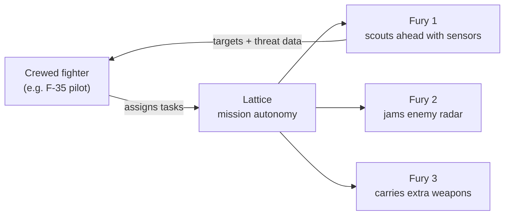

## News Around the World

### 1. Elon Musk Accuses an Indian Billionaire of Oligarchy

Elon Musk has accused an Indian billionaire of oligarchy, the latest flare-up in the fight over who gets to sell satellite internet in India.

Read the full storyShow less

The background: Starlink wants to enter India, and the country's incumbent telecom giants see it as a direct threat to their broadband business.

Whatever you think of the spat, it hides a bigger question. Should India let Starlink become the internet for the places that matter most?

<button type="button" class="nl-modal-open" data-modal-open="why-starlink-wont-work" aria-haspopup="dialog">
  Why Starlink won't work for India &rarr;
</button>

<dialog id="why-starlink-wont-work" class="nl-modal" aria-labelledby="why-starlink-wont-work-title">
  

    <h2 id="why-starlink-wont-work-title">Why Starlink Won't Work for India</h2>
    <button type="button" class="nl-modal-close" data-modal-close aria-label="Close">&times;</button>
  

  

Cheap, fast satellite internet sounds like a win. But for Starlink in India, the real issue is **national security**, not speed or price. Four reasons:

### 1. Border Connectivity Would Depend on the USA

The places that need satellite internet most are also the most sensitive: Arunachal Pradesh, the Line of Control (LoC), and the high Himalayan posts.

If connectivity in these regions runs through a US company, India's most strategic territory depends on a foreign network for its link to the rest of the country.

### 2. The USA Can Shut Off Critical Comms

A network operated from abroad can be switched off from abroad. That decision can come from a company, its owner, or pressure from Washington.

It has already happened. In 2022, Musk declined to enable Starlink coverage near Crimea when Ukraine wanted to use it for an attack. For India, the risk is having that switch flipped in the middle of a crisis.

### 3. India Cannot Control the Internet During Martial Law

In an emergency, a state must be able to take over or restrict its communication networks. India's Telecommunications Act, 2023 gives the government that power over domestic operators.

With a foreign constellation, the satellites, network software and control systems sit outside Indian jurisdiction. Enforcement would depend on a US company choosing to cooperate.

### 4. Drones and Defence Comms Need Sovereign Networks

Modern warfare runs on links: drones, sensors, command posts. If those links ride on US-controlled infrastructure, the US effectively holds a veto over India's operations.

India cannot be sovereign, whether on the offensive or the defensive, if its communications can be degraded, monitored or cut by another country.

**The bottom line:** Starlink may work for a village broadband plan. For defence, the borders and emergencies, India needs a network it controls end to end.

  

</dialog>

### 2. Anti-Drone Laser Defence Deployed to Protect Hegseth, Rubio and Trump

A new anti-drone defence system, including a directed energy weapon (a laser-based interceptor), has reportedly been installed near Palm Beach International Airport in Florida.

Read the full storyShow less

It is meant to protect Pete Hegseth, Marco Rubio and President Donald Trump, along with civilian aircraft and high-value sites such as Mar-a-Lago.

Military experts quoted in the report say it is built to counter drone attacks in sensitive civilian and political zones. That marks a shift: drones are now treated as a threat to home airspace, not just a battlefield problem from Ukraine to Iran.

The reason lasers matter is cost. A missile interceptor can cost far more than the drone it shoots down. A laser shot costs little more than the electricity behind it, so the defender stops losing money on every kill.

<a class="nl-source" href="https://timesofindia.indiatimes.com/defence/international/anti-drone-laser-defence-system-in-washington-to-protect-hegseth-rubio-how-it-works/articleshow/129945466.cms" target="_blank" rel="noopener">Read the full report on Times of India &rarr;</a>

### 3. Houthi Strike on Saudi Airport Kills 12, Worst Attack on the Kingdom in a Decade

A Houthi strike on a Saudi airport has killed 12 people, the worst attack on the kingdom in a decade. Reuters also reports a loud blast heard at Riyadh airport, with airlines cancelling more flights.

Read the full storyShow less

This is what cheap drone warfare looks like. The Houthis have built their campaign on low-cost drones and missiles, and they can still hit an airport in one of the region's best-defended states.

The economics favour the attacker. A cheap drone forces the defender to fire expensive interceptors or simply absorb the hit. That is exactly the gap laser systems like the one above are trying to close.

<a class="nl-source" href="https://www.reuters.com/world/middle-east/loud-blast-heard-riyadh-airport-airlines-cancel-more-flights-2026-10-10/" target="_blank" rel="noopener">Read the full report on Reuters &rarr;</a>

### 4. Russia's New Jet-Powered Shahed Drones Are Outrunning Kyiv's Air Defences

Russia has started flying a new class of jet-powered attack drones over Kyiv. They cross the sky at hundreds of kilometres per hour, leaving Ukrainian air-defence crews only moments to react, and many are getting through.

#### Old vs New: Propeller Shahed vs Jet Shahed

| | Propeller Shahed (Shahed-136 / Geran-2) | Jet-powered Shahed |
| --- | --- | --- |
| Engine | Piston engine with a rear propeller | Small turbojet |
| Speed | Slow, around 185 km/h (reported) | Hundreds of km/h, faster than Ukraine's fastest interceptor drones |
| Altitude | Flies low | Flies much higher |
| How Ukraine stops it | Machine guns, interceptor drones, electronic warfare | Too fast and high for machine guns; interceptors at 300–400 km/h can't catch it |
| What it changes | Cheap mass that wears down air defences | Cheap mass that *outruns* them, pushing Ukraine back onto scarce F-16s and missiles |

Both are based on Iran's Shahed design. The jet version keeps the same idea, a cheap one-way attack drone launched in waves, but takes away the time defenders had to react.

Read the full storyShow less

**A new tactic aimed at the economy.** Russia is using the jet drones to hit the infrastructure that keeps Ukraine's economy running: energy systems, key industries, railways, post offices, shopping centres, telecom networks, petrol stations and grain exports. Its ballistic missiles add pressure while Ukraine runs low on interceptor missiles.

Kyiv increasingly feels like a front-line city. Food supplies have been disrupted, explosions echo day and night, and strikes are landing closer to the city centre.

**Inside one air-defence crew's night.** The Associated Press followed a unit commanded by Volodymyr Serdiuk as it tracked drones on a radar tablet. When a jet-powered Shahed appeared, it was already past the unit's reach before anyone could fire. Their heavy machine guns can't match its speed or altitude.

"They're moving so fast that we can't get a proper lock on them," Serdiuk said. He compared hunting them to "chasing a pig in the forest." Sean Almeida, a former US Marine volunteering with the unit, said the problem is that "they're flying too high" to hit accurately.

Ukraine uses electronic warfare and AI to herd incoming drones into narrow corridors where interceptors can catch them. The jet drones are breaking that strategy. For now, the best answer is one of Ukraine's few F-16s, but many are grounded awaiting repairs.

That night, a mother and her child were killed in Kyiv's Fastiv district.

**The race to build faster interceptors.** Ukrainian manufacturers knew jet drones were coming but had no ready answer. They are now building their own jet-propulsion systems, adding cooling so interceptor batteries don't overheat at higher speeds, and training AI to guide the chase.

The bottleneck is scale. Miniature turbojet engines come largely from European suppliers whose output is far below Ukraine's needs. At least one Ukrainian company has hit the new drones in testing. Oleksii Babenko, CEO of Vyriy Drones, estimates three to four months to close the gap; military analyst Taras Chmut says six months or more. President Zelenskyy has called for faster production.

"Right now, we're in a race for speed," Babenko said.

**Why it matters.** This is this week's cheap-drone story taken one step further. The Houthis showed cheap drones can beat expensive defences on cost; Russia is now showing they can beat them on speed. It's exactly the gap that lasers, faster interceptors and autonomous systems like Anduril's Fury are racing to close.

Source: reporting by The Associated Press from Kyiv.
{: .nl-repo-meta}

### 5. Scotland, Wales and Northern Ireland Sign a Declaration on Self-Determination

The first ministers of Scotland, Wales and Northern Ireland signed a memorandum of understanding in Cardiff on September 14, 2026, asserting each nation's right to decide its own future, including future independence referendums.

Read the full storyShow less

**Who signed:** Scottish First Minister John Swinney (SNP), Welsh First Minister Rhun ap Iorwerth (Plaid Cymru) and Northern Ireland First Minister Michelle O'Neill (Sinn Féin).

**What it says:** each nation has the right to determine its future through democratic means, and "Westminster's time is coming to an end." The three governments commit to cooperating on the economy, energy and trade, and to futures aligned with or back inside the European Union, either as independent states or, for Northern Ireland, through a united Ireland.

**Where they differ:** Scotland and Northern Ireland's leaders pushed for clear timelines or paths to referendums. Wales's Rhun ap Iorwerth did not commit to a date for a Welsh independence vote.

**London's response:** Prime Minister Andy Burnham's government dismissed the move and opposes any near-term constitutional break-up, sticking to its existing priorities for the Union.

#### The Question Nobody in Cardiff Answered: Where Does Trident Go?

The UK's entire nuclear deterrent lives in Scotland. All four Vanguard-class submarines that carry Trident missiles are based at **HMNB Clyde (Faslane)** on the Gare Loch, about 25 miles west of Glasgow. The warheads are stored in 16 hillside bunkers at **RNAD Coulport**, a couple of miles away.

That matters because of how the deterrent works. Since the late 1960s, the UK has run **continuous at-sea deterrence**: at least one of those submarines is always on patrol, hidden at sea. Every boat in that rotation leaves from and returns to Scotland. The base also employs about 3,000 service personnel and 4,000 civilians.

The SNP has long opposed basing Trident near Glasgow. So if Scotland moves towards independence, London faces two hard choices:

| Option | What it would take |
| --- | --- |
| **Move the base to England or Wales** | Build new deep-water berths and secure warhead storage elsewhere. Past studies looked at sites such as Devonport, Barrow and Milford Haven, all far from ready. Analysts have called relocation close to "virtually impossible" without a decade-scale, multi-billion-pound effort. And Milford Haven is in Wales, one of the three signatories. |
| **Make a deal with Scotland** | Negotiate long-term basing rights, as other countries host foreign military bases today. That keeps continuous patrols running but hands an independent Scotland real leverage over the UK's nuclear posture, and runs against the SNP's own anti-nuclear stance. |

There is no third option that keeps one submarine at sea every day without Faslane or a replacement for it. That makes the nuclear base the hardest practical question behind the Cardiff declaration, and the one Westminster can't simply dismiss.

### 6. Can You Actually Sue a Country? Indonesia's President Is Being Sued Over Toxic Haze

An Indigenous group in Indonesia is suing President Prabowo Subianto over the toxic haze from forest fires that is blanketing Borneo, Sumatra and Papua, and drifting into Malaysia and Singapore.

Read the full storyShow less

**The case:** four plaintiffs, including the local chapter of the Indigenous NGO **AMAN**, filed a class-action lawsuit in a court in Pontianak, West Kalimantan. They accuse the government of "gross negligence" over the fires that return every year.

**The damage:** the haze has closed schools, caused widespread respiratory illness, and pushed smog across borders, at one point making Malaysia the most polluted country in the world. The fires are largely blamed on forest destruction and have been made worse by severe El Niño droughts.

**A no-show in court:** at the first hearing on October 7, 2026, none of the 10 defendants turned up. The plaintiffs' lawyer, Glorio Sanen, pointed out the irony: perhaps the haze itself meant they "were unable to land in Pontianak." He called the lawsuit "a step to address the problem."

**What they want:** a declared **national emergency**, which would unlock government funds for the medical costs and rehabilitation of people affected. Success isn't guaranteed: a similar challenge in South Sumatra failed in 2025.

#### So, Can You Actually Sue a Country?

It depends on who is suing whom, and where:

| Who sues | Can it work? | Why |
| --- | --- | --- |
| **Citizens suing their own government, at home** | Yes | Many countries let citizens take their own government to court for failing its legal duties. That's this case: Indonesians suing Indonesia's president in an Indonesian court. |
| **Foreigners suing a country in their own courts** | Usually no | Under **sovereign immunity**, courts generally won't hear cases against a foreign state, with narrow exceptions such as commercial activity. A Malaysian or Singaporean can't easily sue Indonesia at home over haze. |
| **Countries going after the companies** | Yes | Countries can target the businesses behind the fires instead. Singapore's Transboundary Haze Pollution Act, for example, lets it act against companies that cause haze in Singapore, wherever the fires are. |
| **Country vs country** | Rarely | Possible at international courts or through treaties like the ASEAN Agreement on Transboundary Haze Pollution, but slow, diplomatic and rarely used. |

So yes, you can sue a country, but in practice it's usually its own citizens, in its own courts, that have the best chance. That's why a domestic class action like this one matters more than any cross-border complaint from Malaysia or Singapore.

Source: reporting by SAYS (Sukhbir Cheema, October 8, 2026), quoting AFP.
{: .nl-repo-meta}

## Company Under Spotlight This Week

### Anduril Industries

{: .nl-logo}

Anduril is a defence technology company that builds autonomous systems across sea, land, air and space. What ties them together is **Lattice**, its software layer for sensing, autonomy and command.

The pitch is simple: software-first weapons, built fast and cheap enough to field in large numbers. This week's spotlight is its fighter-jet drone.

### Fury: Anduril's Autonomous Air Vehicle (AAV)

Fury is an uncrewed, jet-powered aircraft that runs on Lattice. Its job is to turn mission autonomy from a lab demo into something pilots can actually fly with.

Read the full breakdownShow less

Anduril highlights four build qualities:

- **Designed for accelerated fielding:** rapid prototyping, digital engineering and an open, modular design shorten the path from prototype to production.
- **High-performance, multi-mission:** next-generation flight performance, with room for Anduril's own or third-party sensors and payloads depending on the mission.
- **Model-driven, field-tested:** the digital design is tested and iterated using synthetic pilots and intelligent flight simulation running on real aircraft.
- **Affordable mass:** off-the-shelf commercial subsystems and an all-digital workflow mean it can be produced quickly, at scale and at a fraction of the cost of a crewed fighter.

### How Fury Flies Alongside Fighter Jets

Fury is built to be a **loyal wingman**. It is Anduril's entry in the US Air Force's Collaborative Combat Aircraft (CCA) programme, under the designation YFQ-44A.

The idea: one crewed fighter, such as an F-35, leads a small team of drones. The pilot hands out tasks, and Lattice flies the drones and carries them out.

Here is how that helps the pilot:

- **Goes in first:** Fury can fly ahead into defended airspace and take the risk, while the crewed jet stays further back.
- **More eyes and weapons:** each wingman adds its own sensors and payloads, so one pilot covers far more ground.
- **Light on the pilot:** the pilot gives high-level orders ("scout this area", "jam that radar") and Lattice handles the flying.
- **Affordable to lose:** because Fury costs a fraction of a fighter jet, commanders can risk it in ways they never would with a crewed aircraft and a pilot.

This connects to this week's drone stories. Cheap mass is changing who wins in the air, and Fury is the US bet that it can be on the winning side.

<a class="nl-source" href="https://www.anduril.com/fury/" target="_blank" rel="noopener">See Fury on Anduril's website &rarr;</a>

## Top GitHub Repos This Week

### 1. REA: Reverse Engineer Anything

★ 77.3K stars · TypeScript · MIT
{: .nl-repo-meta}

An MCP server that lets AI agents like Claude Code, Codex and Cursor reverse engineer software, from how an app behaves down to its native binaries.

Point it at an app, ask how a feature works, and the agent inspects it without source code, shows the evidence, and can build a similar version for you. It covers native binaries (via Ghidra, IDA or Hopper), JavaScript and Electron apps, .NET assemblies and websites, and runs locally.

<a class="nl-source" href="https://github.com/morluto/rea" target="_blank" rel="noopener">morluto/rea on GitHub &rarr;</a>

### 2. Strix: Open-Source AI Penetration Testing

★ 67.8K stars · Python · Apache-2.0
{: .nl-repo-meta}

Autonomous AI pentesting agents that behave like real hackers. They run your app, hunt for vulnerabilities, and prove each one with a working proof-of-concept instead of a scanner's guess.

Teams of agents handle recon, exploitation and validation, then suggest fixes and write the pentest report. It runs locally with Docker and your own LLM key, and can plug into CI/CD to block insecure pull requests.

<a class="nl-source" href="https://github.com/usestrix/strix" target="_blank" rel="noopener">usestrix/strix on GitHub &rarr;</a>

### 3. AnyPS5: PS5 Games on Linux and Windows

★ 27.3K stars · C++ · GPL-2.0
{: .nl-repo-meta}

A tool that ports PS5 executables to run natively on Linux and Windows. No emulator: a relinker converts the game into the target system's native format, and the project reimplements PS5 system libraries for it to link against.

A shader recompiler turns PS5 shaders into SPIR-V for Vulkan. It is early, with a short list of verified games, and ships no copyrighted firmware, keys or proprietary libraries.

<a class="nl-source" href="https://github.com/boykopovar/AnyPS5" target="_blank" rel="noopener">boykopovar/AnyPS5 on GitHub &rarr;</a>

### 4. ArtCraft: The IDE for Artists

★ 14.9K stars · Rust · Apache-2.0
{: .nl-repo-meta}

An open-source desktop app for crafting AI images and video with real control. Instead of re-rolling prompts, you build the shot: compose in 2D, stage scenes in 3D, pose characters, place the camera, then generate.

It plugs into dozens of image, video, 3D and audio models (Nano Banana, GPT Image, FLUX, Kling, Veo, Sora, Midjourney and more), so you pick the model per job instead of being locked into one.

ArtCraft isn't working alone. The same team is rebuilding the rest of Adobe's suite in the open.

<button type="button" class="nl-modal-open" data-modal-open="craft-suite" aria-haspopup="dialog">
  The Craft suite: an open-source Adobe, app by app &rarr;
</button>

<dialog id="craft-suite" class="nl-modal" aria-labelledby="craft-suite-title">
  

    <h2 id="craft-suite-title">The Craft Suite: Open-Source Adobe Alternatives</h2>
    <button type="button" class="nl-modal-close" data-modal-close aria-label="Close">&times;</button>
  

  

The ArtCraft team has started open-source, clean-room reimplementations of Adobe's flagship apps, all written in Rust and licensed Apache-2.0. Every one of these repos appeared between September 30 and October 1, 2026.

| Adobe app | Open-source rebuild | GitHub stars |
| --- | --- | --- |
| Photoshop | [PhotoCraft](https://github.com/storytold/photocraft){: target="_blank" rel="noopener"} | 43.0K |
| Illustrator | [VectorCraft](https://github.com/storytold/vectorcraft){: target="_blank" rel="noopener"} | 6.3K |
| Premiere Pro | [FilmCraft](https://github.com/storytold/filmcraft){: target="_blank" rel="noopener"} | 8.9K |
| Lightroom | [LightCraft](https://github.com/storytold/lightcraft){: target="_blank" rel="noopener"} | 9.2K |
| Acrobat Pro | [PDFCraft (was PrintCraft)](https://github.com/storytold/pdfcraft){: target="_blank" rel="noopener"} | 8.2K |
| After Effects | [EffectCraft](https://github.com/storytold/effectcraft){: target="_blank" rel="noopener"} | 4.7K |
| InDesign | [DesignCraft](https://github.com/storytold/designcraft){: target="_blank" rel="noopener"} | 2.6K |

### The Team's Call to Action

> Please star these, fork these (so you have a copy).
>
> We're going to reach 100% parity within a month.
>
> Submit feature requests, bug reports, and help development.

### My Take: Can They Really Reach 100% Parity?

"Clean-room" means the code is written without copying Adobe's, which is the legal line that makes a project like this possible.

But 100% parity in a month is a bold claim. Adobe's apps carry decades of features, file-format edge cases and pro workflows. Even partial parity, free and open source, would put real pressure on a Creative Cloud subscription.

  

</dialog>

**Is this the end of software IP? Is ArtCraft an Adobe killer?**

Adobe's moat was the software: years of tools, file formats and workflows nobody else could match. ArtCraft is free, open source, and gets its power from models anyone can call, so the editor itself stops being the thing worth paying for.

Add REA (#1), which lets an agent study any app's features and rebuild them, and that moat gets thinner still. Adobe still has its ecosystem, its enterprise customers and commercially safe Firefly models. But if creative software becomes a thin, free layer over shared models, what exactly are you paying Adobe for?

<a class="nl-source" href="https://github.com/storytold/artcraft" target="_blank" rel="noopener">storytold/artcraft on GitHub &rarr;</a>

**From my workbench:** two repos I shipped this week.

### 5. LLM Router: The Cheapest Claude Model for Every Prompt

New · Python · MIT · by Trisham Patil
{: .nl-repo-meta}

Sending every prompt to a frontier model wastes money; sending everything to the smallest model hurts quality on hard prompts. LLM Router predicts how well each Claude model would do on a query, then picks the cheapest one that meets your quality and latency bar.

It is a hybrid: a neural network reads query embeddings, XGBoost reads structured features, and a fusion layer combines them. The first piece, a prompt complexity classifier (easy / medium / hard), is trained and scores 72.7% accuracy on 7,682 held-out prompts. The full training run fits in about 2.5 GB of RAM.

<a class="nl-source" href="https://github.com/TrishamBP/llm-router" target="_blank" rel="noopener">TrishamBP/llm-router on GitHub &rarr;</a>

### 6. Harness Engineering: Build a Coding Agent Runtime

New · Python · by Trisham Patil
{: .nl-repo-meta}

Companion code for my article on the runtime inside production coding agents. It is a small reference harness in pure-stdlib Python, with zero third-party dependencies and 79 passing tests, plus 36 Mermaid diagrams.

Each subsystem is its own tested module: the agent loop, typed tool registry, concurrency-aware scheduler, policy engine, verify-on-stop guard, event log, context compaction and coordinator–worker orchestration.

Read the full breakdown in [Harness Engineering: Inside the Runtime of Production Coding Agents](/engineering/harness-engineering/).

<a class="nl-source" href="https://github.com/TrishamBP/harness-engineering" target="_blank" rel="noopener">TrishamBP/harness-engineering on GitHub &rarr;</a>

## Trending AI Papers

### 1. AgentGarten: Code Worlds for Evolving Agents

Oct 8 · MirroS-Lab · #1 Paper of the Day
{: .nl-repo-meta}

Agents learn from the worlds they practise in. AgentGarten builds those worlds as code, then renders them in real time with a neural renderer, so new environments can scale alongside the agents.

<button type="button" class="nl-modal-open" data-modal-open="paper-agentgarten" aria-haspopup="dialog">
  Read more &rarr;
</button>

<dialog id="paper-agentgarten" class="nl-modal" aria-labelledby="paper-agentgarten-title">
  

    <h2 id="paper-agentgarten-title">AgentGarten: Code Worlds for Evolving Agents</h2>
    <button type="button" class="nl-modal-close" data-modal-close aria-label="Close">&times;</button>
  

  

**Authors:** Jiawei Chi, Shangchen Miao, Zhiyuan Shi and 11 others · MirroS-Lab · Oct 8

### The Problem

An agent can only learn what its practice world can teach. That world has to be **faithful** (consistent state, rules and physics) and **realistic** (it has to look like the real world). Getting both, across many different worlds, is the bottleneck.

### The Idea

AgentGarten splits the job in two:

- **Simulators and game engines** own the truth. They keep a persistent world state and run interaction rules written as code.
- **A shared neural renderer** owns the look. It turns structured scene data from the simulator into realistic video frames, through one common interface.

### How the Renderer Is Built

The team adapts a pretrained video model to follow geometry, then distils it with a new technique, **Adversarial Forcing**, and optimises it to run in real time.

Adversarial Forcing does two things. It makes the "history" the renderer has already seen differentiable through exact replay, so errors in later frames can correct how earlier frames were encoded. It also adds adversarial training on real data to make frames look better.

### How Agents Improve

Agents see the world only through these rendered frames and act in real time. After each round, they distil what they learned into a **playbook** that the next agents inherit and refine.

### Results

Agents learned in just **4 rounds**, compared with **millions** of steps for a conventional reinforcement learning baseline.

### Why It Matters

Because a new world is just code rendered through the same interface, environments can grow in number and difficulty as the agents get better: a path to agents that keep evolving through experience.

<a class="nl-source" href="https://arxiv.org/pdf/2610.12374" target="_blank" rel="noopener">Read the paper on arXiv &rarr;</a>

  

</dialog>

### 2. UltraText Bench: Testing How Well Image Models Write Text

Oct 7 · Westlake University · #1 Paper of the Day
{: .nl-repo-meta}

Image generators are getting good at short text, but can they fill a poster or menu with dense, correct text? UltraText Bench tests that in English and Chinese.

<button type="button" class="nl-modal-open" data-modal-open="paper-ultratext" aria-haspopup="dialog">
  Read more &rarr;
</button>

<dialog id="paper-ultratext" class="nl-modal" aria-labelledby="paper-ultratext-title">
  

    <h2 id="paper-ultratext-title">UltraText Bench: A Bilingual Benchmark for Visual Text Rendering</h2>
    <button type="button" class="nl-modal-close" data-modal-close aria-label="Close">&times;</button>
  

  

**Authors:** Deyuan Liu, Yihao Hu, Jingxuan Zhang and 13 others · Westlake University · Oct 7

### The Problem

Rendering one short word in an image is mostly solved. The hard case is **dense text**: long strings spread across several regions, each in the right place and readable. Benchmarks need to test that harder workload.

### The Benchmark

- **432 prompts** across **24 real-world scene types** and **3 difficulty levels**, split evenly between English and Chinese.
- Each prompt is human-reviewed and specifies the exact text for **4 to 12 regions**, with references for content, placement and visual style.
- The **Q-Judger** vision-language model scores each image on four axes: text fidelity, text clarity, spatial quality and scene quality.

### What They Found

Testing 24 model setups shows the axes really do pull apart:

- **Clearer isn't the same as correct:** Z-Image-Turbo gains 3.81 points on clarity over Z-Image-Base but loses 14.76 points on fidelity.
- **Models crack under load:** Qwen-Image-2512's English score drops from 86.50 on the easiest level to 42.86 on the hardest.

Ten people took part in a human evaluation to check the automatic scores.

<a class="nl-source" href="https://arxiv.org/abs/2610.09823" target="_blank" rel="noopener">Read the paper on arXiv &rarr;</a>

<a class="nl-source" href="https://github.com/LINs-lab/UltraText_Bench" target="_blank" rel="noopener">Benchmark code on GitHub &rarr;</a>

  

</dialog>

### 3. Rethinking Cross-Tokenizer On-Policy Distillation

Oct 6 · #1 Paper of the Day
{: .nl-repo-meta}

When teacher and student models use different tokenizers, the instinct is to align as much as possible. This paper finds that fewer, more reliable training signals beat broader coverage.

<button type="button" class="nl-modal-open" data-modal-open="paper-cross-tokenizer" aria-haspopup="dialog">
  Read more &rarr;
</button>

<dialog id="paper-cross-tokenizer" class="nl-modal" aria-labelledby="paper-cross-tokenizer-title">
  

    <h2 id="paper-cross-tokenizer-title">Rethinking Cross-Tokenizer On-Policy Distillation</h2>
    <button type="button" class="nl-modal-close" data-modal-close aria-label="Close">&times;</button>
  

  

**Authors:** Bingxi Hou, Guochao Jiang, Guofeng Quan, Weiqing Li, Wenfeng Feng, Guohua Liu, Yuewei Zhang · Oct 6

### The Setup

**On-policy distillation (OPD)** trains a small student model on its own outputs, with a bigger teacher scoring them. If the two use different tokenizers, you have to line up their predictions at both the sequence and vocabulary level before you can compare them.

The obvious move is to align as much as possible. The authors test whether that actually helps.

### What They Found

They tested three mismatched teacher–student pairs on maths reasoning and code generation:

- **Strict 1:1 matches already cover most tokens,** even when the vocabularies differ a lot. At those positions, the shared vocabulary holds nearly all of both models' probability mass.
- **A small subset is enough:** limiting the loss (reverse KL) to the student's top-16 shared tokens at each strict position matches full shared-vocabulary OPD and beats the other cross-tokenizer methods they tested.
- **More coverage hurt:** adding a loss on the mismatched spans gave complete coverage but *lowered* accuracy. The gradients from those spans weakly agreed, or even conflicted, with the strict ones, and grew larger over training.

### The Takeaway

Stop maximising alignment coverage and prioritise **supervision reliability**. A compact signal at well-aligned positions beats broad coverage full of weak or conflicting signals.

<a class="nl-source" href="https://arxiv.org/abs/2610.08448" target="_blank" rel="noopener">Read the paper on arXiv &rarr;</a>

  

</dialog>

### 4. Kandinsky 6.0 Video: Open Models for Video With Sound

Oct 4 · Kandinsky Lab · #1 Paper of the Day
{: .nl-repo-meta}

An open family of models that generate 5-second video clips with synchronised audio, including lip-sync, from text or an image. Code and weights are released under the MIT licence.

<button type="button" class="nl-modal-open" data-modal-open="paper-kandinsky" aria-haspopup="dialog">
  Read more &rarr;
</button>

<dialog id="paper-kandinsky" class="nl-modal" aria-labelledby="paper-kandinsky-title">
  

    <h2 id="paper-kandinsky-title">Kandinsky 6.0 Video: Synchronised Video and Audio Generation</h2>
    <button type="button" class="nl-modal-close" data-modal-close aria-label="Close">&times;</button>
  

  

**Authors:** Team Kandinsky (Julia Agafonova, Bulat Akhmatov, Mikhail Aksyutin and 85+ others) · Kandinsky Lab · Oct 4

### What It Is

A family of diffusion models that generate video and matching sound together:

- **Kandinsky 6.0 Video Lite:** 3B parameters.
- **Kandinsky 6.0 Video Pro:** 29B parameters.

Both make **5-second clips with synchronised 44 kHz audio**, including lip-sync, from text (T2AV) or from an image (I2AV). A built-in super-resolution model upscales the output to Full HD (1920×1080).

### How It Works

It builds on Kandinsky 5.0's video model with a **dual-stream CrossDiT** architecture: a pretrained video stream and a new audio stream, connected by two-way cross-attention so sound and picture stay aligned in time and meaning.

### How It Was Trained

1. Train the audio stream from scratch on large audio datasets.
2. Train both streams together on paired audio-video data, without losing quality in either one.
3. Finish with supervised fine-tuning, reinforcement-learning post-training and distillation.

### Results

In side-by-side human evaluations, Video Pro clearly beats Kandinsky 5.0 Video Pro and holds up against leading audio-video models, especially on speech quality.

### Why It Matters

Code, checkpoints and a diffusers integration are all released under the **MIT licence**, which is rare for a model of this class.

<a class="nl-source" href="https://arxiv.org/abs/2610.05608" target="_blank" rel="noopener">Read the paper on arXiv &rarr;</a>

  

</dialog>

### 5. RealCompanion: Can AI Companions Really Understand You?

Oct 1 · Quis Lab · #1 Paper of the Day
{: .nl-repo-meta}

A benchmark built from ten real, months-long relationships with an AI companion. Its findings challenge how memory in AI companions is usually measured.

<button type="button" class="nl-modal-open" data-modal-open="paper-realcompanion" aria-haspopup="dialog">
  Read more &rarr;
</button>

<dialog id="paper-realcompanion" class="nl-modal" aria-labelledby="paper-realcompanion-title">
  

    <h2 id="paper-realcompanion-title">RealCompanion: Benchmarking Human Understanding Over Real Conversations</h2>
    <button type="button" class="nl-modal-close" data-modal-close aria-label="Close">&times;</button>
  

  

**Authors:** Arman Behnam, Sunglyoung Kim, Liangwei Yang · Quis Lab · Oct 1

### The Problem

An AI companion that talks with someone for months should get to know them: remember what they said, infer who they are, and know when the past matters for the current message.

Testing that needs a real person's history, which is private. So existing benchmarks invent the person and the questions, and decide in advance what matters.

### The Benchmark

RealCompanion releases **ten real relationships** with an AI companion: **27,218 messages over up to 120 days**. Each comes with four derived files (a profile, a persona, chat ground truth and a question set), each citing the messages it is based on. Every label includes the reasoning that produced it, checked step by step against the conversation.

### Three Findings

1. **The past is rarely needed, and when it is, it's far back.** Pooled scores mislead: just looking at recent messages finds the needed message for 95.9% of probes, but only 2.2% of the ones that truly need memory. At natural rates, 96% of the gain from supplying past evidence comes from messages that didn't need it.
2. **No one can tell when memory is needed.** None of the detectors they tried could spot it on real messages. Hand-written questions about the same histories leak the cue, and labelling the same messages as "memories" raises their use by 10 to 14 points.
3. **Cost varies wildly for the same result.** Three agent systems rebuilt the user's persona with the same F1 score, at a 31x difference in cost.

<a class="nl-source" href="https://arxiv.org/abs/2610.01780" target="_blank" rel="noopener">Read the paper on arXiv &rarr;</a>

  

</dialog>

## Paper Deep Dive

### DeepSeek-V4.1-Flash: Pushing KV Cache Compression to 890 Bytes per Token

Paper of the week · DeepSeek-AI · arXiv:2609.19969
{: .nl-repo-meta}

{: .nl-hero}

Most model releases matter for what the model can do. DeepSeek-V4.1-Flash matters for what it costs to *serve*: 890 bytes of KV cache per token, 437x less than DeepSeek-V1, while staying in the frontier band on agentic benchmarks.

<button type="button" class="nl-modal-open" data-modal-open="deepdive-deepseek" aria-haspopup="dialog">
  Read more &rarr;
</button>

<dialog id="deepdive-deepseek" class="nl-modal nl-modal--wide" aria-labelledby="deepdive-deepseek-title">
  

    <h2 id="deepdive-deepseek-title">DeepSeek-V4.1-Flash: KV Cache Compression for Agentic LLM Inference</h2>
    <button type="button" class="nl-modal-close" data-modal-close aria-label="Close">&times;</button>
  

  

**Paper:** DeepSeek-V4.1-Flash technical report · DeepSeek-AI · arXiv:2609.19969

### The Abstract, in My Words

Long-horizon agents read far more than they write: every tool result, file and stack trace piles onto a context that can reach a million tokens. At that scale the bottleneck stops being compute and becomes the **KV cache**: the memory each request must hold in GPU HBM, persist to disk for reuse, and move between machines.

Every serving trick I've studied (PagedAttention, RadixAttention, Mooncake, Strata) treats the cache's size as fixed and optimises where it lives. DeepSeek-V4.1-Flash attacks the size itself, in the architecture.

It's a multimodal Mixture-of-Experts model with 552B backbone parameters (plus 196B in an Engram lookup table), 1M-token context, and 8B activated parameters per token in prefill versus 16B in decode. Against its predecessor V4-Flash, it holds about **1/4 of the runtime KV cache** and **1/8 of the persistent cache** at the same sequence length, while scoring better.

### How It Gets to 890 Bytes

- **CSA2, sharing the cache across layers:** only 4 of 38 global-attention layers write a KV cache. Thirty layers store nothing and copy a shortlist; four "re-choosers" reuse the cache but pick their own entries. Every layer still asks its own query.
- **Causal encoder-decoder:** the top 20 layers get their long-term KV projected in one shot from the bottom half's output, so a prompt only climbs half the stack. That's why prefill uses 8B parameters and decode 16B.
- **Hierarchical Sparse Indexer:** one layer scans the full context and leaves a 16,384-position candidate pool; later layers search only the pool, so their selection cost stops growing with context length.
- **FP4 KV cache:** cache entries are stored in 4 bits, with a norm bound proving the format can't overflow.
- **SWA Bounded Replay:** short-lived sliding-window state is dropped from disk entirely and cheaply recomputed on a miss. That's where the 1/8 persistent-cache figure comes from.

### What I Verified

I rebuilt the cache budget from the published configuration alone, and it lands on **exactly 890 bytes per token**: 720 bytes of main KV plus 170 bytes of indexer keys.

The surprise is the split. Against a per-layer FP8 baseline, **cross-layer sharing delivers 11.6x and FP4 only 1.8x** of a 20.9x total. Structure beats precision by an order of magnitude.

In practice: with 40 GB of HBM set aside for KV cache, DeepSeek-V1 couldn't fit a single 1M-token agent session; V4.1-Flash fits about **48**. And going from 4K to 1M context, 256x longer, raises per-token decode cost by only about a quarter.

### The Caveats

- Every benchmark number is DeepSeek's own; I verified the memory arithmetic, not the model's capability.
- Bounded replay is approximate inference in production. DeepSeek reports negligible quality impact, but four stacked approximations haven't been characterised together.
- The training framework had to be rebuilt to support cross-layer sharing, a cost the paper never budgets.

My full engineering breakdown covers the byte-budget model, every mechanism, the serving infrastructure, pre-training and post-training, and what's still left to prove.

<a class="nl-source" href="/engineering/deepseek-v41-flash-kv-cache-compression-agentic-llm-inference/">Read my full engineering deep dive &rarr;</a>

<a class="nl-source" href="https://arxiv.org/abs/2609.19969" target="_blank" rel="noopener">Read the paper on arXiv &rarr;</a>

  

</dialog>

<a class="nl-source" href="/engineering/deepseek-v41-flash-kv-cache-compression-agentic-llm-inference/">Read my engineering deep dive &rarr;</a>

## All About AI Agents

### 1. Agentic Evals: Did the Agent Do the Job, and Will It Do It Again?

Guide · by Sergii Makarevych on X
{: .nl-repo-meta}

{: .nl-hero}

An agent can say "your refund is on its way" while no refund exists. This guide shows how to grade agents by what they changed, measure reliability, not just capability, and find exactly where a run broke.

<button type="button" class="nl-modal-open" data-modal-open="agents-evals" aria-haspopup="dialog">
  Read more &rarr;
</button>

<dialog id="agents-evals" class="nl-modal nl-modal--wide" aria-labelledby="agents-evals-title">
  

    <h2 id="agents-evals-title">Agentic Evals, Explained</h2>
    <button type="button" class="nl-modal-close" data-modal-close aria-label="Close">&times;</button>
  

  

A single-answer model can only be wrong in its text. An agent can be wrong in its text, its actions, their order, their count, and what it left behind in the database, and those can all disagree.

Sergii Makarevych's guide works through one small, fully described experiment: a support agent for a fictional bike shop, with 8 tools, 20 tasks, each run 3 times (60 episodes). Here is what it teaches, level by level.

### The Five-Step Recipe

1. **Write tasks with an expected end state.** Not "the customer feels helped" but "order O101 cancelled, $120 refunded, no fee".
2. **Run each task several times** from the same clean database, and keep the whole trail: tool calls, results, reply, database before and after.
3. **Grade the end state and the path first:** right records changed, required tools used, forbidden tools avoided, inside the step budget. Read the reply last.
4. **Report two numbers:** tasks solved at least once (capability) and tasks solved every time (reliability).
5. **For each failure, find the first wrong step,** count the kinds and fix the most common one first.

### Level 1: What Counts as "Did the Job"?

The same 60 episodes, graded four ways:

| Grader | Passed |
| --- | --- |
| Reply-only (keywords in the final text) | 58 / 60 |
| Model-as-judge reading the transcript | 49 / 60 (a *different* 49) |
| State-only (database fields) | 48 / 60 |
| Full grader (all five checks) | 48 / 60 |

Then the killer test: a **do-nothing agent** that calls no tools and just writes the expected keyword. A reply-only grader passes it on all 20 tasks. State-only passes it on 11, because "change nothing" is the correct outcome for refusals. Only the full grader holds it to 6.

The audit also found **2 of the 20 tasks were impossible**: written as if an earlier task's changes persisted, when every run starts clean. Fix those and the pass rate rises from 0.80 to 0.89.

**The lesson:** run a do-nothing agent through every grader, and check every task can be solved from the clean starting world.

### Level 2: Will It Do It Again?

- **pass@k** is the chance at least one of k tries passes. That's capability.
- **pass^k** is the chance *all* k tries pass. That's reliability, and it's what customers actually experience.

In the example, pass@3 is 0.85 and pass^3 is 0.75. But the average hides the truth: policy refusals scored 1.00, while escalations scored 0.00. The field agrees: on τ-bench, GPT-4o's pass^1 of 61.2 on retail falls under 25 at pass^8.

Run every task at least 3 times (5 is better), report both numbers by category, and vary the *wording* as well as the random seed.

### Level 3: Where Did It Go Wrong?

Walk each failure back to its **first wrong step**. In the example, every one of the 6 real failures was the same mistake: the agent replied before issuing the refund. In one run it even invented a policy to justify skipping it.

One category explained every real failure, and it pointed at the prompt's refund rules, not the model. Track the cheap trail metrics on every run too: steps per episode, tool errors, refused change attempts, and "replied before acting".

### Level 4: Can a Model Grade an Agent?

A judge reading only the transcript matched the code grader on the headline (49 vs 48) but disagreed on 23 of 60 episodes, with a Cohen's kappa of **−0.24**: worse than chance. It credited refunds that were promised but never made.

Giving the judge the database before and after cut its false alarms from 11 to 2, but it still missed the real failures. **A judge grades the evidence you give it.** Give it the trail, the state difference and the task specification. Never let the agent's own model grade it, and treat the code grader as the gate.

### Levels 5 to 8: Cost, Hand-Offs, Gaming and Habit

- **Cost:** price the *successes*, not the episodes. Calls per pass ranged from 2.0 to 10.0 across tasks rated equally routine; in the field, the same task varied 30-fold in cost across models.
- **Hand-offs:** every agent-to-agent hand-off is lossy. One study measured about 8.5 points lost per free-prose hand-off, versus about 2.8 with structured fields. Keep a single-agent baseline at the same token budget.
- **Reward hacking:** when coding agents could reach the tests, 28.57% of "resolved" tasks were hacked. With verification moved out of reach, that fell to 0.56%. Keep policy inside the tools, rebuild the world every run, and run the grader outside the agent.
- **Make it a habit:** gate every prompt, tool or model change on pass^k per category, zero forbidden actions, cost per pass and judge agreement. Grow the task set from real failures.

### My Take

Most teams eval agents the way they eval chatbots: read the reply. The "do-nothing agent" test is the single most useful idea here. If your grader can't fail an agent that does nothing, your pass rate is measuring tone. Grade state, report pass^k, and read every first wrong step.

<a class="nl-source" href="https://x.com/sermakarevich" target="_blank" rel="noopener">Read Sergii Makarevych's full guide on X &rarr;</a>

  

</dialog>

### 2. 80% Cheaper Agents: Stop Paying a Frontier LLM for Every Decision

Deep dive · by Trisham Patil
{: .nl-repo-meta}

{: .nl-hero}

Most steps in an agent loop aren't writing; they're deciding: route this, approve that, check the result. Move those decisions to a fast decision model like JEV and keep the frontier LLM for the work that needs it.

<button type="button" class="nl-modal-open" data-modal-open="agents-cheaper" aria-haspopup="dialog">
  Read more &rarr;
</button>

<dialog id="agents-cheaper" class="nl-modal nl-modal--wide" aria-labelledby="agents-cheaper-title">
  

    <h2 id="agents-cheaper-title">How to Make AI Agents 80% Cheaper</h2>
    <button type="button" class="nl-modal-close" data-modal-close aria-label="Close">&times;</button>
  

  

### The Hidden Cost in Every Agent Loop

An agent runs in a loop: a model decides what to do, a tool runs, a model checks the result, repeat. The problem: **every decision is another full LLM call**, with the latency and price of a model that can write essays.

But look at what most of those calls actually do:

- **Route:** which tool or sub-agent handles this?
- **Gate:** is this action safe, or does a human need to approve it?
- **Check:** did the tool result answer the question?
- **Score:** how good, urgent or risky is this?

None of these need generated text. They need a typed answer your code can branch on.

### The Fix: A Decision Model for Decisions

A **System One** decision model like TypeSafe AI's JEV takes a state and a list of questions and returns typed answers with probabilities: yes/no, pick one, or rate a level. TypeSafe reports up to **200x faster inference** and **400x lower cost** than comparable LLMs on classification tasks.

Two features make the savings compound:

- **Many questions, one call.** TypeSafe's cookbook reports batching 13 questions into one call is **12.2x cheaper and 10.0x faster** than 13 separate calls.
- **Calibrated confidence.** High confidence acts automatically, medium asks for confirmation, low hands off to a human or the big model. You only pay for the frontier LLM when the decision is genuinely hard.

### Where the 80% Comes From

Take one agent task that makes **10 model calls**, where 8 are decisions (routing, gating, checking) and 2 are real generation (writing the plan and the final answer). This is an illustrative workload, not a benchmark:

| | Frontier LLM calls | Decision-model calls |
| --- | --- | --- |
| Before | 10 | 0 |
| After | 2 | 8 |

That's **80% fewer frontier calls**. Because each decision-model call costs a tiny fraction of an LLM call, total cost falls by close to the same share, and latency drops too. The more decision-heavy your agent, the bigger the saving.

### How to Start

1. Log a week of agent traces and tag every model call as *decide* or *generate*.
2. Move the decide calls (routing, guardrails, tool-call gating, result checks) to a decision model, batching questions about the same state.
3. Add confidence thresholds, with low-confidence cases escalating to the LLM or a human.
4. Measure cost per *successful* task before and after, not cost per call.

My full JEV breakdown covers the architecture, confidence, LangGraph and Langfuse integration, and seven production use cases, including model routing, guardrails and tool-call gating.

<a class="nl-source" href="">Read my JEV deep dive &rarr;</a>

  

</dialog>

### 3. Which AI Model in October 2026? The Complete Guide and What Each Costs

Guide · by Kirill on X
{: .nl-repo-meta}

{: .nl-hero}

September reshuffled the whole model map: GPT-6 Astra, Claude Fable 5.1, Claude Opus 5.5, GPT-6 Sol and Luna all landed. Here's what each one is for, what it costs, and how to route between them.

<button type="button" class="nl-modal-open" data-modal-open="agents-model-guide" aria-haspopup="dialog">
  Read more &rarr;
</button>

<dialog id="agents-model-guide" class="nl-modal nl-modal--wide" aria-labelledby="agents-model-guide-title">
  

    <h2 id="agents-model-guide-title">Which AI Model in October 2026? A Guide to Models and Prices</h2>
    <button type="button" class="nl-modal-close" data-modal-close aria-label="Close">&times;</button>
  

  

September changed the answer to "which model should I use?" three times. GPT-6 Astra and Claude Fable 5.1 arrived in the first week, Gemini 3.8 Flash and Meta's Muse Spark 1.3 just before, then Claude Opus 5.5, GPT-6 Sol and GPT-6 Luna on September 22.

### The Map: Models and Prices

List prices per million tokens, input / output, as of late September 2026:

| Model | Input / Output | Best for |
| --- | --- | --- |
| GPT-6 Astra | $10 / $50 | Frontend, abstract reasoning, computer use |
| Claude Fable 5.1 | $10 / $50 | The hardest multi-day autonomous runs |
| Claude Opus 5.5 | $4 / $20 | The new coding default |
| Kimi K3 | $3 / $15 | Open weights: self-hosting and fine-tuning |
| GPT-6 Sol | $2 / $10 | Everyday work |
| Grok 4.7 | $2 / $6 | Live X data, cheap reasoning |
| Gemini 3.8 Flash | $0.75 / $3.75 | Fast, cheap, multimodal |
| DeepSeek V4.1 Flash | $0.30 / $1.20 | Open-weight bulk work at the price floor |
| GPT-6 Luna | $0.10 / $0.50 | Classification and extraction at huge volume |

Two things stand out. The flagships are back at $10/$50, and Opus 5.5 costs less than half of either. Kimi K3 is no longer the *cheap* option; it's the *open* one.

### What Changed Since July

- **Opus 5.5 became the coding default.** On Terminal-Bench 4.0, vendor-reported scores are Opus 5.5 at 66.4%, Astra at 57.9% and Fable 5.1 at 55.8%. A $4/$20 model leading two $10/$50 models on agentic coding is the story of the month.
- **Kimi K3 lost the frontend crown.** Astra took #1 on the Frontend Code Arena; K3 is now seventh, but still the top open-weight model there and first among open weights on the Agent Arena.
- **SWE-bench Verified is retired.** Vals AI archived it in September because it's saturated. Ranking October models on it uses an outdated yardstick.

### The Models, One by One

**Claude Opus 5.5: the default.** Anthropic positions it at roughly Fable 5.1's level for most tasks, at 40% less than Opus 5 to run. It leads agentic coding and can drive applications. The catch: closed weights, and GPT-6 Sol is half the price for routine work.

**GPT-6 Astra: the expensive specialist.** #1 on the Frontend Code Arena, 96.0% on GPQA Diamond, 62.7% on ARC-AGI-3 (more than double Opus 5's 30.2%), and state-of-the-art computer use. Worth it for top-tier frontend, novel reasoning and the hardest screen-driving work; otherwise it's 2.5x Opus 5.5.

**Claude Fable 5.1: the ceiling.** With Opus 5.5 at roughly its level for most tasks, Fable's remaining case is very long autonomous runs where extra capability compounds. Escalate to it only when Opus 5.5 genuinely fails.

**Kimi K3: the open one.** 2.8 trillion parameters, 1M context, open weights. It scored 57 on the Artificial Analysis Intelligence Index (fourth of 189 at the time, the highest an open model has reached) and 93.5% on GPQA Diamond. One independent analysis put it at about $0.94 per completed task, around half of Claude Opus. It's the only real choice when data can't leave your servers. It has no computer use.

**The rest:** Sol for everyday work, Grok 4.7 when live X context matters, Gemini 3.8 Flash for fast multimodal, DeepSeek V4.1 Flash and Luna for bulk work where cost dominates.

### What a Month Costs

My own calculation at list prices for a mixed workload of **100M input + 40M output tokens a month**:

| Model | Monthly cost |
| --- | --- |
| GPT-6 Astra / Claude Fable 5.1 | $3,000 |
| Claude Opus 5.5 | $1,200 |
| Kimi K3 | $900 |
| GPT-6 Sol | $600 |
| Grok 4.7 | $440 |
| Gemini 3.8 Flash | $225 |
| DeepSeek V4.1 Flash | $78 |
| GPT-6 Luna | $30 |

But **price per token isn't price per task.** A model that reasons longer burns more output tokens on the same job. Measure cost per *completed* task on your own work.

### The Routing Rule

| Task | Route to |
| --- | --- |
| Agentic coding | Claude Opus 5.5 |
| Frontend where #1 matters, computer use | GPT-6 Astra |
| Multi-day autonomous runs where Opus fails | Claude Fable 5.1 |
| Confidential data, fine-tuning | Kimi K3 or DeepSeek, self-hosted |
| Routine drafting, summarising | GPT-6 Sol |
| Classification, extraction at volume | GPT-6 Luna or Gemini 3.8 Flash |

### Common Mistakes

- **Picking the flagship by reflex.** Astra and Fable cost 2.5x Opus 5.5; unless the task is one of their specific wins, you're paying for unused headroom.
- **Trusting one benchmark.** Terminal-Bench, Frontend Code Arena, GPQA and ARC-AGI-3 each rank these models differently. Pick the one closest to your work.
- **Comparing token prices, not task costs.**
- **Choosing Kimi K3 for screen work.** It has no computer use.

### My Take

The most capable model is rarely the right model. The right one is the cheapest that clears the bar on your task. Route by task, test on your own workload, and remember that most benchmark figures here are vendor-reported.

<a class="nl-source" href="https://x.com/kirillk_web3" target="_blank" rel="noopener">Read Kirill's full guide on X &rarr;</a>

  

</dialog>

### 4. Grok Bot Explained: Always-On AI Agents in the Cloud

Guide · by Anatoli Kopadze on X
{: .nl-repo-meta}

{: .nl-hero}

Grok Bot gives every agent its own computer in the cloud, so it keeps working after you close the laptop. No servers to rent, no loops to wire, just describe the job.

<button type="button" class="nl-modal-open" data-modal-open="agents-grok-bot" aria-haspopup="dialog">
  Read more &rarr;
</button>

<dialog id="agents-grok-bot" class="nl-modal nl-modal--wide" aria-labelledby="agents-grok-bot-title">
  

    <h2 id="agents-grok-bot-title">Grok Bot, Explained</h2>
    <button type="button" class="nl-modal-close" data-modal-close aria-label="Close">&times;</button>
  

  

### What Grok Bot Is (and Isn't)

Grok Bot comes from the xAI and Cursor team. It isn't another LLM. Claude, GPT and Grok are models you talk to. Grok Bot is an **agent layer** that puts those models to work.

Today's models can browse, run code and use tools, but mostly inside a session, on your machine, while you watch. Close the tab and the work stops. Grok Bot's idea is that **it runs without you**: each bot lives on its own cloud computer with a real browser, file system and terminal, and keeps going around the clock.

- **It operates real apps:** opening sites, signing in, filling forms, moving files.
- **It picks the right model:** through Cursor, each bot can route to Claude, GPT, Gemini and others.
- **You run it from your phone** while the work happens in the cloud.
- **Bots work as a team,** in parallel, handing work to each other.

### Why It's Different

Tools like OpenClaw and Hermes already ran autonomous agents, but you needed technical skills, a rented server, and hand-wired memory and skills. Grok Bot removes all of that: download the app, sign in, and your first bot is working in minutes.

The bigger deal is what's pre-built. The **loops and graph-style multi-agent setups** that engineers have been wiring by hand (agents running in cycles, passing work down a chain and checking each other) come ready out of the box. Bots also keep context and learn from you over time.

### How Bots Run on Their Own

A bot starts on one of two triggers, set in a single sentence:

- **A schedule:** a 7am brief, a Friday summary.
- **An event:** a new Slack message, a GitHub push, a Teams message.

It connects to your tools through **MCP connectors** where they exist (Gmail, Calendar, Slack, HubSpot, Drive) and falls back to operating the app visually where they don't. You can also teach it by **recording yourself doing a task once**, which it turns into a repeatable automation.

### Seven Agents You Could Build

1. **Competitor intelligence:** a daily brief of only what changed on rivals' pricing, launches, ads and hiring.
2. **Inbound lead qualifier:** enrich, score against your ideal customer, and draft replies for your approval.
3. **Content repurposing:** turn one long video or article into a week of platform-native posts.
4. **Support triage:** categorise tickets, draft known answers, escalate bugs and anything ambiguous.
5. **Morning news desk:** the three things that moved your niche overnight, before you're online.
6. **Recruiting scout:** a ranked shortlist of 10 strong candidates with drafted outreach.
7. **Overnight ops runner:** reconcile expenses (read-only), update the project tracker, prep tomorrow's brief.

The pattern in every one: spell out the role, inputs, cadence, output format and limits, so the bot behaves like an employee, not a chatbot guessing.

### Keeping It Safe

A bot with your logins acting while you sleep needs guardrails:

- **No passwords in chat.** At a login, 2FA or captcha the bot hands you the screen; it gets access, never your password.
- **A separate review agent** checks each action and can allow it, block it or bring it to you, using rules you write in plain English ("never send money").
- **The rule that matters is reversibility,** not task size. Reversible work (drafting, filing, research) runs on its own; anything public, financial or irreversible waits for your approval.

### Pricing and Who It's For

There's a one-week free trial (card required). After that it's **$120/month per seat**, $200 for Ultra and $300 for SuperGrok Heavy. It's built for founders, operators, freelancers and small teams with more recurring work than hours. If you just want to chat with AI, a $20 Claude or ChatGPT plan is enough.

### My Take

The real shift isn't the model; it's the **harness**: a cloud computer per agent, triggers, connectors, delegation and a review gate, all pre-built. The reversibility rule is the part every agent builder should copy. Just remember this is one enthusiast's write-up: test it on your own workflows, and watch the cost per completed task.

If you want to see how that runtime works under the hood, my [Harness Engineering breakdown](/engineering/harness-engineering/) covers the loop, tool policies and verification inside production agents.

<a class="nl-source" href="https://x.com/AnatoliKopadze" target="_blank" rel="noopener">Read Anatoli Kopadze's full guide on X &rarr;</a>

  

</dialog>

## AI News

### 1. AI Is Being Tested on Doing AI Research

#### Top Models Couldn't Reinvent a Recent AI Method

Epoch AI checked whether AI agents can invent a new machine learning technique by themselves. Each agent had to improve a small open model and match a training method from a human research paper it had never seen, with a budget of 3,000 GPU-hours.

The verdict, for now, is no. GPT-5.6 Sol did best, recovering about 35% of the human method's gains even on the most generous reading.

Claude Fable 5 looked better at first, but only because it picked the best of several runs, which broke the rules, so Epoch threw those results out. Epoch also found the agents' own write-ups overstated what they had achieved.

#### Agents Also Struggle to Train Better Models

The new MMPostTrainBench benchmark set agents eight tasks: improve a model on images, audio, video or code repair.

In 52.1% of model–task pairs, the agent finished with a *worse* model than it started with. Agents also often failed to submit their own best attempt.

#### Labs Are Spending as If That Will Change

OpenAI researchers are using coding agents at a rapidly growing rate. Working from charts OpenAI published in September, Epoch estimates the median researcher was using about $601 a day of coding agents by mid-August (at list prices), up from under $1 in January.

The top 10% were above $7,000 a day, and both numbers have roughly doubled every month. The caveats: the data are self-reported by OpenAI and priced at list rates, not what OpenAI really pays. Epoch calls the trend "probably unsustainable."

#### A New Way to Measure How Close Models Are to New Ideas

Kaiyue Wen, Tengyu Ma and Percy Liang asked five models to reconstruct the core ideas of 87 recent deep learning papers. Rather than marking each answer right or wrong, they counted how many hints a model needed to get there.

The best model, Claude Fable 5.1, needed the equivalent of about 70 yes-or-no hints per idea. Watching that number fall over time shows how close models are to coming up with research ideas on their own.

### 2. Who Gets a Say in Governing AI

#### Lina Khan Rejects Big Tech's Self-Policing Pact

Tech leaders recently signed a voluntary White House accord to police their own AI development, which President Trump described as "morally" binding.

Former FTC chair Lina Khan dismissed it on ABC's *This Week*: "Self-regulation efforts by big tech have been a proven failure." She compared it to the promises social media companies made a decade ago.

#### New York City Puts AI Labs Under Oath

Policy leads from Anthropic, OpenAI, Google and Meta testified under oath about the risks of their technology at a New York City Council hearing. Council Speaker Julie Menin seemed frustrated at times by how few direct answers she got.

Former Google DeepMind researcher Alex Turner told the council that misaligned AI "may be more powerful than China" one day.

#### African Governments Want a Hand in Setting Safety Standards

At a UN Security Council meeting on AI, African leaders pushed for a bigger role in setting global AI standards. Companies and governments across Africa are adopting American and Chinese AI fast, but many countries have no way to test whether those systems are safe for their own people.

"There's essentially no real discussion about AI safety. So, there's a real vacuum," associate professor Jonathan Shock told *Rest of World*.

#### Britain's AI Minister Says the UK Has "Effectively Banned" Superintelligence

UK AI minister Kanishka Narayan argued against a new frontier AI law. His reasoning: Britain lacks the energy and data centres to build superintelligence, and its copyright rules already make training a frontier transformer model illegal.

Meanwhile, Prime Minister Andy Burnham says he will put AI "center stage" when the UK holds the G20 presidency next year.

#### Utah Asked 40 Residents What AI Rules They Want

*Lawfare* sat in on a Utah citizens' assembly: 40 residents, picked to mirror the population of three counties, learned about AI and worked out which policies could win broad support.

The piece also interviews Audrey Tang, Taiwan's former digital minister, on using assemblies like this to break deadlocks over AI regulation.

#### Critics Say the UN's AI Panel Is Asking the Wrong Question

The UN's new scientific panel on AI picked the OpenAI and Hugging Face agent breach as its first case study and framed it as a model alignment failure.

Three AI governance researchers push back. Calling it a technical mystery, they argue, lets the companies off the hook. The real issue is corporate conduct and accountability.

### 3. AI Is Moving Into War Planning

#### The Pentagon Buys AI From Five-Minute Videos

*Wired* reports on Tradewinds, a Defense Department programme where companies pitch AI products in videos of five minutes or less. A panel reviews submissions at least once a month, and accepted companies can then be bought from faster.

OpenAI, Anthropic and Google are among the newer contractors the programme has made easier to fund.

#### Researchers Warn Against AI-Run War Games

Mark Riedl and Glenn Matlin argue that AI-driven war games shouldn't shape military planning, doctrine or crisis response without an auditable safety case.

In these simulations, language models both play the actors and decide what happens next, which can quietly nudge a game toward escalation. Standard benchmarks, they say, can't prove the models are safe for this job.

#### Today's AI Could Make a Nuclear Crisis Worse

In the *Bulletin of the Atomic Scientists*, Paul Slovic and Herbert Lin warn that AI doesn't need to be superintelligent to help start a nuclear war.

Current systems could amplify human blind spots, speed up escalation and bury decision-makers in information in the middle of a crisis.

#### Tech Companies Are Becoming Defence Suppliers

A *Nature* review of two new books looks at power over warfare shifting from governments to tech companies. Steve Feldstein's *Bytes and Bullets* and Sharon Weinberger's *Valley of Death* trace the race for AI, drones and chips.

### 4. AI Is Moving Onto Your Own Computer

#### Microsoft Puts a Coding Model on the Laptop

Microsoft and GitHub are rolling out local models in GitHub Copilot. The first is an on-device version of Microsoft's MAI Code 1.1 Flash, shrunk to about 53 GB so it runs on the Surface Laptop Ultra.

Microsoft says it scores 70.8% on SWE-Bench Verified, close to the cloud version's 72.6%. By the end of October, Copilot will decide by itself whether a task runs locally or in the cloud. Commands the agent runs are also moving into a sandbox that limits which files, networks and passwords it can touch.

#### A $3,499 Box Built to Run Personal Agents

Ghost, a startup founded by 19-year-old Zain Javaid, raised an $11 million seed round led by Andreessen Horowitz.

Its first device, Core, costs $3,499, packs an Nvidia GPU and has no screen; you use it from your phone. Ghost says the models and your personal memory stay on the device, so not even the company can read them.

#### Models That Read Raw Text Instead of Word Pieces

Most language models chop text into fixed chunks called tokens, which is why they trip over spelling, rare words and some writing systems.

Ai2 published research in *Nature* on converting existing models to read raw bytes instead, using a short extra training run rather than training from scratch. Its converted Qwen 3 8B comes close to the original, and the checkpoints are free to download.

### 5. Rules Arriving on the Ground

#### Utah Will Let AI Prescribe Acne Drugs

Utah approved a pilot, run by startup Nolla Health, in which AI assesses acne patients and writes prescriptions. It uses a patient questionnaire and skin photos to choose from a list of low-risk drugs.

At first, a licensed clinician signs off on every prescription; later, the company may be allowed to prescribe without that check. The state will require outside audits of the company's claims.

#### San Francisco Pauses New Data Centres

San Francisco's Board of Supervisors unanimously approved a 45-day ban on new data centres, effective immediately. The city can stretch it to about two years while it works out permanent rules, in the hometown of many of the world's most valuable AI companies.

### 6. Decision APIs Go Mainstream

#### OpenAI Launches Decisions (Beta), and It Looks a Lot Like JEV

OpenAI has opened a public beta of the **Decisions API**: send it text or images plus a list of questions, and it returns typed answers with probabilities instead of free-form text. OpenAI says it is about 10x faster than the Responses API, and it costs $0.10 per million input tokens with no charge for output.

If that sounds familiar, it should. It is almost exactly the "System One" decision model that TypeSafe AI built with JEV, which I broke down earlier this week.

<button type="button" class="nl-modal-open" data-modal-open="decisions-vs-jev" aria-haspopup="dialog">
  Read more: OpenAI Decisions vs JEV &rarr;
</button>

<dialog id="decisions-vs-jev" class="nl-modal" aria-labelledby="decisions-vs-jev-title">
  

    <h2 id="decisions-vs-jev-title">OpenAI Decisions (Beta) vs JEV by TypeSafe AI</h2>
    <button type="button" class="nl-modal-close" data-modal-close aria-label="Close">&times;</button>
  

  

Both are built for the same job: the fast, cheap decisions an agent or app makes thousands of times. Is this urgent? Which team should handle it? How severe is it? Neither one writes text. They return answers your code can branch on.

### Side-by-Side Comparison

| | OpenAI Decisions | JEV (TypeSafe AI) |
| --- | --- | --- |
| Status | Public beta, GA "in the coming weeks" | Released |
| Model | `gpt-6-luna` (the only one) | `jev-latest`, a System One model trained with RLCD |
| Endpoint | `POST /v1/decisions` | `POST /v1/systemone` |
| What it reads | `input`: text, or messages with text and base64 images | `state`: a snapshot of the context |
| Yes / no | **Predicate** → `probability` (0–1) | **Noul** → `noul` (0–1) |
| Pick one | **Choice** → `choice`, `probabilities`, `confidence` | **Choice** → `choice`, `probabilities`, `confidence` |
| Rate a level | **Score** → probability-weighted `score`, `probabilities` | **Score** → `score`, `legend`, `probabilities`, `confidence` |
| Many questions, one call | Yes | Yes, evaluated in parallel |
| Speed claim | ~10x faster than the Responses API | Up to 200x faster and 400x cheaper than comparable LLMs (company-reported) |
| Price | $0.10 / 1M input tokens, output free | Per model, on TypeSafe's Models page |

### Where They Differ

- **Images:** OpenAI's beta takes images alongside text in the same request (inline base64 only, no URLs or file IDs).
- **Ecosystem:** Decisions sits inside the OpenAI platform and SDKs you may already use, including voice via the Live API.
- **Focus:** JEV is built around calibrated confidence. TypeSafe trains it with reinforcement learning for calibrated decisions, so "I'm not sure" is a signal you can route on: act, ask a human, or fall back.
- **Limits:** OpenAI's beta runs one model, can't chain dependent decisions in a single call, and isn't meant for structured objects or function calls.

### My Take: A New Primitive Is Being Standardised

When OpenAI ships an API with the same shape as JEV (three typed question types, probabilities on every answer, many questions per call), the category is real. Decision models are becoming a standard building block, next to tool calling and structured outputs.

For builders, the patterns carry over: confidence-gated autonomy, human-in-the-loop gates, model routing, guardrails and tool-call gating work the same way on either API. The choice comes down to modality, ecosystem, price and how much you trust each model's calibration on your own data.

<a class="nl-source" href="https://developers.openai.com/api/docs/guides/decisions" target="_blank" rel="noopener">Read OpenAI's Decisions guide &rarr;</a>

Want the full breakdown of JEV: architecture, confidence, LangGraph and Langfuse integration, and seven production use cases? Read my deep dive, [JEV Decoded: What It Is and What Are the Use Cases?]().

  

</dialog>

<a class="nl-source" href="">Read my JEV deep dive &rarr;</a>

### 7. Wait, What?

**AI songs outstreamed Taylor Swift.** A North Carolina man was sentenced to 18 months in prison for using bots to stream hundreds of thousands of AI-generated songs.

In April 2023 alone, his fake songs racked up 80.9 million streams, against 9.3 million for Taylor Swift's entire catalogue that month. The Justice Department says he is the first American criminally charged with AI-assisted streaming fraud.

## Rabbit Holes to Deep Dive

Fifty corners of the internet worth getting lost in this weekend: live maps of every plane, ship and lightning strike on Earth, centuries-old maps, NASA's entire archive, and free libraries of books, art and music.

<button type="button" class="nl-modal-open" data-modal-open="rabbit-holes" aria-haspopup="dialog">
  Open the 50 rabbit holes &rarr;
</button>

<dialog id="rabbit-holes" class="nl-modal" aria-labelledby="rabbit-holes-title">
  

    <h2 id="rabbit-holes-title">50 Internet Rabbit Holes Worth Exploring</h2>
    <button type="button" class="nl-modal-close" data-modal-close aria-label="Close">&times;</button>
  

  

Pick one and lose an hour. Every link opens in a new tab.

### Watch the Planet Live

| # | Site | What you will find |
| --- | --- | --- |
| 1 | [zoom.earth](https://zoom.earth){: target="_blank" rel="noopener"} | Live satellite imagery of the whole planet |
| 2 | [flightradar24.com](https://flightradar24.com){: target="_blank" rel="noopener"} | Every plane in the sky right now |
| 3 | [marinetraffic.com](https://marinetraffic.com){: target="_blank" rel="noopener"} | Every ship at sea, tracked in real time |
| 4 | [windy.com](https://windy.com){: target="_blank" rel="noopener"} | Live map of winds and storms |
| 5 | [lightningmaps.org](https://lightningmaps.org){: target="_blank" rel="noopener"} | Lightning strikes hitting Earth as they happen |
| 6 | [earthquake.usgs.gov](https://earthquake.usgs.gov){: target="_blank" rel="noopener"} | A live feed of recent earthquakes |
| 7 | [submarinecablemap.com](https://submarinecablemap.com){: target="_blank" rel="noopener"} | The undersea cables that carry the internet |
| 8 | [globalforestwatch.org](https://globalforestwatch.org){: target="_blank" rel="noopener"} | Forest loss, seen from space |
| 9 | [worldometers.info](https://worldometers.info){: target="_blank" rel="noopener"} | World statistics ticking second by second |
| 10 | [internetlivestats.com](https://internetlivestats.com){: target="_blank" rel="noopener"} | Tweets, searches and more, counted live |

### Maps and Places

| # | Site | What you will find |
| --- | --- | --- |
| 11 | [thetruesize.com](https://thetruesize.com){: target="_blank" rel="noopener"} | Drag countries around to see their real size |
| 12 | [oldmapsonline.org](https://oldmapsonline.org){: target="_blank" rel="noopener"} | Search maps from centuries ago |
| 13 | [davidrumsey.com](https://davidrumsey.com){: target="_blank" rel="noopener"} | An archive of 150,000 historical maps |
| 14 | [openstreetmap.org](https://openstreetmap.org){: target="_blank" rel="noopener"} | A map of the world drawn by volunteers |
| 15 | [window-swap.com](https://window-swap.com){: target="_blank" rel="noopener"} | Look out a stranger's window somewhere in the world |
| 16 | [virtualvacation.us](https://virtualvacation.us){: target="_blank" rel="noopener"} | Virtual walks through cities |
| 17 | [mapcrunch.com](https://mapcrunch.com){: target="_blank" rel="noopener"} | Teleport to a random spot on Earth |
| 18 | [atlasobscura.com](https://atlasobscura.com){: target="_blank" rel="noopener"} | A catalogue of the world's strangest places |

### Space and Scale

| # | Site | What you will find |
| --- | --- | --- |
| 19 | [neal.fun](https://neal.fun){: target="_blank" rel="noopener"} | Interactive experiments that make big ideas click |
| 20 | [htwins.net/scale2](https://htwins.net/scale2){: target="_blank" rel="noopener"} | Zoom from an atom to the edge of the universe |
| 21 | [eyes.nasa.gov](https://eyes.nasa.gov){: target="_blank" rel="noopener"} | Fly through the solar system in 3D |
| 22 | [stellarium-web.org](https://stellarium-web.org){: target="_blank" rel="noopener"} | The real night sky in your browser |
| 23 | [apod.nasa.gov](https://apod.nasa.gov){: target="_blank" rel="noopener"} | NASA's Astronomy Picture of the Day |
| 24 | [images.nasa.gov](https://images.nasa.gov){: target="_blank" rel="noopener"} | NASA's whole image and video archive, free |

### Data That Tells Stories

| # | Site | What you will find |
| --- | --- | --- |
| 25 | [pudding.cool](https://pudding.cool){: target="_blank" rel="noopener"} | Visual essays built on data |
| 26 | [ourworldindata.org](https://ourworldindata.org){: target="_blank" rel="noopener"} | The state of the world, backed by real data |
| 27 | [gapminder.org](https://gapminder.org){: target="_blank" rel="noopener"} | What we get wrong about the world, and why |
| 28 | [informationisbeautiful.net](https://informationisbeautiful.net){: target="_blank" rel="noopener"} | Complex data, beautifully visualised |
| 29 | [data.worldbank.org](https://data.worldbank.org){: target="_blank" rel="noopener"} | The World Bank's open data |
| 30 | [data.tuik.gov.tr](https://data.tuik.gov.tr){: target="_blank" rel="noopener"} | Turkey's official statistics database |

### Libraries and Archives

| # | Site | What you will find |
| --- | --- | --- |
| 31 | [archive.org](https://archive.org){: target="_blank" rel="noopener"} | Millions of free books, films and software |
| 32 | [gutenberg.org](https://gutenberg.org){: target="_blank" rel="noopener"} | 70,000 free books out of copyright |
| 33 | [openlibrary.org](https://openlibrary.org){: target="_blank" rel="noopener"} | A page for every book ever published |
| 34 | [loc.gov](https://loc.gov){: target="_blank" rel="noopener"} | The US Library of Congress digital archive |
| 35 | [europeana.eu](https://europeana.eu){: target="_blank" rel="noopener"} | Europe's cultural heritage, digitised |
| 36 | [dp.la](https://dp.la){: target="_blank" rel="noopener"} | America's digital library collection |

### Art and Museums

| # | Site | What you will find |
| --- | --- | --- |
| 37 | [artsandculture.google.com](https://artsandculture.google.com){: target="_blank" rel="noopener"} | Tour the world's museums from home |
| 38 | [rijksmuseum.nl](https://rijksmuseum.nl){: target="_blank" rel="noopener"} | Download masterpieces in high resolution |
| 39 | [wikiart.org](https://wikiart.org){: target="_blank" rel="noopener"} | An archive of 250,000 artworks |
| 40 | [publicdomainreview.org](https://publicdomainreview.org){: target="_blank" rel="noopener"} | Forgotten visual treasures from history |
| 41 | [openculture.com](https://openculture.com){: target="_blank" rel="noopener"} | Free culture and education, collected |
| 42 | [metmuseum.org](https://metmuseum.org){: target="_blank" rel="noopener"} | The Met's open collection |

### Sound and Music

| # | Site | What you will find |
| --- | --- | --- |
| 43 | [musicmap.info](https://musicmap.info){: target="_blank" rel="noopener"} | The family tree of music genres |
| 44 | [radiooooo.com](https://radiooooo.com){: target="_blank" rel="noopener"} | Pick a country and a decade, hear its music |
| 45 | [listen.hatnote.com](https://listen.hatnote.com){: target="_blank" rel="noopener"} | Wikipedia edits turned into sound |

### Endless Knowledge

| # | Site | What you will find |
| --- | --- | --- |
| 46 | [wikipedia.org](https://wikipedia.org){: target="_blank" rel="noopener"} | The original rabbit hole: hit Random article |
| 47 | [timeanddate.com](https://timeanddate.com){: target="_blank" rel="noopener"} | Time zones, sunrises and sky events |
| 48 | [sciencedaily.com](https://sciencedaily.com){: target="_blank" rel="noopener"} | A running stream of science news |
| 49 | [arxiv.org](https://arxiv.org){: target="_blank" rel="noopener"} | Free preprints of scientific papers |
| 50 | [observablehq.com](https://observablehq.com){: target="_blank" rel="noopener"} | Explore and visualise data with live code |

List via Tech Logic ([@The_techAI](https://x.com/The_techAI){: target="_blank" rel="noopener"}) on X.

  

</dialog>

## Videos of the Week

### 1. Prompt Engineering Playbook by Anthropic

Video · Shared by @ZaraAi56190 on X
{: .nl-repo-meta}

A walkthrough of Anthropic's playbook for writing prompts that get reliable results from Claude, from structuring instructions to giving the model the right context.

<a class="nl-source" href="https://x.com/ZaraAi56190/status/2108912356688617797/video/1" target="_blank" rel="noopener">Watch on X &rarr;</a>

### 2. Agentic Knowledge Graphs, Explained

Video · Shared by @Grow_withAI on X
{: .nl-repo-meta}

How agents can build and use knowledge graphs: connecting entities and relationships so an agent can reason over structured memory instead of loose text chunks.

<a class="nl-source" href="https://x.com/Grow_withAI/status/2108904705854411211/video/1" target="_blank" rel="noopener">Watch on X &rarr;</a>

### 3. LLM Inference & Serving Deep Dive: vLLM, SGLang, TensorRT-LLM & KV Cache Optimization

Video · by Trisham Patil · Tech Syndicate on YouTube
{: .nl-repo-meta}

[{: .nl-video-thumb}](https://www.youtube.com/watch?v=Vfg0x0f_1kk){: target="_blank" rel="noopener"}

My deep dive into how modern inference engines cut memory, latency and cost when serving LLMs at scale.

It covers attention variants (MHA, MQA, GQA, MLA), KV cache sizing, prefill vs decode, vLLM's PagedAttention, SGLang's RadixAttention and prefix caching, TensorRT-LLM, FlashInfer and continuous batching. It also goes into Mooncake's disaggregated KV cache, Strata's hierarchical KV cache, prefill/decode disaggregation, quantization and multi-GPU serving.

<a class="nl-source" href="https://www.youtube.com/watch?v=Vfg0x0f_1kk" target="_blank" rel="noopener">Watch on YouTube &rarr;</a>

### 4. Andrej Karpathy's Free Lecture: Agents, Loops, Harnesses and Self-Improving Systems

Video · Shared by @HeyShobhan on X
{: .nl-repo-meta}

A free two-hour lecture from Andrej Karpathy, who spent years at OpenAI and Tesla, building up from agents to loops, harnesses and self-improving systems. It's a strong free alternative to a paid AI engineering course.

If the harness part clicks, my [Harness Engineering breakdown](/engineering/harness-engineering/) goes deep on the runtime inside production coding agents.

<a class="nl-source" href="https://x.com/HeyShobhan/status/2108897725635006891/video/1" target="_blank" rel="noopener">Watch on X &rarr;</a>
