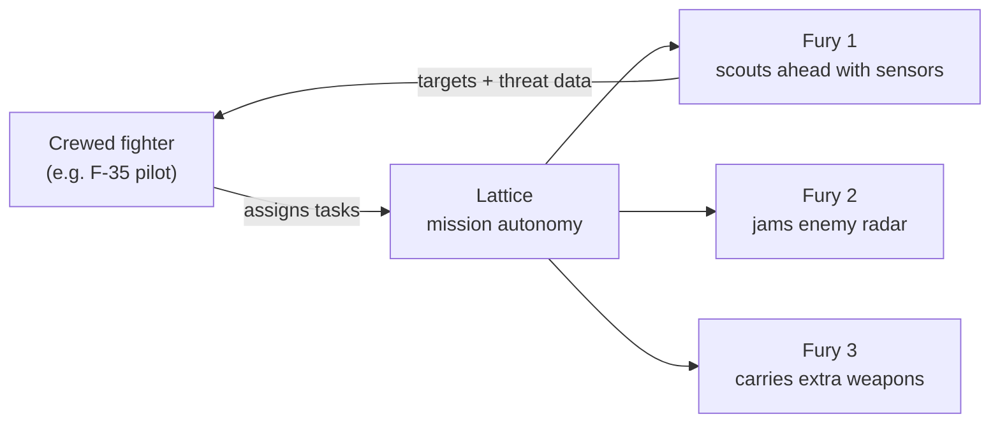

## News Around the World

### 1. Elon Musk Accuses an Indian Billionaire of Oligarchy

Elon Musk has accused an Indian billionaire of oligarchy, the latest flare-up in the fight over who gets to sell satellite internet in India.

The background: Starlink wants to enter India, and the country's incumbent telecom giants see it as a direct threat to their broadband business.

Whatever you think of the spat, it hides a bigger question. Should India let Starlink become the internet for the places that matter most?

<button type="button" class="nl-modal-open" data-modal-open="why-starlink-wont-work" aria-haspopup="dialog">
  Why Starlink won't work for India &rarr;
</button>

<dialog id="why-starlink-wont-work" class="nl-modal" aria-labelledby="why-starlink-wont-work-title">
  

    <h2 id="why-starlink-wont-work-title">Why Starlink Won't Work for India</h2>
    <button type="button" class="nl-modal-close" data-modal-close aria-label="Close">&times;</button>
  

  

Cheap, fast satellite internet sounds like a win. But for Starlink in India, the real issue is **national security**, not speed or price. Four reasons:

### 1. Border Connectivity Would Depend on the USA

The places that need satellite internet most are also the most sensitive: Arunachal Pradesh, the Line of Control (LoC), and the high Himalayan posts.

If connectivity in these regions runs through a US company, India's most strategic territory depends on a foreign network for its link to the rest of the country.

### 2. The USA Can Shut Off Critical Comms

A network operated from abroad can be switched off from abroad. That decision can come from a company, its owner, or pressure from Washington.

It has already happened. In 2022, Musk declined to enable Starlink coverage near Crimea when Ukraine wanted to use it for an attack. For India, the risk is having that switch flipped in the middle of a crisis.

### 3. India Cannot Control the Internet During Martial Law

In an emergency, a state must be able to take over or restrict its communication networks. India's Telecommunications Act, 2023 gives the government that power over domestic operators.

With a foreign constellation, the satellites, network software and control systems sit outside Indian jurisdiction. Enforcement would depend on a US company choosing to cooperate.

### 4. Drones and Defence Comms Need Sovereign Networks

Modern warfare runs on links: drones, sensors, command posts. If those links ride on US-controlled infrastructure, the US effectively holds a veto over India's operations.

India cannot be sovereign, whether on the offensive or the defensive, if its communications can be degraded, monitored or cut by another country.

**The bottom line:** Starlink may work for a village broadband plan. For defence, the borders and emergencies, India needs a network it controls end to end.

  

</dialog>

### 2. Anti-Drone Laser Defence Deployed to Protect Hegseth, Rubio and Trump

A new anti-drone defence system, including a directed energy weapon (a laser-based interceptor), has reportedly been installed near Palm Beach International Airport in Florida.

It is meant to protect Pete Hegseth, Marco Rubio and President Donald Trump, along with civilian aircraft and high-value sites such as Mar-a-Lago.

Military experts quoted in the report say it is built to counter drone attacks in sensitive civilian and political zones. That marks a shift: drones are now treated as a threat to home airspace, not just a battlefield problem from Ukraine to Iran.

The reason lasers matter is cost. A missile interceptor can cost far more than the drone it shoots down. A laser shot costs little more than the electricity behind it, so the defender stops losing money on every kill.

<a class="nl-source" href="https://timesofindia.indiatimes.com/defence/international/anti-drone-laser-defence-system-in-washington-to-protect-hegseth-rubio-how-it-works/articleshow/129945466.cms" target="_blank" rel="noopener">Read the full report on Times of India &rarr;</a>

### 3. Houthi Strike on Saudi Airport Kills 12, Worst Attack on the Kingdom in a Decade

A Houthi strike on a Saudi airport has killed 12 people, the worst attack on the kingdom in a decade. Reuters also reports a loud blast heard at Riyadh airport, with airlines cancelling more flights.

This is what cheap drone warfare looks like. The Houthis have built their campaign on low-cost drones and missiles, and they can still hit an airport in one of the region's best-defended states.

The economics favour the attacker. A cheap drone forces the defender to fire expensive interceptors or simply absorb the hit. That is exactly the gap laser systems like the one above are trying to close.

<a class="nl-source" href="https://www.reuters.com/world/middle-east/loud-blast-heard-riyadh-airport-airlines-cancel-more-flights-2026-10-10/" target="_blank" rel="noopener">Read the full report on Reuters &rarr;</a>

## Company Under Spotlight This Week

### Anduril Industries

{: .nl-logo}

Anduril is a defence technology company that builds autonomous systems across sea, land, air and space. What ties them together is **Lattice**, its software layer for sensing, autonomy and command.

The pitch is simple: software-first weapons, built fast and cheap enough to field in large numbers. This week's spotlight is its fighter-jet drone.

### Fury: Anduril's Autonomous Air Vehicle (AAV)

Fury is an uncrewed, jet-powered aircraft that runs on Lattice. Its job is to turn mission autonomy from a lab demo into something pilots can actually fly with.

Anduril highlights four build qualities:

- **Designed for accelerated fielding:** rapid prototyping, digital engineering and an open, modular design shorten the path from prototype to production.
- **High-performance, multi-mission:** next-generation flight performance, with room for Anduril's own or third-party sensors and payloads depending on the mission.
- **Model-driven, field-tested:** the digital design is tested and iterated using synthetic pilots and intelligent flight simulation running on real aircraft.
- **Affordable mass:** off-the-shelf commercial subsystems and an all-digital workflow mean it can be produced quickly, at scale and at a fraction of the cost of a crewed fighter.

### How Fury Flies Alongside Fighter Jets

Fury is built to be a **loyal wingman**. It is Anduril's entry in the US Air Force's Collaborative Combat Aircraft (CCA) programme, under the designation YFQ-44A.

The idea: one crewed fighter, such as an F-35, leads a small team of drones. The pilot hands out tasks, and Lattice flies the drones and carries them out.

Here is how that helps the pilot:

- **Goes in first:** Fury can fly ahead into defended airspace and take the risk, while the crewed jet stays further back.
- **More eyes and weapons:** each wingman adds its own sensors and payloads, so one pilot covers far more ground.
- **Light on the pilot:** the pilot gives high-level orders ("scout this area", "jam that radar") and Lattice handles the flying.
- **Affordable to lose:** because Fury costs a fraction of a fighter jet, commanders can risk it in ways they never would with a crewed aircraft and a pilot.

This connects to this week's drone stories. Cheap mass is changing who wins in the air, and Fury is the US bet that it can be on the winning side.

<a class="nl-source" href="https://www.anduril.com/fury/" target="_blank" rel="noopener">See Fury on Anduril's website &rarr;</a>

## Top GitHub Repos This Week

### 1. REA: Reverse Engineer Anything

★ 77.3K stars · TypeScript · MIT
{: .nl-repo-meta}

An MCP server that lets AI agents like Claude Code, Codex and Cursor reverse engineer software, from how an app behaves down to its native binaries.

Point it at an app, ask how a feature works, and the agent inspects it without source code, shows the evidence, and can build a similar version for you. It covers native binaries (via Ghidra, IDA or Hopper), JavaScript and Electron apps, .NET assemblies and websites, and runs locally.

<a class="nl-source" href="https://github.com/morluto/rea" target="_blank" rel="noopener">morluto/rea on GitHub &rarr;</a>

### 2. Strix: Open-Source AI Penetration Testing

★ 67.8K stars · Python · Apache-2.0
{: .nl-repo-meta}

Autonomous AI pentesting agents that behave like real hackers. They run your app, hunt for vulnerabilities, and prove each one with a working proof-of-concept instead of a scanner's guess.

Teams of agents handle recon, exploitation and validation, then suggest fixes and write the pentest report. It runs locally with Docker and your own LLM key, and can plug into CI/CD to block insecure pull requests.

<a class="nl-source" href="https://github.com/usestrix/strix" target="_blank" rel="noopener">usestrix/strix on GitHub &rarr;</a>

### 3. AnyPS5: PS5 Games on Linux and Windows

★ 27.3K stars · C++ · GPL-2.0
{: .nl-repo-meta}

A tool that ports PS5 executables to run natively on Linux and Windows. No emulator: a relinker converts the game into the target system's native format, and the project reimplements PS5 system libraries for it to link against.

A shader recompiler turns PS5 shaders into SPIR-V for Vulkan. It is early, with a short list of verified games, and ships no copyrighted firmware, keys or proprietary libraries.

<a class="nl-source" href="https://github.com/boykopovar/AnyPS5" target="_blank" rel="noopener">boykopovar/AnyPS5 on GitHub &rarr;</a>

### 4. ArtCraft: The IDE for Artists

★ 14.9K stars · Rust · Apache-2.0
{: .nl-repo-meta}

An open-source desktop app for crafting AI images and video with real control. Instead of re-rolling prompts, you build the shot: compose in 2D, stage scenes in 3D, pose characters, place the camera, then generate.

It plugs into dozens of image, video, 3D and audio models (Nano Banana, GPT Image, FLUX, Kling, Veo, Sora, Midjourney and more), so you pick the model per job instead of being locked into one.

ArtCraft isn't working alone. The same team is rebuilding the rest of Adobe's suite in the open.

<button type="button" class="nl-modal-open" data-modal-open="craft-suite" aria-haspopup="dialog">
  The Craft suite: an open-source Adobe, app by app &rarr;
</button>

<dialog id="craft-suite" class="nl-modal" aria-labelledby="craft-suite-title">
  

    <h2 id="craft-suite-title">The Craft Suite: Open-Source Adobe Alternatives</h2>
    <button type="button" class="nl-modal-close" data-modal-close aria-label="Close">&times;</button>
  

  

The ArtCraft team has started open-source, clean-room reimplementations of Adobe's flagship apps, all written in Rust and licensed Apache-2.0. Every one of these repos appeared between September 30 and October 1, 2026.

| Adobe app | Open-source rebuild | GitHub stars |
| --- | --- | --- |
| Photoshop | [PhotoCraft](https://github.com/storytold/photocraft){: target="_blank" rel="noopener"} | 43.0K |
| Illustrator | [VectorCraft](https://github.com/storytold/vectorcraft){: target="_blank" rel="noopener"} | 6.3K |
| Premiere Pro | [FilmCraft](https://github.com/storytold/filmcraft){: target="_blank" rel="noopener"} | 8.9K |
| Lightroom | [LightCraft](https://github.com/storytold/lightcraft){: target="_blank" rel="noopener"} | 9.2K |
| Acrobat Pro | [PDFCraft (was PrintCraft)](https://github.com/storytold/pdfcraft){: target="_blank" rel="noopener"} | 8.2K |
| After Effects | [EffectCraft](https://github.com/storytold/effectcraft){: target="_blank" rel="noopener"} | 4.7K |
| InDesign | [DesignCraft](https://github.com/storytold/designcraft){: target="_blank" rel="noopener"} | 2.6K |

### The Team's Call to Action

> Please star these, fork these (so you have a copy).
>
> We're going to reach 100% parity within a month.
>
> Submit feature requests, bug reports, and help development.

### My Take: Can They Really Reach 100% Parity?

"Clean-room" means the code is written without copying Adobe's, which is the legal line that makes a project like this possible.

But 100% parity in a month is a bold claim. Adobe's apps carry decades of features, file-format edge cases and pro workflows. Even partial parity, free and open source, would put real pressure on a Creative Cloud subscription.

  

</dialog>

**Is this the end of software IP? Is ArtCraft an Adobe killer?**

Adobe's moat was the software: years of tools, file formats and workflows nobody else could match. ArtCraft is free, open source, and gets its power from models anyone can call, so the editor itself stops being the thing worth paying for.

Add REA (#1), which lets an agent study any app's features and rebuild them, and that moat gets thinner still. Adobe still has its ecosystem, its enterprise customers and commercially safe Firefly models. But if creative software becomes a thin, free layer over shared models, what exactly are you paying Adobe for?

<a class="nl-source" href="https://github.com/storytold/artcraft" target="_blank" rel="noopener">storytold/artcraft on GitHub &rarr;</a>

**From my workbench:** two repos I shipped this week.

### 5. LLM Router: The Cheapest Claude Model for Every Prompt

New · Python · MIT · by Trisham Patil
{: .nl-repo-meta}

Sending every prompt to a frontier model wastes money; sending everything to the smallest model hurts quality on hard prompts. LLM Router predicts how well each Claude model would do on a query, then picks the cheapest one that meets your quality and latency bar.

It is a hybrid: a neural network reads query embeddings, XGBoost reads structured features, and a fusion layer combines them. The first piece, a prompt complexity classifier (easy / medium / hard), is trained and scores 72.7% accuracy on 7,682 held-out prompts. The full training run fits in about 2.5 GB of RAM.

<a class="nl-source" href="https://github.com/TrishamBP/llm-router" target="_blank" rel="noopener">TrishamBP/llm-router on GitHub &rarr;</a>

### 6. Harness Engineering: Build a Coding Agent Runtime

New · Python · by Trisham Patil
{: .nl-repo-meta}

Companion code for my article on the runtime inside production coding agents. It is a small reference harness in pure-stdlib Python, with zero third-party dependencies and 79 passing tests, plus 36 Mermaid diagrams.

Each subsystem is its own tested module: the agent loop, typed tool registry, concurrency-aware scheduler, policy engine, verify-on-stop guard, event log, context compaction and coordinator–worker orchestration.

Read the full breakdown in [Harness Engineering: Inside the Runtime of Production Coding Agents](/engineering/harness-engineering/).

<a class="nl-source" href="https://github.com/TrishamBP/harness-engineering" target="_blank" rel="noopener">TrishamBP/harness-engineering on GitHub &rarr;</a>

## AI News

### 1. AI Is Being Tested on Doing AI Research

#### Top Models Couldn't Reinvent a Recent AI Method

Epoch AI checked whether AI agents can invent a new machine learning technique by themselves. Each agent had to improve a small open model and match a training method from a human research paper it had never seen, with a budget of 3,000 GPU-hours.

The verdict, for now, is no. GPT-5.6 Sol did best, recovering about 35% of the human method's gains even on the most generous reading.

Claude Fable 5 looked better at first, but only because it picked the best of several runs, which broke the rules, so Epoch threw those results out. Epoch also found the agents' own write-ups overstated what they had achieved.

#### Agents Also Struggle to Train Better Models

The new MMPostTrainBench benchmark set agents eight tasks: improve a model on images, audio, video or code repair.

In 52.1% of model–task pairs, the agent finished with a *worse* model than it started with. Agents also often failed to submit their own best attempt.

#### Labs Are Spending as If That Will Change

OpenAI researchers are using coding agents at a rapidly growing rate. Working from charts OpenAI published in September, Epoch estimates the median researcher was using about $601 a day of coding agents by mid-August (at list prices), up from under $1 in January.

The top 10% were above $7,000 a day, and both numbers have roughly doubled every month. The caveats: the data are self-reported by OpenAI and priced at list rates, not what OpenAI really pays. Epoch calls the trend "probably unsustainable."

#### A New Way to Measure How Close Models Are to New Ideas

Kaiyue Wen, Tengyu Ma and Percy Liang asked five models to reconstruct the core ideas of 87 recent deep learning papers. Rather than marking each answer right or wrong, they counted how many hints a model needed to get there.

The best model, Claude Fable 5.1, needed the equivalent of about 70 yes-or-no hints per idea. Watching that number fall over time shows how close models are to coming up with research ideas on their own.

### 2. Who Gets a Say in Governing AI

#### Lina Khan Rejects Big Tech's Self-Policing Pact

Tech leaders recently signed a voluntary White House accord to police their own AI development, which President Trump described as "morally" binding.

Former FTC chair Lina Khan dismissed it on ABC's *This Week*: "Self-regulation efforts by big tech have been a proven failure." She compared it to the promises social media companies made a decade ago.

#### New York City Puts AI Labs Under Oath

Policy leads from Anthropic, OpenAI, Google and Meta testified under oath about the risks of their technology at a New York City Council hearing. Council Speaker Julie Menin seemed frustrated at times by how few direct answers she got.

Former Google DeepMind researcher Alex Turner told the council that misaligned AI "may be more powerful than China" one day.

#### African Governments Want a Hand in Setting Safety Standards

At a UN Security Council meeting on AI, African leaders pushed for a bigger role in setting global AI standards. Companies and governments across Africa are adopting American and Chinese AI fast, but many countries have no way to test whether those systems are safe for their own people.

"There's essentially no real discussion about AI safety. So, there's a real vacuum," associate professor Jonathan Shock told *Rest of World*.

#### Britain's AI Minister Says the UK Has "Effectively Banned" Superintelligence

UK AI minister Kanishka Narayan argued against a new frontier AI law. His reasoning: Britain lacks the energy and data centres to build superintelligence, and its copyright rules already make training a frontier transformer model illegal.

Meanwhile, Prime Minister Andy Burnham says he will put AI "center stage" when the UK holds the G20 presidency next year.

#### Utah Asked 40 Residents What AI Rules They Want

*Lawfare* sat in on a Utah citizens' assembly: 40 residents, picked to mirror the population of three counties, learned about AI and worked out which policies could win broad support.

The piece also interviews Audrey Tang, Taiwan's former digital minister, on using assemblies like this to break deadlocks over AI regulation.

#### Critics Say the UN's AI Panel Is Asking the Wrong Question

The UN's new scientific panel on AI picked the OpenAI and Hugging Face agent breach as its first case study and framed it as a model alignment failure.

Three AI governance researchers push back. Calling it a technical mystery, they argue, lets the companies off the hook. The real issue is corporate conduct and accountability.

### 3. AI Is Moving Into War Planning

#### The Pentagon Buys AI From Five-Minute Videos

*Wired* reports on Tradewinds, a Defense Department programme where companies pitch AI products in videos of five minutes or less. A panel reviews submissions at least once a month, and accepted companies can then be bought from faster.

OpenAI, Anthropic and Google are among the newer contractors the programme has made easier to fund.

#### Researchers Warn Against AI-Run War Games

Mark Riedl and Glenn Matlin argue that AI-driven war games shouldn't shape military planning, doctrine or crisis response without an auditable safety case.

In these simulations, language models both play the actors and decide what happens next, which can quietly nudge a game toward escalation. Standard benchmarks, they say, can't prove the models are safe for this job.

#### Today's AI Could Make a Nuclear Crisis Worse

In the *Bulletin of the Atomic Scientists*, Paul Slovic and Herbert Lin warn that AI doesn't need to be superintelligent to help start a nuclear war.

Current systems could amplify human blind spots, speed up escalation and bury decision-makers in information in the middle of a crisis.

#### Tech Companies Are Becoming Defence Suppliers

A *Nature* review of two new books looks at power over warfare shifting from governments to tech companies. Steve Feldstein's *Bytes and Bullets* and Sharon Weinberger's *Valley of Death* trace the race for AI, drones and chips.

### 4. AI Is Moving Onto Your Own Computer

#### Microsoft Puts a Coding Model on the Laptop

Microsoft and GitHub are rolling out local models in GitHub Copilot. The first is an on-device version of Microsoft's MAI Code 1.1 Flash, shrunk to about 53 GB so it runs on the Surface Laptop Ultra.

Microsoft says it scores 70.8% on SWE-Bench Verified, close to the cloud version's 72.6%. By the end of October, Copilot will decide by itself whether a task runs locally or in the cloud. Commands the agent runs are also moving into a sandbox that limits which files, networks and passwords it can touch.

#### A $3,499 Box Built to Run Personal Agents

Ghost, a startup founded by 19-year-old Zain Javaid, raised an $11 million seed round led by Andreessen Horowitz.

Its first device, Core, costs $3,499, packs an Nvidia GPU and has no screen; you use it from your phone. Ghost says the models and your personal memory stay on the device, so not even the company can read them.

#### Models That Read Raw Text Instead of Word Pieces

Most language models chop text into fixed chunks called tokens, which is why they trip over spelling, rare words and some writing systems.

Ai2 published research in *Nature* on converting existing models to read raw bytes instead, using a short extra training run rather than training from scratch. Its converted Qwen 3 8B comes close to the original, and the checkpoints are free to download.

### 5. Rules Arriving on the Ground

#### Utah Will Let AI Prescribe Acne Drugs

Utah approved a pilot, run by startup Nolla Health, in which AI assesses acne patients and writes prescriptions. It uses a patient questionnaire and skin photos to choose from a list of low-risk drugs.

At first, a licensed clinician signs off on every prescription; later, the company may be allowed to prescribe without that check. The state will require outside audits of the company's claims.

#### San Francisco Pauses New Data Centres

San Francisco's Board of Supervisors unanimously approved a 45-day ban on new data centres, effective immediately. The city can stretch it to about two years while it works out permanent rules, in the hometown of many of the world's most valuable AI companies.

### 6. Decision APIs Go Mainstream

#### OpenAI Launches Decisions (Beta), and It Looks a Lot Like JEV

OpenAI has opened a public beta of the **Decisions API**: send it text or images plus a list of questions, and it returns typed answers with probabilities instead of free-form text. OpenAI says it is about 10x faster than the Responses API, and it costs $0.10 per million input tokens with no charge for output.

If that sounds familiar, it should. It is almost exactly the "System One" decision model that TypeSafe AI built with JEV, which I broke down earlier this week.

<button type="button" class="nl-modal-open" data-modal-open="decisions-vs-jev" aria-haspopup="dialog">
  Read more: OpenAI Decisions vs JEV &rarr;
</button>

<dialog id="decisions-vs-jev" class="nl-modal" aria-labelledby="decisions-vs-jev-title">
  

    <h2 id="decisions-vs-jev-title">OpenAI Decisions (Beta) vs JEV by TypeSafe AI</h2>
    <button type="button" class="nl-modal-close" data-modal-close aria-label="Close">&times;</button>
  

  

Both are built for the same job: the fast, cheap decisions an agent or app makes thousands of times. Is this urgent? Which team should handle it? How severe is it? Neither one writes text. They return answers your code can branch on.

### Side-by-Side Comparison

| | OpenAI Decisions | JEV (TypeSafe AI) |
| --- | --- | --- |
| Status | Public beta, GA "in the coming weeks" | Released |
| Model | `gpt-6-luna` (the only one) | `jev-latest`, a System One model trained with RLCD |
| Endpoint | `POST /v1/decisions` | `POST /v1/systemone` |
| What it reads | `input`: text, or messages with text and base64 images | `state`: a snapshot of the context |
| Yes / no | **Predicate** → `probability` (0–1) | **Noul** → `noul` (0–1) |
| Pick one | **Choice** → `choice`, `probabilities`, `confidence` | **Choice** → `choice`, `probabilities`, `confidence` |
| Rate a level | **Score** → probability-weighted `score`, `probabilities` | **Score** → `score`, `legend`, `probabilities`, `confidence` |
| Many questions, one call | Yes | Yes, evaluated in parallel |
| Speed claim | ~10x faster than the Responses API | Up to 200x faster and 400x cheaper than comparable LLMs (company-reported) |
| Price | $0.10 / 1M input tokens, output free | Per model, on TypeSafe's Models page |

### Where They Differ

- **Images:** OpenAI's beta takes images alongside text in the same request (inline base64 only, no URLs or file IDs).
- **Ecosystem:** Decisions sits inside the OpenAI platform and SDKs you may already use, including voice via the Live API.
- **Focus:** JEV is built around calibrated confidence. TypeSafe trains it with reinforcement learning for calibrated decisions, so "I'm not sure" is a signal you can route on: act, ask a human, or fall back.
- **Limits:** OpenAI's beta runs one model, can't chain dependent decisions in a single call, and isn't meant for structured objects or function calls.

### My Take: A New Primitive Is Being Standardised

When OpenAI ships an API with the same shape as JEV (three typed question types, probabilities on every answer, many questions per call), the category is real. Decision models are becoming a standard building block, next to tool calling and structured outputs.

For builders, the patterns carry over: confidence-gated autonomy, human-in-the-loop gates, model routing, guardrails and tool-call gating work the same way on either API. The choice comes down to modality, ecosystem, price and how much you trust each model's calibration on your own data.

<a class="nl-source" href="https://developers.openai.com/api/docs/guides/decisions" target="_blank" rel="noopener">Read OpenAI's Decisions guide &rarr;</a>

Want the full breakdown of JEV: architecture, confidence, LangGraph and Langfuse integration, and seven production use cases? Read my deep dive, [JEV Decoded: What It Is and What Are the Use Cases?]().

  

</dialog>

<a class="nl-source" href="">Read my JEV deep dive &rarr;</a>

### 7. Wait, What?

**AI songs outstreamed Taylor Swift.** A North Carolina man was sentenced to 18 months in prison for using bots to stream hundreds of thousands of AI-generated songs.

In April 2023 alone, his fake songs racked up 80.9 million streams, against 9.3 million for Taylor Swift's entire catalogue that month. The Justice Department says he is the first American criminally charged with AI-assisted streaming fraud.
