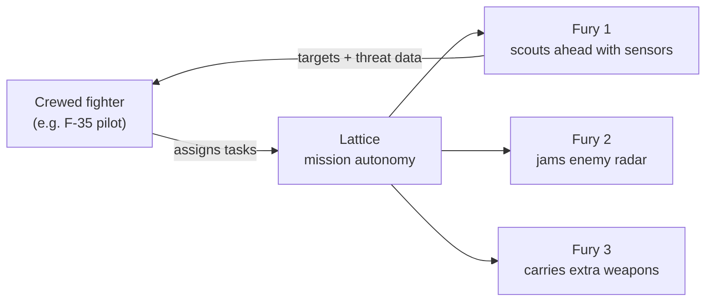

## News Around the World

### 1. Elon Musk Accuses an Indian Billionaire of Oligarchy

Elon Musk has accused an Indian billionaire of oligarchy, the latest flare-up in the fight over who gets to sell satellite internet in India.

The background: Starlink wants to enter India, and the country's incumbent telecom giants see it as a direct threat to their broadband business.

Whatever you think of the spat, it hides a bigger question. Should India let Starlink become the internet for the places that matter most?

<button type="button" class="nl-modal-open" data-modal-open="why-starlink-wont-work" aria-haspopup="dialog">
  Why Starlink won't work for India &rarr;
</button>

<dialog id="why-starlink-wont-work" class="nl-modal" aria-labelledby="why-starlink-wont-work-title">
  

    <h2 id="why-starlink-wont-work-title">Why Starlink Won't Work for India</h2>
    <button type="button" class="nl-modal-close" data-modal-close aria-label="Close">&times;</button>
  

  

Cheap, fast satellite internet sounds like a win. But for Starlink in India, the real issue is **national security**, not speed or price. Four reasons:

### 1. Border Connectivity Would Depend on the USA

The places that need satellite internet most are also the most sensitive: Arunachal Pradesh, the Line of Control (LoC), and the high Himalayan posts.

If connectivity in these regions runs through a US company, India's most strategic territory depends on a foreign network for its link to the rest of the country.

### 2. The USA Can Shut Off Critical Comms

A network operated from abroad can be switched off from abroad. That decision can come from a company, its owner, or pressure from Washington.

It has already happened. In 2022, Musk declined to enable Starlink coverage near Crimea when Ukraine wanted to use it for an attack. For India, the risk is having that switch flipped in the middle of a crisis.

### 3. India Cannot Control the Internet During Martial Law

In an emergency, a state must be able to take over or restrict its communication networks. India's Telecommunications Act, 2023 gives the government that power over domestic operators.

With a foreign constellation, the satellites, network software and control systems sit outside Indian jurisdiction. Enforcement would depend on a US company choosing to cooperate.

### 4. Drones and Defence Comms Need Sovereign Networks

Modern warfare runs on links: drones, sensors, command posts. If those links ride on US-controlled infrastructure, the US effectively holds a veto over India's operations.

India cannot be sovereign, whether on the offensive or the defensive, if its communications can be degraded, monitored or cut by another country.

**The bottom line:** Starlink may work for a village broadband plan. For defence, the borders and emergencies, India needs a network it controls end to end.

  

</dialog>

### 2. Anti-Drone Laser Defence Deployed to Protect Hegseth, Rubio and Trump

A new anti-drone defence system, including a directed energy weapon (a laser-based interceptor), has reportedly been installed near Palm Beach International Airport in Florida.

It is meant to protect Pete Hegseth, Marco Rubio and President Donald Trump, along with civilian aircraft and high-value sites such as Mar-a-Lago.

Military experts quoted in the report say it is built to counter drone attacks in sensitive civilian and political zones. That marks a shift: drones are now treated as a threat to home airspace, not just a battlefield problem from Ukraine to Iran.

The reason lasers matter is cost. A missile interceptor can cost far more than the drone it shoots down. A laser shot costs little more than the electricity behind it, so the defender stops losing money on every kill.

<a class="nl-source" href="https://timesofindia.indiatimes.com/defence/international/anti-drone-laser-defence-system-in-washington-to-protect-hegseth-rubio-how-it-works/articleshow/129945466.cms" target="_blank" rel="noopener">Read the full report on Times of India &rarr;</a>

### 3. Houthi Strike on Saudi Airport Kills 12, Worst Attack on the Kingdom in a Decade

A Houthi strike on a Saudi airport has killed 12 people, the worst attack on the kingdom in a decade. Reuters also reports a loud blast heard at Riyadh airport, with airlines cancelling more flights.

This is what cheap drone warfare looks like. The Houthis have built their campaign on low-cost drones and missiles, and they can still hit an airport in one of the region's best-defended states.

The economics favour the attacker. A cheap drone forces the defender to fire expensive interceptors or simply absorb the hit. That is exactly the gap laser systems like the one above are trying to close.

<a class="nl-source" href="https://www.reuters.com/world/middle-east/loud-blast-heard-riyadh-airport-airlines-cancel-more-flights-2026-10-10/" target="_blank" rel="noopener">Read the full report on Reuters &rarr;</a>

## Company Under Spotlight This Week

### Anduril Industries

{: .nl-logo}

Anduril is a defence technology company that builds autonomous systems across sea, land, air and space. What ties them together is **Lattice**, its software layer for sensing, autonomy and command.

The pitch is simple: software-first weapons, built fast and cheap enough to field in large numbers. This week's spotlight is its fighter-jet drone.

### Fury: Anduril's Autonomous Air Vehicle (AAV)

Fury is an uncrewed, jet-powered aircraft that runs on Lattice. Its job is to turn mission autonomy from a lab demo into something pilots can actually fly with.

Anduril highlights four build qualities:

- **Designed for accelerated fielding:** rapid prototyping, digital engineering and an open, modular design shorten the path from prototype to production.
- **High-performance, multi-mission:** next-generation flight performance, with room for Anduril's own or third-party sensors and payloads depending on the mission.
- **Model-driven, field-tested:** the digital design is tested and iterated using synthetic pilots and intelligent flight simulation running on real aircraft.
- **Affordable mass:** off-the-shelf commercial subsystems and an all-digital workflow mean it can be produced quickly, at scale and at a fraction of the cost of a crewed fighter.

### How Fury Flies Alongside Fighter Jets

Fury is built to be a **loyal wingman**. It is Anduril's entry in the US Air Force's Collaborative Combat Aircraft (CCA) programme, under the designation YFQ-44A.

The idea: one crewed fighter, such as an F-35, leads a small team of drones. The pilot hands out tasks, and Lattice flies the drones and carries them out.

Here is how that helps the pilot:

- **Goes in first:** Fury can fly ahead into defended airspace and take the risk, while the crewed jet stays further back.
- **More eyes and weapons:** each wingman adds its own sensors and payloads, so one pilot covers far more ground.
- **Light on the pilot:** the pilot gives high-level orders ("scout this area", "jam that radar") and Lattice handles the flying.
- **Affordable to lose:** because Fury costs a fraction of a fighter jet, commanders can risk it in ways they never would with a crewed aircraft and a pilot.

This connects to this week's drone stories. Cheap mass is changing who wins in the air, and Fury is the US bet that it can be on the winning side.

<a class="nl-source" href="https://www.anduril.com/fury/" target="_blank" rel="noopener">See Fury on Anduril's website &rarr;</a>
