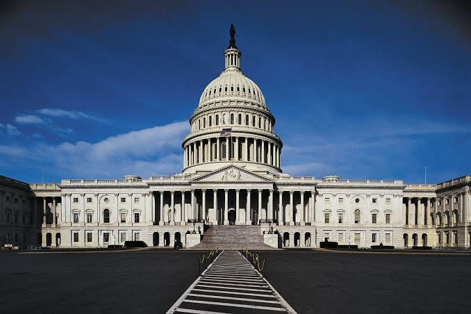
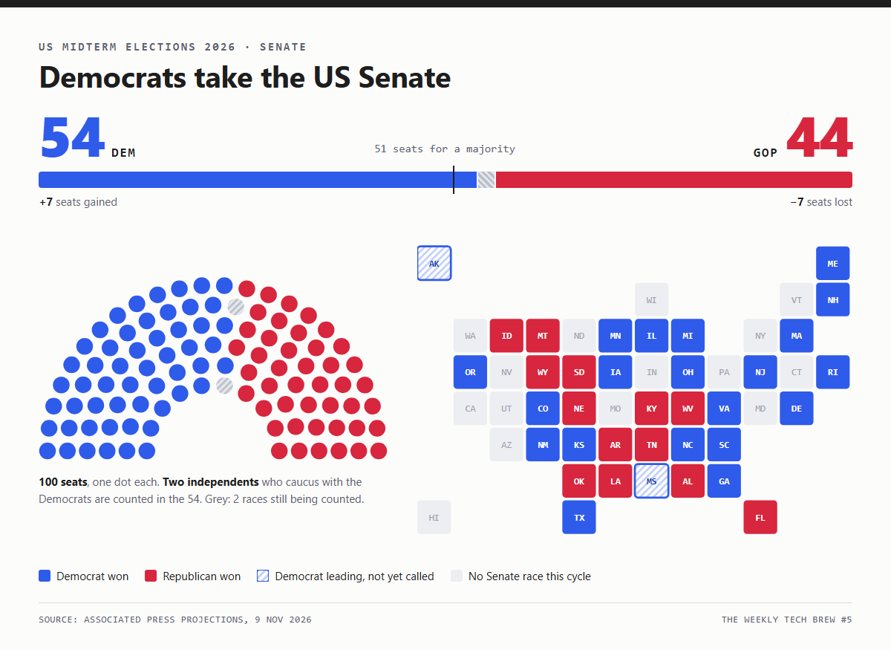
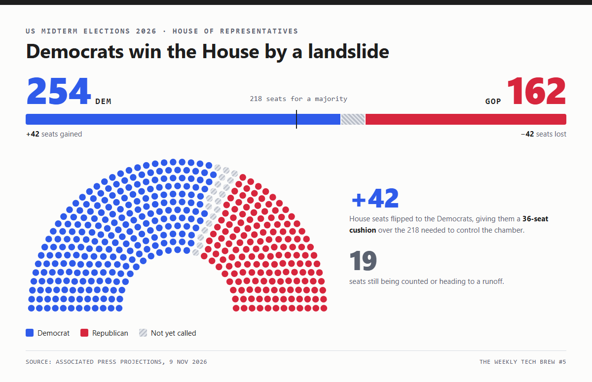
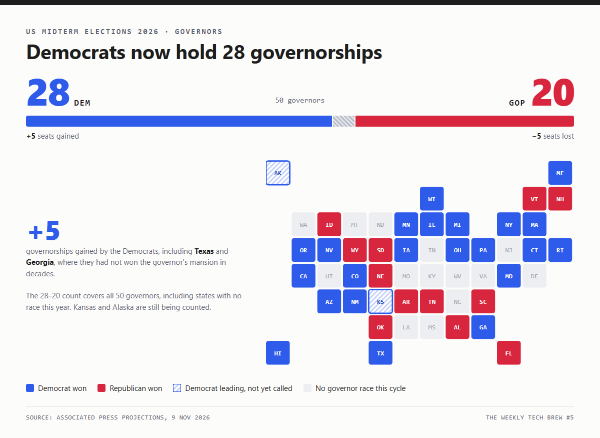
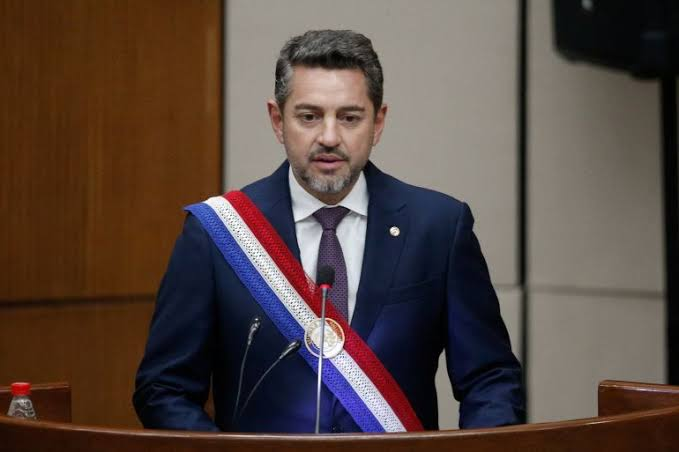

शुभ दीपावली

Happy Diwali

Welcome to **The Weekly Tech Brew Diwali Edition**. The festival of lights is a good excuse to look back at what lit up AI and tech this week: new model releases, research papers worth your time, and repos that shipped.

May your builds stay green and your inference stay fast. Happy Diwali from my side to yours.

Tap anywhere on this card to light a cracker.

## The World Brief

Global News &middot; Geopolitics &middot; Economy &middot; Technology

### 1. US Midterm Elections 2026

{: .nl-hero}

*The US Capitol, where both chambers of Congress now change hands after the 2026 midterms. (Representative image)*

US midterm elections work as a nationwide referendum on a sitting president's first two years in office. They decide whether the White House keeps its legislative momentum or runs into a divided government.

When the opposition party captures Congress, as the Democrats have in the 2026 midterms, the balance of power shifts across both domestic lawmaking and foreign policy.

#### 1. Why Midterm Elections Matter

Midterms take place halfway through a president's four-year term. They decide:

- **The entire House of Representatives:** all 435 seats are contested every two years.
- **One-third of the Senate:** about 33 to 34 of the 100 seats are up each cycle.
- **State-level power:** dozens of governorships and state legislatures, which shape local policy and draw voting districts.

**The legislative reality:** historically, the president's party almost always loses seats in the midterms. If the opposition flips one or both chambers, the administration can no longer easily pass major legislation or get quick confirmations.

#### 2. Passing Bills Under a Democratic Congress

Under Article I of the US Constitution, no bill becomes law unless it passes both the House and the Senate in identical form and then reaches the President's desk.

- **Legislative gridlock:** with Democrats controlling Congress, Donald Trump's big legislative priorities, such as permanent tax code changes, federal budget cuts and statutory deregulation, are effectively blocked. Anything that reaches his desk now needs bipartisan compromise.
- **The presidential veto:** Democrats can write and pass their own bills, but the president can veto them. Overriding a veto takes a two-thirds supermajority in both chambers, which is rare in polarised politics. The usual result is stalemate, with the real fights happening around must-pass funding deadlines (continuing resolutions and the debt limit).
- **A shift to executive action:** unable to pass sweeping laws, the White House has to lean harder on executive orders, federal agency rulemaking and presidential trade authority (such as emergency tariffs).
- **Subpoenas and oversight:** Democratic committee chairs can now issue subpoenas, open investigations into the executive branch and hold public hearings, which puts the administration on the defensive.

#### 3. War Powers and Military Action Against Iran

The Constitution splits authority over foreign conflict between the two branches:

| Constitutional power | Executive (President) | Legislative (Congress) |
|---|---|---|
| Primary authority | Commander-in-Chief (Article II) | Declares war and approves treaties (Article I) |
| Operational control | Directs military operations and tactical strikes | Makes the rules governing the armed forces (Article I, Section 8) |
| Funding and budget | Requests defence appropriations | Power of the purse (Article I, Section 9) |

On military escalation or war with Iran, three practical mechanisms matter:

- **The War Powers Resolution of 1973:** a president must notify Congress within 48 hours of sending US forces into hostilities, and must pull them out within 60 to 90 days unless Congress passes an Authorization for Use of Military Force (AUMF) or declares war.
- **The power of the purse:** funding is Congress's strongest brake on a conflict. A Democratic-led Congress can write binding provisions into the annual National Defense Authorization Act (NDAA) or defence appropriations bills that bar any taxpayer money from being spent on offensive operations against Iran without prior congressional approval.
- **Executive precedent:** modern presidents have often ordered limited air strikes, defensive retaliation or targeted operations without asking Congress first, arguing that Article II gives them inherent power to protect US personnel and assets abroad. Sustained, large-scale offensive combat against Iran, though, cannot be kept going for long without explicit congressional funding and authorisation.

ExpandCollapse

#### The Results at a Glance

*Senate: Democrats gain 7 seats for a 54&ndash;44 majority. Alaska and Mississippi are still being counted.*

*House: a 42-seat swing hands Democrats 254 seats, well clear of the 218 majority line.*

*Governors: Democrats pick up 5 states and now hold 28 of the 50 governorships.*

#### Democrats Take Both Chambers of Congress

The Democrats have won both the US Senate and the House of Representatives, which gives them control of Congress for the rest of Donald Trump's presidency.

The projected results gave the party plenty to celebrate and handed the Republicans a long list of losses. Here are the biggest Democratic wins and the historic firsts of the night.

#### Democratic Wins in Deep-Red Trump Country

Democrats won in states that Trump carried comfortably in the presidential election two years ago.

In **Texas**, James Talarico won a US Senate seat and Gina Hinojosa was elected governor. The two statewide wins end a losing streak for Texas Democrats that stretches back almost two generations. Hinojosa also becomes the state's **first Latina governor**.

Talarico's election-night party erupted as the projections came in, with supporters hugging and toasting a result many had not dared to expect.

In **Kansas**, Adam Hamilton won a tight Senate race, making him the state's first Democratic senator in nearly a century.

Hakeem Jeffries, the top Democrat in the House, is now in line to become Speaker. "Today begins the great American comeback," he told supporters. If his colleagues keep him as their leader, he will take over from Republican Mike Johnson and become the **first Black Speaker of the House**.

#### Trump Concedes the Democrats Did a "Good Job"

Trump gave a string of interviews to US media through the evening and struck a conciliatory tone, saying the Democrats did a "good job".

He said he would accept the results and looked forward to working with the opposition, while keeping his veto over any legislation Democrats push through Congress.

He also distanced himself from some Republican candidates: "In some cases they didn't like the candidates, and in some cases those candidates were not my friend."

Trump admitted that the US-Israel war on Iran, which has pushed up consumer prices at home, weighed on the vote. He argued that high fuel prices stopped voters from seeing how well the economy was doing "as much as they should have", adding: "The gasoline was caused by Iran."

#### Abdul El-Sayed Becomes the First Muslim US Senator

In **Michigan**, Abdul El-Sayed won one of the closest races of the night and became the **first Muslim elected to the US Senate**, keeping the seat in Democratic hands.

He beat Republican Mike Rogers, who had picked up a last-minute endorsement from Haley Stevens, El-Sayed's own Democratic rival in the primary.

It was one of the most bitter contests of the midterms. Trump invoked 9/11 and called El-Sayed a "jihadist" without offering any evidence, which drew a backlash and accusations of Islamophobia.

On stage, El-Sayed told supporters he had always added "inshallah" (God willing) whenever anyone mentioned the result. "But today, tonight, we can turn that 'inshallah' into 'alhamdulillah'," he said, meaning "praise be to God".

#### Distancing From Trump Did Not Save Republicans

The defeat of **Susan Collins**, Maine's Republican senator for three decades, showed how deep the Republican losses ran.

She lost to Democrat Troy Jackson, a logger who leaned on his working-class background to win over blue-collar voters in Maine. Conceding, Collins said serving the state for 30 years had been the "honour of my life". The mood at her watch party in Bangor was sombre, with the song *Closing Time* playing in the room.

Collins went into the race as one of the most vulnerable Republican incumbents, and her strategy of keeping her distance from Trump did not work.

Ashley Hinson met the same fate in **Iowa**, losing a close Senate race to Josh Turek. Hinson had broken with the president in places, urging him to end the war with Iran and opposing his move to ease beef tariffs, while still defending his wider tariff policy.

#### Historic Firsts: Black Governors, a Gay Senator and a Gen Z Congresswoman

- **Florida:** Republican Byron Donalds becomes the state's **first Black governor**, after a strong endorsement from Trump. Taking over from Ron DeSantis, he called Florida the "envy of the nation" and promised to make it more affordable. It was one of the few bright spots of the night for Republicans.
- **Georgia:** Democrat Keisha Lance Bottoms, the former mayor of Atlanta, won the governor's race, becoming the state's **first Black governor and first woman governor**. She beat Republican billionaire and healthcare executive Rick Jackson, and gives Georgia its first Democratic governor in more than 20 years.
- **New Hampshire:** Democrat Chris Pappas becomes the **first openly gay man elected to the Senate**, celebrating on stage with his husband. He beat former Republican senator John Sununu, and thanked him for his public service.
- **Colorado:** Melat Kiros becomes the **first Gen Z woman elected to Congress** (Gen Z covers people born between 1997 and 2012).

#### Further Reading

- <a href="https://www.bbc.com/news/us-canada" target="_blank" rel="noopener">BBC News: US midterm elections 2026, the big wins and historic firsts &rarr;</a>

### 2. From Bank Run to Impeachment: The Sudden Fall of Paraguay's Santiago Peña

{: .nl-hero}

*Paraguay's red, white and blue presidential sash at a swearing-in in Congress. (Representative image)*

Paraguay has been plunged into a major political and financial crisis after the collapse of **Ueno Bank**, which set off massive street protests and led to the impeachment and arrest of President **Santiago Peña**.

ExpandCollapse

#### The Ueno Bank Collapse

- **Mass account freezes:** in early November 2026, regulators seized Ueno Bank, a prominent digital lender with a huge retail customer base, over severe insolvency, risky insider lending and illicit related-party transfers. The seizure locked roughly **3 million retail accounts** and put more than **$800 million** in public funds and pensions at risk.
- **Economic shockwaves:** Ueno had grown into one of the country's main financial platforms, so everyday transactions froze nationwide. Public transport, delivery networks and pension payouts were disrupted immediately.

#### The Impeachment and Arrest of Santiago Peña

- **Political fallout:** Peña, who had close ties to Ueno's leadership, first offered his resignation. The Chamber of Deputies rejected it and opened formal impeachment proceedings instead.
- **Senate removal:** on **6 November 2026**, the Senate voted unanimously to impeach and remove Peña from office, stripping him of presidential immunity at the same time.
- **Detention:** prosecutors indicted Peña on charges including breach of trust, influence peddling and illicit enrichment. He was arrested and moved to a military facility for his own protection amid intense public unrest. **Carlos Carvallo**, head of the Central Bank, was also indicted and arrested.

#### Where Paraguay Stands Now

- **New administration:** Vice President **Pedro Alliana** was sworn in as President on 6 November and will serve out the remaining term through August 2028.
- **Depositor relief:** central bank authorities have activated the Deposit Guarantee Fund, starting phased payouts and moving account balances to stable partner banks.
- **Public outcry:** protests continue across Asunción, outside government buildings and Ueno's headquarters, demanding accountability and the full recovery of people's savings.

## The Company Dossier

Startups &middot; AI Labs &middot; Founders &middot; Business Models &middot; Innovation

Inside the companies building the technologies and businesses shaping tomorrow.

### Thinking Machines Lab: Mira Murati's AI Lab for Customizable, Collaborative AI

{: .nl-hero}

In September 2024, **Mira Murati** announced she was stepping down as Chief Technology Officer of OpenAI to make "time and space" for her "own exploration". She left amid a wider wave of executive departures and structural changes at the company.

After her exit she launched **<a href="https://thinkingmachines.ai/" target="_blank" rel="noopener">Thinking Machines Lab</a>** as a **public benefit corporation**. Its goal is to build next-generation AI that is more widely understood, more customizable and more generally capable.

By building an independent lab outside the established frontier players, Murati set out to pursue focused research into **AI agents and customizable models**, such as the lab's tooling product **Tinker**, under a governance structure built around responsible, targeted frontier development.

ExpandCollapse

#### 1. What Is Thinking Machines Lab?

Thinking Machines Lab is an **AI research and product company**. Its pitch is simple: everyone should have the knowledge and the tools to make AI work for their own needs and goals, not just the handful of labs that train frontier models.

#### 2. The Three Gaps It Wants to Close

The lab argues that AI capabilities have raced ahead while three things have lagged behind:

- **Understanding:** the scientific community's grasp of how frontier systems actually work trails far behind what those systems can do.
- **Access to know-how:** knowledge of how these models are trained sits inside a few top labs, which narrows both public debate about AI and people's ability to use it well.
- **Customization:** for all their power, today's models are still hard to adapt to a specific person's needs and values.

Its answer is to make AI systems **more widely understood, customizable and generally capable**.

#### 3. Who Is Building It

The team is made up of scientists and engineers behind some of the most widely used AI products and tools: **ChatGPT** and **Character.ai**, open-weight models like **Mistral**, and open-source projects such as **PyTorch**, **OpenAI Gym**, **Fairseq** and **Segment Anything**.

That mix matters: it is a team that has shipped consumer products, open models and the infrastructure the rest of the field builds on.

#### 4. How the Lab Says It Will Work

**Open science by default.** Thinking Machines plans to publish technical blog posts, papers and code regularly. Its view is that sharing work both benefits the public and keeps its own research culture sharp. Its research blog is called **Connectionism**.

**AI that works with people, not instead of them.** Rather than chasing fully autonomous systems, the lab wants to build **multimodal systems that collaborate with people**. It also wants AI that adapts to the full range of human expertise, not just the fields current models are best at, like programming and maths.

**Strong foundations:**

- **Model intelligence comes first.** Collaboration and customization only matter if the underlying model is strong, so the lab is building frontier-level models for domains like science and programming.
- **Infrastructure quality is a priority.** Research speed depends on reliable, efficient, easy-to-use infrastructure, and the lab says it would rather build things properly for the long run than take shortcuts.
- **Multimodality is core.** Working across text, images and other inputs makes communication more natural, keeps more information and captures intent better.

**Learning by doing:**

- **Research and product are designed together.** Shipping products keeps the research grounded in real problems, and good research makes better products.
- **Safety is empirical and iterative.** The lab plans to keep a high bar against misuse while maximising user freedom, share safe-building recipes with the industry, and speed up outside alignment research by releasing code, datasets and model specs. It sees today's methods, such as red-teaming and post-deployment monitoring, as lessons that carry over to more capable future systems.
- **Measure what matters.** The focus is on whether systems create real value in the world. The lab's view is that big breakthroughs often come from rethinking the objective, not just pushing an existing benchmark higher.

#### 5. What It Has Shipped

- **Tinker:** the lab's tooling product for customizing models, with its own docs for developers.
- **Inkling:** the lab's own model line. The newest release, flagged as new on its homepage, is **Inkling 2 Small**.

#### 6. Why It Matters

Most frontier labs compete on one axis: a bigger, smarter general model. Thinking Machines is betting on a second axis: **who gets to shape the model**. If customization and open research become the differentiator, the lab is positioned less as another chatbot company and more as the toolmaker for everyone who wants AI built around their own work.

#### 7. Where to Explore

- <a href="https://thinkingmachines.ai/" target="_blank" rel="noopener">Thinking Machines Lab: official website (Inkling, Tinker, Connectionism and open roles)</a>
- <a href="https://x.com/thinkymachines" target="_blank" rel="noopener">Thinking Machines on X: @thinkymachines</a>


  Sections go below, in the usual order:
  The World Brief / The Company Dossier / The Model Drop / Repo Radar /
  Beyond The Abstract / Tech Signals / Extra Time.
  Remove `wip: true` from the front matter once the issue is ready to send.

