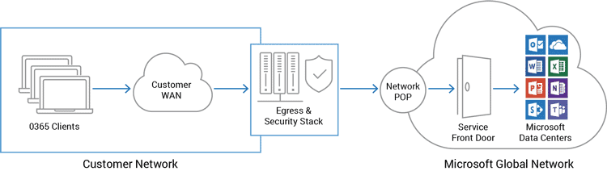

## The World Brief

Global News &middot; Geopolitics &middot; Economy &middot; Technology

### 1. The Boardroom Power Play: Why Jensen Huang Couldn't Survive the Scandal

Jensen Huang's resignation as **NVIDIA CEO** after a major personal and corporate scandal raises a fascinating question: **how much power does a company's board really have?** Why can NVIDIA's board remove its founder, while **Mark Zuckerberg at Meta** and **Larry Page at Google** enjoy far greater protection through their ownership and voting structures?

ExpandCollapse

{: .nl-hero}

*Founders of Meta and Alphabet control a majority of shareholder votes with a minority of the equity. NVIDIA has no super-voting class.*

#### What Are Class A and Class B Shares?

Class A and Class B shares are part of a **dual-class stock structure**. It separates a company's **financial ownership** (who gets the profits) from its **voting control** (who makes the decisions).

Most public companies follow a simple **"one share, one vote"** rule. Founders of big tech companies like Meta and Alphabet instead split their stock into different classes before going public. That let them raise billions of dollars from public investors without giving up control of the company.

#### How the Share Classes Differ

| Share Class | Who Owns Them | Voting Power | Financial Value & Dividends |
|---|---|---|---|
| **Class A** | General public & institutional funds (traded on stock exchanges, e.g. GOOGL, META) | 1 vote per share | Equal share of profits and dividends |
| **Class B** | Founders & early insiders only (never traded publicly) | 10 votes per share ("super-voting") | Equal share of profits and dividends |
| **Class C** | Public investors & employees (e.g. Alphabet's GOOG) | 0 votes per share | Equal share of profits and dividends |

*Companies issue Class C shares so they can pay employees in stock or raise funds without issuing new voting shares that would dilute the founders' majority.*

#### Why the Board Cannot Kick Zuckerberg or Brin Out

In a standard company, shareholders elect the **Board of Directors**, and the board has the power to hire or fire the CEO.

That is how **Steve Jobs** was pushed out of Apple in 1985 and **Sam Altman** was temporarily ousted from OpenAI in 2023.

At Meta and Alphabet, that chain of command is locked by pure arithmetic.

**Minority equity, majority votes:**

- **Mark Zuckerberg (Meta):** owns roughly **13.5%** of Meta's total equity, almost entirely in Class B shares. Because each Class B share carries 10 votes, that stake translates into **61% of all voting power**.
- **Sergey Brin & Larry Page (Alphabet):** together the co-founders hold **under 12%** of Alphabet's economic stake, yet their Class B shares give them **52.7% of total voting power** (27.4% for Page and 25.3% for Brin).

**The boardroom checkmate:**

- Under corporate law, shareholders vote on who sits on the board.
- Zuckerberg (61%) and Brin + Page (52.7% combined) hold more than 50% of the votes by themselves, so they **single-handedly decide who is elected to or removed from the board**.
- Even if every independent director turned against the founders, the founders could call a shareholder vote, replace the entire board and appoint directors who support them.
- Giant institutional investors like **BlackRock** or **Vanguard** are just as powerless. Even if every outside shareholder voted together, they would still hold less than half the votes.

#### When Does Their Control End?

Super-voting Class B shares cannot be sold to outsiders as super-voting stock.

Under both Meta's and Alphabet's corporate charters, the moment a founder **sells, transfers or gifts** a Class B share to an outside party, or **passes away**, that share automatically converts 1-for-1 into an ordinary Class A share with just 1 vote.

Unless Zuckerberg or Brin voluntarily step down, or sell enough shares to drop below the 50% voting threshold, they remain effectively untouchable.

### 2. When Microsoft Goes Dark: The Global Outage That Took Down Outlook and Teams

One infrastructure failure, millions of disruption reports, and businesses around the world suddenly unable to reach their digital workplaces. **Microsoft's November outage** exposes a critical weakness in **cloud dependency**: when the infrastructure layer fails, the entire productivity ecosystem can come crashing down.

ExpandCollapse

{: .nl-hero}

*Outlook, Teams, SharePoint and the admin portals all sit behind the same shared backend layers.*

This is a **cascading infrastructure failure in Microsoft 365**, most notably seen in Microsoft's global outage in **November 2024** (tracked under incident IDs **MO941162** and **EX941560**). A single defect in a shared backend layer took down **Outlook, Microsoft Teams, SharePoint and the admin portals** for millions of users worldwide at the same time.

Users see Outlook and Teams as separate apps. Underneath, both are tightly coupled to the **same gateway, identity and data-storage layers**.

*How Microsoft 365 traffic flows from client devices to Microsoft's data centers.*

As the architecture above shows, traffic from every client device passes through a shared **Service Front Door** and common data center infrastructure before it reaches individual apps. When a core layer in that pipeline fails, every app behind it goes dark together.

#### How One Failure Triggered a Global Blackout

**1. A faulty update in the caching layer**

During the November 2024 incident, an update introduced a defect into a **shared caching tier** serving Exchange Online and Microsoft 365.

Instead of serving fast responses from memory, the affected caching nodes began failing and dropping requests.

**2. Cache stampede (backend overload)**

When the caching tier stopped absorbing traffic, millions of client connections bypassed the cache and hit the core mailbox and routing servers directly.

This sudden surge, known in distributed systems as a **thundering herd** or **cache stampede**, quickly exhausted compute and memory capacity across multiple regions.

**3. Why Teams collapsed alongside Outlook**

Many organisations treat Teams as a fallback when email goes down, assuming the two run independently. Under the hood, Teams depends heavily on **Exchange Online** and the **Microsoft 365 Substrate**:

- **Calendars & meetings:** Teams reads and writes meeting schedules directly from a user's Exchange mailbox.
- **Chats & compliance:** chat history, contact cards and voicemail records are indexed and stored through shared Substrate/Exchange services.

**Result:** once Exchange's caching and routing tier choked, Teams lost calendar sync, message delivery stalled, and connection timeouts spread across desktop and mobile clients.

**4. Control-plane lockout**

The **Microsoft 365 Admin Center** relies on the same shared infrastructure. IT administrators were locked out of service-health dashboards and tenant controls.

Meanwhile Microsoft rolled back the faulty change, restarted the affected caching nodes and throttled background sync traffic over **roughly 24 hours**.

#### The Core Cloud Dependency Vulnerability

Modern SaaS productivity suites reach massive scale by consolidating critical services onto **shared infrastructure**. That creates **high-blast-radius single points of failure**:

| Shared Infrastructure Layer | Role in the Ecosystem | Impact When It Fails |
|---|---|---|
| **Edge Routing (Service Front Door)** | Terminates TLS and routes global traffic to the nearest healthy cluster | Clients cannot reach endpoints at all; apps appear completely offline |
| **Shared Caching & M365 Substrate** | Handles hot mailbox, chat, presence and calendar state at scale | Cascading backend overload knocks out Outlook, Teams and SharePoint at once |
| **Identity Plane (Entra ID)** | Issues OAuth tokens and validates active sessions | Total sign-in lockout across Microsoft apps and third-party SSO tools |

Enterprises standardise almost entirely on a single cloud ecosystem for email, chat, file storage and identity. So a single misconfiguration at the infrastructure layer can immediately halt day-to-day operations across entire organisations.

