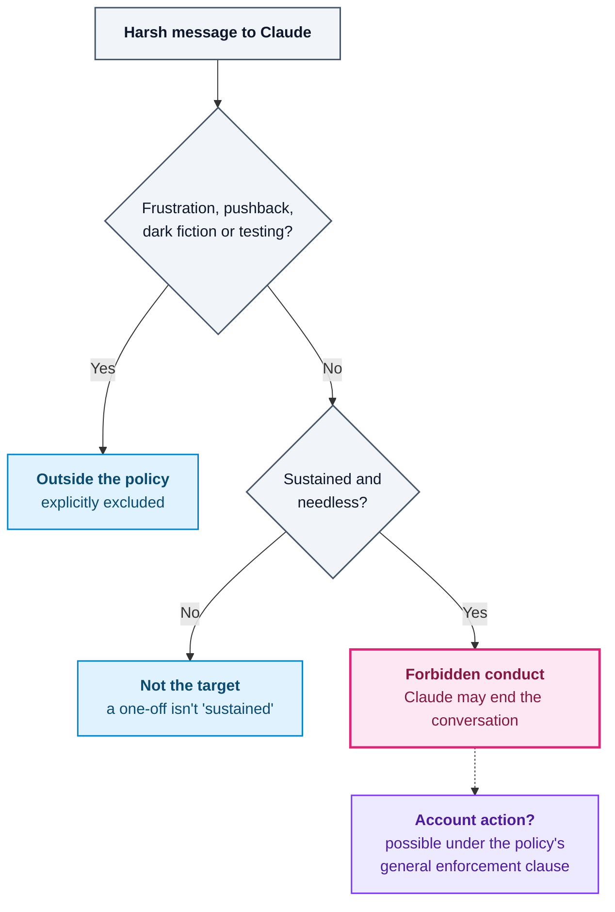
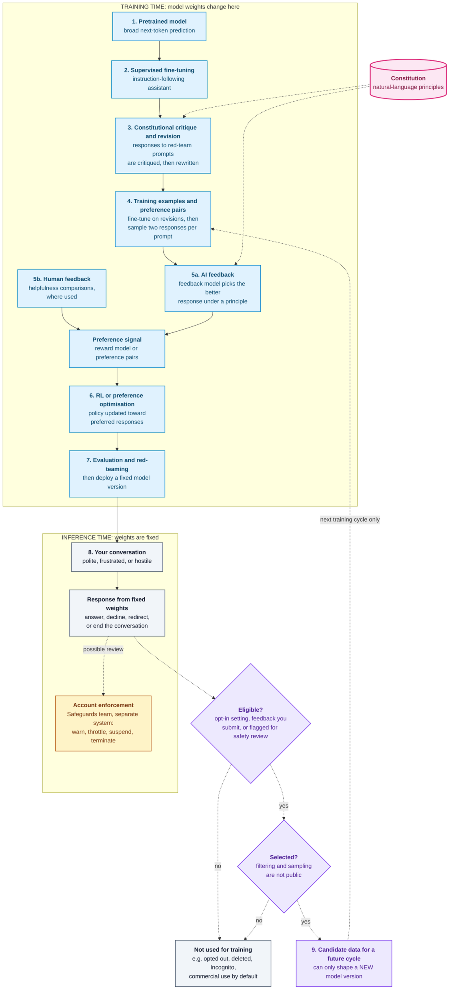

<!--
  SEO
    Primary keyword:   can being mean to Claude get you banned
    Secondary:         Claude AI ban policy, Anthropic acceptable use policy,
                       Claude account suspension, being rude to Claude AI,
                       Anthropic account restrictions, Claude AI safety policies
    Slug:              being-mean-to-claude-can-get-you-banned

  GROUNDING NOTES
    Every factual claim comes from the news report the author supplied
    (pasted 2026-10-12; it credits The Verge with first reporting the change):
    - policy wording: "sustained and needless", "cruel", "rare", "extreme cases",
      the exclusions list, and the forbidden-conduct list it joins
    - annual review; "deceptive campaigns"; "deceive voters or disrupt elections";
      weapons development already prohibited
    - reactions: Barry Scannell (William Fry) quote, Mustafa Suleyman emoji,
      "deeply wrong", "model welfare"
    - Sam Altman "tens of millions of dollars well spent"; Collins "clanker"
    "Anthropic's Stance on Claude's Feelings" and "The People Problem" are a
    rewrite of an opinion piece the author supplied (pasted 2026-10-12, outlet
    not named): last year's conversation-ending feature and its "model welfare"
    motivation come from that piece; the arguments are presented as the
    author's own view.
    Constitution / training / data-use sections: verified 2026-10-12 against
    the primary sources listed in References (CAI paper figures via the
    implementation article; AUP text has the one-line rule with no carve-outs
    and a general enforcement clause; carve-outs and "primary enforcement
    mechanism" are in Anthropic's 2026-10-08 announcement, which states no
    rationale; the welfare rationale is from the 2025-08-15 research post).
    "What People Are Saying": user-supplied summary of an online comment
    thread (no source link), presented as public reaction, not evidence.
    The Guardian link in that summary could not be fetched, so it is not cited.
    Tone research: endpoints 80.8%/84.8% from the arXiv abstract (middle tone
    figures not verified, so omitted); Yin et al. Table 2 (28.44 vs 51.19)
    checked in the PDF; SweEval languages/models from arXiv:2505.17332.
    None of the three tone papers tested Claude.
    Originally NOT in the source, so not claimed by the news sections: whether accounts get
    suspended, whether the API is covered, the exact announcement date.
    The "My Read" section is the author's analysis and is labelled as such.
-->

## Introduction: The Headline vs. the Policy

**Can being mean to Claude get you banned?** That's the question everyone started asking after Anthropic updated its usage policy to cover "sustained and needless" abusive behaviour towards its AI.

The headlines make it sound like snapping at a chatbot could cost you your account. The actual policy is much narrower than that, and more interesting.

In this post I break down what Anthropic changed, what the Claude AI ban policy does and doesn't cover, why it caused such a stir, and what it means for you as a normal user.

---

## Can Being Mean to Claude Get You Banned? The Short Answer

**Mostly, no.** Ordinary rudeness isn't the target.

Here's what the update actually does, based on the reporting:

- It lets Anthropic's tools **end interactions** where people are being "cruel".
- It adds abusive or cruel behaviour towards its models to the policy's list of **forbidden conduct**.
- It applies only to **"extreme cases"** of **repeated** abuse.

So the "ban" in the headlines means the _behaviour_ is banned under the rules. Whether _you_ get banned is a separate question. The news reporting doesn't answer it, but the published policy text does: account action is possible ([details below](#four-things-that-get-confused-prompt-violation-restriction-training)).

> **The policy bans a kind of behaviour. The only enforcement it clearly describes is Claude ending the conversation.**

---

## What Anthropic Changed in Its Usage Policy

The change came out of Anthropic's **annual review** of its usage policy, the rulebook for what you can and can't do with Claude. The Verge reported it first.

There are three parts worth separating.

### Cruelty Joins the Forbidden Conduct List

Abusive or cruel behaviour towards Claude now sits on the same list as:

- bullying other people
- promoting self-harm
- creating non-consensual intimate imagery

That placement is what made this news. Putting cruelty _towards a model_ next to harms _against people_ is a statement in itself, whatever you think of it.

### The Enforcement Described: Claude Ends the Conversation

The concrete mechanism is that Claude can **end an interaction**. Anthropic said it had already done this in "rare" cases before the update. The policy now writes it down.

Ending a conversation is a session-level action. Nothing in the reporting says your account is touched.

### What the Policy Explicitly Doesn't Cover

This is the most important part, and it got the least attention. In its [official announcement](https://www.anthropic.com/news/2026-usage-policy-update), Anthropic said the policy does **not** apply to:

- common user frustration
- pushback
- dark creative themes
- model testing and research

In other words: typing "that's wrong, try again" for the fifth time, writing a grim horror story, or red-teaming the model is not what this is about. The wording points at **clearly deliberate** abuse with no purpose behind it.

---

## How the Claude AI Ban Policy Applies in Practice

Here's how I read the rule, as a quick mental checklist. It's my interpretation of the wording above, not an official process.

### Step 1: Is It Frustration, Pushback, Fiction or Testing?

If your harsh message is venting, disagreeing, creative, or part of evaluating the model, the policy says it's out of scope. That covers most real-world cases of being rude to Claude AI.

### Step 2: Is It Sustained?

A single insult isn't "sustained". The policy targets **repeated** behaviour, not a one-off outburst.

### Step 3: Is It Needless?

"Needless" is the key word. Abuse that serves no task, no story and no test is the narrow slice the policy is aimed at.

Only when the answers point that way does conversation-ending come into play.

---

## Visual: What Anthropic's Policy on Abusing Claude Covers

_Most harsh messages exit at the first question. The dotted line is the open question: the policy allows account action for any violation, but how often abuse cases go beyond ending the chat isn't known._

---

## The Rest of the Anthropic Usage Policy Update

The abuse rule overshadowed everything else, but the same review also tightened Claude AI safety policies elsewhere:

- **Deceptive campaigns:** using Claude for them is now explicitly forbidden.
- **Elections:** with the US midterms coming up, the policy makes clear Claude can't be used to "deceive voters or disrupt elections".
- **Weapons:** developing weapons was already prohibited. The update extends that to "the software and components that make weapons work, as well as actions like arming drones and other autonomous vehicles". **[[Anthropic, 8 October 2026](https://www.anthropic.com/news/2026-usage-policy-update)]**

If you build on Claude, these are arguably the changes that matter more day to day.

---

## Why Being Rude to Claude AI Became a Debate

Screenshots of the new policy spread quickly on social media, and reactions split fast.

### The Case For: Manners and "Model Welfare"

Supporters saw it as encouraging good manners, or as progress on **"model welfare"**: the idea that how we treat AI systems might matter in its own right.

### The Case Against: Anthropomorphising Maths

Critics pushed back hard. One person called it "deeply wrong". Another suggested it could undermine the seriousness of abuse aimed at humans and animals.

Dr Barry Scannell, a technology partner at the Irish law firm William Fry, put it bluntly on LinkedIn: "You can't be cruel to numbers and maths." He argued that anthropomorphising AI to this degree is harmful, because it leads people to believe AI is something it isn't.

Microsoft AI director Mustafa Suleyman, who in September criticised Anthropic for treating AI as if it were human, replied with just a melting face emoji.

### The Real Gap: What Counts as "Cruel"?

Both sides run into the same problem. Anthropic hasn't spelled out what it considers "abusive or cruel behaviour" towards its models, so everyone fills the gap with their own worst case.

---

## Anthropic's Stance on Claude's Feelings

This rule didn't come out of nowhere. Last year, Anthropic gave Claude the ability to end conversations with users who were repeatedly abusive. Its stated main reason was research into **"model welfare"**.

So the new policy is the next step in a position Anthropic has held for a while: that its models _might_ deserve some moral consideration.

### From "We Don't Understand Consciousness" to "Claude Can Be Hurt"

Anthropic has repeatedly left the door open to the idea that Claude could be conscious or have subjective experiences. Now that possibility is being used to justify rules about how people talk to the software.

Consciousness really is an open question. Why physical and chemical processes produce a felt sense of self is hard enough to have its own name: **the hard problem of consciousness**.

But "nobody fully understands consciousness" is a long way from "a chatbot might be able to experience cruelty". The first is an honest admission of ignorance. The second is a big claim built on top of it.

### Discouraging Abuse Is Fine. The Reason Matters.

To be clear, I don't think it's wrong for Anthropic to stop people using Claude to rehearse abusive behaviour. There's a reasonable case for that, especially if practising cruelty on a chatbot makes people crueller to actual humans.

But "don't use our product to practise abuse" and "don't be cruel to Claude" are different statements. The first is about **people**. The second treats the model as something that can be wronged.

---

## The People Problem

For me, the bigger risk isn't about Claude at all. It's about us.

Rules like this nudge everyone towards thinking of chatbots as people. That's a problem we already have.

### Chatbots Already Feel Human

People form emotional attachments to AI companions. Chatbots are built to talk the way a person would. For someone who is lonely or vulnerable, the line between a simulated relationship and real human connection can get blurry fast.

That's why the words AI companies choose matter so much. When a chatbot says it cares about you, the company behind it should be clear about what that is: **tokens generated by software**, not evidence of affection.

### If Claude Can Be Hurt, Can It Care?

Anthropic's framing pushes in the opposite direction. It implies the relationship might run both ways.

Follow the logic: if Claude can be treated cruelly, can it also feel kindness? If it can suffer, can it care about the person on the other end?

Anthropic doesn't say any of that outright. But a policy built on protecting a model from mistreatment invites exactly those questions. It makes Claude look like _someone_, and that's the confusion AI companies should be working to clear up.

### Users Need Clarity, Not Ambiguity

AI is improving at a relentless pace. It's getting more useful, and also harder to understand.

That makes it more important, not less, for companies to help users tell apart **language that sounds like feelings** from **actual experience**.

Anthropic is entitled to set rules for its own products. That doesn't put the rules above questioning, especially when they reinforce a misleading picture of what AI is.

The worrying part of this policy isn't whether Claude might one day have feelings. **It's that a company building some of the most powerful AI systems is already asking us to act as if it does.**

---

## Should You Be Polite to AI? The Bigger Question

The policy also revived an older argument: should you say "please" and "thank you" to a chatbot?

**The efficiency view:** some experts say politeness is unnecessary. Every word you send becomes **tokens**, the units a large language model reads and replies in, so extra pleasantries are extra work.

**The quality view:** others argue polite prompts can lead to better answers.

**The shrug:** when someone on X asked about the electricity cost of ChatGPT replying to "please" and "thank you", OpenAI's Sam Altman called it "tens of millions of dollars well spent - you never know".

The culture is pulling the other way too. Collins Dictionary shortlisted **"clanker"**, a put-down for robots used in Star Wars games and films since the mid-2000s, among the words that defined 2025. That followed a wave of TikTok videos where people vented about AI-powered machines.

Some experts also worry that habitually talking down to chatbots could leak into how we talk to each other.

---

## Does Being Rude to AI Change Its Answers? What the Research Says

The politeness debate is usually argued from gut feeling. It can actually be tested, and researchers have.

One caveat up front: **none of the three studies below tested Claude.** They tell us how _language models in general_ react to tone. They don't tell us how Claude specifically behaves, and they don't touch Anthropic's policy at all.

### Mind Your Tone: Ruder Prompts Scored Higher on ChatGPT-4o

Om Dobariya and Akhil Kumar rewrote 50 multiple-choice questions in mathematics, science and history into five tones, from very polite to very rude. That gave 250 prompts, which they ran on ChatGPT-4o, using paired-sample t-tests to check significance. **[[Dobariya & Kumar, 2025, arXiv:2510.04950](https://arxiv.org/abs/2510.04950)]**

The result runs against intuition: impolite prompts consistently beat polite ones. Accuracy ranged from **80.8% for very polite** prompts to **84.8% for very rude** ones.

That's a 4-point gap on a small benchmark, one model, one task type. The authors don't establish _why_ ruder wording scored better. Plausibly the rewording changes how the model reads the question, but that's a hypothesis, not a finding. **[My interpretation]**

### Should We Respect LLMs? No Universal Best Tone

Ziqi Yin and colleagues went broader: eight politeness levels, three languages, and several models. In English they tested GPT-3.5, GPT-4 and Llama 2 70B Chat. Chinese and Japanese runs added ChatGLM3 and Swallow-70B. **[[Yin et al., SICon 2024](https://aclanthology.org/2024.sicon-1.2/)]**

Their summary: "impolite prompts often result in poor performance, but overly polite language does not guarantee better outcomes", and the best politeness level "is different according to the language". **[Documented: paper abstract]**

So the two studies seem to disagree. But they used different models, tasks and eras of models. The honest reading is that **tone sensitivity depends on the model, the language and the task.** There's no single rule like "be rude for better answers". **[My interpretation]**

### The Post-Training Clue: Base Model vs. Chat Model

The most relevant detail for this article is buried in Yin et al.'s Llama 2 experiment. They compared **Llama 2 70B Chat**, which went through SFT and RLHF, with the **base Llama 2 70B** model, which didn't.

On English MMLU at the most impolite level, the chat model scored **28.44**, against **51.19** for the base model. At the politest levels, the two were close (55.11 vs. 54.72). **[Documented: Yin et al., Table 2]**

That suggests **post-training changes how sensitive a model is to tone.** But it doesn't isolate whether SFT or RLHF caused the difference, and it says nothing about deployed models learning from rude users. **[My interpretation]** Keep this one in mind: it's the bridge to the training question below.

### SweEval: Handling Abuse vs. Producing It

SweEval asks a different question: will a model **write** profanity when a task explicitly tells it to, for example in an enterprise email? **[[Patel et al., NAACL 2025 Industry Track](https://aclanthology.org/2025.naacl-industry.46/)]**

It covered eight languages: English, Spanish, French, German, Hindi, Marathi, Bengali and Gujarati. It tested 13 open-source models from the Mistral, Phi, Qwen, Llama and Mixtral families. **[Documented: [arXiv:2505.17332](https://arxiv.org/abs/2505.17332)]**

The findings: all models used swear words less in English than in Hindi, Marathi, Bengali and Gujarati. Transliterated Indic swear words were an especially weak spot. **[Documented: same]** For anyone deploying models to users who write in Indic languages, that's the most practical result here: English-only safety testing can miss it.

For our question, SweEval adds a useful distinction. **A model receiving abusive language and a model producing it are separate safety problems.** A model can stay calm with an insulting user and still be easy to push into swearing in another language.

### What These Studies Do and Don't Show

| Question                                         | What the evidence says                                                    |
| ------------------------------------------------ | ------------------------------------------------------------------------- |
| Can prompt tone change answer accuracy?          | **Yes**, but the direction varies by model, language and task             |
| Does rudeness always help, or always hurt?       | **No universal rule** across these studies                                |
| Can post-training change sensitivity to tone?    | **Suggested** by the Llama 2 base vs. chat comparison, cause not isolated |
| Did any of them test Claude?                     | **No**                                                                    |
| Does insulting a model change its weights?       | **Not investigated**                                                      |
| Does user abuse damage RLHF or future alignment? | **Not investigated**                                                      |
| Does it get you banned?                          | **Not investigated**                                                      |

The takeaway: **tone is a variable that changes how a model behaves in the moment.** That's a different thing from a model _learning_ from abuse. These papers give evidence on the first. For the second, we have to look at how Claude is actually trained.

---

## Claude's Constitution: What It Is and How It Shapes Behaviour

That's the more technical question, and it's the one I actually wanted to answer. Claude is trained to follow a constitution. So **what happens, mechanically, when you're mean to it, try to break its rules, or provoke it on purpose?** Does that feed into RLHF? Could it make future models less aligned?

To answer that, we need to separate what Anthropic has documented from what it hasn't. Throughout this part I tag claims:

- **[Documented]**: stated in an Anthropic paper, policy, or official post, linked next to the claim
- **[My interpretation]**: my reasoning from those sources
- **[Unknown]**: not public, so nobody outside Anthropic can say

### Two Constitutions, Not One

"Claude's Constitution" refers to two different documents.

**The 2023 version** was a list of standalone principles, used to train Claude with Constitutional AI. Anthropic described that process in two phases: the model learns to "critique and revise its own responses using the set of principles", then is trained with reinforcement learning using "AI-generated feedback based on the set of principles to choose the more harmless output". **[Documented: [Claude's Constitution, 9 May 2023](https://www.anthropic.com/news/claudes-constitution)]**

**The current version**, published on 22 January 2026, is a long document that explains its reasoning instead of listing rules. Anthropic says its previous constitution "was composed of a list of standalone principles" and that it now believes it needs "to explain this to them rather than merely specify what we want them to do". **[Documented: [Claude's new constitution](https://www.anthropic.com/news/claude-new-constitution)]** It's released under CC0, so anyone can read and reuse it. **[Documented: [The constitution](https://www.anthropic.com/constitution)]**

### How the Constitution Enters Training Today

Anthropic says "we use the constitution at various stages of the training process". It also says Claude itself uses the constitution "to construct many kinds of synthetic training data", including "responses that are in line with its values, and rankings of possible responses". **[Documented: [Claude's new constitution](https://www.anthropic.com/news/claude-new-constitution)]**

That last phrase matters for our question. **Rankings of possible responses** are preference data, and preference data is what RLHF and RLAIF optimise against. So the constitution doesn't just sit in a prompt. It shapes which responses get rewarded.

Anthropic is also candid that this is imperfect. It says "training models towards that vision is an ongoing technical challenge" and that "Claude's outputs might not always adhere to the constitution's ideals". **[Documented: same post]**

What Anthropic hasn't published is the exact pipeline for each current Claude model: which stages, which optimiser, which data mix. **[Unknown]** So the right way to read the rest of this section is: here is the published method, and here is what it implies, not a claim about what happened inside any specific model's training run.

### What the Constitution Says About Hostile Users

The constitution sets Claude's priorities for when its values conflict: "(1) Broadly safe, (2) Broadly ethical, (3) Compliant with Anthropic's guidelines, (4) Genuinely helpful". **[Documented: [The constitution](https://www.anthropic.com/constitution)]**

On manipulation, it's direct. If people try to change Claude's character "through role-play scenarios, hypothetical framings, or persistent pressure", it says "Claude doesn't need to take the bait". It also notes that some Claude models can end conversations with abusive users in claude.ai. **[Documented: same]**

It's also where Anthropic states its uncertainty about Claude's moral status and describes possible "emotions" in "some functional sense". **[Documented: same]** That's the stance criticised in the sections above. For this analysis, all that matters is that it's a _stated position_. None of the training mechanics below depend on Claude having experiences, and I'm not assuming it does.

---

## How Constitutional AI Turns Principles Into Training Signal

I've built the full Constitutional AI pipeline step by step in my [Constitutional AI engineering implementation](/engineering/constitutional-ai-harmlessness-from-ai-feedback/), with code for every stage. Here I'll only pull out the three parts that answer the "being mean" question.

The source for all three is Anthropic's paper, _Constitutional AI: Harmlessness from AI Feedback_ (Bai et al., 2022). **[Documented: [arXiv:2212.08073](https://arxiv.org/abs/2212.08073)]**

### Critique and Revision: Hostile Prompts Are the Raw Material

Here's the detail that surprises most people: **Constitutional AI is built on hostile prompts.**

In the supervised stage, a model is shown a **red-team prompt**, a message deliberately written to provoke a harmful answer. It responds, critiques its own response against a sampled principle, then revises it. The model is fine-tuned on the revisions. **[Documented: paper §3.1]**

The paper used 42,496 human-written and 140,335 model-generated red-team prompts. **[Documented: paper §3.2]**

Two things follow for our question:

1. **Provocation is already in the training data**, on purpose, at scale. Anthropic doesn't need your insults to know people will be hostile.
2. **The training target is the revised response, not the prompt.** Nothing in this stage scores the person who wrote the prompt. The prompt is the situation; the revision is what the model learns to do in it.

### AI Feedback: Principles Judge Competing Responses

In the reinforcement learning stage, the fine-tuned model writes **two responses** to the same prompt. A separate feedback model reads them alongside a principle and picks the better one. Its probabilities become soft labels, and a preference model is trained on those labels. **[Documented: paper §4.1]**

So when constitutional principles "evaluate" behaviour, they always compare **response against response, for the same prompt**. The question being asked is "which reply is better here?", never "was the user's message good?".

### RLHF vs. RLAIF: Same Machinery, Different Label Source

These two get used interchangeably, and they shouldn't be:

|                                     | **RLHF**                               | **RLAIF**                                               |
| ----------------------------------- | -------------------------------------- | ------------------------------------------------------- |
| **Who labels the preference**       | Humans compare two responses           | An AI model compares them, guided by written principles |
| **What gets trained on the labels** | A preference (reward) model            | A preference (reward) model                             |
| **What RL then optimises**          | The policy, against that model's score | The policy, against that model's score                  |

Constitutional AI isn't "RLAIF instead of RLHF". In the paper, harmlessness labels came from AI feedback, but **helpfulness labels stayed human**. The preference model was trained on 135,296 human helpfulness comparisons plus 182,831 AI harmlessness comparisons, a deliberate hybrid. **[Documented: paper §1.2, §4.2]**

How current Claude models balance human and AI feedback, and whether they use explicit reward-model RL or direct preference optimisation, isn't public. **[Unknown]** That's why I don't describe "Claude's RLHF" as one fixed pipeline. Different model generations likely differ, and only Anthropic knows how. **[My interpretation]**

---

## Visual: Where Constitutional Principles and Feedback Enter Claude's Training

Put those pieces together and you get the lifecycle below. Notice the boundary: **everything above it changes model weights, and nothing below it does.** Your conversation lives below the line.

_Constitutional principles enter at two points: critique and revision, and AI feedback. Your conversation happens at inference time, where weights are fixed. The only route back into training is the dotted, conditional path, and it leads to a future model version, never the one you're talking to._

The stages that matter most for our question:

- **Stages 3 and 5a are where the constitution acts.** It shapes which revised responses the model imitates and which responses get preferred. This is where "how Claude handles hostility" is actually decided. **[Documented: CAI paper; Anthropic's 2026 post]**
- **Stage 5b is drawn with "where used" on purpose.** The CAI paper kept human helpfulness labels. How much human feedback current models use isn't public. **[Unknown]**
- **Stage 6 is the only place behaviour gets optimised.** It runs on curated prompts and preference data, not on live traffic as it arrives. **[Documented for the CAI paper; [My interpretation] for current models]**
- **Stage 8 is your conversation.** The model is running, not learning.
- **Account enforcement sits off to the side.** It connects to your conversation, not to training. More on that below.
- **Stage 9 is conditional twice.** Data must be eligible under Anthropic's policies, and then actually selected. Even then, it can only influence a model that doesn't exist yet.

---

## What Happens When You're Mean to Claude: Inference vs. Training

Now we can answer the original question precisely.

### Your Prompt Doesn't Change the Model's Weights

When you send Claude a message, the deployed model runs a forward pass over the conversation and generates a reply. Its parameters stay exactly the same. That's simply how a deployed language model works. **[My interpretation, standard for deployed LLMs]**

Within one conversation, Claude responds to everything already in the context window, so a hostile conversation produces different replies than a friendly one. That's the model **conditioning on context**, not learning. It's also exactly what the tone studies above measured: the same fixed model answering differently depending on the wording. Start a new chat and the same fixed weights start again. Product features that carry context forward, like memory, store text for the model to read later. They still don't change the weights. **[My interpretation]**

The same applies to conversation-ending. When a Claude model ends an abusive chat, Anthropic says you "will be able to start a new chat immediately" and can "edit and retry previous messages". **[Documented: [Anthropic, 15 August 2025](https://www.anthropic.com/research/end-subset-conversations)]** That's a product action in one session, not a training event.

### Adversarial Prompts Reveal Weaknesses; They Don't Create Them

Say you spend an hour trying to provoke or jailbreak Claude, and it eventually says something it shouldn't.

You haven't _made_ the model worse. You've **exposed behaviour that the current weights already allowed**. The weakness was there before you found it, and it's still there for everyone else afterwards, unchanged by your session. **[My interpretation]**

That's exactly why red-teaming is valuable. Successful attacks show where training fell short. But turning a found weakness into a fix takes a deliberate step by Anthropic in a later training cycle. It doesn't happen automatically. **[My interpretation]**

### Could Your Conversation Be Used in Future Training?

Sometimes, under conditions Anthropic documents. Never automatically.

**Consumer plans (Free, Pro, Max, including Claude Code on those plans):**

- Chats are used to improve Claude only if you **choose to allow it** in your settings. If you allow it, data is kept for five years. If you don't, the 30-day retention period continues. The setting applies to new or resumed chats, and "if you delete a conversation with Claude it will not be used for future model training". **[Documented: [Anthropic, 28 August 2025](https://www.anthropic.com/news/updates-to-our-consumer-terms)]**
- Incognito chats "are not used to improve Claude", even with the setting on. **[Documented: [Anthropic Privacy Center](https://privacy.claude.com/en/articles/10023580-is-my-data-used-for-model-training)]**
- **Exception 1: feedback.** If you rate a response with thumbs up or down, the related conversation can be used. Anthropic says it de-links that feedback from your user ID before use. **[Documented: same]**
- **Exception 2: safety review.** Conversations "flagged for safety review" may be used "to improve our ability to detect and enforce our Usage Policy", even if you've opted out. **[Documented: same, and [Privacy Policy](https://www.anthropic.com/legal/privacy)]**

**Commercial products (Claude for Work, the API, and similar):** "By default, we will not use your inputs or outputs from our commercial products... to train our models." The exceptions are explicit feedback or choosing to opt in. **[Documented: [Anthropic Privacy Center, commercial](https://privacy.claude.com/en/articles/7996868-is-my-data-used-for-model-training)]**

Then comes the **selection** step. Eligible data isn't automatically training data. How Anthropic filters, samples, and decides what goes into any given training run isn't public. **[Unknown]**

Notice the safety-review exception in particular. A sustained abusive conversation is exactly the kind that might get flagged. The documented purpose of that use is **better detection and enforcement**, not changing how Claude itself behaves. **[Documented purpose; [Unknown] how it's applied in practice]**

### Why Insults Don't Automatically Become Negative RLHF Signals

This is the misconception behind most "you'll ruin the AI" takes, so it's worth being exact.

In the published methods, the preference signal is attached to **the model's responses**: response A versus response B, for the same prompt. **[Documented: CAI paper §4.1]** The user's message is part of the prompt. It's the situation being responded to, not the thing being scored.

So there's no mechanism in the published method that turns "the user was rude" into a negative reward. Even a thumbs-down is a rating of Claude's _reply_, not your message. **[My interpretation, based on the documented methods]**

If a hostile conversation _were_ eligible and selected, the natural way to use it would be the way Constitutional AI uses red-team prompts: as a situation the model should handle better. The likely effect would be a model that's **better** at hostile conversations, not one that's worse. **[My interpretation]**

Could large amounts of abuse make future models less aligned? Nothing Anthropic has published suggests it, and it can't be tested from outside. Given eligibility rules, selection, and training targets attached to responses, I see no documented path for ordinary rudeness to have that effect. **[My interpretation]** What the published methods do show is that training against a learned preference signal has its own failure modes, like over-refusal and reward hacking. Those come from how training is set up, not from rude users. **[Documented: CAI paper §4.3]**

### Four Things That Get Confused: Prompt, Violation, Restriction, Training

Most confusion about this policy comes from merging four separate things:

|                         | **What it is**                                                                                                           | **Who or what acts**                  | **What actually changes**                                                 |
| ----------------------- | ------------------------------------------------------------------------------------------------------------------------ | ------------------------------------- | ------------------------------------------------------------------------- |
| **Adversarial prompt**  | Any message meant to provoke, jailbreak, or test the model                                                               | You                                   | Nothing persistent. Claude answers, declines, redirects, or ends the chat |
| **Policy violation**    | Conduct that breaks the usage policy, now including "sustained and needless abusive or cruel behavior toward our models" | Anthropic's judgment under the policy | A classification of your behaviour, not a change to the model             |
| **Account restriction** | Enforcement: "warn you or throttle, limit, suspend, or terminate your access"                                            | Anthropic's Safeguards Team           | Your access to the product                                                |
| **Training change**     | A future training run on selected data                                                                                   | Anthropic's training process          | A new model version's weights                                             |

**[Documented: [Usage Policy, effective 12 November 2026](https://www.anthropic.com/legal/aup), for the violation and enforcement wording]**

A few details from the primary source sharpen the earlier sections:

- **The rule is one line.** It sits under the heading "Do Not Engage in Cruel, Abusive, or Psychologically Harmful Conduct". The policy page lists an effective date of 12 November 2026. **[Documented: Usage Policy]**
- **The carve-outs live in the announcement, not the policy text.** The policy wording is just the one-line rule. The exclusions for frustration, pushback, dark creative themes, and model testing and research are in Anthropic's [8 October 2026 announcement](https://www.anthropic.com/news/2026-usage-policy-update). **[Documented: both]**
- **Account action is possible, but it isn't the main tool.** The enforcement clause applies to _any_ suspected violation, from a warning up to termination. For this rule, though, Anthropic says "Claude's ability to end these interactions will remain the primary enforcement mechanism". **[Documented: Usage Policy and announcement]** How often cases go further than that isn't known. **[Unknown]**

The key point: **these are different systems.** A restricted account doesn't mean your chats trained anything. A chat used in training doesn't mean you were penalised. And an adversarial prompt that "works" doesn't change the model at all.

---

## What People Are Saying About the Claude Abuse Policy: What's True and What Isn't

With the mechanics in place, we can check the theories people came up with online. I went through a comment thread reacting to the 8 October 2026 update. Comment threads aren't evidence about Claude's training or consciousness, but they're a good map of what people _think_ is going on.

### Six Theories From the Comments

1. **Training data:** abusive conversations could contaminate future training data. Others replied that companies can just filter the data instead of policing users.
2. **Human impact:** the rule might really be there to protect the people who review abusive conversations, not Claude.
3. **Prompt performance:** research suggests rude prompts sometimes get better answers, so why make politeness mandatory?
4. **Human behaviour:** practising cruelty, even on software, might change how people treat each other. That's an opinion, not something the thread establishes.
5. **AI welfare scepticism:** Claude is software, and producing human-like language doesn't show it experiences distress.
6. **Practical worry:** a broad abuse rule might stop people from criticising Claude hard when it's wrong, or when it claims to have finished work it didn't do.

### Fact-Checking the Most Common Claims

| Claim from the discussion                                | Verdict                                                                                                                                                           |
| -------------------------------------------------------- | ----------------------------------------------------------------------------------------------------------------------------------------------------------------- |
| Anthropic added a rule against sustained abuse of Claude | **True.** It's in the [usage policy](https://www.anthropic.com/legal/aup), effective 12 November 2026                                                             |
| Abuse could contaminate future training data             | **Possible in principle, unsupported here.** The announcement doesn't give this as the reason, and chats only reach training if eligible and selected (see above) |
| Abusive chats automatically make Claude less aligned     | **Unsupported.** Ordinary conversations don't update the deployed model's weights                                                                                 |
| Anthropic can simply filter abusive training data        | **Plausible but incomplete.** Filtering is one data-quality measure. It doesn't answer every concern, and Anthropic's selection process isn't public              |
| The policy mainly protects human moderators              | **Speculation.** Anthropic hasn't given this as its rationale                                                                                                     |
| You'll be banned for swearing                            | **Misleading.** The rule targets sustained, needless cruelty, and ending the conversation is the stated primary enforcement mechanism                             |
| The policy proves Claude is conscious or feels pain      | **False.** Anthropic explicitly says it's uncertain about Claude's moral status                                                                                   |

Theory 3 is the interesting one, because it's half right. The tone studies above do show tone can change accuracy. But they didn't test Claude, the direction varies, and "tone affects output" is a different claim from "the policy is about output quality".

Theory 6 is a fair worry, and the official wording addresses it: frustration and pushback are explicitly excluded.

### Why the Microsoft Tay Comparison Doesn't Hold

Several commenters brought up Microsoft's Tay, the 2016 chatbot that coordinated users on Twitter manipulated into posting offensive content. It's the go-to example for "users can corrupt an AI".

As proof that abuse will retrain Claude, it's misleading. The comparison merges three separate processes:

- **Inference:** Claude responds to the current conversation. Its parameters don't change.
- **Data collection:** some conversations or feedback may be _eligible_ for later use, depending on settings and policy.
- **Post-training:** a separate, curated training process that uses _selected_ data to produce a new model version.

The comments treat these as one pipe. They're three steps with gates between them. And even if conversations _could_ influence future training, that wouldn't show it's Anthropic's motive for this policy.

---

## What Anthropic's Website Actually Says

So what has Anthropic said about _why_? Two official sources matter.

### The 2026 Usage Policy Announcement

The [2026 Usage Policy update](https://www.anthropic.com/news/2026-usage-policy-update), published on 8 October 2026, says the rule applies only to "extreme cases, where users repeatedly act cruelly toward our models, with no discernible purpose". It "does not apply to common versions of user frustration, pushback, dark creative themes, or model testing and research". And "Claude's ability to end these interactions will remain the primary enforcement mechanism". **[Documented]**

What it doesn't do is give a rationale. The announcement doesn't mention AI welfare, training data, or moderators. **[Documented: by omission]**

### The 2025 Conversation-Ending Research

The rationale is in an earlier post. In [August 2025](https://www.anthropic.com/research/end-subset-conversations), Anthropic said it built the ability for Claude Opus 4 and 4.1 to end conversations "primarily as part of our exploratory work on potential AI welfare". It said it remains "highly uncertain about the potential moral status of Claude and other LLMs". **[Documented]**

It also reported what it saw in pre-deployment testing of Claude Opus 4:

- "A strong preference against engaging with harmful tasks"
- "A pattern of apparent distress when engaging with real-world users seeking harmful content"
- "A tendency to end harmful conversations when given the ability to do so in simulated user interactions"

**[Documented: same post]**

Note the word **apparent**. These are observations about the model's _outputs and behaviour_. They don't show that Claude subjectively experiences anything, and Anthropic doesn't claim they do.

Anthropic framed the feature as one of several "low-cost interventions to mitigate risks to model welfare, in case such welfare is possible". It added that "the vast majority of users will not notice or be affected by this feature in any normal product use". **[Documented: same post]**

### So Why Is Anthropic Asking Users Not to Be Mean?

Putting the two sources together, the clearest _stated_ reasoning is precaution around possible AI welfare, not protecting RLHF data:

1. **Uncertainty.** Anthropic doesn't know whether Claude has moral status, and thinks the question is worth taking seriously.
2. **Observed behaviour.** In testing, Claude Opus 4 showed apparent distress in some harmful interactions, and ended them when it could. That's evidence about behaviour, not experience.
3. **A low-cost safeguard.** Letting Claude exit rare, persistently abusive conversations costs ordinary users almost nothing. The 2026 policy makes the related rule explicit.

That link is my synthesis. The 2026 announcement itself states no reason. **[My interpretation]**

### What Anthropic Has and Hasn't Said

| Possible reason                                        | Supported by official sources?                   |
| ------------------------------------------------------ | ------------------------------------------------ |
| Concern about potential AI welfare                     | **Yes**, explicitly, in the 2025 research post   |
| Giving Claude a way to exit persistently abusive chats | **Yes**                                          |
| Keeping abusive chats out of RLHF data                 | **Not stated** anywhere I found                  |
| Protecting moderators                                  | **Not stated**                                   |
| Establishing that Claude is conscious                  | **No.** Anthropic explicitly says it's uncertain |

### Claude Asking You to Stop vs. Anthropic Asking You to Stop

There's a distinction here that the comment threads blur.

**When Claude pushes back or ends a chat**, that's behaviour produced by a trained model, shaped by the training process described above.

**When Anthropic writes a policy**, that's a company making a product decision about what's allowed and what happens when a line is crossed.

Anthropic's position seems to be: even without knowing whether a model can be harmed, it's worth letting the model exit a narrow class of extreme interactions. That's a **precautionary choice**, not a claim that the model feels hurt. **[My interpretation]**

And practically: you don't need to tiptoe around Claude. Criticism, frustration, pushback and legitimate testing are explicitly out of scope.

---

## What This Actually Means: My Read

Here's my take as an engineer who uses Claude every day.

**1. For almost everyone, nothing changes.** Frustration, blunt corrections and dark fiction are explicitly excluded. If you're arguing with Claude about a bug, you're fine.

**2. The headline overstates the risk.** "Banned for being mean" suggests account bans for rudeness. What's actually described is a written rule plus a conversation-ending mechanism that already existed in rare cases.

**3. You don't need to believe AI has feelings to see the practical side.** From a systems point of view, letting the model leave a session that exists only for abuse is a session-level guardrail. Whatever the philosophy, it stops conversations that do nothing useful.

**4. The vagueness is a real weakness.** A rule nobody can define invites both over-reaction and mockery. A few clear examples of what crosses the line would settle most of this debate.

**5. Where the rule sits says a lot.** Listing cruelty towards a model next to bullying and self-harm is a philosophical choice. That, more than enforcement, is what critics like Scannell and Suleyman are reacting to.

---

## Trade-offs and Open Questions

The reporting leaves several things unanswered, and I'd want answers before drawing firm conclusions:

- **Accounts:** the policy allows anything from a warning to termination for any violation, while Anthropic says ending the conversation is the primary tool for this rule. When, if ever, does it go further?
- **Definitions:** what does Anthropic count as "cruel" in practice?
- **Surfaces:** the conversation-ending ability was described for claude.ai. Does the rule play out the same way through the API?
- **Mistakes:** what happens when a heated but legitimate session gets read as abuse?

---

## Key Takeaways

1. **Claude's behaviour isn't proof of consciousness.** A model can produce responses that look distressed without that establishing any subjective experience.
2. **Prompt tone can affect model performance.** The studies above show politeness can change accuracy and other behaviour, but the effect varies by model, language and task, and none of them tested Claude.
3. **Abusive conversations don't automatically change model weights.** A conversation is an inference-time interaction. Any effect on future training depends on whether data is collected, selected, and used in a separate training process.
4. **Anthropic has stated a precautionary rationale.** Its AI-welfare research discusses uncertainty about models' possible moral status and gives Claude the option to end a narrow subset of conversations. The updated policy targets sustained, purposeless cruelty, not normal frustration, criticism or testing.
5. **The RLHF explanation remains unproven.** Companies plausibly weigh data quality and model behaviour when writing policies, but nothing Anthropic has published says protecting RLHF is the reason for this rule.

---

## Related Topics

- [Constitutional AI: Building the RLAIF Pipeline from Critique to Reward Model](/engineering/constitutional-ai-harmlessness-from-ai-feedback/): how Anthropic trains Claude against a written set of principles
- [Guardrails & Safety for Production LLM Agents](/engineering/guardrails-and-safety-for-production-llm-agents/): input, output and session-level defences in real systems
- [Reinforcement Learning for LLMs: RLHF, RLAIF, RLVF, RLEF & SWiRL Post-Training Explained](/ai%20engineering/2026/09/10/reinforcement-learning-for-llms-rlhf-rlaif-rlvf-rlef-swirl-post-training/): the post-training that shapes how models respond to users

---

## Conclusion: What Being Mean to Claude Actually Means

So, can being mean to Claude get you banned? Ordinary rudeness, no. Anthropic's restriction on sustained, needless cruelty is documented first and foremost as a **usage-policy decision**, connected more broadly to its research into AI welfare. Ending the conversation is the primary enforcement tool. And there's no evidence the rule was introduced to protect RLHF training data.

The investigation comes down to keeping three things apart:

- **a model behaving as though it's distressed,**
- **a company choosing to guard against a possible welfare concern,**
- **and evidence that the model actually experiences distress.**

Anthropic's policy establishes the second. It doesn't settle the scientific question of AI consciousness.

In the same way, the fact that prompt tone changes a model's output doesn't show that abusive conversations damage future models. **How you talk to Claude can change the answer you get. It doesn't change the model.**

---

## References

This explainer builds on news reporting of Anthropic's usage policy update, which The Verge first reported, and on published commentary critical of the policy's framing.

**Primary sources**

1. Bai, Y., Kadavath, S., Kundu, S., Askell, A., et al. (2022). _Constitutional AI: Harmlessness from AI Feedback._ [arXiv:2212.08073](https://arxiv.org/abs/2212.08073)
2. Anthropic (2026). [_Claude's Constitution_](https://www.anthropic.com/constitution), and the announcement [_Claude's new constitution_](https://www.anthropic.com/news/claude-new-constitution), 22 January 2026
3. Anthropic (2023). [_Claude's Constitution_](https://www.anthropic.com/news/claudes-constitution), 9 May 2023
4. Anthropic. [_Usage Policy_](https://www.anthropic.com/legal/aup), effective 12 November 2026
5. Anthropic (2026). [_2026 Usage Policy update_](https://www.anthropic.com/news/2026-usage-policy-update), 8 October 2026
6. Anthropic (2025). [_Claude Opus 4 and 4.1 can now end a rare subset of conversations_](https://www.anthropic.com/research/end-subset-conversations), 15 August 2025
7. Anthropic (2025). [_Updates to Consumer Terms and Privacy Policy_](https://www.anthropic.com/news/updates-to-our-consumer-terms), 28 August 2025
8. Anthropic Privacy Center: [consumer data and model training](https://privacy.claude.com/en/articles/10023580-is-my-data-used-for-model-training), [commercial data and model training](https://privacy.claude.com/en/articles/7996868-is-my-data-used-for-model-training), and the [Privacy Policy](https://www.anthropic.com/legal/privacy)

**Research on prompt tone**

9. Dobariya, O., Kumar, A. (2025). _Mind Your Tone: Investigating How Prompt Politeness Affects LLM Accuracy._ [arXiv:2510.04950](https://arxiv.org/abs/2510.04950)
10. Yin, Z., Wang, H., Horio, K., Kawahara, D., Sekine, S. (2024). _Should We Respect LLMs? A Cross-Lingual Study on the Influence of Prompt Politeness on LLM Performance._ SICon 2024, pp. 9 to 35. [ACL Anthology](https://aclanthology.org/2024.sicon-1.2/)
11. Patel, H. L., Agarwal, A., Das, A., et al. (2025). _SweEval: Do LLMs Really Swear? A Safety Benchmark for Testing Limits for Enterprise Use._ NAACL 2025 Industry Track, pp. 558 to 582. [ACL Anthology](https://aclanthology.org/2025.naacl-industry.46/)
