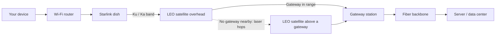
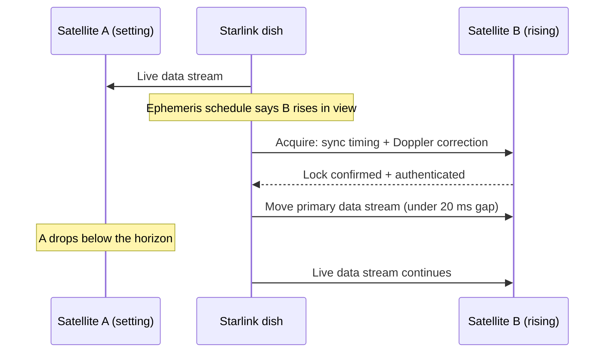

<!--
  SEO
    Primary keyword:   Starlink in India
    Secondary:         Starlink India launch, Starlink satellite internet,
                       low Earth orbit satellites, satellite broadband India,
                       Starlink India regulations, NavIC, Kargil GPS denial,
                       SpaceX Starlink
    Slug:              will-starlink-work-in-india
    Search intent:     informational

  CHECKLIST (once content is written)
    - "Starlink in India" in at least one H2 (already in the first 100 words)
    - H2 / H3 hierarchy, short paragraphs
    - Every image gets keyword-aware alt text

  INTERNAL LINKING
    orbital-laboratory-space-medicine (SpaceX Dragon / CRS-35, same SpaceX thread)
-->

Will Starlink work in India? It's one of the most-searched questions about the country's internet future, and the honest answer depends on more than the technology.

Starlink in India would be a satellite internet service beamed down from thousands of satellites in low Earth orbit. In principle, any home with a clear view of the sky could get broadband, no fiber or cell tower needed.

This post looks at how Starlink actually works, what it would take to work well in India, and whether it can really close the gap for the people the ground network hasn't reached.

## How Starlink Satellite Internet Works

> **TL;DR**
>
> - **Old satellite internet is slow because it's far away.** Geostationary satellites sit about 36,000 km up, so a round trip takes 600 ms or more.
> - **Starlink flies much closer.** Its satellites orbit at roughly 540–570 km, which cuts round-trip latency to about 25–40 ms.
> - **Closer means faster-moving.** Each satellite crosses the sky in minutes, so Starlink needs thousands of them to keep you connected.
> - **Satellites talk to each other with lasers.** Data can hop across several satellites in space before coming down.
> - **The dish steers itself electronically.** A phased-array antenna tracks satellites with no moving parts.
> - **Gateways connect space to the internet.** Ground stations plug the satellite network into terrestrial fiber.

At its core, Starlink is a global broadband system. It replaces heavy geostationary satellites and long-distance fiber cables with a **huge, fast-moving mesh network in space**.

To see why that matters, start with what came before it.

### The Problem With Geostationary Satellite Internet

Traditional satellite internet uses satellites in **Geostationary Earth Orbit (GEO)**, about **36,000 km** above the equator.

At that height, a satellite circles Earth exactly once a day, so it appears fixed in the sky. That's convenient: point the dish once and you're done.

The catch is distance. A signal has to travel up and back down that 36,000 km, and the round trip comes to **600 milliseconds or more**. Browsing works, but video calls, online gaming, and anything else real-time become painful or unusable.

### The Low Earth Orbit Advantage

Starlink flies in **Low Earth Orbit (LEO)**, at altitudes between about **540 km and 570 km**.

| | GEO satellite internet | Starlink (LEO) |
| --- | --- | --- |
| Altitude | ~36,000 km | ~540–570 km |
| Round-trip latency | 600 ms or more | ~25–40 ms |
| Position in the sky | Fixed | Crosses the sky in minutes |
| Satellites needed for coverage | A few | Thousands |

#### Why Lower Means Faster

Starlink satellites are roughly **60 to 70 times closer** to Earth than GEO satellites. Less distance means less time for the signal to travel.

At **25–40 ms** round trip, voice calls, competitive gaming, and remote management of cloud infrastructure all become practical.

#### The Coverage Trade-Off

There's a price for flying low. LEO satellites move fast, at about **27,000 km/h**, and complete an orbit in roughly **90 minutes**.

From the ground, a single satellite is visible for only **a few minutes** before it drops below the horizon. To keep a connection unbroken, another satellite has to rise into view as the last one sets.

That's why Starlink needs a **dense constellation of thousands of satellites**, not a handful.

### The Space Segment: A Constellation Connected by Lasers

The network is made up of thousands of flat-panel satellites carrying high-throughput antennas.

#### Optical Intersatellite Links

Modern Starlink satellites carry **optical crosslinks**, better known as space lasers.

Without them, every satellite would have to beam its data straight down to a nearby ground station. With them, satellites can pass data to each other in orbit at speeds of up to **hundreds of gigabits per second**.

That changes what "coverage" means. A request from the middle of an ocean or a remote desert can hop **satellite to satellite** across the sky until it reaches one that's directly above a ground gateway.

### The Ground Segment: The Dish and the Gateways

Getting data between space and the regular internet takes two pieces of ground hardware.

#### The User Terminal (the Dish)

Old satellite dishes had to be aimed precisely by hand. The Starlink dish is an **electronic phased-array antenna** instead.

It contains **hundreds of tiny antennas**. By shifting the timing (phase) of the signal at each one, the dish steers its radio beam electronically. That lets it follow fast-moving satellites across the sky **with no moving parts**.

#### Gateway Earth Stations

Gateways are large ground stations with big parabolic antennas, wired directly into **high-capacity fiber-optic backbones**.

When a satellite passes within range of a gateway, it hands user data down to it, bridging the space network into the regular internet.

### End-to-End: What Happens When You Load a Web Page

Here's the full path a request takes:

1. **Router to dish.** Your router sends packets over Wi-Fi to the phased-array dish.
2. **Dish to satellite.** The dish beams the signal up to a LEO satellite overhead, in the **Ku or Ka band**.
3. **Satellite to ground, directly or via lasers.**
   - If a gateway is nearby, the satellite sends the data straight down to it.
   - If you're somewhere remote with no gateway in range, the data **hops across neighboring satellites by laser** until it reaches one above an active gateway.
4. **Gateway to the internet.** The gateway pushes the traffic into terrestrial fiber, which carries it to the target server or data center.

The response travels the same path in reverse, and the whole round trip usually takes **25–40 ms**.

## The Engineering That Makes Starlink Work: Satellite Handovers

Low orbit and laser links explain why Starlink is *fast*. They don't explain why it *stays connected*.

That comes down to **handovers**, arguably the most impressive engineering in the whole system.

### The Handover Problem

Starlink satellites orbit at about **550 km** and travel at roughly **27,000 km/h (~7.8 km/s)**. From your dish, a single satellite is in view for only about **3 to 5 minutes**.

So your terminal has to drop one satellite and pick up the next roughly **12 to 20 times every hour**.

It has to do this during a live Zoom call or an online game, without you noticing. Four pieces of engineering make that possible.

### 1. Phased-Array Antennas: Steering Without Moving

Traditional dishes use motors to physically turn toward a satellite. That works for slow geostationary satellites. It can't work for LEO.

A motor couldn't swing fast enough, and it wouldn't survive years of tracking satellite after satellite across the sky.

**Electronic steering** replaces the motor. The Starlink dish has hundreds of tiny antenna elements. By adjusting the **phase** (timing) of the signal at each one, the dish makes the radio waves add up in one direction and cancel out in others.

The result is a radio beam that can be pointed anywhere in the sky, with nothing moving. The dish can jump its beam from a satellite setting in the west to one rising in the east in **microseconds**.

### 2. Predictive Ephemeris Scheduling: Knowing Where to Look

The dish doesn't search the sky for a signal. It already knows where to look.

It relies on **ephemeris data**: continuously updated orbital paths for the constellation, downloaded from the network itself. Combined with its own precise **GPS position**, the dish knows where each satellite will be at any given moment.

From that, it builds a rolling schedule. For example:

> *Satellite A drops behind my tree line at 11:14:20. Satellite B climbs into clear view at 11:14:18.*

The handover is planned **before** it's needed, not worked out on the fly.

### 3. Beating the Doppler Effect

At 7.8 km/s, motion distorts the signal itself.

As a satellite rushes **toward** you, its radio frequency shifts **up** (blueshift). As it passes and races **away**, the frequency shifts **down** (redshift). It's the same effect that makes a passing siren change pitch, at enormous speed.

Left uncorrected, that shift would knock the radios out of sync. So the terminal and satellite continuously calculate their **relative velocity** and adjust their oscillator frequencies to match, sliding up and down the band so both ends stay locked.

### 4. The "Make-Before-Break" Handover

The switch itself is designed so the connection is never actually dropped. As it's commonly described, it happens in three stages:

1. **Target acquisition.** While still talking to Satellite A, the dish uses a slice of its capacity, or rapidly alternates between the two, to lock on to incoming Satellite B.
2. **The handover.** Once Satellite B's timing, frequency correction, and authentication check out, the terminal moves its main data stream over.
3. **The interruption window.** The switch takes a fraction of a second, typically **under 20 milliseconds** of disruption.

A gap that short is easy to hide. **TCP** quietly resends anything lost, and real-time apps like video calls and games, which usually run over **UDP**, smooth over tiny gaps with their own buffering. To you, the call just keeps going.

### What Actually Makes Starlink Work

Put it all together and no single breakthrough explains Starlink. It works because several pieces all have to succeed together:

| Layer | What it solves |
| --- | --- |
| Low Earth orbit | Latency: ~25–40 ms instead of 600 ms+ |
| Dense constellation | Coverage: a new satellite is always rising |
| Laser crosslinks | Reach: data can travel to a distant gateway through space |
| Phased-array dish | Tracking: instant beam steering with no moving parts |
| Ephemeris scheduling | Timing: every handover is planned in advance |
| Doppler correction | Signal lock: radios stay in sync at 7.8 km/s |
| Make-before-break handover | Continuity: switches cause millisecond gaps, not dropouts |

Add laser routing across multiple hops, handovers between ground stations, and thousands of terminals doing all of this at once, and the network starts to look less like a set of satellites and more like a **huge, constantly shifting distributed router in space**.

Which brings us back to the ground. Every one of those paths has to end at a gateway, and that's where the question of Starlink in India really begins.

## Starlink in India and the Trust Question: Can India Rely on the USA?

The technology works. The harder question is about **who controls it**.

Starlink is owned by SpaceX, an American company that operates under American law. If India comes to depend on it for connectivity, a natural question follows: what happens if Washington's interests and New Delhi's ever diverge?

India has been in that position before, with a different American satellite system.

### The Kargil War: When India Was Denied GPS

The best-known case is the **Kargil War of 1999**. It's widely reported as the main instance of the United States withholding GPS support from India during a national security crisis.

#### What Happened

Between **May and July 1999**, Pakistani infiltrators occupied high-altitude posts on the Indian side of the **Line of Control (LoC)**.

To map the rugged terrain and target enemy bunkers, the Indian military asked the United States for precise positional data and satellite/GPS support.

#### The US Response

The Clinton administration **denied India access** to military-grade GPS.

That left India with civilian GPS, which at the time was deliberately degraded. Under a policy called **Selective Availability (SA)**, civilian accuracy was reduced to roughly **50–100 meters**. Full precision required the encrypted military keys of the **Precise Positioning Service (PPS)**, and the US wouldn't share them.

Indian forces fell back on traditional maps, ground intelligence, and dangerous manual reconnaissance in extreme Himalayan conditions.

#### Why the US Said No

Washington was walking a diplomatic tightrope:

- India's **1998 nuclear tests** had triggered US sanctions only a year earlier.
- The US didn't want to be seen **directly aiding one side** in a regional war.
- It was wary of **escalating tensions with Pakistan**, a longtime US partner.

### Has It Happened Since?

There's **no publicly known case** of the US blocking or switching off GPS for India since Kargil. The landscape changed quickly after the war.

| Year | Event | What changed |
| --- | --- | --- |
| 1999 | Kargil War | India denied military-grade GPS |
| 2000 | Selective Availability switched off | Civilian GPS accuracy improved worldwide, from ~100 m to roughly 10–20 m |
| 2016 | LEMOA signed | Logistics cooperation between the US and Indian militaries |
| 2018 | COMCASA signed | Encrypted military communications sharing |

#### The End of Selective Availability

In **May 2000**, driven by the rapid growth of commercial GPS, aviation, and global logistics, President Clinton ordered Selective Availability **permanently switched off**. Ordinary GPS became far more reliable everywhere, India included.

#### Warmer US–India Ties

In the decades since, defense and diplomatic ties between New Delhi and Washington have warmed considerably. Foundational agreements like **LEMOA** and **COMCASA** now allow deeper military cooperation and the sharing of encrypted communications.

### The Lasting Lesson: Why India Built NavIC

Even so, Kargil left a mark. It showed Indian leadership that **depending entirely on a foreign-controlled satellite network** could leave the country blind in a war if the politics shifted.

The episode is widely cited as a key trigger for the **Indian Space Research Organisation (ISRO)** to build **NavIC (Navigation with Indian Constellation)**, India's own independent regional satellite navigation system.

NavIC includes an encrypted, high-accuracy **Restricted Service** built specifically for the Indian military. The goal is simple: navigation and targeting over India's region shouldn't depend on another government's decision during a crisis.

### What Kargil Means for Starlink in India

GPS and Starlink are different systems, but the strategic question is the same: **who holds the off switch?**

There's a recent example. In 2023, Elon Musk confirmed that he had declined a Ukrainian request to activate Starlink coverage for a military operation near Crimea. Whatever you think of that decision, it showed that a privately run satellite network can be shaped by the choices of the company, and the country, behind it.

For India, that makes control of the **ground segment** central. Every Starlink connection has to come down through a gateway. Gateways located in India, operating under Indian law, give the country a point of oversight that a purely space-based network wouldn't.

Kargil taught India not to rely blindly on foreign satellites. The question for Starlink isn't whether it works over India. It's **on whose terms**.

## The Legal Obstacle: What Starlink Needs to Operate in India

India's answer to "on whose terms?" is written into its regulations.

Running a satellite internet provider like Starlink in India means clearing **several layers of rules**, set by space, telecom, and national security authorities.

Starlink has already passed key milestones: a **Unified License with GMPCS authorization** from the Department of Telecommunications (DoT), and space-sector clearance from **IN-SPACe**. But several strict legal and operational requirements still have to be met before commercial service can legally go live.

### The Regulatory Checklist at a Glance

| # | Requirement | Authority | What it covers |
| --- | --- | --- | --- |
| 1 | Telecom licensing (GMPCS, VSAT, ISP) | Department of Telecommunications (DoT) | The right to sell services in India |
| 2 | Space-sector authorization | IN-SPACe | The right to beam signals over Indian territory |
| 3 | Security and data localization | DoT and security agencies | Local data, lawful interception, Indian gateways |
| 4 | Spectrum assignment | WPC Wing of the DoT | The specific radio frequencies it can use |
| 5 | Terminal type approval | Telecommunication Engineering Centre (TEC) | Certification of every dish sold in India |

### 1. Telecom Licensing (DoT / GMPCS)

A company can't offer communication services in India on foreign credentials alone. It has to comply with Indian telecom law.

- **Unified License (GMPCS):** Starlink holds a **Global Mobile Personal Communication by Satellite (GMPCS)** license, which is mandatory for satellite-based telephony and broadband anywhere in India.
- **VSAT and ISP authorizations:** The license also covers **Commercial Very Small Aperture Terminal (VSAT)** and **Internet Service Provider (ISP) Category A** authorizations.

Those authorizations come with obligations. Starlink must follow Indian ISP guidelines, verify every subscriber (**KYC**), and support **lawful interception**, just like any Indian telecom operator.

### 2. Space Clearance (IN-SPACe)

Private satellite operators can't beam signals into Indian territory without the space regulator's approval.

That regulator is the **Indian National Space Promotion and Authorisation Centre (IN-SPACe)**: the single-window agency under the Department of Space that authorizes private space activities, orbital resource use, and **non-geostationary constellations** operating over India.

Starlink needed, and received, formal approval from IN-SPACe.

### 3. National Security and Data Localization

This is where the lesson of Kargil shows up in law. Given India's sensitive geopolitical position, satellite communications face rigorous security checks.

#### Data Sovereignty

All **subscriber data, traffic metadata, and operational logs** generated in India must be **stored within India's borders**.

#### Lawful Interception

Starlink's systems must plug into the **standard lawful interception protocols** used by Indian security and intelligence agencies, the same as terrestrial telecom operators. When legally authorized, the government must be able to intercept communications for national security.

#### Ground Gateway Routing

Traffic that starts and ends in India must go through **locally built, approved ground gateways**, not unauthorized cross-border links.

Remember how a Starlink request can hop across satellites by laser until it reaches *any* gateway? This rule closes that door for Indian traffic. Data has to come down **on Indian soil**, which is exactly the point of oversight the trust question calls for.

### 4. Spectrum Assignment (WPC Wing)

A telecom license doesn't automatically include the right to use radio frequencies.

#### Specific Frequency Allocation

Starlink has to apply to the **Wireless Planning and Coordination (WPC) Wing** of the DoT for specific, cleared frequency bands, typically in the **Ku and Ka bands**, for both its user terminals and its gateway links.

#### The Spectrum Debate

How satellite spectrum should be handed out in India has been fiercely debated:

- **Administrative allocation:** spectrum is assigned rather than sold, in line with how shared space resources are handled globally.
- **Auction:** spectrum is sold to the highest bidder, the way mobile spectrum is.

The choice matters a lot. It shapes how much it costs satellite operators to get their frequencies, and on what terms.

### 5. Type Approval for User Terminals

Every device in India that transmits radio signals into space has to be certified.

Starlink's user terminals, the flat-panel dishes and routers, need **equipment type approval** from the **Telecommunication Engineering Centre (TEC)**. The approval confirms they meet Indian limits on electromagnetic radiation and interference.

Without it, the dishes can't legally be imported, sold, or switched on in India.

### What the Legal Framework Really Says

Read together, these rules show India's position: **Starlink is welcome, but it has to play by Indian rules.**

Licensing, KYC, lawful interception, local data storage, and Indian gateways all exist so that a foreign-owned network over India ends up answering to **Indian law** on the ground.

## Why Starlink Won't Give India What It Needs

If Indian law can bind Starlink this tightly, does India effectively get control? It depends on what you mean by **"IP"**, because the term covers two very different things:

- **Intellectual Property:** the technology, satellite designs, and source code
- **Internet Protocol:** the network data, meaning how traffic is routed and how user information is handled

India can win control over one. It won't get the other.

### Intellectual Property: The Technology Stays With SpaceX

#### Will Starlink Hand It Over? No.

SpaceX is a private company. Its **satellite manufacturing blueprints**, **phased-array antenna designs**, **proprietary software**, and **constellation-management algorithms** are its most valuable assets.

Everything covered earlier in this post, from laser crosslinks and ephemeris scheduling to make-before-break handovers, is exactly the know-how SpaceX won't give away to any foreign government.

#### Would the US Allow It? No.

Even if SpaceX wanted to share its core space technology, the US government would stand in the way.

Under **US export controls, including ITAR (International Traffic in Arms Regulations)**, advanced aerospace, satellite, and communications technology is treated as a matter of **national security**. American law restricts companies from transferring sensitive space technology to foreign countries.

### Internet Protocol: The Data Plays by India's Rules

If "IP" means **network data**, how traffic is routed and how user information is handled, the picture flips.

Starlink keeps its technology. But to get its GMPCS license and operate in India, it has had to accept strict **data localization and national security conditions** over how Indian data flows:

- **Local gateways:** Indian data can't be beamed straight to foreign ground stations. Starlink has to run **gateway earth stations inside India**.
- **No cross-border routing:** Indian user traffic must stay within India's borders. Starlink can't route it through foreign ground stations or mirror it on overseas servers.
- **No overseas decryption:** Starlink can't copy or decrypt Indian user data outside India.
- **Lawful interception:** like Jio or Airtel, Starlink must build compliance paths that let Indian security and law enforcement agencies **monitor communications, or restrict service in specific regions**, during emergencies or national security crises.

### The Two Kinds of IP Side by Side

| | Intellectual Property (the technology) | Internet Protocol (the data) |
| --- | --- | --- |
| Who controls it | SpaceX | India's regulators |
| Will India get it? | No | Yes, as a condition of the license |
| Why | Corporate ownership and US export controls | Data localization, Indian gateways, lawful interception |
| What India gains | Nothing it can build on | Oversight of traffic on Indian soil |

### The Gap That Matters

That's the core reason Starlink can't give India what it actually needs.

India can make Starlink's **data** follow Indian rules. It can't make Starlink's **technology** Indian. The satellites, the software, and the decision to keep the constellation running all stay with an American company, under American law.

Oversight isn't the same as ownership. And for the systems India can't afford to lose, only ownership is enough.

## Why India Needs Its Own Starlink

Regulations can make a foreign network *answer* to Indian law. They can't make it Indian.

That gap is why national security planners worry about foreign-dependent technology. Relying on a satellite network that someone else owns and controls creates a **strategic bottleneck**, however good the service is in peacetime.

India's push toward its own space and communication infrastructure, from NavIC for navigation to strict local rules for satellite operators, comes down to a few hard realities.

### 1. The Kill Switch Problem

If India's military or critical infrastructure depends entirely on a foreign navigation system like GPS, or on foreign satellite communications, the country behind that system holds an **implicit veto** over India's operations.

In a border conflict, a war, or a domestic emergency, that country could:

- **Switch off** access
- **Refuse to hand over** encryption keys
- **Degrade accuracy** over the conflict zone

This isn't hypothetical. At Kargil, India asked for military-grade GPS access and was refused.

An indigenous system means that however tense geopolitics get, **Indian command centers keep control** of their own targeting, tracking, and operational telemetry.

### 2. Remote, High-Altitude Borders

India has thousands of kilometers of rugged, hostile mountain borders, in **Ladakh, Sikkim, and Arunachal Pradesh**, along with vast maritime boundaries.

In these regions, fiber-optic cables and cell towers are scarce, and the ones that exist are easily destroyed by **shelling, landslides, or sabotage**.

So border posts, forward-deployed troops, tactical drones, and naval patrols depend on **satellite communication and positioning** to coordinate and stay safe.

If a foreign provider throttles bandwidth, cuts off a region over a compliance dispute, or simply has an outage, India's frontline defenses could be **cut off at the worst possible moment**.

This is where Starlink's biggest strength becomes a liability. The places where satellite internet matters most are the same places where depending on a foreign network is most dangerous.

### 3. Jamming, Spoofing, and Encryption Gaps

Civilian signals, such as standard GPS or the open commercial internet, are **public, unencrypted, and vulnerable** to electronic warfare.

- **Jamming** drowns out a signal so receivers can't use it.
- **Spoofing** broadcasts fake signals that steer receivers to the wrong position.

Indigenous systems like **NavIC** are built with two tiers:

| Service | Users | Protection |
| --- | --- | --- |
| Standard Positioning Service (SPS) | Civilian | Open signal |
| Restricted Service (RS) | Military | Encrypted, using cryptographic codes that are hard to spoof, decrypt, or manipulate |

India controls the keys to the Restricted Service, so it doesn't depend on anyone else's encryption.

### 4. Espionage and Data Leakage

In modern warfare, **data is a weapon**.

If border telemetry, military tracking, and sensitive government communications all flowed through **foreign-owned satellites and foreign ground stations**, foreign intelligence agencies could potentially see:

- Troop movements
- Weaknesses in infrastructure
- Tactical deployments

Indigenous infrastructure, combined with **strict data localization**, keeps the data about India's internal security **inside India's borders and under Indian law**.

### The Four Risks at a Glance

| Risk | With a foreign-controlled network | With an indigenous network |
| --- | --- | --- |
| Kill switch | Another government holds a veto | India decides who gets access |
| Border connectivity | Frontline links depend on a foreign provider | Critical links stay under Indian control |
| Jamming and spoofing | Open civilian signals are exposed | Encrypted military service, Indian-held keys |
| Espionage | Sensitive data may pass through foreign hands | Data stays in India, under Indian law |

### Strategic Autonomy, Not Just National Pride

When people talk about **strategic autonomy** or **Atmanirbhar Bharat** (self-reliance) in space, it can sound like national pride or industrial policy.

It's really about something more practical. If a war breaks out, a crisis hits, or the borders turn volatile, India's military and critical systems must be able to **operate independently**, without needing permission, or a key, from a foreign capital.

That's the real answer to whether Starlink will work in India. It can serve homes, businesses, and remote villages well. But for the systems a country can't afford to lose, **India needs a network of its own**.

## How India Is Trying to Bridge the Gap: The NavIC Story

India has tried this before. Its own navigation system, **NavIC (Navigation with Indian Constellation)**, is the clearest example of what building sovereign space infrastructure really takes.

NavIC has given India real strategic independence. It has also run into serious technical and operational problems, and they show how hard this road is.

### What NavIC Is Missing

#### 1. It's Regional, Not Global

GPS, GLONASS, and Galileo are **global** systems that cover the whole planet. NavIC is **regional**: it covers India and an extended area up to about **1,500 km beyond its borders**.

That's enough for national defense and domestic use. But NavIC can't track assets or guide operations anywhere else in the world.

#### 2. Failing Atomic Clocks

NavIC's biggest technical weakness has been the reliability of its **onboard atomic clocks**.

Navigation satellites work by broadcasting extremely precise time. Several first-generation NavIC satellites failed early when their **rubidium atomic clocks** stopped working.

Each lost clock matters because of a basic rule of satellite navigation: a receiver needs signals from at least **four satellites at once** to work out a 3D position.

| Unknown | Why it needs a satellite |
| --- | --- |
| Latitude | Where you are north–south |
| Longitude | Where you are east–west |
| Altitude | How high you are |
| Receiver clock error | Your device's clock isn't atomic-precise, so it has to be solved for too |

Four unknowns need four equations, and that means four satellites. NavIC's operational constellation has reportedly fallen to **just three working satellites**, below the minimum needed for standalone positioning.

#### 3. Phones Can't Easily Hear It

The first generation of NavIC broadcast on the **L5 and S-band** frequencies.

Most mass-market smartphones are built around the **L1 band** used by GPS. Only devices with specific chipsets could pick up NavIC's signals, so everyday adoption has been slow.

### How ISRO Is Fixing It

ISRO is actively repairing, upgrading, and expanding NavIC, though the engineering is hard.

#### The Second-Generation NVS Satellites

ISRO has developed a new generation of satellites, the **NVS series**, designed to fix the weaknesses of the first.

#### Indian-Made Atomic Clocks

To stop depending on imported clocks for such sensitive hardware, ISRO's **Space Applications Centre (SAC)** built **indigenous rubidium atomic clocks**, which have flown and been tested on satellites such as **NVS-01**.

#### Adding the L1 Band

The newer NVS satellites add the **L1 frequency band**, the same one GPS uses. That makes it far easier for chipmakers to build NavIC support into ordinary smartphones.

#### Replenishing the Constellation

ISRO is working through setbacks to get more second-generation satellites into orbit. The biggest so far was **NVS-02**, which reached orbit in 2025 but couldn't raise itself into its intended working orbit after a fault in its onboard propulsion system.

### NavIC's Problems and Their Fixes at a Glance

| Limitation | Fix in progress |
| --- | --- |
| Failing imported atomic clocks | Indian-built rubidium clocks from SAC |
| Constellation below four working satellites | New NVS launches to replenish the fleet |
| Little smartphone support (L5 / S-band only) | L1 band added on NVS satellites |
| Regional coverage only | Still regional by design |

### What NavIC Teaches About an Indian Starlink

NavIC is going through a difficult transition, but it remains a **top national priority**. ISRO keeps pushing new launches and hardware upgrades to restore full redundancy, so that a foreign GPS blackout would no longer leave India stranded.

The lesson for satellite internet is sobering. NavIC needs only a handful of satellites, and keeping even that many working has been a struggle.

A Starlink-class broadband network needs **thousands**, along with the laser links, phased-array terminals, and handover engineering covered earlier in this post. India has shown it has the will to build its own. The open question is whether it can build at that scale, and how fast.

## Key Takeaways

- **Starlink works because it flies low.** At roughly 550 km instead of 36,000 km, latency drops from 600 ms or more to about 25–40 ms.
- **Low orbit only works with a huge constellation.** Each satellite is in view for just minutes, so thousands of satellites, laser links, phased-array dishes, and planned handovers keep the connection unbroken.
- **Kargil is the precedent.** In 1999, the US refused India military-grade GPS in the middle of a war, which pushed India toward building NavIC.
- **Starlink in India must play by Indian rules.** Licensing, KYC, lawful interception, data localization, and gateways in India give the country oversight of the data.
- **Oversight isn't ownership.** SpaceX keeps its technology, and US export controls keep it out of reach, so the off switch stays outside India.
- **Sovereign networks are hard to build.** NavIC's clock failures and shrinking constellation show the difficulty, and a broadband network needs thousands of satellites, not a handful.

## Conclusion: Will Starlink Work in India?

Technically, yes. Starlink in India can deliver fast, low-latency internet anywhere with a clear view of the sky, including the remote regions fiber hasn't reached.

India's regulations go further, making sure the network answers to Indian law on the ground: Indian data, Indian gateways, Indian oversight.

But working over India isn't the same as belonging to India. The satellites, the software, and the final decision to keep the network running stay with an American company. Kargil showed what that can mean in a crisis.

So the real answer has two parts. Starlink can serve India's homes and businesses. For the systems India can't afford to lose, it needs a network of its own.

NavIC shows India can build one, and also how hard it is to keep running. The question for the next decade isn't whether Starlink works in India. It's **whether India can build a network that never has to ask permission**.
