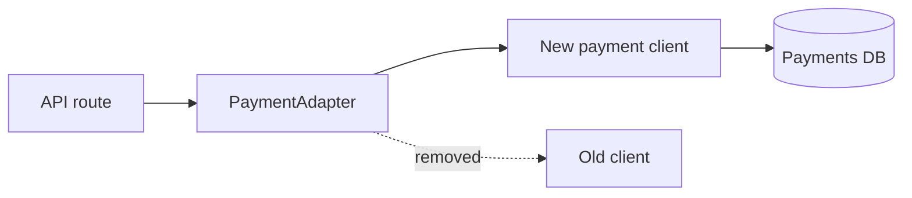

<!--
  SEO
    Primary keyword:   coding with Claude Opus 5.5
    Secondary:         Claude Opus 5.5 prompting, Opus 5.5 vs Opus 5,
                       Claude Code workflow, effort parameter, definition of
                       done, agentic coding, AI pair programming, decisions.md,
                       prompt engineering
    Slug:              coding-with-claude-opus-5-5
    Search intent:     informational

  CONTENT
    "My Workflow" sections are the author's own process (decisions.md,
    flow.md, task.md, architecture discussion), written up from their notes.
    "Best use cases" is a first draft for the author to adjust.
    Opus 5.5 facts were checked on 2026-10-24 against Anthropic's
    "Prompting Claude Opus 5.5" page (link in Further Reading). These are
    verbatim/close to that page: effort default medium (Opus 5: high),
    medium >= Opus 5 high on coding + knowledge work, >30% faster output,
    thinking always on (thinking: disabled not accepted), xhigh/max more
    thinking per turn, reasoning_extraction refusals, unattended-run advice,
    multiapp explore prompt, time budgets, design-cliche prompt, PIL/OpenCV.
    NOT on that page (secondary coverage + general practice, framed as
    habits): define-done payment example, TASKS.md file name, subagents by
    name, steer instead of restart, "mark what you couldn't confirm",
    narrow first-pass review, second model family. The "12 rules" numbering
    is from secondary coverage, not Anthropic.
    Hero: scripts/opus_5_5_coding_hero.py (original art, no logos).

  INTERNAL LINKING
    /engineering/harness-engineering/
    /ai%20engineering/2026/08/22/context-engineering-loop-graph-engineering/
    /artificial%20intelligence/2026/10/12/being-mean-to-claude-can-get-you-banned/
-->


## Introduction: Coding with Claude Opus 5.5 Needs Fewer Prompting Tricks

Most of what I learned about prompting older Claude models is now getting in my way. Lines like "think carefully", "show your reasoning" and "think step by step" used to help. When **coding with Claude Opus 5.5**, they mostly add latency and cost, and some of them can even get a request refused.

The model changed underneath those habits. Opus 5.5 always thinks, its default effort is lower, and it carries long coding tasks further on its own than Opus 5 did.

This post covers three things:

- **What's actually different** from Opus 5, based on Anthropic's official "Prompting Claude Opus 5.5" guide.
- **The prompting habits** I've kept, dropped, and added.
- **My own workflow**: a design discussion before every big decision, plus three files (`decisions.md`, `flow.md`, `task.md`) that keep the model's work readable.

---

## What's Different in Opus 5.5 vs Opus 5

### Thinking Is Always On

On Opus 5 you could turn thinking off at `high` effort or below. Opus 5.5 doesn't accept `thinking: {"type": "disabled"}`: thinking is always on.

So "think step by step" is redundant. If you want a quick reply, say "Answer directly." If you want more or less deliberation, change the **effort** setting, not the wording of the prompt.

### Medium Is the New Default Effort

Opus 5 defaulted to `high`. Opus 5.5 defaults to `medium`.

The labels aren't comparable across models. In Anthropic's testing, Opus 5.5 at `medium` **matches or beats Opus 5 at `high`** on coding and knowledge-work evals, and on several coding evals `low` comes close at much lower cost.

There's a catch. At the same named level, Opus 5.5 tends to think *more* per turn than Opus 5, especially at `xhigh` and `max`. Copying your old effort setting across means longer turns and bigger bills.

### Faster, Leaner, Better at Long Agentic Work

Anthropic says Opus 5.5 generates output tokens **more than 30% faster** than Opus 5 and usually finishes the same task with fewer tokens.

It's strongest at multistep work in a real repository: carrying a change across a large codebase until the tests pass. It also holds up better on long, mostly unattended runs, such as audits and migrations split across parallel subagents.

### It Reads Screenshots and Diagrams Properly

Visual input is the other big jump. Anthropic reports that Opus 5.5, even at its lowest effort, reads values off dense charts more accurately than Opus 5 did at its highest.

It's also better where meaning depends on layout: which boxes an arrow connects, what changed between two versions of a diagram, or when a meeting starts in a calendar screenshot.

---

## Claude Opus 5.5 Prompting: The Rules I Follow

Anthropic's guide is organised by symptom ("my agent stops early", "replies start slowly"), not as a numbered list. The "12 rules" framing you may have seen comes from secondary coverage. Here is my version: the official advice plus the habits that work for me.

### 1. Define "Done" in the First Message

Give the whole task in one message instead of drip-feeding steps. State the goal, what finished looks like, and the few cases where it should stop.

```text
Migrate the payment endpoints from the old client to the new one.
Done means: every endpoint uses the new client, the old client is
deleted, and the test suite passes. Stop and ask me only if a test
fails for a reason you can't explain.
```

### 2. Delete "Think Carefully" Lines

They don't add thinking; effort does. Anthropic found that removing such a line from a chat system prompt made replies start sooner with no clear drop in quality.

### 3. Start at Medium Effort and Measure

Set `medium` explicitly, then test other levels on your own tasks. Keep `xhigh` and `max` for work where you've *measured* a quality gain. To get less thinking, lower the effort rather than adding instructions.

### 4. Tell It Which Stops You Want

On long tasks, Opus 5.5 sometimes ends a turn with a summary, an offer to continue, or a list of decisions that don't actually block anything. If you want it to keep going, say so, and name the stops you *do* want:

```text
When a step doesn't need my input, keep going. Put status notes in
the same message as your next action. Stop and ask only when you
can't continue without me, or before anything destructive: deleting
data, force-pushing, or changing anything outside this repository.
```

For unattended agents, Anthropic's advice is to treat a text-only end of turn as a **progress report, not proof the task is done**. Check the checklist, and continue any open items.

### 5. Keep the Task List in a File

Long runs get their older turns summarised. A checklist in a file (`TASKS.md`, or my `task.md` below) survives that, and it lets you see the run's state at a glance. The model ticks off items and adds new work as it finds it.

### 6. Ask for Subagents and Check Their Evidence

For big audits, migrations or reviews, ask for the split explicitly:

```text
Audit every service in services/ for the retry bug in the linked
issue. Give each service to its own subagent. When a subagent reports
back, check its evidence before you accept it.
```

In multiagent setups, a time budget helps too. Anthropic suggests the harness add a line like `elapsed 340s / 1200s` to each message. The model then paces itself and runs more work in parallel.

### 7. Steer Instead of Restarting

Remembered a requirement mid-run? Send it ("Also keep the old endpoint names as aliases") instead of starting over. Runs are longer now, so a restart throws away more work.

### 8. Ask What It Couldn't Confirm

For research and analysis I add: "Mark anything you couldn't confirm, and say where you looked." At the end of a long task, I read **what it needs from me first**: open decisions, approvals and blocked work.

### 9. Use It for a Narrow First-Pass Review

```text
Review the diff on this branch against main. List only problems you'd
block the merge for. For each one, give the file and line, why it's
wrong, and how to show it fails.
```

Early testers report Opus 5.5 catches more bugs than Opus 5 with fewer false alarms. For high-stakes changes I still get a second review from a different model family, since different models miss different things.

### 10. Don't Ask It to Show Its Reasoning

Prompts that push the model to write out its internal reasoning can be declined under the `reasoning_extraction` safeguard. Ask for a normal explanation instead:

```text
Explain why you chose this approach in three sentences.
```

If you need the reasoning programmatically, read the summarised thinking blocks (`display: "summarized"`) instead.

### 11. Attach the Screenshot; Don't Retype It

Attach the chart, diagram or screenshot and ask a specific question about it. For the densest inputs, higher-resolution images help. So does giving the model a container with PIL or OpenCV, so it can crop, zoom and measure.

### 12. Name the Design Clichés You Don't Want

"Avoid a generic AI look" just swaps one default style for another. List the specific patterns instead, then check the result and extend the list:

```text
Output a vanilla HTML/CSS personal website with placeholder data.
Do not use a cream or off-white background, italic accent words in
headlines, numbered "01/02/03" section labels, monospace labels, or
pill-shaped buttons.
```

---

## My Claude Code Workflow with Opus 5.5

The rules above are about single prompts. Most of my real work happens in long Claude Code sessions, and the hard part there isn't getting code written. It's **keeping track of what the model decided and why**.

So I give it four habits to follow. (The file snippets below are illustrative examples, not from a real project.)

### Step 1: Discuss Before Every Major Architectural Decision

Before any big structural change (a new service, a data model, a migration strategy), I don't ask for code. I ask for a **discussion**.

I describe the problem in Claude Code, and Opus 5.5 lays out the options, the trade-offs and what it would pick. We go back and forth until the approach is settled, and only then does implementation start.

This is the cheapest point to catch a bad idea. Changing a design in conversation costs a message; changing it after 40 files are written costs a day.

### Step 2: decisions.md — What It Decided and What "Done" Means

Every time I ask Opus 5.5 to tell me a task is done, it has to write to `decisions.md`. Each entry records:

- **The decision** it took.
- **What "done" means** for that task, written as checkable conditions.
- **The evidence** that those conditions are met.

```markdown
## 2026-10-24 — Payment client migration
Decision: wrap the new client in an adapter instead of editing call sites.
Done means:
- [x] all 14 payment endpoints call the adapter
- [x] old client module deleted
- [x] test suite passes (212/212)
Evidence: `npm test` output, grep shows 0 imports of old client.
```

This turns "I'm done" into something I can verify in ten seconds. It also matches the official advice: a summary is a report, and the checklist is what tells you whether the work is finished.

### Step 3: flow.md — A Mermaid Map of Every Major Change

Reading a long diff tells me *what* changed, not *how the pieces now connect*. So every major change gets logged in `flow.md` as a flow or Mermaid diagram.



One glance at this tells me what the model is doing to the system. Opus 5.5 is good at reading diagrams, so the same file also helps it re-orient after its context gets summarised.

### Step 4: task.md — Why This Approach and Not the Others

`task.md` is the long-form log. For every major task it records:

- **What was done.**
- **Why** that decision was taken.
- **The alternatives** that were considered.
- **The advantage** of the chosen approach over each alternative.

| Approach | Why not / why yes |
|---|---|
| Edit every call site | Fast, but touches 14 files and is hard to roll back |
| Feature flag per endpoint | Safe, but leaves two clients alive for weeks |
| **Adapter (chosen)** | One switch point, old client deletable today, easy rollback |

`decisions.md` tells me *whether* something is done. `task.md` tells me *why it was done that way*, which matters most three months later when someone asks "why didn't we just...?"

---

## Best Use Cases for Coding with Claude Opus 5.5

Based on the guide and my own use, this is where Opus 5.5 earns its cost:

- **Long, well-defined changes in a real repo.** Migrations, refactors and dependency upgrades where "done" is a passing test suite. This is the official headline strength.
- **Large audits split across subagents.** One subagent per service or module, with the lead agent checking each one's evidence.
- **First-pass code review.** Narrow scope, blocking issues only, before a human looks.
- **Work that starts from a picture.** Architecture diagrams, dashboard screenshots, UI mockups and error screenshots: attach them rather than describing them.
- **Design discussions.** Talking through options before committing, and having the reasoning written down in `task.md`.

Where I'd be more careful: anything destructive or outside the repo (always keep a confirmation step), and high-stakes changes that deserve a second reviewer from another model family.

---

## Key Takeaways

- **Delete the compensating instructions.** "Think carefully" and "show your reasoning" are unnecessary on Opus 5.5, and the second can trigger a `reasoning_extraction` refusal.
- **Effort is the main control.** Start at `medium`; it matches or beats Opus 5 at `high` on coding in Anthropic's tests. Reserve `xhigh` and `max` for measured gains.
- **Define done and the stop conditions up front.** Then treat a summary as a progress report, not proof of completion.
- **Keep state in files.** A checklist survives context summarisation; `decisions.md`, `flow.md` and `task.md` make the work auditable.
- **Discuss before you build.** Settling architecture in conversation is far cheaper than fixing it in code.
- **Show, don't transcribe.** Attach screenshots and diagrams; Opus 5.5 reads them better than Opus 5 did.

---

## Conclusion: Say What You Want, Then Let Opus 5.5 Work

Coding with Claude Opus 5.5 is less about clever prompts and more about clear contracts. Say what you want, define what "done" means, say when to stop, then let it work, and read what it needs from you when it finishes.

The files are what make that trust possible. When every decision, change and trade-off is written down, I can hand the model bigger tasks because I can check its work quickly.

If the model no longer needs to be told how to think, the real question becomes: **how clearly can you tell it what you want?**

---

## Further Reading: Claude Opus 5.5 and Agentic Coding

- [Prompting Claude Opus 5.5](https://platform.claude.com/docs/en/build-with-claude/prompt-engineering/prompting-claude-opus-5-5) — Anthropic's official guide to Opus 5.5 behaviour and prompting patterns.
- [What's new in Claude Opus 5.5](https://platform.claude.com/docs/en/models/opus-5-5/whats-new-opus-5-5) — capabilities and API changes.
- [Prompting best practices](https://platform.claude.com/docs/en/build-with-claude/prompt-engineering/claude-prompting-best-practices) — techniques for all current Claude models.
- Related on this blog: [Harness Engineering](/engineering/harness-engineering/), [Prompt, Context, Loop, Graph: Why Context Engineering Matters](/ai%20engineering/2026/08/22/context-engineering-loop-graph-engineering/) and [Being Mean to Claude Can Get You Banned](/artificial%20intelligence/2026/10/12/being-mean-to-claude-can-get-you-banned/).
