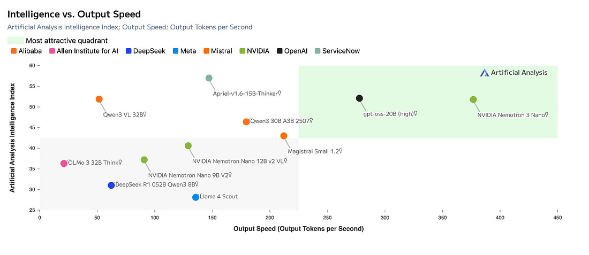
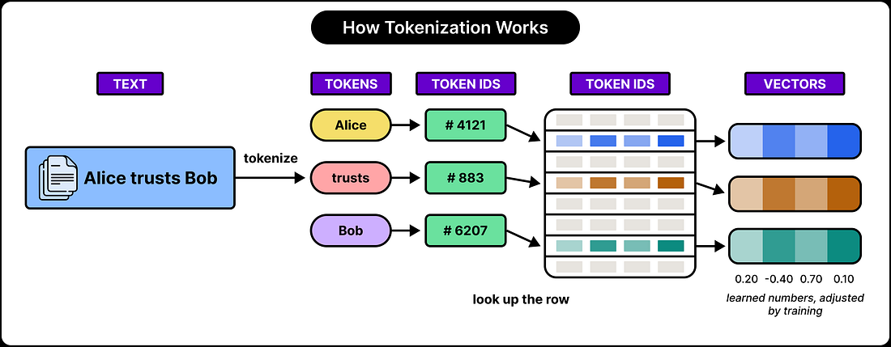
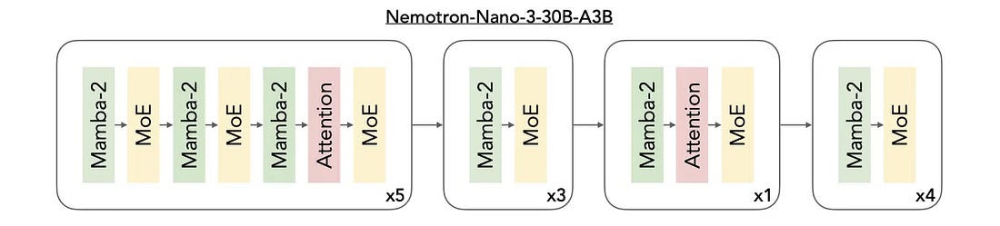
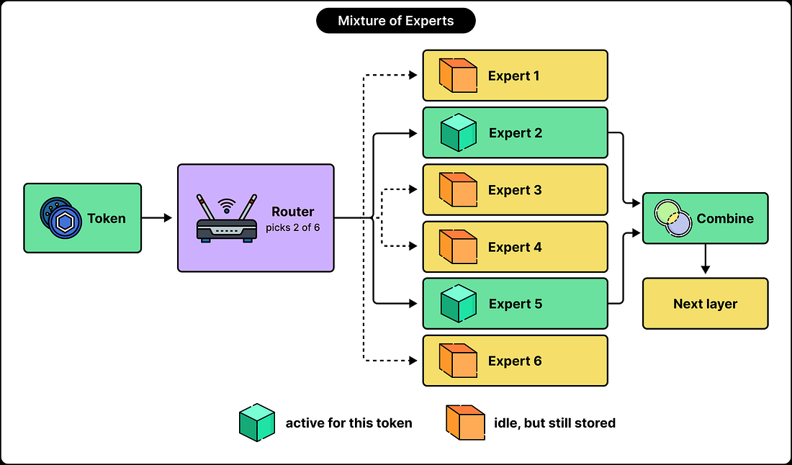
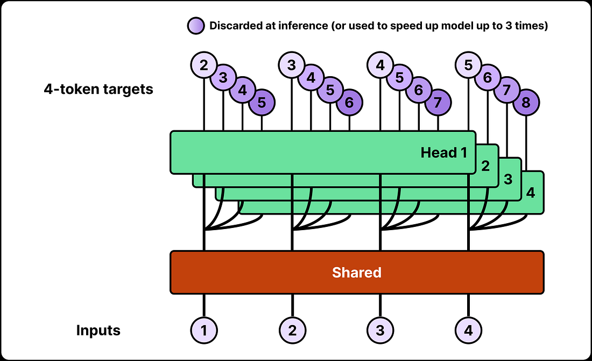

<!--
  SEO
    Primary keyword:   NVIDIA Nemotron
    Secondary:         Nemotron models, Nemotron architecture, hybrid
                       Mamba-Transformer, mixture of experts, grouped-query
                       attention, multi-token prediction, speculative
                       decoding, NVFP4, GRPO, NVIDIA open models
    Slug:              how-nvidia-nemotron-models-work
    Search intent:     informational

  CONTENT
    Body is author-supplied text only; add sections only when the author supplies them.
    Hero: author-supplied photo (NVIDIA logo on a phone, green NVIDIA eye
    mark blurred behind it).
    Interactive figures (CSS in css/blog-paper.css): qkv-demo
    (attention-qkv-demo.js), mamba-demo (mamba-state-demo.js), moe-demo
    (moe-routing-demo.js), mtp-demo (mtp-speculative-demo.js).
-->

**NVIDIA Nemotron** is NVIDIA's family of large language models (LLMs).

One design goal runs through the whole family: get a highly capable model while cutting the compute and memory it needs. NVIDIA's engineers get there with three moves. They mix different kinds of neural-network layers, they activate only a fraction of the parameters for each token, and they speed up how the model generates its output.

This article opens up Nemotron models to show how they work and which techniques NVIDIA used to build them. We'll cover:

- How Nemotron generates text
- Where a transformer model spends its compute and memory
- How NVIDIA Nemotron cuts those costs
- How Nemotron combines Mamba layers with mixture-of-experts (MoE)
- How NVIDIA trains the models
- How Nemotron uses multi-token prediction
- How NVIDIA shrinks the storage footprint of its models

*Intelligence vs. output speed. NVIDIA Nemotron 3 Nano sits in the most attractive quadrant: it scores about 52 on the Artificial Analysis Intelligence Index while generating around 375 output tokens per second, faster than any other model on the chart. Source: NVIDIA Developer Blog (data from Artificial Analysis).*

## How NVIDIA Nemotron Generates Text

Nemotron is a transformer-based LLM, so at a high level it generates text the same way any other LLM does.

It starts with the user's input text. The model splits that text into **tokens**: whole words, pieces of words, punctuation marks, or other small fragments of text.

Each token is then turned into a list of numbers called an **embedding**. These embeddings flow through a stack of layers, and each layer refines the model's representation of the text.

*From text to embeddings. "Alice trusts Bob" becomes three tokens, each token maps to an ID, and each ID looks up one row of the embedding table. The numbers in each row are learned during training.*

At the output end, the model scores every token that could come next. This is the **decoding** step: it picks one token, adds it to the sequence, and runs again to produce the next one.

All of these calculations use the model's **parameters** (its weights), the values it learned during training.

### Why Nemotron Optimizes for AI Agents

Nemotron's main aim is to make this generation loop as cheap and fast as possible. That matters most for **AI agents**.

An agent doesn't answer once and stop. It reads instructions, calls a tool, reads the tool's response, decides what to do next, and repeats. A coding agent can make dozens of model calls to solve a single problem, so every bit of efficiency per call adds up.

The Nemotron Lightning model, with 30 billion total parameters, is built to make this kind of repeated work cheaper.

## How a Transformer Model Spends Compute and Memory

A transformer-based language model spends most of its compute and memory in two places: **attention** and the **feed-forward network**.

### Token Representations Change Layer by Layer

As we saw, the model splits text into tokens and turns each token into a list of numbers. Think of that list as the token's **representation**.

The representation isn't fixed. As the text moves through the layers, the model learns more about each token and the context around it, and it rewrites the numbers to match.

### Attention: Moving Information Between Tokens

**Attention** is how information moves from one token to another.

Take the sentence *"Adam puts the ice cream in the freezer because it was melting."* To understand "it", the model needs to know about "ice cream", which appeared earlier. Attention pulls that earlier information into the representation of "it".

### Query, Key and Value: How Attention Matches Tokens

Attention works with three vectors per token: a **query**, a **key**, and a **value**. A good analogy is a pile of notes:

- The **query** is the question the current token is asking ("which earlier thing am I referring to?").
- The **key** is the label on each note, describing what that note is about.
- The **value** is the content of the note, the information it can actually hand over.

The model compares the query with every available key. It then mixes the values together, giving more weight to the keys that matched best. Under the hood, all of it is just arithmetic on vectors.

Step through the animation below to watch "it" find "ice cream":

<figure class="qkv-demo" aria-label="Interactive animation of query, key and value attention">
  <noscript>This interactive attention animation needs JavaScript.</noscript>
</figure>

*How attention works, step by step. The query from "it" is scored against the key of every earlier token, softmax turns the scores into weights, and the weighted values blend into a new representation of "it". Switch heads to see a different matching pattern. Weights are illustrative, not from a real model.*

### Multi-Head Attention and the Feed-Forward Network

A transformer runs several of these attention calculations side by side. Each one is an **attention head**, and each head learns its own way of matching and combining information.

After attention, the **feed-forward network** processes each token position on its own. It applies matrix multiplications and nonlinear functions to produce a new representation.

In our example, once attention has carried "ice cream" into the representation of "it", the feed-forward network refines that representation using patterns it learned in training.

Put simply: **attention collects the useful notes from across the text, and the feed-forward network works on the notes you've collected.**

### The KV Cache: Reusing Work During Generation

Now for the cost.

A model writes its answer one token at a time. It produces a token, feeds it back in as part of the input, and produces the next one. This is called **autoregressive generation**.

Between steps, almost all of the text stays the same. Recomputing the keys and values for every earlier token at every step would repeat a huge amount of work.

The **KV cache** fixes this by storing those keys and values so the model can reuse them. But the cache lives in memory. With full attention, a longer history means more keys and values to store, and more of them to check at every step.

### Prefill vs. Decode: Quadratic vs. Linear Attention Cost

Reading the prompt (**prefill**) and continuing the answer (**decode**) cost different amounts.

During prefill, the model works out relationships across every position in the prompt. In a model that only looks backward, the first token compares against one position, the second against two, the third against three, and so on. Those comparisons pile up across the whole prompt.

So if you **double the prompt, the attention work roughly quadruples**: the cost grows quadratically with prompt length.

During decode, the KV cache already holds everything earlier. Each new token only compares itself against the cached history, so **doubling the history roughly doubles the attention work** for that token: linear growth.

## How NVIDIA Nemotron Reduces Inference Costs

NVIDIA's Nemotron 3 models attack both of those costs with two ideas: **Mamba layers** and a **mixture of experts (MoE)**.

*The Nemotron 3 Nano (30B-A3B) layer pattern. Mamba-2 layers (green) do most of the sequence work, MoE layers (yellow) replace the dense feed-forward networks, and attention (red) shows up only occasionally. Source: NVIDIA.*

### Mamba Layers: A Fixed-Size Running State

A **Mamba layer** keeps a compact numerical **state** and updates it as each new token arrives. Think of it as a running set of notes about everything read so far.

The state is made of numerical features the model learned during training, and it carries information across long sequences. The key difference from attention: it doesn't grow by keeping a separate key-value record for every earlier token.

So during generation, a Mamba layer's state size and per-token update cost stay **fixed**. The model keeps updating it without ever searching through an ever-growing cache.

Watch the sentence flow through a Mamba layer. Each token writes into the same 32-number state, while an attention KV cache would add one entry per token:

<figure class="mamba-demo" aria-label="Interactive animation of tokens flowing through a Mamba layer state">
  <noscript>This interactive Mamba animation needs JavaScript.</noscript>
</figure>

*How a Mamba layer processes tokens. The selective gate decides, per token, how much to write into the state and how much of the old state to keep: "ice" and "cream" write heavily, "the" barely does. The state never grows; the KV cache below grows with every token. Sizes and colours are illustrative.*

That fixed state comes with a trade-off. Squeezing a long history into a bounded representation can make it **harder to retrieve exact details** later, such as an exact name or number from far back in the text.

For a deeper dive into selective state spaces, see our engineering implementation of [Mamba: Linear-Time Sequence Modeling with Selective State Spaces](/engineering/mamba-linear-time-sequence-modeling-selective-state-spaces/).

### Mixture of Experts: Large Capacity, Small Per-Token Cost

A **mixture-of-experts** architecture changes the feed-forward part of the layer.

Instead of one feed-forward network, the layer holds many of them, called **experts**. A **router** picks a small group of experts to process each token. The model can have a huge total capacity, but each token only uses a slice of it.

## How Nemotron Uses Mamba and MoE Together

Nemotron mixes Mamba and attention inside a single network.

Mamba processes sequences efficiently. Attention gives direct access to the representations of earlier positions. Nemotron interleaves the two so information can travel through both as it moves up the network.

### A Hybrid Mamba-Transformer Layer Stack

The architecture fixes the order of the layers, and every token representation passes through that same sequence. It meets Mamba, attention and expert layers at set positions.

That means each attention layer works on representations that earlier layers have already processed. Most of the sequence processing runs on a compact state, while a few selected layers keep attention's ability to link distant positions. Only those attention layers need a KV cache.

### How MoE Routing Works in Nemotron

**Mixture of experts** gives the model capacity without running every expert.

In a dense model, every token at a given layer goes through the same feed-forward network. In an MoE layer, there are many alternative feed-forward networks. The router chooses which ones to use, the chosen experts process the representation, and their outputs are combined using the **routing weights**.

*A simplified MoE layer. The router sends the token to 2 of 6 experts. The rest sit idle for this token but still have to be stored.*

Here is the same idea at Nemotron's real scale, one token at a time:

<figure class="moe-demo" aria-label="Interactive animation of mixture-of-experts routing with 128 experts">
  <noscript>This interactive mixture-of-experts animation needs JavaScript.</noscript>
</figure>

*MoE routing in Nemotron. For each token, the router picks 6 of 128 routed experts and weights them; 2 shared experts always run. The weighted outputs are summed and passed to the next layer. Which experts fire is illustrative, not real routing.*

### 128 Experts, 6 Active: Where "30B Total, 3B Active" Comes From

NVIDIA's Lightning configuration uses **128 routed experts per MoE layer**, and the router selects **6 of them for each token**. That's how a model with roughly **30 billion parameters** uses only about **3 billion** for any given token.

The unused experts don't disappear, though. They're still part of the model, and they must stay available because the next token may need them.

So sparse activation cuts the **work per token**, but the **total parameter count** still decides how much memory you need to host the model.

### Grouped-Query Attention: 32 Query Heads, 2 KV Heads

For attention, Lightning uses **32 query heads but only 2 key-value heads**. This is a classic **grouped-query attention (GQA)** setup.

In standard multi-head attention, every head has its own keys and values. With GQA, several query heads share the same keys and values. Here, 16 query heads share each key-value head.

The model keeps many different ways to query the context, but it stores far fewer distinct keys and values. That shrinks the KV cache of each attention layer by 16x compared with giving every head its own.

## How NVIDIA Trains Nemotron Models

Training happens in two broad moves: first you build a language model, then you teach it useful behavior. Training sets the values of the weights, and with them, what the model's calculations can actually do.

### Stage 1: Pretraining on Broad, Then High-Quality Data

The first stage is **pretraining**. The model reads huge amounts of text, predicts the next token, and adjusts its weights to reduce its prediction errors.

Over billions of examples, it builds internal representations of language, code, facts and other patterns. Lightning's base model was pretrained on crawled and synthetic data covering code, math, science and general knowledge.

NVIDIA's pretraining moves from a **broad data mixture** toward **more weight on high-quality material**. The broad early mix gives coverage; the later sampling focuses on the capabilities NVIDIA cares about most.

### Stage 2: Supervised Fine-Tuning (SFT)

Next comes **supervised fine-tuning (SFT)**: the model learns from examples of the behavior you want. These can include instructions, conversations, code, tool interactions and structured responses.

In NVIDIA's SFT recipe, system and user messages provide the context, but the training loss is computed **only on the assistant tokens**. The model learns which response to produce for a given conversation, not how to imitate the user.

For tasks that need structured output, the target response shows both the right information and the required format, such as valid JSON.

### Stage 3: Reinforcement Learning with GRPO

**Reinforcement learning** adds feedback on the model's own attempts. Lightning uses **Group Relative Policy Optimization (GRPO)**.

The model writes several responses to the same prompt. Each response gets a reward, and training compares the responses against each other to decide how to update the model.

The full recipe includes environments that check math answers, run code against tests, check whether instructions were followed, and validate output schemas.

We break down GRPO itself in our engineering implementation of [GRPO from DeepSeekMath](/engineering/grpo-deepseekmath-group-relative-policy-optimization/), and the wider landscape in [Reinforcement Learning for LLMs](/ai%20engineering/2026/09/10/reinforcement-learning-for-llms-rlhf-rlaif-rlvf-rlef-swirl-post-training/).

### Why the Training Stages Build on Each Other

The stages follow a clear progression:

1. **Pretraining** builds broad predictive ability.
2. **SFT** shows the model examples of useful behavior.
3. **Reinforcement learning** refines that behavior using feedback on the model's own attempts.

## How Nemotron Uses Multi-Token Prediction (MTP)

Making each token cheaper still leaves one bottleneck: ordinary generation is **sequential**. Each next token depends on everything before it, including the tokens the model just produced.

**Multi-token prediction (MTP)** trains an extra mechanism to predict further ahead than one token.

*Multi-token prediction. A shared trunk feeds several heads, each predicting a token further ahead. At inference, the extra heads can be dropped or reused to speed up generation.*

### Speculative Decoding: Draft, Verify, Accept

At inference time, those predictions power **speculative decoding**. A lightweight drafting mechanism proposes several candidate tokens, and the main model checks the whole proposed continuation in **one verification pass**.

<figure class="mtp-demo" aria-label="Interactive animation of multi-token prediction and speculative decoding">
  <noscript>This interactive speculative decoding animation needs JavaScript.</noscript>
</figure>

*Speculative decoding with MTP drafts. Each round, the draft head proposes 3 tokens and the main model verifies them in a single pass. Matching drafts are kept, and the first mismatch is replaced by the main model's own token. Here, 11 tokens take 4 main-model passes instead of 11. The rounds are illustrative.*

If several proposed tokens are accepted, generation jumps ahead several positions while the main model runs fewer sequential passes. If a proposal is rejected, generation simply continues from the last accepted token, so the output matches what the main model would have produced on its own.

NVIDIA's models ship with both **built-in MTP** and **separate draft models**.

For more on how drafting and verification work, see our engineering implementations of [EAGLE-3 speculative decoding](/engineering/eagle-3-speculative-decoding-llm-inference-acceleration/) and [DeepSeek-V3's multi-token prediction](/engineering/deepseek-v3-auxiliary-loss-free-moe-mtp-fp8-training/).

## How NVIDIA Shrinks Nemotron with Low-Precision NVFP4 Weights

NVIDIA also optimized how the numbers inside the model are stored.

A **BF16** weight takes 16 bits. Storing weights in fewer bits shrinks the model and cuts how much data has to move through memory. The catch is **approximation error**: a smaller set of numbers can't reproduce every original weight exactly.

### The NVFP4 Format

NVIDIA uses **NVFP4**, which combines 4-bit floating-point values with scaling information. Every block of 16 values shares an **FP8 scale**, and there is one more scale for the whole tensor.

That works out to about 4.5 bits per weight once the block scales are included, versus 16 for BF16.

### Quantization-Aware Distillation (QAD)

NVIDIA also uses **quantization-aware distillation (QAD)**. You start from the BF16 model and create a quantized **student** from it. The BF16 model stays frozen as the **teacher**.

The student trains with simulated quantization and learns to match its output scores to the teacher's. It learns to work around its own rounding errors instead of just inheriting them.

The result: the model shrinks from about **66 GB in BF16** to about **22 GB as an NVFP4 checkpoint**, roughly a third of the size.

## Conclusion: Nemotron 3 Super, Ultra and LatentMoE

The same ideas scale up. **Nemotron 3 Super** has about **120 billion total** and **12 billion active** parameters. **Ultra** takes it to about **550 billion total** and **55 billion active**.

Both use the hybrid Mamba-attention design and introduce **LatentMoE**.

### LatentMoE: Cheaper Expert Computation

LatentMoE goes after another cost of expert processing. Moving wide token representations around and loading expert weights is expensive.

The fix is to **project the representation into a smaller space** for the routed expert computation. The experts work on this compact version, their outputs are combined, and the result is projected back up to the model's full width.

Narrowing the routed computation saves memory traffic and communication. NVIDIA spends those savings on **more experts and more active expert combinations** at a similar inference budget.

### Multi-Teacher On-Policy Distillation

Ultra also adds a new training technique: **multi-teacher on-policy distillation**. The model generates its own attempts and gets guidance from several **domain-specialized teacher models**.

"On-policy" means the student learns from attempts it generated itself. That way the teachers give guidance on the situations the student actually runs into, not just ones from a fixed dataset.

Every technique in this article chases the same goal: keep the intelligence and spend less compute, memory and time per token. So which matters more for the agents you're building, a smarter model or a cheaper one?

## Related Reading: Our Engineering Implementations

- [Nemotron 3 Nano: Open, Efficient Mixture-of-Experts Hybrid Mamba-Transformer Model for Agentic Reasoning](/engineering/nemotron-3-nano-moe-hybrid-mamba-transformer-agentic-reasoning/)
- [Llama-Nemotron: Efficient Reasoning Models](/engineering/llama-nemotron-efficient-reasoning-models/)
- [Mamba: Linear-Time Sequence Modeling with Selective State Spaces](/engineering/mamba-linear-time-sequence-modeling-selective-state-spaces/)
- [Accelerating Mamba-2 Forward Pass Kernels with NVIDIA CUDA Tile](/signals/accelerating-mamba-2-forward-pass-kernels-nvidia-cuda-tile/)
- [GRPO: Group Relative Policy Optimization](/engineering/grpo-deepseekmath-group-relative-policy-optimization/)
- [EAGLE-3 Speculative Decoding](/engineering/eagle-3-speculative-decoding-llm-inference-acceleration/)
- [DeepSeek-V3: Auxiliary-Loss-Free MoE, Multi-Token Prediction and FP8 Training](/engineering/deepseek-v3-auxiliary-loss-free-moe-mtp-fp8-training/)

## References

1. NVIDIA. [Nemotron 3: Efficient and Open Intelligence (Nemotron 3 family white paper)](https://research.nvidia.com/labs/nemotron/files/NVIDIA-Nemotron-3-White-Paper.pdf).
2. NVIDIA. [Nemotron 3 Super: Open, Efficient Mixture-of-Experts Hybrid Mamba-Transformer Model](https://research.nvidia.com/labs/nemotron/files/NVIDIA-Nemotron-3-Super-Technical-Report.pdf).
3. NVIDIA Developer Blog. [Inside NVIDIA Nemotron 3: Techniques, Tools, and Data That Make It Efficient and Accurate](https://developer.nvidia.com/blog/inside-nvidia-nemotron-3-techniques-tools-and-data-that-make-it-efficient-and-accurate/).
