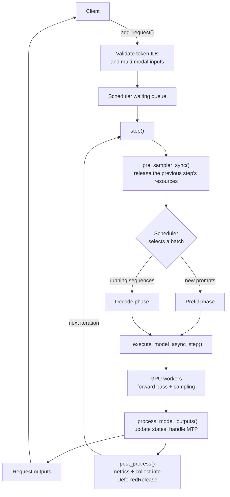

<!--
  SEO
    Title:             DeepInfer: By DeepSeek
    SEO title:         DeepInfer by DeepSeek: Open-Source Inference Engine for V4.1-Flash
    Meta description:  (159 chars) see `description` above
    Slug:              /signals/deepinfer-deepseek-inference-framework/
    Primary keyword:   DeepInfer
    Secondary:         DeepSeek inference framework, DeepSeek-V4.1-Flash inference, LLM inference engine,
                       open-source LLM inference, expert parallelism (EP + EPLB), speculative decoding (DSpark),
                       FlashMLA / DeepGEMM / DeepEP, NVIDIA SM100, Huawei Ascend 950
    Internal links:    /engineering/deepseek-v41-flash-kv-cache-compression-agentic-llm-inference/
                       /engineering/eagle-3-speculative-decoding-llm-inference-acceleration/
                       /engineering/deepseek-v3-auxiliary-loss-free-moe-mtp-fp8-training/
    Source:            https://github.com/deepseek-ai/DeepInfer

  Body is written one section at a time, on request only.
-->

*An illustrative SM100-class board, one of the two hardware targets of the DeepInfer release. Drawn for this post; not an NVIDIA floor plan.*

## DeepInfer Project Overview: DeepSeek's Production Inference Framework
{: data-eyebrow="01 / Project overview"}

**DeepInfer** is the inference framework behind DeepSeek's large-scale production services. This open-source release provides **offline inference for DeepSeek-V4.1-Flash** on **NVIDIA SM100 GPUs** and **Huawei Ascend 950 NPUs**.

The README lists its main features:

- **Optimized kernels** for the model and sampler runtime
- **Attention data parallelism (DP)** and **context parallelism (CP)**
- **MoE expert parallelism (EP) with EPLB**, the expert-parallel load balancer
- **DSpark speculative decoding**
- **SWA bounded replay**
- **Batch-invariant inference**
- **Structured outputs**

DeepSeek's deployment Q&A for DeepInfer also discusses two systems ideas: **PD disaggregation** and **DP load balancing**. Both are critical for running massive Mixture-of-Experts models like DeepSeek-V3 and V4 efficiently at scale.

> **Not in this release.** DeepInfer ships the engine. The README lists Prefill/Decode disaggregation and load balancing across data-parallel replicas as required for a complete inference service, but not included here.

### 1. What Is PD Disaggregation (Prefill-Decode Disaggregation)?

PD disaggregation splits the two phases of LLM inference, **prefill** and **decode**, onto separate, specialized clusters or worker nodes.

  

    
Phase 1 / Compute-bound

    <h4 class="fn-card-title">Prefill</h4>
    
The prefill worker processes the whole prompt at once in one large parallel matrix operation and builds the initial key-value (KV) cache. This stage needs high compute throughput.

  

  

    
Phase 2 / Memory-bandwidth-bound

    <h4 class="fn-card-title">Decode</h4>
    
The model then generates output tokens one at a time, autoregressively. Every token re-reads the model weights and KV cache from memory, so memory bandwidth, not raw compute, is the bottleneck.

  

#### Why Disaggregate Prefill and Decode?

In a standard **collocated** setup, one set of GPUs handles both stages. A long prompt then causes a **prefill spike** that blocks ongoing decode for other users and adds latency jitter.

With disaggregation, dedicated **prefill nodes** process prompts and stream the resulting KV cache over fast interconnects (NVLink, InfiniBand / RDMA) to **decode nodes**. In DeepSeek's deployment the KV cache is fetched from their **3FS** file system into host memory and swapped into GPU memory over RDMA.

This removes resource contention between the two phases. It lowers **Time-to-First-Token (TTFT)** and keeps inter-token latency smooth. DeepSeek's Q&A notes that TTFT and time-between-tokens can then be tuned independently, with a prefill-to-decode GPU ratio of roughly 1:1.

### 2. What Is DP (Data Parallelism) and DP Load Balancing?

Here, **DP means data parallelism**: specifically attention data parallelism, or data-parallel replicas.

#### What DP Means in a MoE Inference System

DeepSeek models are massive **Mixture-of-Experts (MoE)** architectures, so they are sharded with schemes like **expert parallelism (EP)** and **tensor parallelism (TP)**. To scale to thousands of GPUs, DeepSeek also replicates parts of the model across groups using data parallelism. As in the DeepSeek-V3 / R1 inference system, attention runs data-parallel with #DP = #EP.

#### The Load Imbalance Problem

Real-world requests are chaotic. One prompt is 50 tokens with a 2,000-token response; another is a 10,000-token document with a one-word answer.

If requests are distributed blindly, some DP replicas end up overloaded with heavy computation while others sit idle.

#### How DP Load Balancing Fixes It

**DP load balancing** is the routing and scheduling layer that spreads incoming requests across data-parallel replicas based on load. Per the Q&A, engines pull work according to their remaining compute quota, and each request goes to the DP rank with the lowest current load.

The goal is high hardware utilization across the cluster. DeepSeek reports its balancing reaches **roughly 80% of a perfectly balanced offline benchmark**.

## DeepInfer vs Mooncake: Two Approaches to PD Disaggregation
{: data-eyebrow="02 / Comparison"}

Moonshot AI's **Mooncake** and DeepSeek's production architecture, which DeepInfer comes from, both use **Prefill-Decode (PD) disaggregation**. They were built to remove different bottlenecks, though.

Mooncake was designed from the start as a **KV-cache-centric** storage and serving platform for the ultra-long-context Kimi models. DeepSeek's inference design is tuned for **compute efficiency in massive Mixture-of-Experts (MoE) models** and for **Multi-head Latent Attention (MLA)**.

### Summary Comparison: Mooncake vs DeepSeek

| Metric / feature | Moonshot AI's Mooncake | DeepSeek's architecture |
|---|---|---|
| Primary design goal | Ultra-long-context management and global KV cache reuse | MoE throughput and low-latency execution |
| Cache hierarchy | Multi-tier pool: GPU VRAM → CPU DRAM → SSD / NVMe | Compact MLA cache moved over GPU-to-GPU and RDMA fabric; the 3FS SSD tier holds the on-disk context cache |
| Attention mechanism | Attention-agnostic: it stores whatever KV cache the engine produces (Kimi K2 itself uses MLA) | MLA, which compresses the KV cache inside the model |
| Ecosystem status | Open-source modular middleware that plugs into vLLM and SGLang | Open kernels (FlashMLA, DeepGEMM, DeepEP), 3FS and now the DeepInfer engine; PD and DP-balancing orchestration stays internal |

  

    
Difference 01 / Design focus

    <h4 class="fn-card-title">Context vs compute</h4>
    
Mooncake manages very long contexts and a global key-value (KV) cache store. DeepSeek focuses on compute efficiency for massive MoE models and on fast network transfers.

  

  

    
Difference 02 / KV cache

    <h4 class="fn-card-title">Store more vs store less</h4>
    
Mooncake spreads the KV cache across GPU memory, CPU memory and SSDs. DeepSeek shrinks the cache inside the model with MLA, then moves the compressed cache between nodes over high-speed interconnects.

  

  

    
Difference 03 / Open source

    <h4 class="fn-card-title">Middleware vs building blocks</h4>
    
Moonshot AI ships Mooncake as open middleware for standard engines like vLLM. DeepSeek releases kernels and now the DeepInfer engine, but keeps production orchestration and data-parallel load balancing private.

  

### Where Mooncake and DeepSeek Agree

Both systems are answers to the same problem: serving large language models cheaply at scale. They share four engineering principles.

  

    
Shared 01 / Phase split

    <h4 class="fn-card-title">Prefill and decode separation</h4>
    
Both split prefill and decode onto different hardware nodes, so the two phases stop competing for the same processors.

  

  

    
Shared 02 / Latency

    <h4 class="fn-card-title">Lower time to first token</h4>
    
Both cut time to first token and keep token generation fast and steady under heavy user traffic.

  

  

    
Shared 03 / Data movement

    <h4 class="fn-card-title">KV transfer and routing</h4>
    
Both move large volumes of KV state between nodes over high-speed cluster networks, and route requests to where that state lives.

  

  

    
Shared 04 / Utilization

    <h4 class="fn-card-title">No idle hardware</h4>
    
Both balance load across compute units to keep processor utilization high and avoid idle GPUs in the cluster.

  

> **The short version.** Mooncake makes room for a huge KV cache. DeepSeek makes the KV cache small enough that it rarely needs that much room. For how MLA shrinks the cache, see the [DeepSeek-V2 MLA breakdown](/engineering/deepseek-v2-mixture-of-experts-mla-language-model/) and the [DeepSeek-V4.1-Flash KV cache compression article](/engineering/deepseek-v41-flash-kv-cache-compression-agentic-llm-inference/).

## Inside the DeepInfer Codebase: The Engine Core Files
{: data-eyebrow="03 / Engine core"}

### The Offline LLM API: `llm.py` and `SamplingParams`

Users talk to DeepInfer through the **`LLM` class** in `llm.py`, which the package's `__init__.py` exports. `LLM` wraps the engine, exposes the tokenizer and offers a batched **`generate()`** call.

Each request is configured by **`SamplingParams`** in `sampling_params.py`. It covers temperature, top-p / top-k, logprobs, stop conditions and seeds, and it validates its arguments before anything reaches the engine.

This walkthrough starts at `llm.py` and follows its imports outward, so every file covered later can be reached from this API.

### The `LLMEngine` Class: DeepInfer's Inference Loop

The **`LLMEngine`** class manages text generation for large language models. It uses three techniques to get maximum throughput:

- **Iteration-level scheduling:** the batch is chosen again at every step, so new requests join and finished requests leave without waiting for the whole batch.
- **Parallel GPU workers:** one worker process per GPU runs the model.
- **KV cache memory management:** the engine divides GPU memory into blocks and gives blocks to sequences as they grow.

The explanations below follow the **Simplified Technical English (ASD-STE100)** style: short sentences, active voice and standard technical terms.

#### How DeepInfer Runs Inference: The Step Loop

Text generation runs in a continuous loop. Each cycle is one **inference step**, the `step()` function.

1. **Add requests.** Clients add prompts with `add_request()`. The engine checks the token IDs and validates multi-modal inputs. Then it puts each request in the scheduler's waiting queue.
2. **Schedule the iteration.** In `step()`, the engine asks the **scheduler** to select a batch of sequences. The scheduler decides between a **prefill** phase (process new prompts) and a **decode** phase (generate the next tokens).
3. **Execute the model.** The engine sends the metadata and the scheduled blocks to the backend workers (`_execute_model_async_step`). The workers run the GPU forward pass and sample the tokens.
4. **Process the outputs.** The engine reads the sampler outputs (`_process_model_outputs`). It updates the sequence states, handles **multi-token prediction (MTP)** and packages the new tokens into request outputs.
5. **Release resources one step later.** Memory cleanup must not block the GPU. So the engine collects old resources in `DeferredRelease` and releases them in the next step, while the GPU computes.

*The DeepInfer `LLMEngine` request flow. Resources collected in one step are released at the start of the next one, so cleanup overlaps with GPU work.*

#### `LLMEngine` Function Reference

**Resource and worker management**

| Function | What it does |
| --- | --- |
| `DeferredRelease.__init__` | Initializes the container that delays memory cleanup. |
| `DeferredRelease.collect_sequence_metadata` | Adds the metadata of finished sequences to the release queue. |
| `DeferredRelease.collect_request_outputs` | Stores old request output IDs for removal later. |
| `DeferredRelease.collect_clone_unpins` | Records the GPU states and blocks to unpin after synchronization. |
| `DeferredRelease.release` | Frees sequence metadata, request outputs and memory blocks safely. |
| `_spawn_worker` | Makes the available GPUs visible to the CUDA driver and starts a parallel `Worker` process. |

**Initialization and lifecycle**

| Function | What it does |
| --- | --- |
| `LLMEngine.__init__` | Initializes the core engine: configuration, tokenizer, multi-modal processors, parallel workers, memory block managers and the scheduler. |
| `LLMEngine._create_scheduler` | Creates and configures the **C++ scheduler** from the cache blocks, the parallel groups and the FLOPs estimators. |
| `LLMEngine.so_matcher_builder` (property) | Builds the structured output matcher for constrained generation, the first time it is needed. |
| `LLMEngine.so_builder_has_pending` | Checks for structured output compilation tasks that are not finished. |
| `LLMEngine.__del__`, `LLMEngine.close` | Shut down the background threads, profile servers and parallel workers, so that no memory leaks. |
| `LLMEngine._init_workers` | Starts the non-driver context-parallel worker processes and initializes the main driver worker. |
| `LLMEngine._init_cache` | Profiles the free GPU memory, calculates a safe number of blocks, initializes the KV cache engines and warms up the model. |
| `LLMEngine.from_engine_args` (class method) | Factory method. Creates an `LLMEngine` from parsed command-line or configuration arguments. |

**Request management**

| Function | What it does |
| --- | --- |
| `LLMEngine.add_request` | Receives a new generation request. Validates the token IDs, processes images or videos if present, creates a `Sequence` object and adds it to the scheduler queue. |
| `LLMEngine.abort_request` | Cancels one or more running or waiting requests by request ID and frees their memory blocks. |
| `LLMEngine.get_num_unfinished_requests` | Returns the number of running and waiting requests. |
| `LLMEngine.has_unfinished_requests` | Checks all data-parallel ranks for unfinished requests. |
| `LLMEngine.get_nextn_pad_token_ids` | Returns the padding token IDs for multi-token prediction (MTP) and speculative decoding. |

**Model execution and output processing**

| Function | What it does |
| --- | --- |
| `LLMEngine.step` | Runs one full inference iteration. Schedules the requests, clones or zeros states if necessary, starts model execution on the workers and returns the new token outputs. |
| `LLMEngine._execute_model_async_step` | Tells the workers to run the forward pass and sampling asynchronously. |
| `LLMEngine._process_model_outputs` | Receives the raw sampler outputs from the workers. Processes MTP information, updates the sequence status in the scheduler, logs performance statistics and builds the request outputs. |
| `LLMEngine.do_copy_state` | Copies GPU state buffers asynchronously for specified sequences, during KV cache saves or prefix caching. |
| `LLMEngine.flush_inflight_reqs` | Flushes and processes all in-flight requests in **zero-overhead scheduling** mode. |
| `LLMEngine.post_process` | Cleans up after the workers finish a step. Processes the model outputs, updates runtime metrics and collects metadata for deferred release. |
| `LLMEngine.pre_sampler_sync` | Runs before the sampler synchronizes. Frees the deferred resources and saves KV cache states. |

**Hooks (extension points)**

These are virtual hook functions. Subclasses override them to implement custom serving architectures, prefix caching strategies or special logging:

`init_pd_split`, `finalize_seq`, `post_schedule`, `should_copy_state`, `do_save_kvcache`, `pe_prepare_save_kvcache`, `pe_do_save_kvcache`, `process_output`, `send_processed_prompts`, `post_process_model_outputs`, `build_extra_metrics_log`

> **Why the hooks matter.** `init_pd_split` is a hook on the open-source engine. The README says Prefill/Decode disaggregation is not in this release. These extension points are where a full serving stack can add it.

### Engine Configuration: `arg_utils.py` and `config.py`

Before the engine starts, **`arg_utils.py`** turns the constructor and CLI arguments into four validated config objects, all defined in **`config.py`**:

| Config object | What it decides |
| --- | --- |
| `ModelConfig` | The model: checkpoint, architecture and shape |
| `CacheConfig` | The KV cache: block size and memory budget |
| `ParallelConfig` | The parallel layout across GPUs (data, context and expert parallelism) |
| `SchedulerConfig` | How the scheduler batches requests at each step |

On the Hugging Face side, **`hugging_face/config.py`** translates a checkpoint's `config.json` into the internal model config. That includes the **attention**, **MoE**, **DFlash**, **Engram**, **RoPE/YaRN** and **vision** sub-configs.

Together, these objects decide the **model shape** and the **parallel layout** that the rest of this tour assumes.

**Referenced components:** `arg_utils.py` · `config.py` · `hugging_face/config.py`

### LLMEngine Orchestration: The Conductor of DeepInfer

`LLMEngine` has one of the highest fan-outs in the import graph. It's the conductor of the whole system:

- It **spawns the workers** and **sets up the KV cache**.
- It **schedules requests** through the C++ scheduler.
- It **runs model steps asynchronously**, handles **MTP state** and builds the **request outputs**.

The **stats logger** reports **throughput**, **MFU** (model FLOPs utilization), **MTP acceptance** and **MoE load balance**. That makes it a good place to see which metrics matter in production.

**Referenced components:** `llm_engine.py` · `stats_logger.py` · `engine_type.py`

### Native C++ Scheduler: Continuous Batching Off the Python Critical Path

To keep scheduling off the Python critical path, DeepInfer writes its **continuous-batching scheduler in C++**. It manages:

- the **waiting and running queues**,
- **chunked prefill** and **preemption**,
- allocation of **paged KV blocks** from an **LRU-ordered `BlockManager`**.

`sequence.hpp` defines the request state that the scheduler tracks. `pybind_scheduler.cpp` exposes all of it to `LLMEngine` as the **`deepinfer._C.engine`** module, and `engine.pyi` describes that module's typed interface.

> **Language lesson: pybind11 and `.pyi` stubs.** pybind11 binds C++ classes and functions as Python objects. Hot loops like scheduling run natively, while the orchestration code stays in Python. A `.pyi` stub file gives IDEs and type checkers the signatures of a compiled extension, which they can't inspect directly.

**Referenced components:** `scheduler.hpp` · `block_manager.hpp` · `sequence.hpp` · `pybind_scheduler.cpp` · `engine.pyi`

### Workers and Process Groups

Each GPU or NPU rank runs a **`Worker`**. The worker carries out one full model step for the engine: **prepare, forward, sample and post-process**.

Workers coordinate through the **process groups** that `parallel_state.py` creates for **data, context, expert and Engram parallelism**. Engine-to-worker messages go through **`shm_broadcast`**, a shared-memory ring buffer derived from vLLM. It's a low-latency channel with **one writer and many readers**.

**Referenced components:** `worker.py` · `parallel_state.py` · `shm_broadcast.py`

### Model Runner and KV Cache

Inside each worker, **`ModelRunner`** loads the model, prepares the input tensors and `InputMetadata`, runs the forward pass and sampling, and profiles memory.

**`CacheEngine`** sizes and allocates the **paged KV and state caches** behind the blocks that the C++ `BlockManager` hands out. It uses separate layouts for **sliding-window**, **compressed** and **sparse-index** attention layers.

**CUDA graphs** are captured and replayed across padded decode batch sizes, which cuts kernel launch overhead.

**Referenced components:** `model_runner.py` · `cache_engine.py` · `cuda_graph_runner.py` · `input_metadata.py`

### Loading DeepSeek Weights

`model_loader.py` picks the model architecture from the **registry** and builds the model on the **meta device**. Then it loads the Hugging Face **safetensors** weights through `weights.py`, with a **watchdog** guarding the load.

Building on the meta device avoids allocating memory for parameters that will be overwritten anyway. The loader also sets up **per-expert and Engram-table coverage**, which is how the routed MoE experts end up spread across the expert-parallel ranks.

**Referenced components:** `model_loader.py` · `weights.py`

### DeepSeek Model Architecture: `deepseek.py`

`deepseek.py` has the **largest fan-out in the codebase**. It stacks the decoder layers together with the embeddings, **YOCO** and the **Engram runtime**. Its causal-LM wrapper handles **EPLB**, sampling and **DFlash MTP**.

Each decoder layer combines two blocks:

- **MLA attention**, with sliding-window plus compressed and sparse KV.
- A **MoE block** that handles gating, EPLB-aware routing, and dispatch/combine with **FP8/FP4 expert weights**.

This is where the README's **attention parallelism** and **MoE expert parallelism** features are implemented.

**Referenced components:** `deepseek.py` · `decoder_layer.py` · `attn.py` · `mlp.py`

### Expert Load Balancing (EPLB)

MoE routing is uneven: some experts get far more tokens than others. So the **EPLB** subsystem tracks how many tokens each expert receives. It periodically recomputes where the **physical expert replicas** should live and moves their weights between ranks.

`policy.py` implements the **greedy replication and placement algorithm**, based on historical token statistics. Its output feeds the routing in the MoE layer described above.

**Referenced components:** `policy.py`

### Sampling and Speculative Decoding (DFlash)

The **`Sampler`** turns hidden states into tokens. It handles **prompt logprobs**, **structured-output masks** and the **verification of MTP/DFlash draft tokens**.

**DFlash** is the speculative-decoding module. It proposes draft tokens with lightweight draft decoder layers and a **confidence head**. The scheduler uses those confidence scores to decide **how many draft tokens to verify**. The results go back to the engine in the sampler output containers from `sequence.py`.

**Referenced components:** `sequence.py`

### Structured Output Constraints

Structured outputs (**regex, JSON schema, EBNF**) are built on **xgrammar**:

- The **compiler** caches compiled grammars.
- The **matchers** track which tokens are allowed at each step and fill a **vocabulary bitmask**.

Matchers are built **asynchronously on a thread pool**, so grammar compilation doesn't stall decoding. A **TileLang kernel** inside the `Sampler` then applies the bitmask to the logits.

### TileLang Kernel Dispatch: `ops.py`

Many of the hot paths above call custom **TileLang** kernels through **`ops.py`**, one of the most-imported files in the codebase.

`ops.py` imports the backend for the current platform (**`cuda`** for SM100 or **`asc`** for Ascend) and re-exports its `*_tl` kernel factories. If that backend doesn't provide a kernel, it raises **`KernelUnavailableError`**. Comparing the CUDA and Ascend versions of the same fused sampling kernel shows how one algorithm is written for two different accelerators.

> **Language lesson: module-level `__getattr__` (PEP 562).** A module-level `__getattr__` lets a Python module resolve attributes lazily, when they're accessed. `ops.py` uses it to raise a clear `KernelUnavailableError` for kernels missing on the current backend, instead of failing at import time.

**Referenced components:** `ops.py` · `fused_sample.py` (CUDA) · `fused_sample.py` (Ascend) · `store_kv_cache.py`

### Hardware Abstraction: `deep_cluster`

The **`deep_cluster`** hardware package exposes a hardware-neutral **device discovery API**: accelerator kind, visible devices, NUMA node and GPU counts. It's how the code above decides between the **NVIDIA and Ascend** code paths.

At the native level, `pybind.cpp` registers the `cuda_utils`, `engine` and `graph_timer` submodules into a **single torch extension**.

**Referenced components:** `__init__.py` · `device.py` · `pybind.cpp`

### Building the Project

- **`build.sh`** is the one-shot build script. It validates `DEEPINFER_ACCELERATOR`, installs the matching requirements and builds everything.
- **`setup.py`** compiles the `deepinfer._C` extension as either a **`CUDAExtension`** or an **Ascend `NpuExtension`**.
- The **`Makefile`** provides per-accelerator build, stub-generation and formatting targets.
- **`pyproject.toml`** configures packaging, pytest markers and Ruff linting.

> **Language lesson: Makefile targets.** Makefile targets declare build steps with dependency tracking. **Phony targets** such as `clean` or `format` name actions, not files. Variables like the accelerator type let one target serve several build configurations.

**Referenced components:** `build.sh` · `setup.py` · `Makefile` · `pyproject.toml`
