<!--
  SEO
    Primary keyword:   multi-agent document intelligence
    Secondary:         evidence-backed knowledge base, knowledge patches, Amazon Bedrock AgentCore,
                       agents-as-tools pattern, S3 SQS Lambda document ingestion, planner and
                       specialist agents, RFP analysis with AI agents, cross-agent validation,
                       agent memory vs knowledge base, DynamoDB conditional writes
    Slug:              /signals/document-to-knowledge-to-agents-aws/
    Meta description:  (157 chars) see `description` above

  Source: raw_data/Document-to-Knowledge-to-Agents (D2K2A).md (architecture draft).
  Made generic at the author's request: no organisation names; tender/RFP analysis is the
  running example only. "tender_id" in the source is generalised to "corpus_id".
  Every ID, date, count and code sketch in the body and in the animated figures is
  illustrative, not measured. Code sketches are my own expansions, not from the source.
  Figures: assets/js/d2k2a-demos.js + css/d2k2a-demos.css (dk- prefix).
  Hero: scripts/d2k2a_hero.py (original artwork).
-->

<link rel="stylesheet" href="{{ '/css/d2k2a-demos.css' | relative_url }}">


*Scale lives in Lambda. Truth lives in the Wiki. Reasoning lives in the agents. Keep those three apart and the rest of the design gets much easier.*

## Why Multi-Agent Document Intelligence Needs a Knowledge Layer
{: data-eyebrow="01 / The problem"}

Most attempts at **multi-agent document intelligence** start the same way: point a few LLM agents at a folder of PDFs and ask for a summary. It works on ten pages. It falls apart on ten thousand.

The failure is not the model. It is the shape of the system. Every agent re-reads raw documents, nobody agrees on which deadline is the real one, and nothing the agents learn survives the run.

My running example is tender (RFP) analysis. A single bid can arrive as dozens of documents: specifications, schedules, legal terms, pricing templates, clarifications. The same pattern applies to any large, unstructured document set: contract packs, due-diligence data rooms, regulatory filings, technical manuals.

This post walks through an architecture I call **Document-to-Knowledge-to-Agents (D2K2A)**. It turns a large document set into validated, evidence-backed intelligence in three stages:

1. **Document**: ingest and process documents at scale, in parallel and in batches.
2. **Knowledge**: integrate extracted facts into a persistent, evidence-backed **Wiki**, the shared knowledge base.
3. **Agents**: a planner and specialist agents reason over the Wiki, then synthesise and validate the final output.

### The Six Design Principles

<div class="fn-cards">
  <div class="fn-card">
    <p class="fn-card-tag">01 / Separation</p>
    <h4 class="fn-card-title">Separate scale from reasoning</h4>
    <p class="fn-card-text">AWS Lambda handles document-scale parallelism. Amazon Bedrock AgentCore handles reasoning and orchestration. Neither does the other's job.</p>
  </div>
  <div class="fn-card">
    <p class="fn-card-tag">02 / Knowledge</p>
    <h4 class="fn-card-title">Knowledge is a first-class asset</h4>
    <p class="fn-card-text">The Wiki is persistent, document-specific and evidence-backed. It is not agent memory.</p>
  </div>
  <div class="fn-card">
    <p class="fn-card-tag">03 / Evidence</p>
    <h4 class="fn-card-title">Evidence everywhere</h4>
    <p class="fn-card-text">Every fact in the Wiki links back to a source document, page and span.</p>
  </div>
  <div class="fn-card">
    <p class="fn-card-tag">04 / Interfaces</p>
    <h4 class="fn-card-title">Controlled interfaces</h4>
    <p class="fn-card-text">Agents read from and contribute to the Wiki only through governed APIs (knowledge patches), never by direct free-form writes.</p>
  </div>
  <div class="fn-card">
    <p class="fn-card-tag">05 / Evolution</p>
    <h4 class="fn-card-title">Start simple, evolve deliberately</h4>
    <p class="fn-card-text">One orchestrator Runtime with logical subagents first. Promote specialists to independent Runtimes only when there is a concrete need.</p>
  </div>
  <div class="fn-card">
    <p class="fn-card-tag">06 / Contracts</p>
    <h4 class="fn-card-title">Stable agent contracts</h4>
    <p class="fn-card-text">Agent interfaces are designed so deployment topology can change without changing planner business logic.</p>
  </div>
</div>

If I had to compress the six into one sentence: **agents should never be the place where knowledge lives**. They consume it and they propose changes to it. Something else owns it.

## The D2K2A Architecture: Three Layers on AWS
{: data-eyebrow="02 / Architecture"}

Here is the whole system on one page. Documents flow top to bottom through three layers.

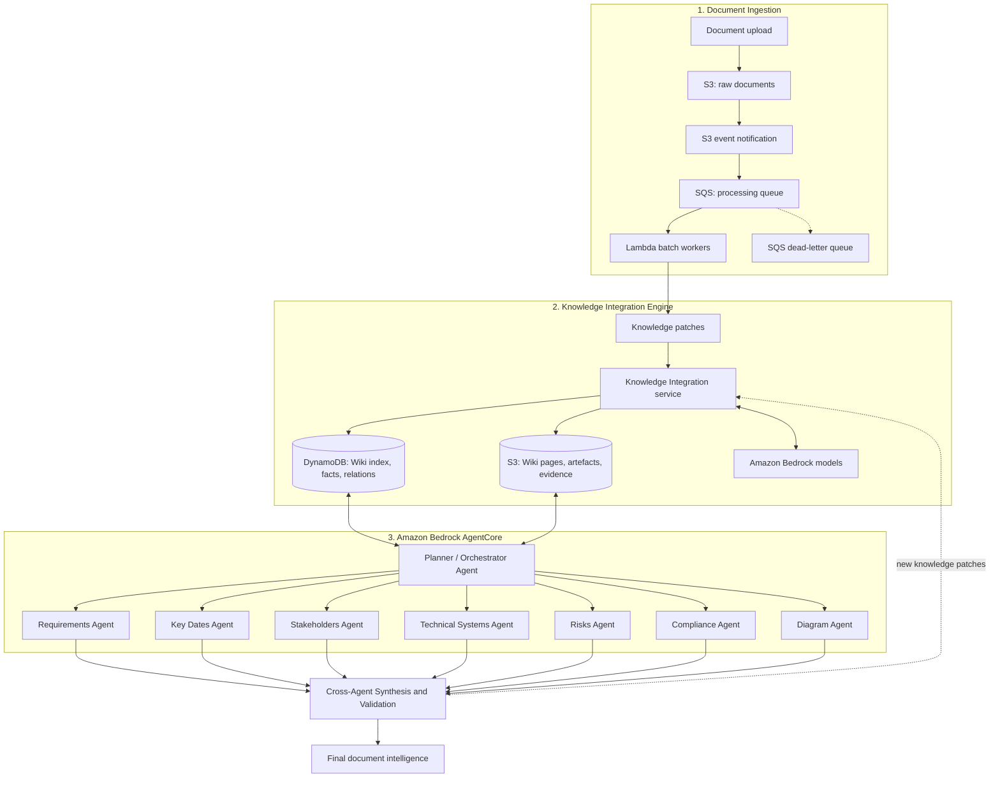

Lambda workers produce **knowledge patches**. The Knowledge Integration Engine merges them into the Wiki. Agents reason over the Wiki and feed validated new knowledge back through the same controlled interface.

The dashed arrow at the bottom is the part I find most interesting. The system does not just read its knowledge base. **Each run can make the Wiki better**, but only through the same validated door the ingestion workers use.

### Who Owns What

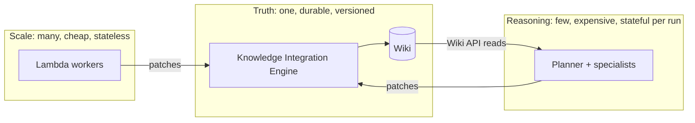

Each box has a different scaling curve, failure mode and cost profile. Mixing them is how you end up with an agent that both parses PDFs and decides which deadline is correct.

## Layer 1: S3, SQS and Lambda Document Ingestion
{: data-eyebrow="03 / Ingestion"}

**Goal:** process many documents in parallel, reliably and cheaply.

| Concern | AWS component | Role |
|---|---|---|
| Raw storage | Amazon S3 (raw bucket) | Immutable source of truth for uploaded documents |
| Triggering | S3 Event Notifications | Emit an event per new object |
| Buffering and backpressure | Amazon SQS | Decouples upload rate from processing rate |
| Failure handling | SQS dead-letter queue | Captures poison messages for inspection and replay |
| Processing | AWS Lambda (batch workers) | Parse, chunk, extract and produce knowledge patches |
| Text and structure extraction | Amazon Textract (optional) | OCR, tables and forms for scanned or complex PDFs |
| Extraction and classification | Amazon Bedrock | LLM-based extraction of requirements, dates, entities |
| Orchestration (optional) | AWS Step Functions | Coordinate multi-step pipelines per document or per corpus |

The queue is the important piece. Users upload in bursts: a whole bid pack lands at once. Without SQS between S3 and Lambda, that burst turns straight into concurrency, throttling and retries against Textract and Bedrock.

With SQS, the upload rate and the processing rate become two separate numbers. Try it below: drop concurrency to 1 and watch queue depth climb, then raise it to 4.

<figure class="dk-demo" data-dk="ingest" aria-label="Animated simulation of S3 SQS Lambda document ingestion: documents upload to S3, queue in SQS, are processed by Lambda workers into knowledge patches, and a poison document is retried three times then moved to the dead-letter queue">
  <figcaption>Fig. A — S3 → SQS → Lambda document ingestion. Ten illustrative documents; doc-06 always fails. Change Lambda concurrency to see backpressure absorbed by the queue.</figcaption>
</figure>
<script src="{{ '/assets/js/d2k2a-demos.js' | relative_url }}" defer></script>

### The Ingestion Sequence

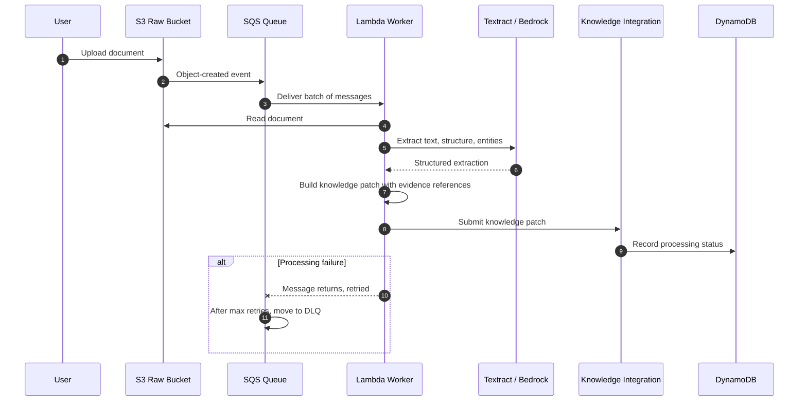

### Life of an SQS Message

The retry and dead-letter behaviour is easier to reason about as a state machine. A message is never "lost". It is either in flight, back in the queue, done, or parked in the DLQ.

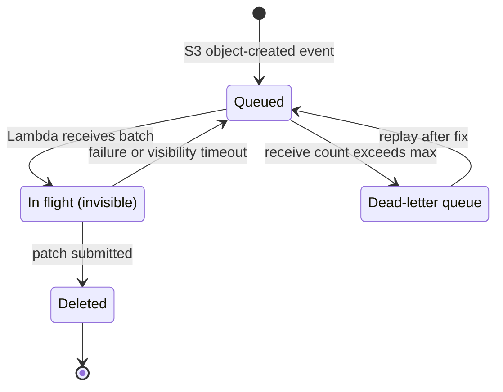

Two engineering consequences fall out of this diagram:

- **Workers must be idempotent.** A message can be delivered more than once, so the same document can produce the same patch twice. The patch contract below handles that.
- **The DLQ is a debugging tool, not a bin.** Because the raw bucket is immutable, a fixed parser can replay everything in the DLQ without re-uploading anything.

### The Knowledge Patch Contract

A **knowledge patch** is the unit of change produced by workers and agents. It is idempotent and carries evidence. This is the single most important interface in the system.

```json
{
  "patch_id": "uuid",
  "corpus_id": "RFP-2026-0142",
  "source": { "document_id": "doc-17", "page": 42, "span": "p42:l10-l18" },
  "producer": { "type": "lambda-worker", "version": "1.3.0" },
  "operations": [
    {
      "op": "upsert",
      "entity_type": "requirement",
      "entity_id": "REQ-0231",
      "attributes": { "text": "...", "mandatory": true },
      "confidence": 0.91
    }
  ],
  "created_at": "2026-11-14T10:00:00Z"
}
```

*(The IDs and values are illustrative. `corpus_id` is whatever scopes one document set: one tender, one contract pack, one data room.)*

Every field earns its place:

- `patch_id` makes replays safe: applying the same patch twice is a no-op.
- `source` is the evidence pointer: document, page and span.
- `producer` records who proposed the change, with a version. When a new extraction prompt goes wrong, this is how I find every patch it produced.
- `confidence` per operation feeds the confidence rollup at the end of the pipeline.

Note what is **not** in the patch: no direct table names, no S3 keys, no "overwrite" flag. A producer proposes. The engine decides.

### Patch Lifecycle

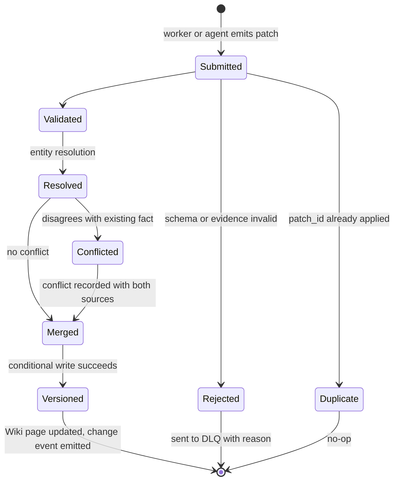

## Layer 2: The Knowledge Integration Engine and the Evidence-Backed Wiki
{: data-eyebrow="04 / Knowledge"}

**Goal:** merge many independent patches into one consistent, **evidence-backed knowledge base**.

The engine has five responsibilities:

- **Validate** patch schema and evidence references.
- **Deduplicate and resolve entities**: the same stakeholder or requirement appearing in several documents.
- **Detect and record conflicts**, for example two documents giving different submission deadlines, rather than silently overwriting.
- **Version** every change for audit and rollback.
- **Expose controlled read and write interfaces** to agents.

The third point is where most retrieval-only systems quietly fail. If doc-02 says the deadline is 14 March and a later clarification says 12 March, last-writer-wins is the worst possible behaviour. **A conflict is information**, and the Wiki should keep it.

### The Integration Flow

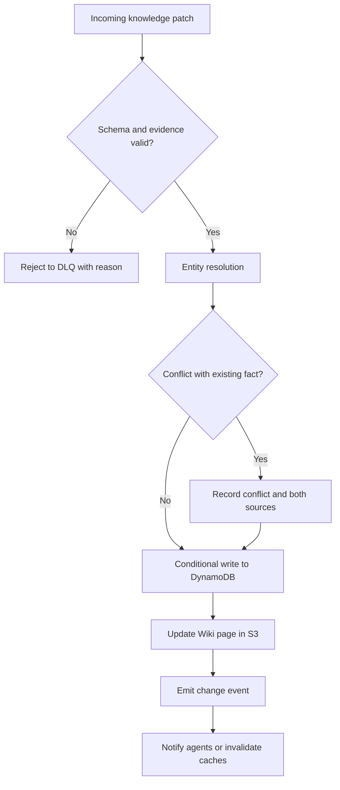

Step through six patches below. One is new, one resolves to an existing requirement, one is a retry replay, one has a broken evidence span, and one contradicts an existing date.

<figure class="dk-demo" data-dk="merge" aria-label="Animated walkthrough of knowledge patches merging into an evidence-backed Wiki: validation, entity resolution, an idempotent replay, a rejected patch, and a submission-deadline conflict recorded with both sources">
  <figcaption>Fig. B — Knowledge patches through the Knowledge Integration Engine. All IDs, pages and dates are illustrative.</figcaption>
</figure>

### Safe Concurrency with DynamoDB Conditional Writes

Hundreds of Lambda workers can submit patches about the same entity at the same moment. The source design leans on **DynamoDB conditional writes and per-entity versioning** for this. Here is how I picture that race playing out:

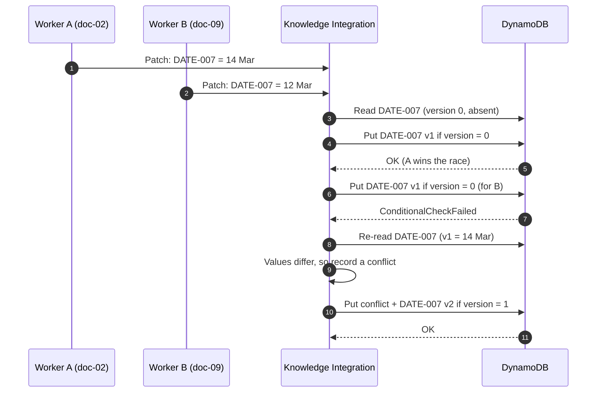

In code, the guard is one condition expression. This is a sketch of my own, not from the source design:

```python
# Illustrative: optimistic concurrency on one fact item.
table.put_item(
    Item={"pk": f"{corpus_id}#FACT#{fact_id}", "value": value,
          "version": expected + 1, "evidence": evidence_ids},
    ConditionExpression="attribute_not_exists(pk) OR version = :v",
    ExpressionAttributeValues={":v": expected},
)
# On ConditionalCheckFailedException: re-read, re-run conflict detection, retry.
```

No locks, no lost updates. The loser of the race does not overwrite; it re-reads and goes back through conflict detection.

### Storage Split: DynamoDB for Facts, S3 for Pages

| Data | Store | Why |
|---|---|---|
| Entities, facts, relations, indexes, status | Amazon DynamoDB | Low-latency key-based access, conditional writes for safe concurrency |
| Wiki pages, document artefacts, evidence snippets, diagrams | Amazon S3 | Cheap, durable, large objects, versioning |
| Reasoning and merge decisions | Amazon Bedrock | Entity resolution, conflict explanation, summarisation |

The split follows access patterns. Agents ask small, keyed questions ("all mandatory requirements for this corpus") that DynamoDB answers fast. Rendered pages and evidence snippets are large, read-mostly blobs that belong in S3.

### The Wiki Data Model

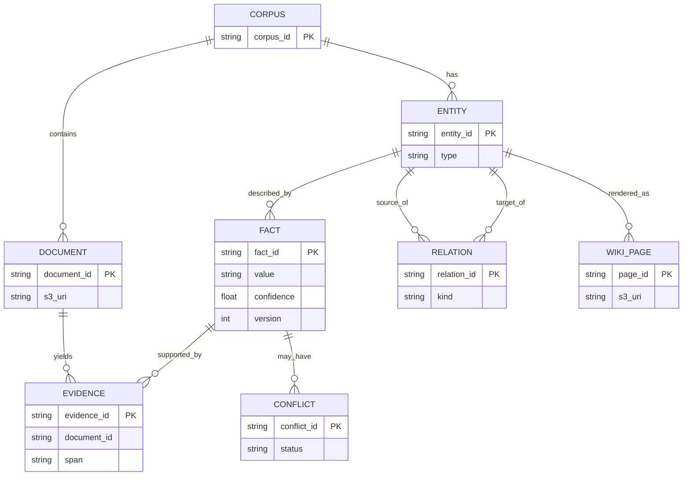

The relationship that matters most is `FACT ||--o{ EVIDENCE`. A fact with zero evidence rows should not exist. That one constraint is what makes every downstream citation checkable.

### Agent Memory vs Knowledge Base

It is tempting to use the agent platform's memory as the knowledge store. The design explicitly says no.

| | Wiki (S3 + DynamoDB) | AgentCore Memory |
|---|---|---|
| Nature | Persistent, document-specific, evidence-backed knowledge | Agent session and user context, preferences, conversational history |
| Owner | Knowledge Integration Engine | The agent runtime |
| Lifetime | Life of the corpus (and beyond) | Session or user scoped |
| Auditability | Full evidence trail | Not designed for it |

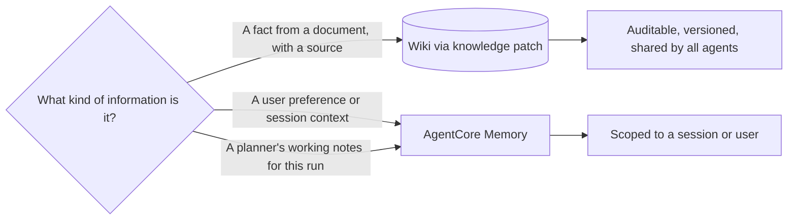

**Decision:** AgentCore Memory is not a replacement for the Wiki. It can complement it, for example by remembering user preferences or a planner's working context.

## Layer 3: Planner and Specialist Agents on Amazon Bedrock AgentCore
{: data-eyebrow="05 / Agents"}

Three terms first, because they get blurred:

- **AgentCore** is the overall platform.
- **AgentCore Runtime** is the managed environment where agents are deployed and executed.
- One Runtime can host an orchestrator with several subagents, or multiple Runtimes can host independently deployable agents. AWS supports both patterns.

### The Specialist Agents

| Agent | Responsibility | Primary Wiki reads | Typical output |
|---|---|---|---|
| **Planner / Orchestrator** | Decompose the task, delegate, monitor, assemble | All | Execution plan, delegated tasks |
| **Requirements** | Functional, non-functional and mandatory requirements | Requirement entities | Structured requirements list |
| **Key Dates** | Deadlines, milestones, clarification windows | Date entities | Timeline |
| **Stakeholders** | Buyer, evaluators, partners, roles | Person and organisation entities | Stakeholder map |
| **Technical Systems** | Systems, integrations, standards, constraints | System entities | Technical landscape |
| **Risks** | Delivery, commercial and contractual risks | Facts, conflicts | Risk register |
| **Compliance** | Mandatory criteria, certifications, legal terms | Requirement and clause entities | Compliance matrix |
| **Diagram** | Mermaid and architecture diagrams from the Wiki | Relations | Diagrams |
| **Knowledge Integration** | Contribute agent-derived knowledge back to the Wiki | Patches | Knowledge patches |

Look at the "Primary Wiki reads" column. Every specialist reads a **narrow, typed slice** of the Wiki, not raw documents. That is the payoff of Layer 2: the Requirements agent never has to discover requirements from scratch on page 412.

### The Orchestration Flow

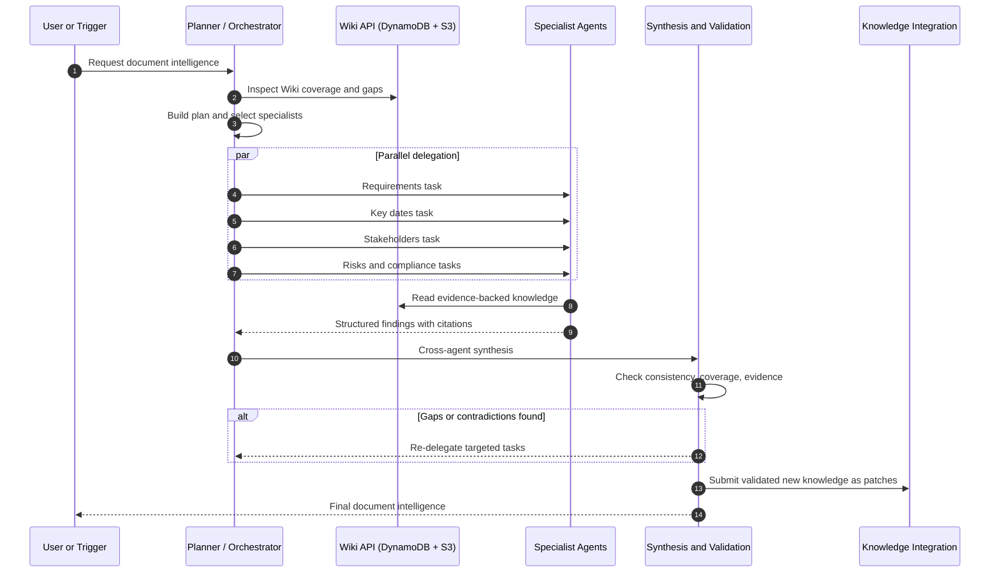

Two details I would not skip. First, the planner **inspects Wiki coverage before planning**, so it knows what already exists. Second, re-delegation is **targeted**: only the specialist with the gap re-runs.

<figure class="dk-demo" data-dk="fanout" aria-label="Animation of a planner agent fanning out to five specialist agents in parallel, cross-agent synthesis running evidence, consistency, coverage, conflict and confidence checks, finding a coverage gap and re-delegating one targeted task to the Risks agent">
  <figcaption>Fig. C — Planner fan-out, cross-agent validation and targeted re-delegation. Speeds and finding counts are illustrative.</figcaption>
</figure>

## Deployment Options: Agents-as-Tools vs Multiple Runtimes
{: data-eyebrow="06 / Deployment"}

This is the decision most teams agonise over too early. The design gives two options and a clear default.

### Option A: One Runtime, Multiple Logical Agents

The planner and specialists run inside one deployed application. Agents are implemented as subagent loops or **tools** using Strands, LangGraph or custom orchestration code. AWS refers to this as the **Agents-as-Tools pattern**.

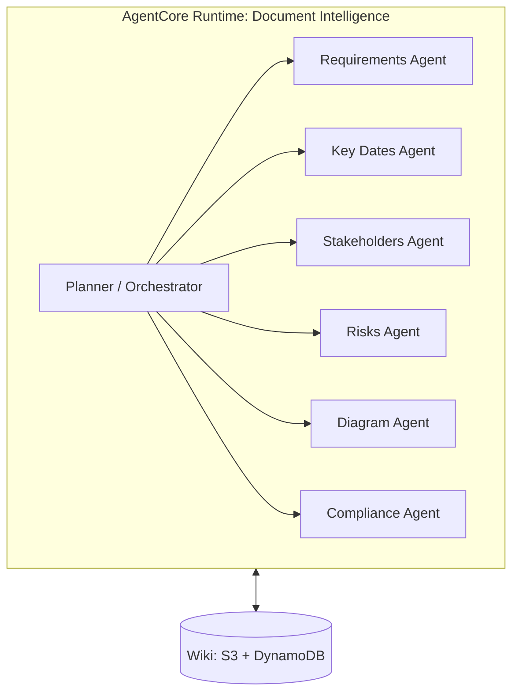

| Advantages | Trade-offs |
|---|---|
| Easier deployment | Specialists scale together |
| Simpler communication | Shared deployment and versioning |
| Lower operational complexity | Shared permissions boundary |
| Shared orchestration and execution context | Harder to split ownership across teams |

### Option B: Multiple AgentCore Runtimes

Each specialist is deployed independently and communicates through **A2A**, **MCP** or direct Runtime invocation.

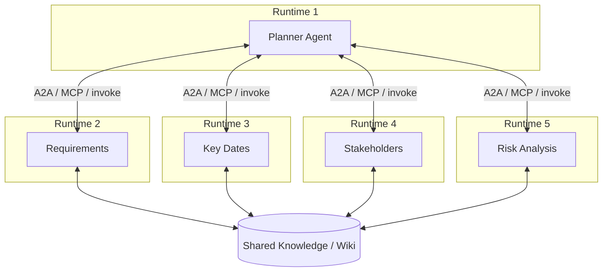

| Advantages | Trade-offs |
|---|---|
| Independent scaling | More deployments to operate |
| Independent versioning and lifecycle | Network hops and added latency |
| Separate permissions and execution boundaries | Distributed tracing is essential |
| Different teams can own different agents | Contract and version management overhead |
| Replace one specialist without redeploying others | Higher cost at low volume |

Toggle between the options below. The thing to watch is the code panel: **the planner's dispatch call does not change**. Only the transport behind it does.

<figure class="dk-demo" data-dk="topology" aria-label="Interactive toggle between Option A, one AgentCore Runtime with logical subagents, a hybrid with Compliance promoted, and Option B with every specialist in its own Runtime, showing the planner dispatch code staying identical">
  <figcaption>Fig. D — Option A vs Hybrid vs Option B. Slower pulses on promoted agents stand for the extra network hop.</figcaption>
</figure>

### The Recommendation: Hybrid, Starting with Option A

| Component | Initial deployment |
|---|---|
| Planner / Orchestrator | AgentCore Runtime |
| Requirements, Key Dates, Stakeholders, Diagram, Risk agents | Logical subagents inside the orchestrator Runtime |
| Knowledge Integration Agent | Separate logical service |
| Batch processing workers | AWS Lambda |
| Shared Wiki | S3 + DynamoDB |

Promote a specialist to its own Runtime only when it needs one of four things. I find it useful to treat this as a literal checklist:

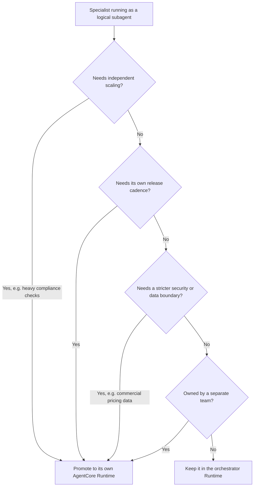

If none of the four answers is yes, splitting the agent out only buys latency, cost and another deployment to babysit.

### The Evolution Path

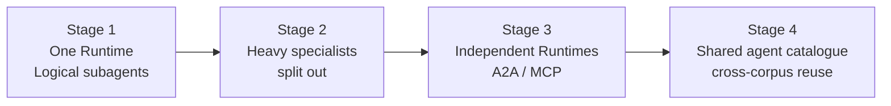

### AgentCore Compute Options

| Compute | Suitable for | Model |
|---|---|---|
| **MicroVM** | Independently hosted, API-driven agents with serverless scaling | One Runtime hosts one agent |
| **Runtime Instances** | Persistent, long-running, collaborative workloads | Multiple agents can share an instance and session |

Runtime Instances are not required for the initial architecture. The MicroVM serverless model is enough to start.

## Agent Interface Design: Keep the Topology Swappable
{: data-eyebrow="07 / Contracts"}

The whole "start with Option A, promote later" plan only works if promotion is cheap. Five rules make it cheap:

1. Define each specialist behind a **typed task interface**: input schema, output schema, error schema.
2. The planner calls specialists through a **single dispatch abstraction**. In Option A this is an in-process tool call. In Option B it is A2A, MCP or Runtime invoke.
3. All Wiki access goes through the **Wiki API**, never direct table or bucket access inside agent logic.
4. Every specialist returns **findings with citations** (entity IDs and evidence IDs).
5. Version agent contracts (`requirements-agent/v1`) so rollouts can be staged.

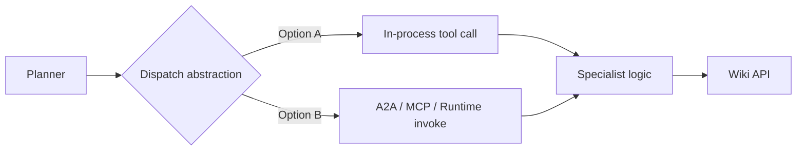

Here is the shape I would give that contract. It is my own illustrative sketch; the source design specifies the rules, not the code:

```python
# Illustrative sketch of a typed specialist contract and a dispatch layer.
from dataclasses import dataclass

@dataclass
class Finding:
    claim: str
    entity_ids: list[str]
    evidence_ids: list[str]      # rule 4: no citation, no finding
    confidence: float

@dataclass
class TaskResult:
    contract: str                # rule 5: e.g. "requirements-agent/v1"
    findings: list[Finding]
    errors: list[str]

class Dispatcher:
    """Rule 2: the planner only ever calls dispatch()."""
    def __init__(self, routes):  # contract -> transport, from config
        self.routes = routes

    def dispatch(self, contract: str, task: dict) -> TaskResult:
        transport = self.routes[contract]   # in-process tool, or A2A / MCP / invoke
        return transport.call(contract, task)
```

Promoting Compliance to its own Runtime is then a **config change in `routes`**, not a planner rewrite. That is decision D6 in one line.

## Cross-Agent Validation and Synthesis
{: data-eyebrow="08 / Validation"}

Without a synthesis stage, five specialists produce five disconnected documents. The synthesis stage turns them into one answer and refuses to ship a weak one.

| Check | Description |
|---|---|
| **Evidence check** | Every claim has at least one valid evidence reference |
| **Consistency check** | Dates, names and numbers agree across agents and with the Wiki |
| **Coverage check** | All required sections are populated; gaps trigger re-delegation |
| **Conflict surfacing** | Known Wiki conflicts are reported, not hidden |
| **Confidence rollup** | Low-confidence items are flagged for human review |

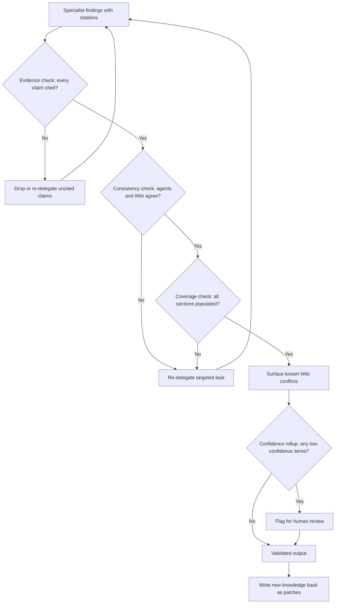

Validated new knowledge is written back through knowledge patches, so **the Wiki improves with each run**. A risk the Risks agent derived from three clauses becomes a fact with three evidence links, available to the next run without recomputation.

## End-to-End Data Flow
{: data-eyebrow="09 / End to end"}

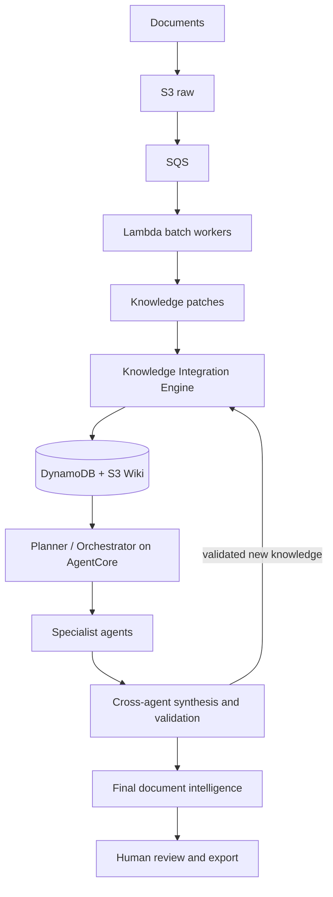

Notice there is exactly one write path into the Wiki (`F`), whether the change comes from a Lambda worker or from an agent. That single path is what makes the audit trail complete.

### AWS Components Summary

| Layer | Component | Purpose |
|---|---|---|
| Ingestion | Amazon S3 | Raw documents, artefacts, Wiki pages, evidence |
| Ingestion | S3 Event Notifications | Trigger processing |
| Ingestion | Amazon SQS (+ DLQ) | Buffering, retries, failure isolation |
| Ingestion | AWS Lambda | Parallel batch processing and knowledge patch creation |
| Ingestion | Amazon Textract (optional) | OCR, tables, forms |
| Ingestion | AWS Step Functions (optional) | Multi-step pipeline orchestration |
| Knowledge | Amazon DynamoDB | Entities, facts, relations, status, locks |
| Knowledge | Amazon S3 | Wiki pages, large artefacts |
| Knowledge | Amazon Bedrock | Extraction, entity resolution, conflict analysis |
| Knowledge | Amazon OpenSearch or Bedrock Knowledge Bases (optional) | Semantic and hybrid retrieval over documents and Wiki |
| Agents | Amazon Bedrock AgentCore Runtime | Host planner and specialist agents |
| Agents | AgentCore Gateway (optional) | Expose tools and APIs (Wiki API, MCP) to agents |
| Agents | AgentCore Identity | Agent and user identity, delegated access |
| Agents | AgentCore Memory (optional) | Session and user context only, not the Wiki |
| Agents | AgentCore Observability | Traces, metrics and logs for agents |
| Agents | Strands Agents, LangGraph or custom code | Agent and orchestration frameworks |
| Cross-cutting | AWS IAM | Least-privilege roles per component |
| Cross-cutting | AWS KMS | Encryption at rest |
| Cross-cutting | Amazon CloudWatch and AWS X-Ray | Monitoring and tracing |
| Cross-cutting | AWS Secrets Manager | Credentials and configuration secrets |
| Cross-cutting | Amazon VPC and VPC endpoints | Private connectivity to AWS services |
| Cross-cutting | Amazon EventBridge (optional) | Change events and loose coupling |

Items marked *optional* are suggestions beyond the core design and should be confirmed per deployment.

## Security and Governance for Multi-Agent Systems
{: data-eyebrow="10 / Security"}

The controlled-interface principle is also the security model. Agents can read; they can only *propose* writes.

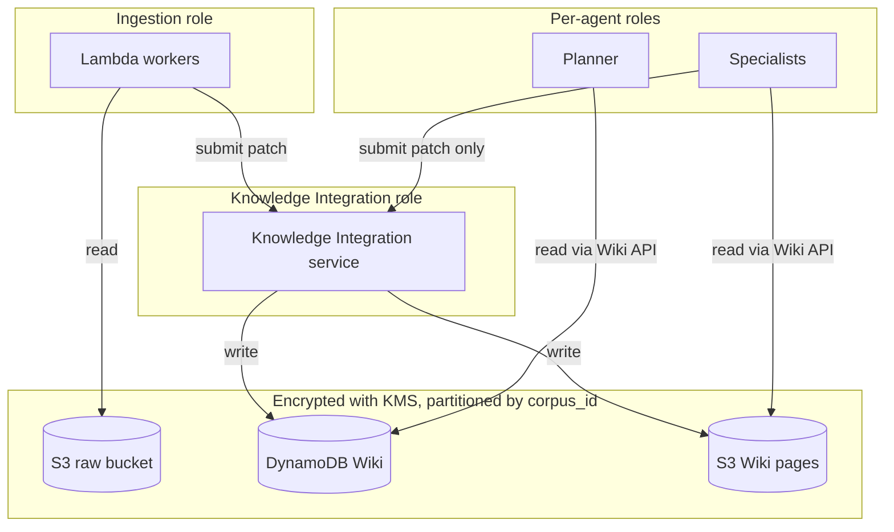

- **Least privilege:** separate IAM roles for ingestion workers, the Knowledge Integration service and each agent. Agents get read access to the Wiki API and write access only through patch submission.
- **Data protection:** S3 and DynamoDB encrypted with KMS. TLS in transit. Private endpoints where possible.
- **Corpus isolation:** partition data by `corpus_id` (and tenant, if multi-tenant) in keys and IAM conditions.
- **Auditability:** every Wiki change is versioned with producer, time and evidence. Agent actions are traced.
- **Guardrails:** apply Amazon Bedrock Guardrails to filter sensitive content and constrain outputs.
- **Human in the loop:** low-confidence items and unresolved conflicts surface for review.
- **Future boundaries:** if a specialist needs a distinct permission boundary (for example, commercial pricing data), that is a trigger to promote it to its own Runtime.

The last bullet ties security back to deployment: a **data boundary is one of the four promotion triggers**. Security requirements, not fashion, should drive the move from Option A to Option B.

## Observability, Replay and Scaling
{: data-eyebrow="11 / Operations"}

| Area | Approach |
|---|---|
| Pipeline health | Queue depth, age of oldest message, DLQ count, Lambda errors and duration |
| Knowledge quality | Patch rejection rate, conflict rate, average confidence, evidence coverage |
| Agent behaviour | AgentCore Observability traces, tool call counts, latency per specialist, token usage |
| Cost | Tokens per corpus, Lambda invocations, storage growth, per-agent cost attribution |
| Replay | Raw documents are immutable, so any stage can be re-run from S3 with a new model or prompt version |

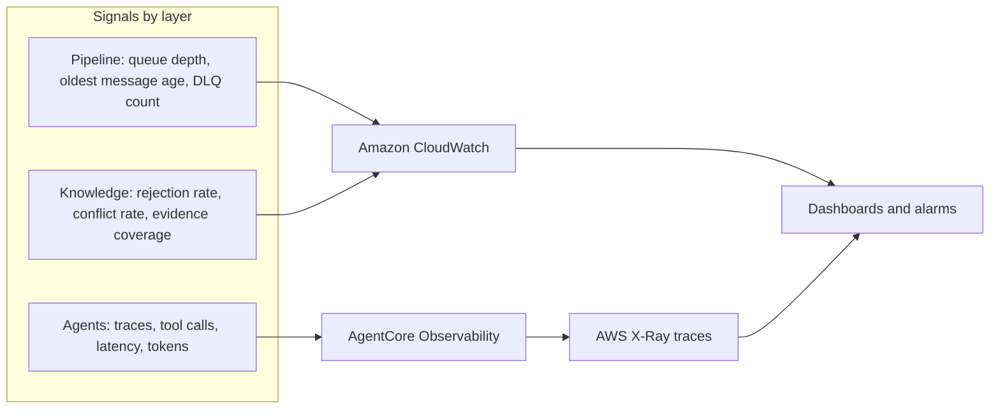

The knowledge-quality row is the one I would build first. Pipeline metrics tell you the system is running. **Rejection rate and conflict rate tell you whether it is right.** A sudden jump in conflicts after a prompt change is the earliest signal that an extractor regressed.

### Replay from Immutable Raw Documents

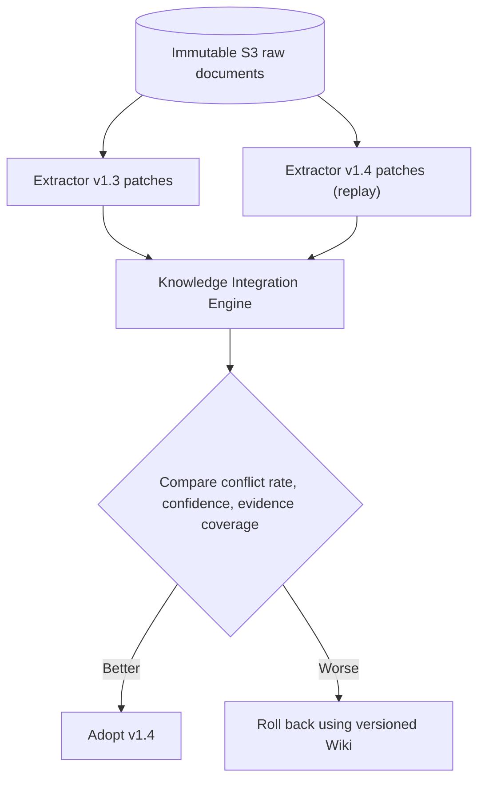

Because patches carry `producer.version` and the Wiki is versioned, a new model or prompt can be evaluated against the old one on the same documents, and rolled back cleanly.

### Scaling Levers

- **Ingestion:** scale by SQS batch size and Lambda concurrency limits. Use reserved concurrency to protect downstream services.
- **Knowledge writes:** DynamoDB conditional writes and per-entity versioning for safe concurrent merges.
- **Agents:** specialists run in parallel under the planner. Split out hot specialists as described in the deployment section.
- **Retrieval:** pre-compute Wiki pages per entity type so agents read compact, structured context instead of raw documents.

The retrieval lever is easy to underrate. Pre-computed pages are also a context-engineering decision: the agent's prompt holds a short, structured, cited page instead of forty raw chunks.

## Delivery Roadmap and Key Decisions
{: data-eyebrow="12 / Roadmap"}

```mermaid
timeline
    title D2K2A delivery roadmap
    Phase 1 Foundation : S3, SQS, Lambda ingestion : Patch schema : Basic Wiki in DynamoDB and S3
    Phase 2 Knowledge Engine : Entity resolution : Conflict handling and versioning : Wiki API
    Phase 3 Agents v1 : One AgentCore Runtime : Planner + Requirements, Key Dates, Stakeholders
    Phase 4 Full specialist set : Risks, Compliance, Technical Systems, Diagram : Synthesis and validation
    Phase 5 Hardening : Guardrails : Observability dashboards : Evaluation harness and security review
    Phase 6 Scale-out : Promote selected specialists : A2A or MCP : Cross-corpus reuse
```

The ordering is deliberate: **agents arrive in Phase 3, after the knowledge layer exists**. Building agents first and a knowledge layer later is how you end up with agents that each grew their own private, unaudited version of the truth.

| # | Decision | Rationale |
|---|---|---|
| D1 | Multiple logical agents, one AgentCore Runtime initially | Avoids premature distributed complexity |
| D2 | Lambda for document-scale parallelism | Elastic, cost-effective batch processing |
| D3 | AgentCore for reasoning and orchestration | Managed agent runtime, identity and observability |
| D4 | S3 + DynamoDB for the Wiki | Durable, scalable, auditable shared knowledge |
| D5 | AgentCore Memory is not the Wiki | Different purpose: session context vs evidence-backed knowledge |
| D6 | Typed agent interfaces and a dispatch abstraction | Later promotion to independent Runtimes without planner changes |
| D7 | Runtime Instances not needed initially | MicroVM serverless model is sufficient at the start |

### Open Questions Before Building

1. Expected document volume per corpus (drives Lambda vs Step Functions and queue tuning).
2. Need for semantic retrieval (OpenSearch or Bedrock Knowledge Bases) in addition to the structured Wiki.
3. Multi-tenant requirements and data residency constraints.
4. Human review workflow and tooling for conflicts and low-confidence facts.
5. Choice of agent framework (Strands, LangGraph or custom).
6. Evaluation strategy: ground-truth document sets and metrics for each specialist.

Question 6 is the one I would not defer. Without a labelled corpus per specialist, "the Risks agent got better" is an opinion.

## Key Takeaways
{: data-eyebrow="13 / Takeaways"}

- **Separate scale, truth and reasoning.** Lambda parses, the Knowledge Integration Engine owns the Wiki, agents reason. Each scales and fails differently.
- **The knowledge patch is the core contract.** Idempotent, evidence-carrying, versioned by producer. Workers and agents both write through it, and nothing else writes at all.
- **Conflicts are data, not errors.** Record both sources and surface them in the output instead of letting the last writer win.
- **An evidence-backed knowledge base is not agent memory.** Keep AgentCore Memory for session context; keep facts in the Wiki.
- **Start with Agents-as-Tools in one Runtime.** Promote a specialist only for scaling, release cadence, a data boundary or team ownership.
- **A dispatch abstraction makes topology a config choice.** Typed, versioned contracts mean Option A to Option B never touches planner logic.

## Related Reading
{: data-eyebrow="14 / Related"}

- [Deciphering Agent-to-Agent Communication using Google's A2A Protocol](/ai%20engineering/2026/07/21/agent-to-agent-communication-google-a2a-protocol/): the protocol behind Option B's cross-Runtime calls.
- [Prompt, Context, Loop, Graph: why context engineering is the layer that doesn't go away](/ai%20engineering/2026/08/22/context-engineering-loop-graph-engineering/): why pre-computed Wiki pages beat raw chunks in an agent's context.
- [Taming a ReAct planner: from 1.1M tokens to 78K](/signals/taming-react-planner-token-usage/): what a planner over long documents costs when it reads too much.
- [Guardrails and safety for production LLM agents](/engineering/guardrails-and-safety-for-production-llm-agents/): input, output, tool and memory defence layers.
- [Evaluation and monitoring for production LLM agents](/engineering/evaluation-and-monitoring-for-production-llm-agents/): the evaluation harness that Phase 5 calls for.
- [SwarmEvolve: latent agent swarms for LLM evolutionary search](/engineering/swarmevolve-latent-agent-swarms-evolutionary-search/): how hundreds of same-model agents can share KV caches, and why that belongs inside one validated specialist step.
- [Harness engineering: inside the runtime of production coding agents](/engineering/harness-engineering/): orchestration, tools and verification inside an agent runtime.

## Conclusion: Build the Knowledge Layer Before the Agents
{: data-eyebrow="15 / Conclusion"}

The interesting part of multi-agent document intelligence is not the number of agents. It is the layer under them.

Once there is a governed, evidence-backed Wiki with one write path, the agents become simple: read a typed slice, return cited findings, propose patches. The synthesis stage can check every claim, conflicts stay visible, and each run leaves the knowledge base a little better than it found it.

So the question I would ask of any agentic document system is this: **if you deleted every agent tomorrow, would the knowledge survive?** If the answer is no, the agents are doing a job that belongs to the architecture.
