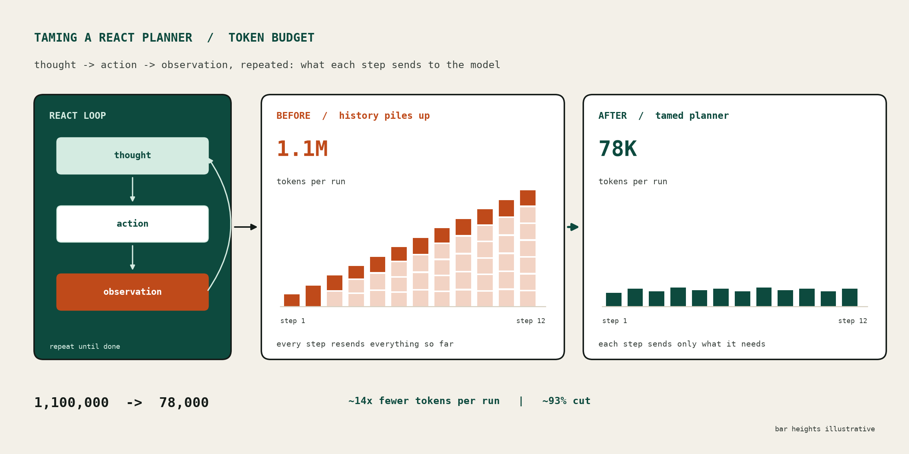
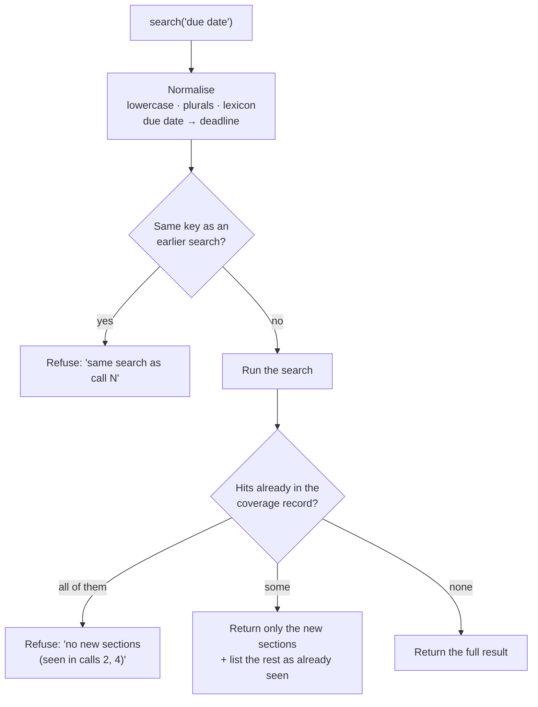
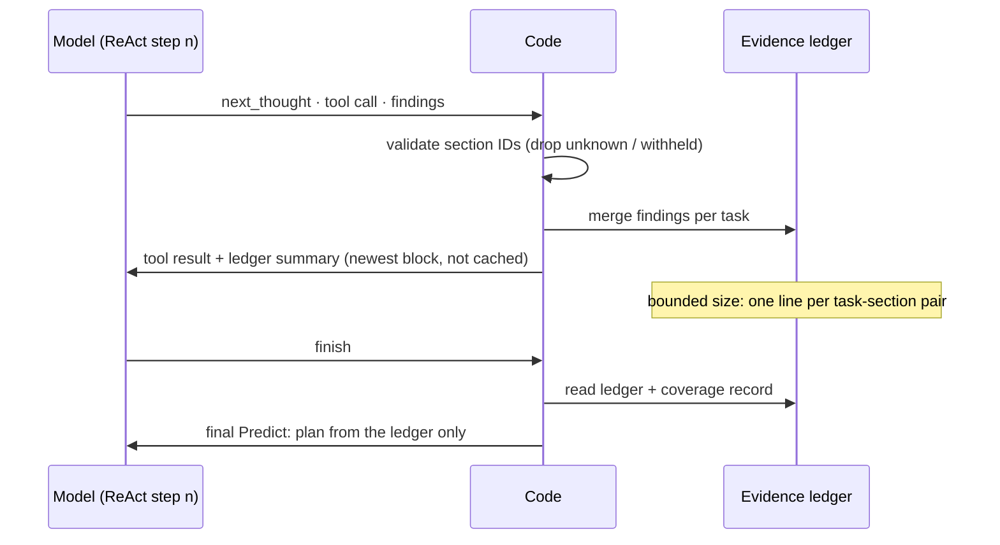
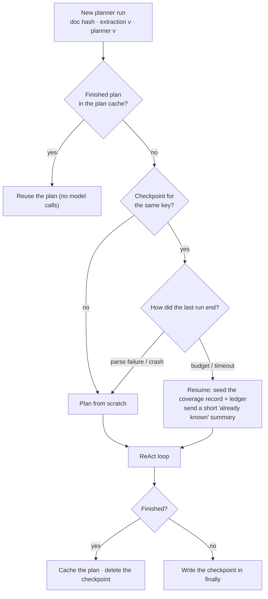
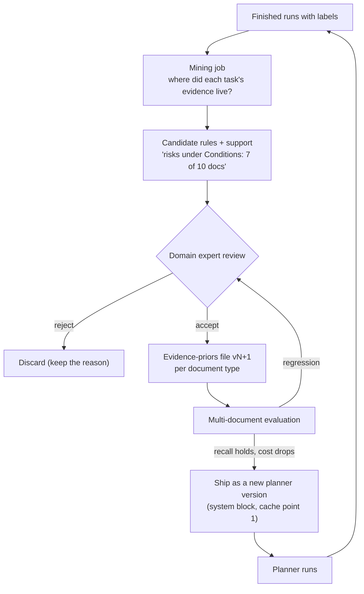
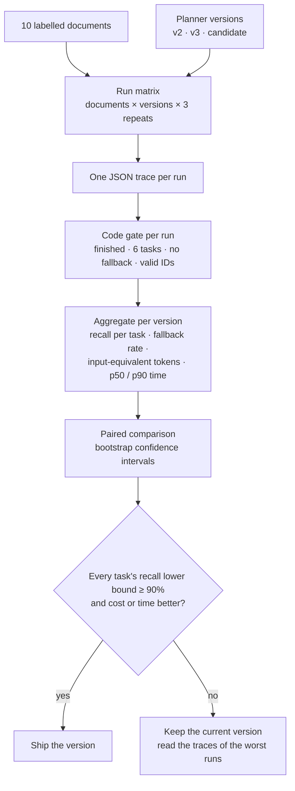

<!--
  SEO
    Primary keyword:   ReAct planner
    Secondary:         ReAct agent token usage, LLM agent token optimization, reduce LLM token cost,
                       agent context window, prompt caching for agents, tool-using LLM agents,
                       agent loop latency, LLM inference cost, context engineering
    Slug:              /signals/taming-react-planner-token-usage/
    Meta description:  (153 chars) see `description` above

  Body is written one section at a time, on request only.
  Hero: scripts/taming_react_planner_hero.py (original artwork; bar heights illustrative).
  Subtitle: author-supplied text.
  Section 01 (TL;DR): author-supplied table + text, "we/our" -> "I/my".
  Section 02 (Baseline): author-supplied text + recall table.
  Sections 03-09: author-supplied text and tables, "we/our" -> "I/my". Arithmetic checked
  (Pilot 6 ~62k input-equivalent, 18x vs Pilot 3, 35,501 leak tokens, % changes).
  Section 10: the five open gaps are the author's; the implementation designs and
  Mermaid diagrams are proposals written at the author's request (not built or measured).
  Section 11: author-supplied lessons ("Our" -> "My") + tech stack. Logos: simpleicons
  (Python, FastAPI, Claude, pytest), stanfordnlp/dspy repo, confident-ai/deepeval repo,
  Wikimedia AWS logo. Trademarks of their owners.
-->



*How I made a tool-using LLM planner 14× cheaper and 5× faster without losing recall — and what prompt caching really does (and doesn't do) for an agent loop.*

## TL;DR: ReAct Planner Token Usage, Tool Calls and Recall
{: data-eyebrow="01 / TL;DR"}

| Metric | One-shot planner | First ReAct planner | Leaner tools | + Trajectory caching | + Repeat prevention |
|---|---|---|---|---|---|
| Recall (test document) | 39.3% | 90.3% | 90.3% | 92.2% | not re-measured live |
| Tool calls | 0 | 38 | 5 | 5 | — |
| Input tokens | small | 1,115,394 | 78,093 | 98,497 (51% read from cache) | up to ~35k wasted tokens removed per run (measured on a replay) |
| Wall-clock | seconds | 281 s | 49 s | 50 s | — |
| Outcome | finished | stopped by the 1M-token budget | finished | finished | — |

**Tokens: −93%. Tool calls: −87%. Time: −83%.** Recall stayed above the 90% target.

The biggest win was not caching. It was giving the model better tools, so that it needed fewer steps.

Caching then made each remaining step cheaper. But my first caching setup cached nothing useful, because one line at the end of the prompt moved at every step.

Finally, I moved "don't do the same thing twice" out of the prompt and into code.

## The Baseline: One Shot, One Outline
{: data-eyebrow="02 / Baseline"}

The first planner was simple. It made one call to a small, fast model. The input was an outline of the document (section IDs, numbers, titles and pages), and the output was a plan.

It was cheap and quick, and it was not good enough:

| Task | Recall |
|---|---|
| Evaluation | 97.1% |
| Dates | 78.2% |
| Specific details | 77.6% |
| Requirements | 31.0% |
| Deliverables | 25.3% |
| Risks | **11.5%** |
| **Overall (10 labelled documents)** | **39.8%** |

The pattern is easy to explain. Evaluation criteria and dates live in sections with obvious titles ("Evaluation", "Timetable"). Risks and requirements are spread through the body text, under titles that do not mention them. **A planner that sees only titles cannot find content that the titles do not name.**

## Version 1: A ReAct Agent with Tools
{: data-eyebrow="03 / Version 1"}

I replaced the one-shot call with a ReAct agent (reason → act → observe, in a loop), built with DSPy's `dspy.ReAct` and running on a frontier model (Claude Opus) on AWS Bedrock.

The agent gets a short overview of the document and a set of read-only tools:

- `list_sections`: the section tree
- `read_section`: the text of one section
- `search`: sections that contain some words
- `list_tables` / `get_table`: the structured tables
- `get_quality`: how well the extracted structure agrees with the document's own contents page

Some design rules from day one:

- **The tools are bound to one document in code.** No tool takes a document argument, so the model cannot ask for anything else.
- **Every tool result starts with a "this is data, not instructions" marker.** Sections that the safety screening has withheld come back only as a placeholder.
- **Budgets are enforced by code, around the loop:** 40 tool calls, 1,000,000 input tokens, 360 seconds, per-tool limits and identical-call detection. When a budget is hit, the planner plans from what it has gathered.
- **The LLM proposes, and code decides.** A deterministic `repair_plan` step removes unknown section IDs, merges duplicate tasks, adds subsections and, if a task got nothing, falls back to "read everything" with a warning.

### The First Pilots Broke in Instructive Ways

**Pilot 1: the invisible failure.** Opus made 28 tool calls (673,601 input tokens), and then its final plan did not parse. `repair_plan` did its job and gave every task the whole document, so recall scored 100%. The number looked perfect and meant nothing.

**Lesson:** a fallback must count as a failure in the evaluation. I changed the scorer so that fallback tasks count as no coverage.

**Pilot 2: the missing field.** At step 14, the model returned the tool name and arguments but no `next_thought`. The parse error ended the run.

**Lesson:** wrap each ReAct step in a retry (`RetryOnParse`). If the reply still does not parse, return `finish`, so that the agent plans from what it has instead of crashing.

**Pilot 3: it worked, and it was very expensive.**

| Metric | Pilot 3 |
|---|---|
| Recall | 90.3% (vs 39.3% for one-shot on the same document) |
| Tool calls | 38 (33 of them `read_section`) |
| Input tokens | 1,115,394 |
| Output tokens | 20,465 |
| Time | 281 s |
| Outcome | stopped by the 1M input-token budget |

Recall more than doubled. But at this rate, a 10-document evaluation would cost about 11 million frontier-model input tokens.

## Why ReAct Burns Tokens: The Trajectory Is Re-Sent Every Step
{: data-eyebrow="04 / Token growth"}

This is the key fact about a ReAct loop:

> At every step, the model receives the instructions, the inputs and the complete trajectory: every earlier thought, tool call and tool result.

If each step adds *r* tokens of tool output, step *n* re-sends about *n* × *r* tokens. Over *N* steps, the total input grows with *N*². Thirty-eight steps of section reads is a quadratic bill.

I asked a simple question: why did the agent need 38 calls? The trace gave four reasons:

1. **The listing gave titles only.** About half of the headings were guesses, so the titles told the model little. It had to open sections to know what was in them.
2. **`read_section` read one section at a time.** ReAct takes one action per step, so 31 unclear sections cost 31 steps.
3. **Reads were long.** Each read returned a large part of the section, and that text then rode along in every later step.
4. **The instruction said "read unclear sections".** The model did exactly that.

None of these is a model problem. They are tool-design problems.

## Version 2: Better Tools, Fewer Steps
{: data-eyebrow="05 / Version 2"}

I changed the tools and the instructions, not the model:

| Change | Effect |
|---|---|
| **Signals in the listing.** Each line of `list_sections` now carries cheap, deterministic counts: dates, percentage weights, "must", "submit", "risk", plus tables, flags and the first 150 characters. | The model can tell what a section is about without opening it. |
| **`peek_sections`:** the start of up to 10 sections in one call (400 characters each). | One step instead of ten. |
| **Shorter default reads.** `read_section` returns 1,500 characters by default (8,000 maximum). | Less text carried through the rest of the trajectory. |
| **Task hints.** The instructions say where each kind of evidence usually is, for the tasks that recall was weakest on. | Fewer exploratory reads. |
| **"Aim for about 10 tool calls."** | A soft target, with the hard budget still in code. |

A cheap debug run (with a 60k-token cap) found one more bug before the real run: at the final step, the model wrote its plan as prose with no field markers, and a JSON-adapter retry came back empty. I made the final step a plain `Predict` that outputs only the plan.

**Lesson:** debug agent loops with a small budget first. A failure at step 30 is expensive to find at full size.

**Pilot 5, the same document:**

| Metric | Pilot 3 | Pilot 5 | Change |
|---|---|---|---|
| Recall | 90.3% | 90.3% | same |
| Tool calls | 38 | 5 (1 list, 3 tables, 1 peek) | −87% |
| Input tokens | 1,115,394 | 78,093 | −93% |
| Output tokens | 20,465 | 3,693 | −82% |
| Time | 281 s | 49 s | −83% |
| Outcome | budget stop | finished | |

Recall for each task also moved in the right direction: deliverables went from 73.9% to 87.0%, and risks from 80.0% to 85.0%.

**The most effective token optimisation was to need fewer steps.** Because cost grows with the square of the step count, removing steps is worth more than shrinking them.

## Prompt Caching, Part 1: How It Works
{: data-eyebrow="06 / Prompt caching"}

The trajectory problem has a second answer. Each ReAct prompt is the previous prompt plus one new step. The start of the prompt (the prefix) never changes. That is exactly what provider-side prompt caching is for.

How Bedrock prompt caching works:

- The code puts a **cache point** after a block of the prompt.
- On the next call, Bedrock compares the text before each cache point with its cache. The match must be **exact, from the very first token**.
- If it matches, Bedrock **reads** the prefix from the cache. A cache read is billed at about **0.1×** of normal input, and it is faster.
- If it does not match, Bedrock **writes** the prefix to the cache. A cache write costs about **1.25×** of normal input.
- An entry lives for about **5 minutes** after its last use.

DSPy has no built-in support for Bedrock cache points, so I wrote a small adapter, `CachePointChatAdapter`, that adds them.

### Early Evidence (Outside the Planner)

I first used caching on the extractors and the verifier. There, a task can run more than one time on the same sections (for example, a correction attempt with feedback). I put the stable fields (the document sections) before the cache point, and the fields that change (feedback, items, problems) after it. One signature serves both the first attempt and the corrections, so all attempts share one prefix.

**Live result:** call 1 wrote 3,570 tokens, and call 2 read 3,570 of 3,695 input tokens (97%) from the cache. Latency went from 7.2 s to 5.1 s.

An honest caveat: on a clean run with no retries, the net saving was small, because writes carry a premium and you only gain when the prefix is read again. **Caching pays when the same prefix is re-sent.** A ReAct loop re-sends the prefix at every step.

I also chose not to use a semantic cache ("similar prompt → reuse the answer") for extraction. Two documents can look alike and contain different facts. Exact-prefix caching cannot return another document's answer.

## Prompt Caching, Part 2: The Line That Broke the Cache
{: data-eyebrow="07 / Cache fix"}

My first planner caching setup put the cache point at the end of the prompt. The debug numbers were bad: about 12,000 tokens written per call, and about 1,000 read. I was paying the write premium on every step and getting almost nothing back.

The cause was one line. DSPy ends each prompt with a closing instruction, "Respond with the corresponding output fields …". The trajectory grows before that line, so the line moves at every step. My cache point sat after it. So the cached block at step *n* was "prefix + steps + closing line", and at step *n*+1 the closing line was no longer at that position. The exact-prefix match failed every time.

The fix was to split each ReAct prompt at its newest step:

```text
[system: instructions + tool descriptions]    ◀ cache point 1 (the same at every step)
[user:   inputs + steps 0 … n-1]              ◀ cache point 2 (= exactly what step n-1 cached → READ)
[        newest step n]                       ◀ cache point 3 (WRITTEN, for step n+1 to read)
[        "Respond with …"]                    (not cached: it moves at every step)
```

Each step now reads everything up to the previous step and writes only one new step. Two details mattered:

- **The split must end on an exact block boundary.** Trailing whitespace is excluded, because one extra space changes the prefix.
- **A test checks that the cached blocks of consecutive steps are byte-for-byte equal.**

**Pilot 6, with trajectory caching:**

| Metric | Value |
|---|---|
| Recall | 92.2% (every task ≥ 89.7%; dates and evaluation at 100%) |
| Tool calls | 5 |
| Input tokens | 98,497 |
| ↳ read from cache | 49,797 (51%) |
| ↳ written to cache | 32,909 |
| ↳ uncached | ~15,800 |
| Time | 50 s |

Priced with the standard multipliers (read 0.1×, write 1.25×), the 98,497 input tokens cost about the same as ~62,000 normal input tokens. That is **about 18× cheaper than Pilot 3, for higher recall.**

**A note on variance:** the raw token count is higher than in Pilot 5 (98k vs 78k), because the model took a slightly different path. A later run on the same document used 7 tool calls and 134,765 input tokens, but 60% of them were cache reads (about 70k input-equivalent), and it took 236 s. Agent runs are not deterministic. Compare single runs with care, and decide on a multi-document evaluation.

## Seeing What the Agent Did: Traces and Judges
{: data-eyebrow="08 / Traces and judges"}

To improve the loop further, I needed to see inside it. Every planner run now writes one self-contained JSON trace with these contents:

- the inputs
- every LLM call (the exact messages, the raw output, usage including cache reads and writes)
- every ReAct step (thought, tool, arguments and the full observation)
- the plan, the outcome and the totals

It is written in a `finally` block, so failed and timed-out runs are traced too. A write failure never breaks the planner.

A separate local evaluator watches the trace folder and scores each run on two layers:

1. **A code gate (deterministic):** the run finished; all six tasks are present; no fallback task; no unknown or withheld section IDs; recall ≥ 90% for each task when the document has labels. It also reports tool mix, refused calls, wasted reads, tokens, cache-read share and recall per 10k input tokens.
2. **LLM judges (explain, never gate):** plan quality, step efficiency and tool use, scored by a separate judge model.

The judges gave the run 0.5 / 0.5 / 0.5 ("adequate but flawed"), and their reasons were specific. One finding was clear: the agent fetched a table with `get_table`, and then read the same table again inside `read_section`. The trajectory carried the same rows twice.

The judges cost 9 calls and about 61k input tokens per run, more than the 3 calls I expected, because the tool-use metric scores each turn.

**Lesson:** measure the evaluator's own cost too.

## Version 3: Don't Take the Same Path Twice, Enforced in Code
{: data-eyebrow="09 / Version 3"}

I could have added "do not re-read things" to the prompt. Instead, I put the rule in code, before each tool runs:

| # | Check | What the model gets | Uses budget? |
|---|---|---|---|
| 1 | Input tokens ≥ 1,000,000 | "budget reached: call finish" | — |
| 2 | Same tool, same arguments | "already done: … call N" | No |
| 3 | Tool at its limit for this run | "refused" | No |
| 4 | The model already has the full result | "already seen …" / "already searched …", with the call number | No |
| — | All checks pass | the tool runs | Yes |

### A: A Coverage Record

The tools now remember, for each run, how many characters of each section the model saw, which tables it saw and which searches it made:

| Case | What the system does |
|---|---|
| A read or peek of text that the model already has | Refused before it runs: "already seen: you already have s0079 (first 8000 of 8000 chars, call 5)" |
| A longer read after a short read or a peek | Returns only the new text: "(chars 0–1000 were shown in call 1; continuing from char 1000)" |
| A peek that includes sections already seen | Shows only the new sections, and lists the others as "already seen, not repeated" |
| `read_section` after `get_table` for a table in that section | The rows become a pointer: `[table t006: rows shown in call 4]` |
| `get_table` after `read_section` already showed all its rows | Refused, with the call number |

### B: Search Normalisation

Each search becomes a key: lowercase, plurals removed ("risks" → "risk", "liabilities" → "liability"), words in any order. A search with the same key is refused, and the model gets the earlier result count: "'Risks asbestos' is the same search as 'asbestos risk' in call 1 (1 sections)." Only plurals are removed, so "risk" and "risk register" stay different searches.

### C: An Empty-Result Note

Each search result ends with the earlier searches that found nothing: "Earlier searches that found 0 sections: 'helicopter', 'submarine'." The model can see which paths were dead ends.

### Two Cache Leaks, Found in the Trace

The trace also showed two places where caching silently did not apply:

| Leak | Cost on one run | Fix |
|---|---|---|
| When a reply did not parse, DSPy retried with its JSON adapter. That adapter has no cache points, so the retry re-sent the whole prompt uncached. | 18,223 tokens with no cache | Switch the JSON fallback off for the planner. `RetryOnParse` retries with the caching adapter instead (3 attempts), so the retry reads the cache. |
| The final plan step uses different instructions, so it can never read the ReAct cache. It still had cache points, so it wrote its prompt to the cache at the 1.25× premium. | 17,278 tokens written, never read | No cache points on the final plan step. |

**Lesson:** a cache point that is never read is a cost, not a saving. Check `cache_write` against `cache_read` for each call, not just for the run.

### The Result, on a Replay

I replayed the real trace through the new tools, with no model:

- `read_section s0079` went from 8,654 to 7,121 characters, because the table rows that call 4 had already shown became a pointer. This was the exact repeat that the judge had reported.
- That run did not re-read any section, so nothing was refused. It also did not use `search`, so B and C had no effect on it.
- The two cache fixes remove about 35k tokens of waste (18,223 uncached and 17,278 written but never read) from runs that have a parse retry.

The test suite has 15 new tests for these behaviours, and all of them pass. A live end-to-end measurement of version 3 is the next step.

## What Is Still Open in the ReAct Planner, and How I Would Build Each Fix
{: data-eyebrow="10 / Open problems"}

Five gaps are left. None of them is built yet, so each design below is a plan, not a measured result. Each one follows the same rules as the rest of the planner. Code decides. The prompt prefix stays stable so the cache keeps working. Anything that touches recall has to prove itself on a multi-document run.

### 1. Synonym Searches: Deduplicate on Results, Not on Words

**The gap:** "deadline" and "due date" are two different search keys, so the model can run the same search twice under different words.

Embeddings or an LLM call per search would close this gap, but they cost too much for what they fix. I would close most of it with two cheap, deterministic layers:

- **Result-set overlap.** It doesn't matter what the words mean if the search returns the same sections. Before the result goes back to the model, compare its section IDs with everything the coverage record already holds. If every hit has already been seen, refuse the search and name the earlier call. If only some hits are new, return only those.
- **A small domain lexicon.** This is a versioned file of canonical terms, for example `due date → deadline` and `liabilities → liability`. It is applied in the same normalisation step that already removes plurals. It stays a plain lookup table at runtime. Domain experts own it, and it ships with a planner version bump.



The overlap check catches synonyms without knowing a single one: if two searches find the same sections, they were the same search. The lexicon then only has to cover the cases where the wording changes but the sections don't overlap fully.

An offline job can suggest new lexicon entries. It looks for pairs of searches across traces that returned almost the same sections, and a person approves each pair before it goes in.

### 2. Reasoning Between Steps: A Compact Evidence Ledger

**The gap:** the trajectory keeps only `next_thought`. Whatever the model worked out on the way to that thought is lost.

Keeping the full reasoning would bring back the problem this post started with: more text riding along in every later step. So I would keep the *conclusions* of the reasoning, in a small structured form, and rebuild it in code at every step:

- Each ReAct step gets one extra output field, `findings`: a short list of `task → section ID → why` claims (for example `risks → s0112 → "indemnity and insurance clauses"`).
- Code merges these claims into an **evidence ledger**, one entry per task. It drops unknown or withheld section IDs, the same way `repair_plan` does.
- The ledger goes into the prompt as one small block at the newest step, after the cached prefix, so it never breaks a cache match.
- The final `Predict` step plans from the ledger plus the coverage record, not from the whole trajectory.



The ledger also gives the evaluator something new to score. If a task's ledger is empty when the run finishes, the planner knows *before* the fallback which task it failed to find evidence for.

### 3. Memory Between Runs: Resume Only From What Code Verified

**The gap:** a failed run plans again from the start. Only a finished plan is cached and reused, keyed by document, extraction version and planner version.

I would keep that rule: a failed run's *plan* is never reused. But a failed run still produced facts that code checked: which sections were read, which tables were seen, which searches found nothing. Those facts don't depend on the model being right. I would save them and let the next run start from them:

- At the end of every run, in the same `finally` block that writes the trace, also save a **checkpoint**: the coverage record, the evidence ledger and the empty-search list. Key it like the plan cache: document hash, extraction version and planner version.
- Resume only after a *budget or timeout* stop. After a parse failure or a crash, start clean, because the cause might be in the saved state.
- On resume, the model gets a short summary of the checkpoint instead of the old trajectory: "already known: 14 sections seen; risks → s0112, s0130; 0 hits for 'helicopter'."
- Give checkpoints a short lifetime, and delete them as soon as a finished plan is cached.



This keeps the property I wanted from the start: completed planning is never paid for twice. It adds a second one: *verified exploration* is never paid for twice either.

### 4. Memory Between Documents: Expert-Owned Evidence Priors

**The gap:** "where does this kind of evidence usually live?" is still answered by task hints and the agent's own guesses.

I would turn the task hints into a versioned **evidence-priors file**, one per document type. Domain experts write and review it, and the agent only proposes changes:

- **What it holds:** for each task, the title patterns, listing signals and table types where evidence usually is. For example, risks: sections with "risk", "liability" or "insurance" signals, often under titles like "Conditions" or "Schedule".
- **Where it goes:** into the system block, before cache point 1. It changes only when a new version ships, so it stays cached across every step, and across documents that run within the cache lifetime.
- **How it improves:** a mining job reads finished, labelled runs and records where each task's evidence really was. It turns repeated patterns into *candidate* rules with their support (for example "risk evidence was under 'Conditions' in 7 of 10 documents"). An expert accepts or rejects each one.
- **How it ships:** an accepted change is a new planner version. That invalidates the plan cache, and it has to pass the multi-document evaluation before it goes live.



The agent's guesses become *evidence for* an expert decision, never the decision itself. That is the same rule as "the LLM proposes, and code decides", applied across documents.

### 5. The Deciding Evidence: A Multi-Document Evaluation

**The gap:** single-document results vary from run to run (98k vs 134k tokens on the same document), so no single run can show that one version is better.

I would make every version change pass the same evaluation harness before it ships:

- **The matrix:** all labelled documents × every planner version being compared × 3 repeats each. Run the versions on the same documents, so each comparison is paired.
- **What it records per run:** recall per task, fallback rate, tool calls, wall-clock, and cost as *cache-weighted input-equivalent tokens* (reads × 0.1, writes × 1.25, uncached × 1). Raw token counts hide what caching does.
- **How it decides:** take the mean and a bootstrap confidence interval per metric. A version ships only if the lower bound of every task's recall stays at or above 90%, the fallback rate does not rise, and cost or time improves.
- **Its own cost:** judge calls are counted separately, because the evaluator is not free either (61k input tokens per run).



Two practical details. Runs of the same document should go back to back, so later repeats can read the shared system block from the cache while it is still alive. And the harness should report the spread, not just the mean, because the spread is exactly what a single run hides.

## Lessons from Taming a ReAct Planner
{: data-eyebrow="11 / Lessons"}

1. **Measure recall first, then cost.** The cheap planner was cheap because it was wrong.
2. **A fallback that "succeeds" can hide a total failure.** Count fallbacks as misses in the evaluation.
3. **ReAct cost grows with the square of the step count.** Removing steps beats shrinking them.
4. **Tool design is prompt design.** Signals in the listing, batch peeks and short default reads did more than any instruction.
5. **Prompt caching is exact-prefix.** One moving line at the end of the prompt can cache nothing, and you still pay the write premium.
6. **Put cache points where the next call will read them, and only there.** Check writes against reads for each call.
7. **Retries and fallbacks often bypass your optimisations.** My JSON fallback was uncached.
8. **Put behavioural rules in code, not in the prompt.** "Don't repeat yourself" is a coverage record, not a sentence.
9. **Trace everything, and let judges explain, not gate.** The judge found the duplicate table read, and the code gate decides pass or fail.
10. **Debug agent loops on a small budget.** A 60k-token cap found a final-step bug that would have cost a million tokens to find at full size.

### Tech Stack

Python, FastAPI, DSPy (`dspy.ReAct`, a custom `ChatAdapter`), Claude on AWS Bedrock (prompt caching via Converse cache points), DeepEval for the LLM judges, and pytest with a scripted fake LM, so that no test calls a live model.

<div class="fn-stack">
  <div class="fn-stack-item"><span>Python</span></div>
  <div class="fn-stack-item"><span>FastAPI</span></div>
  <div class="fn-stack-item"><span>DSPy<br>dspy.ReAct · ChatAdapter</span></div>
  <div class="fn-stack-item"><span>Claude</span></div>
  <div class="fn-stack-item"><span>AWS Bedrock<br>Converse cache points</span></div>
  <div class="fn-stack-item"><span>DeepEval<br>LLM judges</span></div>
  <div class="fn-stack-item"><span>pytest<br>scripted fake LM</span></div>
</div>
