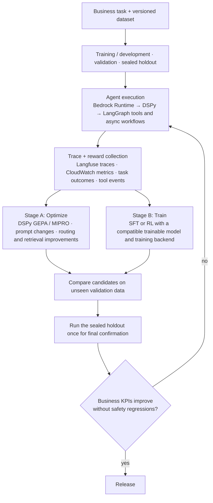

<!--
  SEO
    Primary keyword:   training agents at the frontier of AI industry
    Secondary:         training AI agents, enterprise RL, reinforcement learning for LLM agents,
                       agentic RL, RL environments, verifiable rewards, LLM agent training,
                       AI agent ROI, post-training LLM agents
    Slug:              /signals/training-agents-frontier-ai-industry/
    Meta description:  (157 chars) see `description` above

  Body is written one section at a time, on request only.
  Hero: scripts/training_agents_frontier_hero.py (original artwork).
  Section 01: author-supplied text (incl. KPI cards + needs-vs-outcome table).
  Section 02: author-supplied text, second person ("your stack") reworded for readers,
  citation artifacts removed. Links and these facts verified 2026-10-29:
  Bedrock RFT models (Nova 2 Lite us-east-1; gpt-oss-20B, Qwen3 32B us-west-2), GRPO;
  Agent Lightning skill install command, MIT license, verl backend; GEPA textual feedback.
-->


*The agentic RL loop: the policy acts in sandboxed environments, verifiers score each trajectory, and the reward updates the policy. Drawn for this post.*

## Enterprise RL
{: data-eyebrow="01 / Enterprise RL"}

### Customers Pay for Business Outcomes

<div class="fn-cards fn-cards--two">
  <div class="fn-card">
    <p class="fn-card-tag">What we assume they want</p>
    <h4 class="fn-card-title">Better RL numbers</h4>
    <ul class="fn-card-text">
      <li>A higher reward score</li>
      <li>A better benchmark ranking</li>
      <li>The newest RL algorithm</li>
    </ul>
  </div>
  <div class="fn-card">
    <p class="fn-card-tag">What they actually pay for</p>
    <h4 class="fn-card-title">ROI on one business metric</h4>
    <ul class="fn-card-text">
      <li><strong>Higher throughput:</strong> more tasks completed per unit of time</li>
      <li><strong>Better decisions:</strong> higher success rates and fewer costly mistakes</li>
      <li><strong>Lower operating costs:</strong> reduced compute, energy and human intervention</li>
      <li><strong>Safe, reliable execution:</strong> actions that respect business constraints and operational policies</li>
    </ul>
  </div>
</div>

> **Enterprise RL is valuable when it improves a measurable business outcome**, not merely when it achieves a higher reward.

### Why Business KPIs Are Hard to Hit with Enterprise Agents

<div class="fn-cards">
  <div class="fn-card">
    <p class="fn-card-tag">01 / Tools</p>
    <h4 class="fn-card-title">Many tools, and they fail</h4>
    <ul class="fn-card-text">
      <li>Tens to 100+ tools per agent</li>
    </ul>
    <p class="fn-card-text"><strong>Common failure modes</strong></p>
    <ul class="fn-card-text">
      <li>Timeouts</li>
      <li>Stale data</li>
      <li>Conflicting sources</li>
      <li>Wrong tool</li>
    </ul>
  </div>
  <div class="fn-card">
    <p class="fn-card-tag">02 / Latency</p>
    <h4 class="fn-card-title">Most time goes to the system</h4>
    <p class="fn-card-text"><strong>Time to first token is affected by</strong></p>
    <ul class="fn-card-text">
      <li>Model planning</li>
      <li>Customer API calls</li>
      <li>Searching documentation</li>
      <li>Database queries</li>
      <li>Network faults and retries</li>
      <li>Model choosing the next step</li>
    </ul>
    <p class="fn-card-text"><strong>What helps</strong></p>
    <ul class="fn-card-text">
      <li>Parallel calls</li>
      <li>Caching</li>
      <li>Materialized views</li>
      <li>Retry budgets</li>
    </ul>
  </div>
  <div class="fn-card">
    <p class="fn-card-tag">03 / Safety</p>
    <h4 class="fn-card-title">Safety lives around the model</h4>
    <p class="fn-card-text"><strong>External dependencies</strong></p>
    <ul class="fn-card-text">
      <li>Tools</li>
      <li>Data</li>
      <li>People</li>
      <li>Network</li>
    </ul>
    <p class="fn-card-text"><strong>Essential controls</strong></p>
    <ul class="fn-card-text">
      <li>Sandbox</li>
      <li>Allowlist</li>
      <li>Policy checks</li>
      <li>Human approval</li>
      <li>Audit log</li>
      <li>Kill switch</li>
    </ul>
  </div>
</div>

### Enterprise RL: What Customers Actually Pay For

The business implication: customers don't pay for agents that merely reason well. They pay for agents that **reliably improve business KPIs**.

| What customers need | Business outcome |
|---|---|
| Reliable tool use | Higher task completion rate |
| Low-latency execution | Faster case resolution |
| Accurate, fresh data | Fewer costly errors |
| Safe, controlled actions | Lower operational risk |
| Efficient orchestration | Lower cost per successful task |
| Continuous learning and optimization | Improved business KPI over time |

> **Key takeaway:** Enterprise RL must optimize the entire system (decision quality, execution reliability, latency, cost and safety), not just the model's reward score.

## Building an Evaluation-Driven Optimization Loop for Enterprise Agents
{: data-eyebrow="02 / Optimization loop"}

The right way to approach enterprise RL is to **build an evaluation-driven optimization loop** for the agentic system first. Then introduce reinforcement learning only when you have a **reliable reward signal** and **enough representative trajectories**.

Take a typical enterprise stack: AWS Bedrock Runtime models, DSPy, asyncio, LangGraph, Langfuse and CloudWatch. With it, the problem separates into three layers.

<div class="fn-cards">
  <div class="fn-card">
    <p class="fn-card-tag">Layer 01 / Evaluate</p>
    <h4 class="fn-card-title">The business outcome</h4>
    <p class="fn-card-text">Did the agent resolve the case, use correct information, follow policy and achieve the target KPI?</p>
  </div>
  <div class="fn-card">
    <p class="fn-card-tag">Layer 02 / Optimize</p>
    <h4 class="fn-card-title">The agent</h4>
    <p class="fn-card-text">Improve prompts, DSPy modules, tool selection, graph routing, retries and context construction based on evaluation results.</p>
  </div>
  <div class="fn-card">
    <p class="fn-card-tag">Layer 03 / Learn</p>
    <h4 class="fn-card-title">From trajectories</h4>
    <p class="fn-card-text">Capture state, actions, tool results, intermediate decisions, final outcomes and rewards. Use them to train or optimize the policy where the chosen model and training infrastructure support it.</p>
  </div>
</div>

> **One crucial distinction:** changing prompts based on evaluation results is not, by itself, reinforcement learning. DSPy optimization, supervised fine-tuning and RL are different techniques. Build the evaluation and trace infrastructure first, so any later optimization is measurable and does not overfit the held-out dataset.

### The Resources I Would Use for Enterprise Agent Optimization

These are the most relevant official docs and open-source projects for this stack.

<div class="fn-cards fn-cards--two">
  <div class="fn-card">
    <p class="fn-card-tag">01 / Best starting point for RL research</p>
    <h4 class="fn-card-title">Agent Lightning: agent-level RL</h4>
    <p class="fn-card-text">Collects agent trajectories and reward signals, then connects agent execution to RL training infrastructure. Relevant to multi-step agents and existing orchestration frameworks. Its training stack (verl, on your own GPUs) is separate from Bedrock Runtime.</p>
    <p class="fn-card-text">The repository ships an Agent Lightning Skill that helps a coding agent improve another agent against a benchmark. Check the current install instructions and compatibility before adopting it.</p>
    <p class="fn-card-text"><a href="https://github.com/microsoft/agent-lightning">GitHub repository</a> · <a href="https://microsoft.github.io/agent-lightning/stable/">Documentation</a> · <a href="https://arxiv.org/abs/2508.03680">Paper</a></p>
  </div>
  <div class="fn-card">
    <p class="fn-card-tag">02 / Optimize prompts using traces</p>
    <h4 class="fn-card-title">DSPy GEPA</h4>
    <p class="fn-card-text">Uses evaluation metrics and textual feedback from failures to improve prompts and multi-module programs. It is the most natural first optimization stage for this stack.</p>
    <p class="fn-card-text">GEPA can use rich feedback about incorrect outputs, tool failures and constraint violations, rather than relying only on a numerical score.</p>
    <p class="fn-card-text"><a href="https://github.com/stanfordnlp/dspy">DSPy GitHub</a> · <a href="https://github.com/stanfordnlp/dspy/blob/main/docs/docs/learn/optimization/optimizers.md">Optimizer guide</a> · <a href="https://dspy.ai/current/api/optimizers/GEPA/overview/">GEPA documentation</a></p>
  </div>
  <div class="fn-card">
    <p class="fn-card-tag">03 / Traces and evaluation datasets</p>
    <h4 class="fn-card-title">Langfuse</h4>
    <p class="fn-card-text">Use it to compare versions, capture nested LangGraph traces, score runs, build datasets from failures and run offline experiments.</p>
    <p class="fn-card-text"><a href="https://langfuse.com/docs/evaluation">Documentation</a> · <a href="https://langfuse.com/guides/cookbook/integration_langgraph">LangGraph integration</a> · <a href="https://langfuse.com/docs/evaluation/experiments/datasets">Datasets and experiments</a></p>
  </div>
  <div class="fn-card">
    <p class="fn-card-tag">04 / Actual model-weight updates</p>
    <h4 class="fn-card-title">Amazon Bedrock Reinforcement Fine-Tuning</h4>
    <p class="fn-card-text">AWS-managed RL fine-tuning (GRPO) for supported models, with custom reward functions in Lambda or a model-as-judge grader. It is not available for every model you can invoke through Bedrock Runtime.</p>
    <p class="fn-card-text">At the time of writing, the docs list Amazon Nova 2 Lite (us-east-1), gpt-oss-20B and Qwen3 32B (us-west-2). Check the live support matrix before designing the training pipeline.</p>
    <p class="fn-card-text"><a href="https://docs.aws.amazon.com/bedrock/latest/userguide/reinforcement-fine-tuning.html">Official RFT documentation</a> · <a href="https://docs.aws.amazon.com/bedrock/latest/userguide/rft-prepare-data.html">Training data format</a> · <a href="https://aws.amazon.com/blogs/machine-learning/reinforcement-fine-tuning-on-amazon-bedrock-best-practices/">AWS best practices</a></p>
  </div>
</div>

### How I Would Structure the Agent Optimization Loop



A few important design decisions:

- **Don't tune on your held-out test set.** Use development data to optimize, validation data to choose candidates and a sealed holdout to estimate generalization.
- **Keep model, prompt, graph, tool and reward versions together.** Otherwise a higher score might come from a code or tool change rather than from learning.
- **Measure the whole workflow.** A correct final answer is not enough if the agent used a prohibited tool, exceeded its latency budget or caused an incorrect business action.
- **Treat the trace as evidence, not automatically as training data.** A trace becomes useful for RL only after you define the decision/action representation, a valid reward signal and an appropriate training objective.

### The Master Prompt for Claude Code

Copy this prompt into Claude Code. It tells Claude Code to inspect the existing repository first, preserve the stack, implement an evaluation and trace pipeline, and work out which RL method is genuinely compatible with your Bedrock models.

```text
Master Engineering Task: Build an Evaluation-Driven Enterprise Agent Optimization and RL Pipeline

ROLE
Act as a Staff AI Systems Engineer, Reinforcement Learning Research Engineer, and ML Platform Engineer.

I am building production-grade agentic AI systems for enterprise business use cases. I want to
systematically improve business outcomes by evaluating agents on held-out datasets, analyzing
execution traces, optimizing prompts and workflows, and eventually applying reinforcement
learning to compatible models.

Do not build a toy demonstration. Inspect the existing repository, identify the actual
architecture, and implement an incremental, testable optimization framework that integrates
with the current codebase.

1. EXISTING TECHNOLOGY STACK
My existing stack includes:
- AWS Bedrock Runtime for foundation model inference.
- Python and asyncio for asynchronous execution.
- LangGraph for stateful agent orchestration and multi-step workflows.
- DSPy for prompt and program optimization.
- Langfuse for tracing, prompt versioning, datasets, experiments, and evaluations.
- AWS CloudWatch for operational logging, metrics, latency, failures, and infrastructure monitoring.

Preserve these technologies wherever possible. Do not replace the existing architecture merely
to accommodate a new framework.

Use typed Python, Pydantic schemas, structured logging, pytest, configuration management, and
asynchronous I/O where appropriate.

2. FIRST INSPECT THE REPOSITORY
Before modifying any code:
1. Inspect the repository tree, README, pyproject.toml or requirements files, configuration,
   entry points, LangGraph definitions, DSPy modules, Bedrock clients, tool integrations, tests,
   and existing Langfuse instrumentation.
2. Identify the current model IDs, AWS Regions, inference APIs, model invocation patterns, and
   whether the system uses a direct Bedrock Runtime API or an OpenAI-compatible endpoint.
3. Determine how prompts, graph state, tools, retries, timeouts, and business outcomes are
   currently represented.
4. Identify which LangGraph nodes contain model decisions and which contain deterministic
   business logic.
5. Identify existing traces, evaluation datasets, test fixtures, and operational metrics.
6. Produce an architecture assessment and an implementation plan before making significant changes.

Do not assume that all models support fine-tuning, log probabilities, token-level training
data, or gradient updates.

3. DEFINE THE BUSINESS OBJECTIVE
Design the system around measurable business outcomes rather than generic model quality.

Create a configurable task-specific reward interface that can evaluate:
- End-to-end task completion.
- Correctness against reference answers or business-system state.
- Compliance with business policies and constraints.
- Tool selection and tool-call success.
- Data grounding and factual consistency.
- Latency, including end-to-end latency and time to first token where applicable.
- Cost per successful task.
- Retry counts and failure rates.
- Human intervention requirements.
- Safety violations and unauthorized actions.

Use task-specific evaluators wherever possible. Use an LLM judge only for dimensions that cannot
be reliably evaluated through deterministic checks.

Do not use a generic reward that treats all tasks alike.

Make reward weights configurable per business use case. Normalize component scores and document
the reward scale.

Implement hard safety constraints separately from the aggregate reward. A high task-completion
score must never compensate for a critical policy violation.

Do not reward verbosity, extra tool calls, or longer reasoning unless they demonstrably improve
the business outcome.

4. IMPLEMENT A DATASET MANAGEMENT AND EVALUATION FRAMEWORK
Support the following dataset partitions:
- Training/development: prompt optimization and training-data construction.
- Validation: candidate selection and hyperparameter tuning.
- Sealed holdout: final generalization measurement.

Ensure the same examples cannot silently leak across partitions.

Define a typed evaluation example containing, as appropriate:
- Stable example ID.
- Business task and input.
- Expected output or reference criteria.
- Expected business-state transition.
- Permitted tools and actions.
- Policy constraints.
- Relevant metadata.
- Dataset version and partition.

Support importing examples from JSONL and, where appropriate, Langfuse datasets.

Implement a reproducible experiment runner that can execute a selected agent version against a dataset.

For every run, record:
- Dataset and example IDs.
- Agent code commit.
- Model provider, model ID, and Region.
- Prompt version and DSPy configuration.
- LangGraph configuration and tool versions.
- Sampling parameters.
- Evaluator and reward-function versions.
- Start/end time and execution status.
- Final output and business outcome.
- Latency, token usage where available, and cost where measurable.
- Trace IDs and failure details.

Use deterministic settings where supported. Where the provider is nondeterministic, measure
variability through repeated runs on a predefined subset.

5. INSTRUMENT COMPLETE AGENT TRAJECTORIES
Implement or extend Langfuse tracing so each agent run can be reconstructed.

Capture:
- Initial business request.
- Relevant context and retrieved evidence.
- Model invocations and prompt versions.
- LangGraph node transitions.
- Model-selected actions and tool names.
- Validated tool arguments, with secrets and sensitive fields redacted.
- Tool results, errors, retries, and timeouts.
- State transitions and intermediate outputs.
- Final response.
- Verified business outcome.
- Reward components and aggregate reward.
- Human feedback or review outcomes, when available.

Represent each run as a trajectory containing ordered events.

For RL-oriented experiments, define an explicit transition schema:

(state_t, action_t, reward_t, state_t+1, terminal, metadata)

Document the meaning of state and action for the actual agent architecture. Do not equate every
LangGraph node with an RL action.

A trajectory must distinguish model-generated actions from deterministic tool execution and
external observations.

For multi-step tasks, support delayed outcome rewards and preserve the association between the
final business result and the decisions that contributed to it.

Avoid collecting hidden chain-of-thought as a training target. Capture structured decisions,
tool actions, observations, outcomes, and concise diagnostic explanations instead.

Ensure sensitive enterprise data, credentials, customer information, and proprietary documents
are protected through redaction, access controls, retention policies, and least-privilege IAM.

6. INTEGRATE LANGFUSE AND CLOUDWATCH
Use Langfuse for:
- End-to-end trace inspection.
- Versioned prompts.
- Dataset creation and management.
- Offline experiments.
- Custom evaluation scores.
- Comparison of agent versions.
- Feedback collection and failure analysis.

Use CloudWatch for:
- Operational logs and metrics.
- Request latency and error rates.
- Throttling, retries, and timeouts.
- Bedrock invocation failures.
- Cost and throughput monitoring where supported.
- Production health and alarms.

Use correlation IDs to link business tasks, LangGraph executions, Langfuse traces, and
CloudWatch log events.

Prefer supported SDKs and OpenTelemetry integrations. Inspect the installed versions before
choosing integration APIs.

Do not invent Langfuse SDK methods or rely on deprecated APIs. Verify the installed version and
its current official documentation.

7. IMPLEMENT DSPY OPTIMIZATION FIRST
Build an offline optimization pipeline that uses existing agent evaluations and failure feedback.

Evaluate suitable DSPy optimizers, especially:
- GEPA for reflective optimization using textual feedback.
- MIPROv2 for prompt instruction and demonstration optimization.
- Other optimizers only where they fit the existing program and data size.

The pipeline must:
1. Establish a baseline on the development and validation datasets.
2. Collect failure examples and diagnostic feedback from traces.
3. Define a task-specific DSPy metric.
4. Optimize only approved DSPy modules and prompt parameters.
5. Respect model invocation budgets, concurrency limits, and AWS quotas.
6. Evaluate candidate versions against validation data.
7. Compare aggregate scores and per-example regressions.
8. Save the selected program, prompts, configuration, and experiment results.
9. Preserve the baseline so every change can be rolled back.

Where possible, return both a numerical score and concise diagnostic feedback from the DSPy metric.

Do not automatically rewrite application code, production prompts, tool permissions, or business
policies based on model-generated suggestions.

Prompt optimization and RL must remain separate experiment types.

8. INVESTIGATE REAL REINFORCEMENT LEARNING FOR THE AGENT
Research the feasibility of reinforcement learning for this exact repository.

Start with these references:
- Amazon Bedrock reinforcement fine-tuning:
  https://docs.aws.amazon.com/bedrock/latest/userguide/reinforcement-fine-tuning.html
- Bedrock reinforcement fine-tuning data preparation:
  https://docs.aws.amazon.com/bedrock/latest/userguide/rft-prepare-data.html
- AWS reinforcement fine-tuning best practices:
  https://aws.amazon.com/blogs/machine-learning/reinforcement-fine-tuning-on-amazon-bedrock-best-practices/
- Microsoft Agent Lightning:
  https://github.com/microsoft/agent-lightning
- Agent Lightning documentation:
  https://microsoft.github.io/agent-lightning/
- DSPy optimizer documentation:
  https://github.com/stanfordnlp/dspy/blob/main/docs/docs/learn/optimization/optimizers.md
- Langfuse evaluation documentation:
  https://langfuse.com/docs/evaluation

Investigate these distinct approaches:
A. DSPy-based prompt/program optimization.
B. Supervised fine-tuning using high-quality, reviewed examples when supported.
C. Reinforcement fine-tuning through Amazon Bedrock for explicitly supported models and Regions.
D. External policy training using a suitable RL framework and a trainable model, if genuine
   agent-level RL is required.

For each approach, explain:
- What parameters are actually updated.
- Which model APIs and model architectures are supported.
- Whether model weights, gradients, token probabilities, or training checkpoints are required.
- How training trajectories are converted into examples.
- How rewards are computed.
- How the resulting model is deployed.
- Whether the existing Bedrock Runtime endpoint can serve the trained model.
- What infrastructure, permissions, GPU requirements, and costs are involved.

Do not claim that ordinary Bedrock Runtime inference supports weight updates or that arbitrary
proprietary models can be trained through the inference API.

Verify the current Bedrock reinforcement fine-tuning support matrix for the configured Region.
If the existing model is unsupported, preserve it for inference and implement a compatible
training path only after documenting the additional requirements.

Investigate Agent Lightning's current capabilities, installation instructions, supported
integrations, training backends, and licensing. Check whether a compatible skill exists for
Claude Code and explain how to install it using the project's official instructions.

Do not introduce an external RL training stack into the production service until a working,
isolated proof of concept has demonstrated compatibility.

9. DESIGN AN RL-COMPATIBLE TRAINING PIPELINE
If an appropriate trainable model and backend are available, implement a modular training interface.

The architecture should separate:
- Task and environment generation.
- Agent rollout execution.
- Trajectory collection.
- Reward computation.
- Dataset export.
- Training orchestration.
- Model artifact management.
- Evaluation.
- Model deployment.

For the first proof of concept, prefer a bounded, reproducible task with objectively verifiable
outcomes, such as structured extraction, SQL generation against a test database, or controlled
tool orchestration.

Implement reward functions that combine business success with correctness and efficiency while
enforcing safety constraints.

Avoid reward hacking. Include negative tests for malformed outputs, unauthorized tool use,
fabricated success, repeated tool calls, and shortcut behaviors that maximize the score without
completing the task correctly.

Do not perform unrestricted online RL against production systems. Use a sandbox or simulator for
training and validate candidate policies offline.

Keep the inference model and training model explicitly versioned and independently configurable.

10. PREVENT EVALUATION LEAKAGE AND OVERFITTING
Enforce these rules:
- Never optimize prompts or reward weights directly against the sealed holdout.
- Never use holdout examples for training or optimizer feedback.
- Select candidates using validation results.
- Run the holdout only at defined evaluation milestones.
- Version all datasets, prompts, reward functions, and code.
- Detect duplicate or near-duplicate examples across partitions where practical.
- Record every candidate, including failed experiments.
- Report confidence intervals or appropriate uncertainty estimates for measured improvements.
- Compare against a fixed baseline and a simple deterministic baseline where applicable.

If the candidate does not improve validation performance or causes safety regressions, reject it.

11. ADD AUTOMATED REGRESSION TESTING AND RELEASE GATES
Implement a command-line workflow along these lines, adapting it to the repository:

python -m agent_optimization.evaluate --dataset development
python -m agent_optimization.optimize_prompts
python -m agent_optimization.evaluate --dataset validation
python -m agent_optimization.compare --baseline baseline --candidate candidate
python -m agent_optimization.evaluate --dataset holdout --sealed

These are proposed interfaces, not mandatory names. Implement the actual commands consistently
with the repository.

Add tests for:
- Reward calculations.
- Dataset partition isolation.
- Trajectory serialization.
- Trace and metric correlation.
- Async concurrency and cancellation.
- Retries and timeouts.
- Tool authorization and safety constraints.
- Experiment reproducibility.
- Candidate promotion and rollback.
- Failure handling when Langfuse, CloudWatch, or Bedrock is unavailable.

Do not invoke paid models during ordinary unit tests. Use mocked clients and deterministic
fixtures. Mark integration tests separately.

12. DEFINE THE BUSINESS EVALUATION REPORT
Generate a machine-readable JSON report and a human-readable Markdown report for each experiment.

Include:
- Baseline versus candidate.
- Task completion rate.
- Business correctness.
- Policy and safety violation rate.
- Tool-call success rate.
- End-to-end latency, including p50 and p95.
- Time to first token where applicable.
- Cost per successful task.
- Retry and failure rates.
- Human intervention rate.
- Reward distribution and component scores.
- Per-category performance.
- Confidence intervals where appropriate.
- Regressions and representative failure cases.
- Dataset, model, prompt, code, and evaluator versions.
- A release recommendation and its justification.

Do not optimize a single composite score at the expense of critical business constraints.

13. IMPLEMENTATION STANDARDS
- Use the existing package manager and coding conventions.
- Keep training and evaluation code separate from production execution paths.
- Use async-safe concurrency controls and bounded parallelism.
- Implement timeouts, exponential backoff with jitter where appropriate, and retry budgets.
- Respect Bedrock quotas and throttling.
- Avoid blocking the asyncio event loop.
- Use environment variables or approved secret management for credentials.
- Never hardcode AWS credentials or API keys.
- Do not send customer data to external services without explicit authorization.
- Make all new infrastructure optional and configuration-driven.
- Document required IAM permissions and AWS costs.
- Do not silently upgrade major dependencies.
- Pin or constrain compatible dependency versions.
- Do not fabricate successful experiments, scores, or deployment results.

14. REQUIRED DELIVERABLES
After inspecting the repository, implement the smallest complete, end-to-end vertical slice.

Deliver:
1. An architecture assessment and implementation plan.
2. A documented evaluation and reward schema.
3. A dataset loader and partition validation.
4. Langfuse and CloudWatch instrumentation improvements.
5. A reproducible baseline evaluation runner.
6. DSPy optimization integration with validation-based candidate selection.
7. A trajectory export format suitable for future training.
8. A compatibility assessment for Bedrock reinforcement fine-tuning and external agent RL.
9. A sandboxed RL proof of concept if the required training backend is available and justified.
10. Unit tests, integration-test instructions, configuration examples, and documentation.
11. A sample experiment report with clearly identified real or synthetic data.
12. A roadmap for progressing from prompt optimization to model training.

15. EXECUTION INSTRUCTIONS
Start by inspecting the repository and presenting a concise assessment.

Then implement the evaluation, tracing, and DSPy optimization path first.

Research the RL options in parallel at the design level, but do not block the baseline
evaluation work on an unverified training framework.

Do not make irreversible changes, alter production resources, launch expensive training jobs, or
deploy a new model without explicit approval.

At completion, explain exactly what was implemented, what tests passed, what remains incomplete,
which RL approaches are compatible with the current models, and the next commands I should execute.

The primary success criterion is a statistically credible improvement in the real business KPI
without degrading safety, reliability, latency, or cost beyond the configured limits.
```

### Claude Code Skills and Guides for Agent Optimization

There are two different kinds of resources worth looking for: **skills that teach Claude Code how to perform the workflow**, and **frameworks that actually execute training**.

<div class="fn-cards">
  <div class="fn-card">
    <p class="fn-card-tag">Investigate first</p>
    <h4 class="fn-card-title">Agent Lightning Skill</h4>
    <p class="fn-card-text">A skill for coding agents that helps improve another agent against a benchmark. Check its current installation guide, and whether its training backend fits your Bedrock setup.</p>
    <p class="fn-card-text"><code>gh skill install microsoft/agent-lightning agent-lightning --agent claude-code</code></p>
    <p class="fn-card-text"><a href="https://github.com/microsoft/agent-lightning/tree/main/skills#agent-lightning-skill">Repository and skill instructions</a></p>
  </div>
  <div class="fn-card">
    <p class="fn-card-tag">Integration guides</p>
    <h4 class="fn-card-title">Langfuse</h4>
    <p class="fn-card-text">Practical references for getting LangGraph traces, evaluations, datasets and experiments working together. They are documentation and integration examples, not an RL training engine.</p>
    <p class="fn-card-text"><a href="https://langfuse.com/guides/cookbook/integration_langgraph">LangGraph cookbook</a> · <a href="https://langfuse.com/docs/evaluation">Evaluation guides</a></p>
  </div>
  <div class="fn-card">
    <p class="fn-card-tag">Before RL</p>
    <h4 class="fn-card-title">DSPy GEPA</h4>
    <p class="fn-card-text">Use it to implement reflective prompt optimization with task-specific feedback before moving to RL. It is particularly useful when you can explain why an agent failed.</p>
    <p class="fn-card-text"><a href="https://github.com/stanfordnlp/dspy">Repository</a> · <a href="https://dspy.ai/current/tutorials/gepa_ai_program/">Optimization tutorial</a></p>
  </div>
</div>

### One Architectural Caveat to Resolve First

If you invoke a proprietary foundation model through Bedrock Runtime, you can collect its trajectories and optimize the surrounding DSPy prompts, graph, tools and workflow. But **you cannot assume those traces can directly update that model's weights**.

Bedrock's managed reinforcement fine-tuning is available only for supported models and Regions. An external RL system may need a separately trainable model and a compatible training backend.

> **My recommended sequence:** Langfuse evaluation and trace collection → DSPy GEPA optimization → validation and sealed-holdout testing → reward and trajectory construction → a small RL proof of concept → production rollout only after measurable improvement.
>
> That gives you a working optimization system early, while keeping the option open to train the model itself later.
